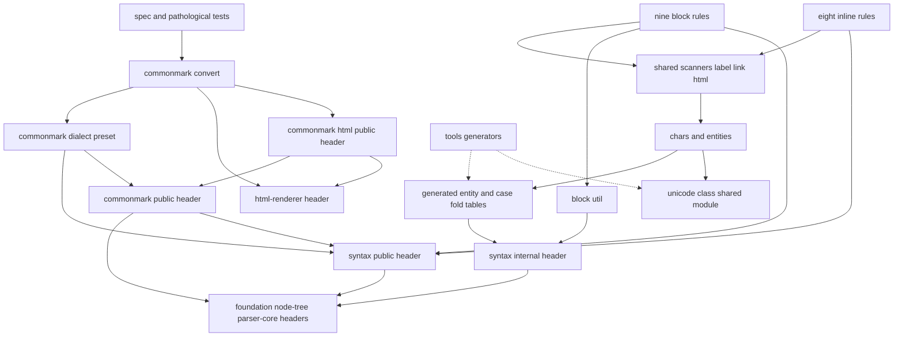
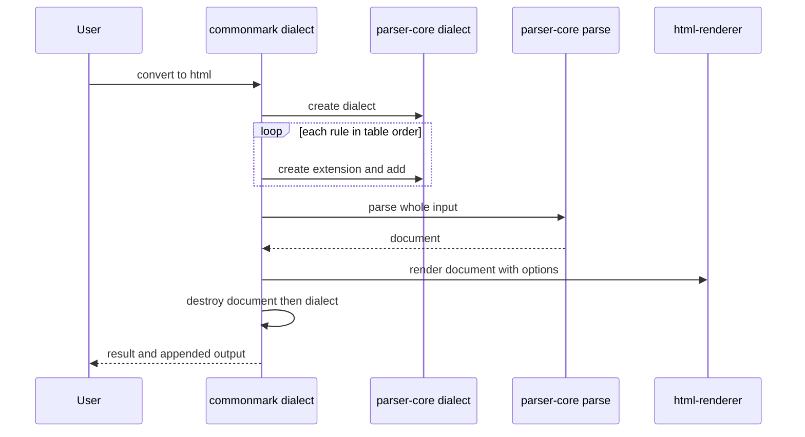
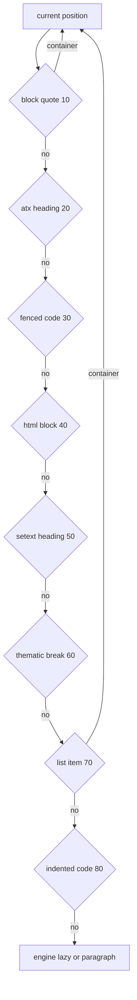

# Design Document: commonmark

## Overview

**Purpose**: CommonMark 仕様 0.31.2 の全構文を、parser-core の公開拡張 API だけを使う 17 個の「規則」（方言に属さない構文単位の拡張。`src/syntax/`、`amark/syntax.h`）として提供し、規則を選んで集める CommonMark 方言プリセット（`src/cmark/`、`amark/cmark.h`）と、Markdown テキストから木・HTML を得る簡易 API を提供する。flanking の判定・ラベルの正規化・文字参照に必要なデータ（HTML5 名前付き文字参照、Unicode 16.0.0 の句読点・空白・大文字小文字の畳み込み）を、`tools/` の生成器で作った静的な表として持つ。句読点・空白の判定は、markdown-renderer と共有する非公開モジュール `src/base/unicode_class.{h,c}`（生成物 `src/base/unicode_class_data.c`）として本仕様が新設する。仕様の例（652 件）の適合テストと cmark 相当の病的入力テストをテスト側に置く。

**Users**: ライブラリ利用者は簡易 API またはプリセットの方言で CommonMark を解析する。方言を組み立てる利用者は規則を選んで方言を作る（例: 生 HTML なし、自作の構文と `emphasis` だけ）。将来の gfm は GFM の規則を `src/syntax/` に足し、同じ規則を集めた GFM 方言プリセットを `src/gfm/` に置く。markdown-renderer は本方言の解析結果で往復テストを行う。

**Impact**: 公開ヘッダ `amark/syntax.h`、`amark/cmark.h`、`amark/cmark_html.h`、規則と共有部品の `src/syntax/syntax_*.c` 群、プリセットの `src/cmark/cmark_*.c`、共有の非公開モジュール `src/base/unicode_class.{h,c}`、生成した表 3 つ、生成器 2 つ、テストとテストデータを追加する。parser-core の契約の緩和 1 件と意味の明確化 2 件（C1〜C3）は parser-core の文書に適用済みで、本仕様はそれに依存する振る舞いを確かめるだけである（API の追加・変更なし）。エラーコード（foundation の `AMARK_ERROR_LIST` とエラーコード一覧表が正本）とノード種別は追加しない。

### Goals
- 0.31.2 の spec.txt の全 652 例で、生 HTML と危険な URL を許可した html-renderer の出力が期待 HTML とバイト単位で一致する
- 17 規則のどの部分集合でも方言を作れ、外した構文の記法は残りの構文の規則で解釈される
- cmark の病的入力の各類型が、1 件あたり CPU 時間 5 秒以内で規定の HTML になる
- エンジンの非公開部分に触れず、ライブラリ外の拡張と同じ API だけを使う

### Non-Goals
- エンジンの行処理・段落・テキスト・遅延継続・デリミタとブラケットの汎用処理（parser-core）
- HTML / Markdown の出力規則（html-renderer / markdown-renderer）
- GFM の構文、smart punctuation、ソース位置、HTML のサニタイズ
- 生成器の CI での自動実行と、生データ（entities.json、UnicodeData.txt）のリポジトリへの格納


**用語**:
- **規則**: 1 つの構文（または状態や記号を共有する構文の組）を実装する拡張。特定の方言に属さず、識別子・ファイル・ヘッダは `syntax` を使う（`amark_syntax_*`、`AMARK_SYNTAX_*`、`src/syntax/syntax_*`、`amark/syntax.h`）。拡張名・構文名には方言の接頭辞を付けない（例: `emphasis`）
- **方言プリセット**: 規則を選んで集めた方言を作る薄い層。構文のロジックを持たず、規則の公開 API だけを使う。CommonMark のプリセットの識別子・ファイル・ヘッダは `cmark` を使う（`amark_cmark_*`、`AMARK_CMARK_*`、`src/cmark/`、`amark/cmark.h`）
- 接頭辞やパスを伴わない単独の「cmark」は参照実装 commonmark/cmark を指す

## Boundary Commitments

### This Spec Owns
- 公開ヘッダ `amark/syntax.h`: 17 個の規則の生成関数と拡張名の定数（プリセットとレンダラのヘッダを include しない）
- 公開ヘッダ `amark/cmark.h`: CommonMark 方言プリセットの生成、簡易パース（`amark/syntax.h` を include し、レンダラのヘッダを include しない）
- 公開ヘッダ `amark/cmark_html.h`: HTML への簡易変換（`amark/cmark.h` と `amark/html.h` を include する）
- CommonMark 0.31.2 の各構文の規則（開始・継続・終了・flanking・rule of 3・リンクの宛先と title・ラベルの正規化・HTML ブロックの 7 種類・文字参照・コードスパンの規則）と、その拡張の記述子・名前・既定の優先順位
- 規則が共有する非公開の部品（`src/syntax/syntax_internal.h` と文字・文字参照・走査・桁の部品）。将来の GFM の規則も同じ部品を使う
- 規則の間の内部の約束: リンク参照定義の値の型と定義テーブルの名前空間 `link`
- CommonMark が必要とするデータの表（エンティティ、Unicode の句読点・空白・畳み込み）、その生成器、出典とライセンスの表記
- 非公開の共有モジュール UnicodeClass（`src/base/unicode_class.h`、`src/base/unicode_class.c`、生成物 `src/base/unicode_class_data.c`）: `amark_unicode_is_punctuation` / `amark_unicode_is_whitespace`。`include/` に置かず export しない。markdown-renderer も利用者（消費側）である
- 病的入力への構文側の対策（内容ごとの記憶、ラベル長の打ち切り、宛先の括弧の入れ子の上限、参照展開の量の上限）
- 仕様適合テスト（spec.txt の固定、抽出器、比較・報告）と病的入力テスト
- parser-core に適用済みの C1〜C3 に依存する振る舞いの確認（Cross-Spec Change Note）

### Out of Boundary
- 段落・テキスト・空行・遅延継続の振る舞い、デリミタ処理とブラケット処理の手順、ブロックの入れ子とブラケットの上限（parser-core。本仕様は使うだけ）
- ノード種別の定義と値の制約（node-tree）。本仕様はノード種別を追加しない
- HTML の出力規則、エスケープ、URL の符号化、安全性の既定値（html-renderer）。適合テストの不一致がレンダラ起因の場合の修正も html-renderer の作業として扱う
- エラー列挙（foundation の `AMARK_ERROR_LIST` とエラーコード一覧表が正本）、アロケータ、バッファ、UTF-8 の前方・後方の復号（foundation）
- 包括ヘッダ・ビルド・テスト登録のシェルのファイル（`amark.h`、`src/CMakeLists.txt`、`tests/CMakeLists.txt`、`tests/cxx_header_test.cpp`、`amark_test_support` のソース一覧）は foundation が所有し、本仕様は追記だけを行う
- GFM の規則と方言プリセット、Markdown の出力（gfm は本仕様の共有部品と規則を使い、必要な変更は本仕様の改訂として扱う）

### Allowed Dependencies
- foundation の公開ヘッダ: `export.h`、`error.h`、`memory.h`、`slice.h`、`utf8.h`（`amark_utf8_decode`、`amark_utf8_decode_previous`）、`buffer.h`
- 本仕様が所有する非公開ヘッダ `src/base/unicode_class.h`: `<stdint.h>`・`<stdbool.h>` だけに依存する基盤層の部品。commonmark の CharClass と markdown-renderer が include する
- node-tree の公開ヘッダ: `node_kind.h`、`node.h`
- parser-core の公開ヘッダ: `parse_shared.h`、`block_syntax.h`、`inline_syntax.h`、`extension.h`、`dialect.h`、`parser.h`
- html-renderer の公開ヘッダ `html.h`: 公開ヘッダ `amark/cmark_html.h`、簡易変換の実装 `cmark_convert.c`、テストだけが include する。`amark/syntax.h`、`amark/cmark.h`、規則のソースは include しない
- C 標準ライブラリ: `<stddef.h>`、`<stdint.h>`、`<stdbool.h>`、`<string.h>`
- テスト: Naos、`amark_test_support`（差し替えアロケータ）。生成器: Python 3（標準ライブラリのみ、開発時だけ）
- 依存方向（左ほど下位。右から左への include のみ）: `上流の公開ヘッダ, unicode_class.h → syntax_internal.h（データ・文字・走査・桁の共有部品） → 各規則のソース（amark/syntax.h を実装する） → cmark_dialect.c（amark/syntax.h だけを使う） → cmark_convert.c`（公開ヘッダは `syntax.h → cmark.h → cmark_html.h`）。規則のソース同士は互いを include・呼び出しせず、共有部品だけを使う。プリセット（`src/cmark/`、将来の `src/gfm/`）は `syntax_internal.h` を include せず、規則の公開 API だけを使う。parser-core の `src/parser/parser_internal.h` と node-tree の `src/tree/node_internal.h` は include しない

### Revalidation Triggers
- 対象の仕様の版の変更（期待 HTML と構文の規則が変わる。html-renderer も再検証）
- 規則の生成関数・拡張名・構文名・既定の優先順位、プリセットに含める規則の変更（方言を組み立てる利用者と gfm に影響）
- 共有部品（`syntax_internal.h`）の関数・意味の変更（gfm の規則が消費側になったら gfm も再検証）
- リンク参照定義の値の型と名前空間の変更
- 簡易 API の引数・所有規則の変更
- 生成した表の出典の版の変更（Unicode の版、entities.json）
- UnicodeClass の関数・意味・表の変更（markdown-renderer が消費側のため、markdown-renderer も再検証）
- foundation の `amark_utf8_decode_previous` の意味の変更
- parser-core の文脈 API・デリミタ・ブラケット・段落の処理器の意味、C1〜C3 の契約の変更（本仕様が再検証する側）
- html-renderer の組み込み出力の表の変更（適合テストの再実行）

## Architecture

### Architecture Pattern & Boundary Map



**Architecture Integration**:
- Selected pattern: 規則と方言プリセットの 2 層。規則の層（`src/syntax/`）は構文ごとの拡張（17 規則）と共有部品からなり、各規則は静的な記述子（`static const`）と、必要なら解析ごとの状態の関数、公開の生成関数だけを持つ。プリセットの層（`src/cmark/`）は構文のロジックを持たず、規則の生成関数の表で方言を組み立てる。図では規則の層が SyntaxPublic・Internal・Data・Chars・Scan・BlockUtil・Blocks・Inlines、プリセットの層が Public・PublicHtml・Dialect・Convert である
- Domain/feature boundaries: 規則の層をデータ（生成した表）、文字と参照（分類・畳み込み・文字参照・エスケープの解決）、共通の走査（ラベル、宛先、title、HTML の構造）、ブロック構文、インライン構文に、プリセットの層を組み立て（方言・簡易パース）と変換（HTML）に分ける。規則のソースは他の規則に依存しない。プリセットは規則の公開 API だけに依存し、将来の GFM のプリセットも同じ規則を集める
- Existing patterns preserved: foundation の共通 API 規約（エラー戻り値＋出力引数、`NULL` で `AMARK_ERROR_INVALID_ARGUMENT`、強い保証）、命名（`amark_<module>_<verb>`、`_t`、`_create`）、ヘッダ規約（include ガード、`AMARK_BEGIN_DECLS`、`AMARK_API`）、内部シンボルは `AMARK_API` を付けず export しない
- New components rationale: 各コンポーネントは要件群に対応する（Components 表）
- Steering compliance: エンジンの非公開部分に触れない。可変のグローバル状態を持たない（表と記述子はすべて `static const`、解析ごとの記憶は拡張の解析状態）。確保は `amark_*` 経由。テスト専用コードを本体に入れない。再帰を使わない（リンク・強調の入れ子はエンジンのスタックが扱う）

### Technology Stack

| Layer | Choice / Version | Role in Feature | Notes |
|-------|------------------|-----------------|-------|
| 言語 | C99（foundation の設定を継承） | 本体とテスト | 新しい依存なし |
| エンジン | parser-core の公開拡張 API | 全構文の実装の土台 | 契約の緩和・明確化（C1〜C3）は適用済み（API 変更なし） |
| 木・出力 | node-tree 標準 18 種別、html-renderer | 解析結果、簡易変換と適合テスト | 種別の追加なし |
| 仕様 | CommonMark 0.31.2 spec.txt（CC BY-SA 4.0） | 規則の正本と適合テストのデータ | `tests/data/commonmark/` に固定 |
| データ | WHATWG entities.json（CC BY 4.0）、Unicode 16.0.0 UCD（Unicode License v3） | 生成した静的表の出典 | 生データはリポジトリに置かない |
| 生成器 | Python 3.8 以上、標準ライブラリのみ | `tools/` での表の生成 | ビルドと CI では実行しない |
| テスト | Naos v0.4.0、`amark_test_support` | 適合・病的入力・単体・失敗注入 | `clock()` による CPU 時間の上限 |

## File Structure Plan

### Directory Structure
```
include/amark/
├── syntax.h                    # 規則: 17 個の生成関数と拡張名の定数（プリセットとレンダラのヘッダを含まない）
├── cmark.h                     # CommonMark プリセット: 方言の生成、簡易パース（syntax.h を include、レンダラのヘッダを含まない）
└── cmark_html.h                # HTML への簡易変換（cmark.h と html.h を include）
src/
├── base/
│   ├── unicode_class.h                  # 非公開（基盤層、markdown-renderer と共有）: amark_unicode_is_punctuation / amark_unicode_is_whitespace
│   ├── unicode_class.c                  # 非公開: ASCII は表を引かず、0x80 以上は unicode_class_data.c の表を二分探索
│   └── unicode_class_data.c             # 生成物: 句読点（P・S）の範囲表、Zs の表。先頭に出典・版・SHA-256・ライセンス
├── syntax/                              # 規則の層（方言に属さない。将来の GFM の規則もここに足す）
│   ├── syntax_internal.h                # 非公開: 共有部品の宣言、定義の値の型、名前空間、上限の定数
│   ├── syntax_entity_data.c             # 生成物: 名前付き文字参照の表（名前の昇順）。先頭に出典・SHA-256・ライセンス
│   ├── syntax_case_fold_data.c          # 生成物: 大文字小文字の畳み込みの表だけ。先頭に出典・版・SHA-256・ライセンス
│   ├── syntax_chars.c                   # 共有部品: ASCII 句読点の判定、前後の文字の復号（後方は amark_utf8_decode_previous）、畳み込み。Unicode の句読点・空白は unicode_class に委ねる
│   ├── syntax_entity_decode.c           # 共有部品: 文字参照の照合と復号（名前付き・10 進・16 進）、エスケープと文字参照の解決（unescape）
│   ├── syntax_link_scan.c               # 共有部品: ラベルの走査と正規化、リンクの宛先・title の走査
│   ├── syntax_html_scan.c               # 共有部品: HTML の開き・閉じタグ、コメント、処理命令、宣言、CDATA の走査、HTML ブロックの開始・終了条件
│   ├── syntax_block_util.c              # 共有部品: 字下げの桁の先読み、指定桁までの空白の読み飛ばし、行の残りの取り出し
│   ├── syntax_thematic_break.c          # 規則: 区切り線
│   ├── syntax_atx_heading.c             # 規則: ATX 見出し
│   ├── syntax_setext_heading.c          # 規則: Setext 見出し
│   ├── syntax_indented_code.c           # 規則: インデントコードブロック
│   ├── syntax_fenced_code.c             # 規則: フェンスコードブロック
│   ├── syntax_html_block.c              # 規則: HTML ブロック
│   ├── syntax_link_reference_definition.c # 規則: リンク参照定義（段落の内容の処理器）
│   ├── syntax_block_quote.c             # 規則: ブロック引用
│   ├── syntax_list.c                    # 規則: リストとリスト項目（解析状態に開いているリストの記録）
│   ├── syntax_backslash_escape.c        # 規則: バックスラッシュエスケープ
│   ├── syntax_entity.c                  # 規則: 文字参照（インライン）
│   ├── syntax_code_span.c               # 規則: コードスパン（解析状態に `` ` `` の位置の記憶）
│   ├── syntax_emphasis.c                # 規則: 強調・強い強調（デリミタ処理器）
│   ├── syntax_link.c                    # 規則: リンクと画像（ブラケット、参照の解決、展開量の上限）
│   ├── syntax_autolink.c                # 規則: オートリンク
│   ├── syntax_html_inline.c             # 規則: 生 HTML（解析状態に閉じのない構造の記憶）
│   └── syntax_line_break.c              # 規則: ハード改行・ソフト改行
└── cmark/                               # CommonMark 方言プリセットの層（構文のロジックを持たない）
    ├── cmark_dialect.c                  # 規則の生成関数の表、方言の生成、簡易パース
    └── cmark_convert.c                  # HTML への簡易変換（html.h を include する唯一の本体ソース）
tools/
├── generate_entity_table.py         # entities.json → src/syntax/syntax_entity_data.c
└── generate_unicode_tables.py       # UnicodeData.txt → src/base/unicode_class_data.c、CaseFolding.txt → src/syntax/syntax_case_fold_data.c
tests/
├── data/commonmark/
│   ├── spec-0.31.2.txt              # 改変しない spec.txt
│   └── LICENSE.txt                  # CC BY-SA 4.0、著者、出典 URL、版、SHA-256、改変していない旨
├── support/
│   ├── test_spec_examples.h         # 抽出器の宣言（例の構造体、読み込み、解放）
│   └── test_spec_examples.c         # spec.txt の読み込みと例の抽出（`→` をタブへ、節名と番号の記録）
├── syntax_rule_test.c          # 規則: 17 規則の生成と名前、外した規則の記法、標準種別だけ、自作の拡張との混在と優先順位
├── syntax_block_test.c         # 規則: ブロック構文の境界（仕様の例にない上限と組み合わせ）
├── syntax_inline_test.c        # 規則: インライン構文の境界（数値参照の範囲、ラベル長、括弧 32 段、展開量）
├── syntax_data_test.c          # 規則: 生成した表の件数と代表値、文字の分類、畳み込み
├── cmark_dialect_test.c        # プリセット: 方言の生成・規則の名前での取り外し・追加・簡易 API
├── cmark_spec_test.c           # プリセット: 全例のバイト比較、1 バイトずつの供給の同一性、例の数の確認、失敗の報告
├── cmark_pathological_test.c   # プリセット: 病的入力の類型ごとの入力生成・出力検査・CPU 時間の上限
└── cmark_error_test.c          # 規則の生成・方言の生成・解析・簡易 API の失敗注入、資源の解放
THIRD_PARTY_NOTICES.md               # エンティティ表 src/syntax/syntax_entity_data.c（CC BY 4.0）、Unicode データ src/base/unicode_class_data.c と src/syntax/syntax_case_fold_data.c（Unicode License v3）、spec.txt（テストのみ、CC BY-SA 4.0）
```

### Modified Files
実装時に本 spec のタスクとして変更する（本 spec の作成時には変更しない）。
シェルのファイル（`amark.h`、`src/CMakeLists.txt`、`tests/CMakeLists.txt`、`tests/cxx_header_test.cpp`、`amark_test_support` のソース一覧）は foundation が所有し、本仕様は追記だけを行う。
- `include/amark/amark.h` — `amark/syntax.h`、`amark/cmark.h`、`amark/cmark_html.h` の include を追記
- `src/CMakeLists.txt` — `src/syntax/syntax_*.c`（生成物 2 つを含む 24 個）、`src/cmark/cmark_*.c`（2 個）と `src/base/unicode_class.c`、`src/base/unicode_class_data.c`（生成物）をソース一覧に追記
- `tests/CMakeLists.txt` — `support/test_spec_examples.c` を `amark_test_support` に追記、8 つのテスト実行ファイルを `naos_add_executable` で登録、spec.txt のパスをコンパイル定義 `AMARK_CMARK_SPEC_PATH` で渡す、病的入力テストに CTest の `TIMEOUT 300` を設定
- `tests/cxx_header_test.cpp` — C++ から `amark_syntax_emphasis_create`（`amark/syntax.h`）、`amark_cmark_dialect_create`（`amark/cmark.h`）、`amark_cmark_convert_to_html`（`amark/cmark_html.h`）を呼ぶ確認を追記
- `CMakeLists.txt`（インストール規則）— `THIRD_PARTY_NOTICES.md` を `LICENSE` と同じ場所にインストール
- `.kiro/steering/structure.md` — `tools/`（開発時だけの生成器）と `tests/data/`（固定したテストデータ）のディレクトリの約束を追記

## System Flows

### 方言の生成と簡易 API



- プリセットの生成は表の順に規則の生成関数で拡張を作り `amark_dialect_add_extension` する。途中の失敗では、追加できなかった拡張を破棄し、作りかけの方言を破棄する（追加済みの拡張は方言が所有して一緒に破棄される、2.4）
- `amark_cmark_parse` は文書を返してから方言を破棄する。CommonMark の拡張はノード種別を定義しないため、文書は方言を参照しない（parser-core に適用済みの C1）

### 1 行のブロック開始判定（CommonMark の優先順位）



- 優先順位は 10 刻みで、GFM などが間に構文を挟める。区切り線は Setext 見出しの後、リスト項目の前（`* * *` は区切り線、段落の後の `---` は見出しの下線）
- 字下げ 4 以上の行で呼ばれるのはインデントコードだけ（他の構文は字下げ 3 以下を自分で確かめて `NONE` を返す）

## Requirements Traceability

| Requirement | Summary | Components | Interfaces | Flows |
|-------------|---------|------------|------------|-------|
| 1.1, 1.4, 1.6 | 17 規則、標準種別だけ、同じ API | SyntaxPublicHeader, 全規則 | `amark_syntax_<rule>_create`、記述子 | 方言の生成 |
| 1.2 | 生成関数の引数検査 | 全規則 | `amark_syntax_<rule>_create` | — |
| 1.3 | 外した構文の記法 | 全規則（相互に依存しない） | 規則のソースの独立 | 開始判定 |
| 1.5 | 拡張名 | SyntaxPublicHeader | `AMARK_SYNTAX_<RULE>_NAME` | — |
| 1.7 | 規則とプリセットの分離 | SyntaxPublicHeader, CommonmarkDialect | 規則の公開 API だけを使う表 | 方言の生成 |
| 2.1, 2.3, 2.4 | プリセット、未凍結、失敗時の解放 | CommonmarkDialect | `amark_cmark_dialect_create` | 方言の生成 |
| 2.2 | 取り外しによる部分集合 | CommonmarkDialect, SyntaxPublicHeader | `amark_dialect_remove_extension` と `AMARK_SYNTAX_<RULE>_NAME` | — |
| 3.1, 3.3, 3.4, 3.5, 3.6 | 簡易パース | CommonmarkDialect | `amark_cmark_parse` | 方言の生成と簡易 API |
| 3.2 | HTML への簡易変換 | CommonmarkHtmlHeader, CommonmarkConvert | `amark_cmark_convert_to_html` | 方言の生成と簡易 API |
| 4.1 | ブロック引用 | BlockQuoteExtension, BlockUtil | 記述子 `block_quote` | 開始判定 |
| 4.2, 4.3, 4.4, 4.5, 4.6 | リスト | ListExtension, BlockUtil | 記述子 `list`、リストの記録 | 開始判定 |
| 4.7 | 継続しない行 | BlockQuoteExtension, ListExtension | `continue_line` | 開始判定 |
| 5.1 | 区切り線 | ThematicBreakExtension | 記述子 `thematic_break` | 開始判定 |
| 5.2 | ATX 見出し | AtxHeadingExtension | `add_content` | 開始判定 |
| 5.3 | Setext 見出し | SetextHeadingExtension | `get_paragraph`、`open_from_paragraph` | 開始判定 |
| 5.4 | インデントコード | IndentedCodeExtension, BlockUtil | `maybe_lazy`、`interrupts_paragraph` | 開始判定 |
| 5.5 | フェンスコード | FencedCodeExtension, EntityAndEscape | `continue_line` の `CLOSE` | 開始判定 |
| 5.6 | HTML ブロック | HtmlBlockExtension, HtmlScan | `close_after_line` | 開始判定 |
| 5.7, 5.8 | リンク参照定義 | LinkReferenceExtension, LinkScan | 段落の内容の処理器、定義テーブル | — |
| 6.1 | エスケープ | BackslashEscapeExtension, CharClass | インライン構文 `\` | — |
| 6.2, 6.3 | 文字参照 | EntityInlineExtension, EntityAndEscape, EntityTable | インライン構文 `&` | — |
| 6.4, 6.5 | コードスパン | CodeSpanExtension | 解析状態の記憶 | — |
| 6.6 | 改行 | LineBreakExtension | `trim_trailing_spaces` | — |
| 6.7 | 生 HTML | HtmlInlineExtension, HtmlScan | インライン構文 `<` | — |
| 6.8 | オートリンク | AutolinkExtension | インライン構文 `<` | — |
| 7.1, 7.2 | 強調 | EmphasisExtension, CharClass, UnicodeClass | デリミタ処理器 | — |
| 7.3, 7.4, 7.5, 7.6 | リンク・画像 | LinkExtension, LinkScan | ブラケット API | — |
| 7.7 | ラベルの正規化 | LinkScan, CharClass, UnicodeTables | `amark_syntax_normalize_label` | — |
| 7.8 | 優先順位 | CodeSpanExtension, AutolinkExtension, HtmlInlineExtension, LinkExtension | 左から順の呼び出しと優先順位 | — |
| 8.1, 8.2, 8.5, 8.7 | spec.txt と抽出・報告 | SpecFixture, SpecExamples | `test_spec_examples_load` | — |
| 8.3, 8.4, 8.6 | バイト比較と分割供給 | ConformanceTest | html-renderer の設定 | — |
| 9.1, 9.6 | 線形時間とメモリ | 全構文の拡張, CodeSpanExtension, HtmlInlineExtension, LinkScan | 計算量の規則 | — |
| 9.2, 9.3 | 病的入力の類型と上限 | PathologicalTest | parser-core の上限 | — |
| 9.4 | 参照展開の量 | LinkExtension | 解析状態の展開量 | — |
| 9.5 | 括弧の入れ子 32 段 | LinkScan | `amark_syntax_scan_link_destination` | — |
| 10.1, 10.3, 10.5 | エンティティ表 | EntityTable, EntityGenerator, ThirdPartyNotices | 生成物の先頭の記録 | — |
| 10.2, 10.3, 10.5 | Unicode の表 | UnicodeClass, UnicodeTables, UnicodeGenerator, ThirdPartyNotices | 生成物の先頭の記録 | — |
| 10.4 | ビルドに生成器不要 | CommonmarkIntegration | 生成物のコミット | — |
| 11.1, 11.2, 11.3 | エラーと確保 | 全コンポーネント, ErrorInjectionTest | 共通 API 規約 | — |
| 11.4 | 妥当な UTF-8 | EntityAndEscape, CharClass（foundation の前方・後方の復号） | 復号・符号化の規則 | — |
| 12.1, 12.2, 12.3 | 並行利用 | CommonmarkDialect, 全規則 | 静的な記述子、解析状態 | — |

## Components and Interfaces

| Component | Domain/Layer | Intent | Req Coverage | Key Dependencies (P0/P1) | Contracts |
|-----------|--------------|--------|--------------|--------------------------|-----------|
| SyntaxPublicHeader | 公開 API（規則） | `amark/syntax.h` | 1.1, 1.2, 1.5, 1.6, 1.7 | parser-core (P0) | Service |
| CommonmarkPublicHeader | 公開 API（プリセット） | `amark/cmark.h` | 2.1, 3.1 | SyntaxPublicHeader, parser-core (P0) | Service |
| CommonmarkHtmlHeader | 公開 API | `amark/cmark_html.h` | 3.2 | CommonmarkPublicHeader, html-renderer (P0) | Service |
| SyntaxInternal | 非公開（規則の層） | 共有部品の宣言と規則の間の約束 | 全体の前提, 5.7 | parser-core (P0) | State |
| EntityTable | データ | 生成した名前付き文字参照の表 | 10.1, 10.5 | — | State |
| UnicodeClass | 共有の非公開部品 | 句読点・空白の判定と生成した表（markdown-renderer と共有） | 7.1, 10.2, 10.5 | — | Service, State |
| UnicodeTables | データ | 生成した畳み込みの表（規則の層の専用） | 10.2, 10.5 | — | State |
| CharClass | 文字 | ASCII 句読点、前後の文字の復号、畳み込み | 6.1, 7.1, 7.7, 11.4 | UnicodeClass, UnicodeTables, foundation Utf8 (P0) | Service |
| EntityAndEscape | 文字 | 文字参照の復号、エスケープの解決 | 5.5, 6.2, 6.3, 7.3, 11.4 | EntityTable, CharClass (P0) | Service |
| LinkScan | 走査 | ラベル、宛先、title | 5.7, 5.8, 7.3, 7.7, 9.5 | CharClass, EntityAndEscape (P0) | Service |
| HtmlScan | 走査 | HTML の構造と HTML ブロックの条件 | 5.6, 6.7 | CharClass (P0) | Service |
| BlockUtil | 走査 | 桁の先読みと読み飛ばし | 4.1, 4.2, 5.4, 5.5 | parser-core BlockContext (P0) | Service |
| ThematicBreakExtension 〜 ListExtension（9 個） | ブロックの規則 | 各ブロック構文 | 1.1, 4.1–4.7, 5.1–5.8 | 共有部品 (P0) | Service, State |
| BackslashEscapeExtension 〜 LineBreakExtension（8 個） | インラインの規則 | 各インライン構文 | 1.1, 6.1–6.8, 7.1–7.8, 9.4 | 共有部品 (P0) | Service, State |
| CommonmarkDialect | プリセット | 規則の生成関数の表、方言、簡易パース | 1.7, 2.1–2.3, 2.4, 3.1, 3.3–3.6, 12.1–12.3 | SyntaxPublicHeader, parser-core Dialect (P0) | Service |
| CommonmarkConvert | 変換 | HTML への簡易変換 | 3.2–3.5 | CommonmarkDialect, html-renderer (P0) | Service |
| EntityGenerator, UnicodeGenerator | ツール | 表の生成 | 10.1–10.3 | Python 3 (P1) | Batch |
| ThirdPartyNotices | ライセンス | 第三者の表記 | 8.1, 10.5 | — | — |
| SpecFixture, SpecExamples | テスト補助 | spec.txt の固定と抽出 | 8.1, 8.2, 8.7 | — | Service |
| ConformanceTest | テスト | 全例のバイト比較 | 8.3–8.6 | CommonmarkConvert (P0) | Batch |
| PathologicalTest | テスト | 病的入力 | 9.1–9.6 | CommonmarkConvert (P0) | Batch |
| RuleTest | テスト | 規則の生成・名前・組み合わせ | 1.1, 1.2, 1.3–1.6 | SyntaxPublicHeader (P0) | Batch |
| ErrorInjectionTest | テスト | 失敗注入 | 11.1–11.3 | test_allocator (P0) | Batch |
| CommonmarkIntegration | ビルド・テスト登録 | 包括ヘッダ、ビルド、テスト、C++ 検査、インストール | 8.7, 10.4 | foundation BuildSystem (P0) | Batch |

### 共通の API 規約（本仕様の全公開関数）
- foundation の共通 API 規約に従う。必須のポインタ引数が `NULL`、`len > 0 && data == NULL` は `AMARK_ERROR_INVALID_ARGUMENT` で何も変更しない（3.4）。失敗時は呼び出し前の状態を保つ（強い保証）
- 構文のコールバックは parser-core の契約に従う: 文脈は呼び出し中だけ使う、渡されたノードと文脈の操作以外で文書を変更しない、自分が読み進めた入力に比例する時間で動く（9.1）
- 構文が木に置く文字列（literal、info、url、title、text）は入力（parser-core が妥当な UTF-8 に正規化済み）の部分列と、`amark_buffer_append_codepoint` で符号化した妥当なコードポイントだけから作る（11.4）

### 公開 API

#### SyntaxPublicHeader

| Field | Detail |
|-------|--------|
| Intent | `amark/syntax.h` に規則の生成関数と拡張名の定数を宣言する（プリセットとレンダラに依存しない） |
| Requirements | 1.1, 1.5, 1.6, 1.7 |

**Contracts**: Service [x]

##### Service Interface
```c
/* include/amark/syntax.h */
#include <amark/error.h>
#include <amark/export.h>
#include <amark/extension.h>

/* 拡張名（= 方言からの取り外しに使う名前。方言の接頭辞を付けない） */
#define AMARK_SYNTAX_THEMATIC_BREAK_NAME            "thematic_break"
#define AMARK_SYNTAX_ATX_HEADING_NAME               "atx_heading"
#define AMARK_SYNTAX_SETEXT_HEADING_NAME            "setext_heading"
#define AMARK_SYNTAX_INDENTED_CODE_NAME             "indented_code"
#define AMARK_SYNTAX_FENCED_CODE_NAME               "fenced_code"
#define AMARK_SYNTAX_HTML_BLOCK_NAME                "html_block"
#define AMARK_SYNTAX_LINK_REFERENCE_DEFINITION_NAME "link_reference_definition"
#define AMARK_SYNTAX_BLOCK_QUOTE_NAME               "block_quote"
#define AMARK_SYNTAX_LIST_NAME                      "list"
#define AMARK_SYNTAX_BACKSLASH_ESCAPE_NAME          "backslash_escape"
#define AMARK_SYNTAX_ENTITY_NAME                    "entity"
#define AMARK_SYNTAX_CODE_SPAN_NAME                 "code_span"
#define AMARK_SYNTAX_EMPHASIS_NAME                  "emphasis"
#define AMARK_SYNTAX_LINK_NAME                      "link"
#define AMARK_SYNTAX_AUTOLINK_NAME                  "autolink"
#define AMARK_SYNTAX_HTML_INLINE_NAME               "html_inline"
#define AMARK_SYNTAX_LINE_BREAK_NAME                "line_break"

/* 規則ごとの生成関数（各規則のソースが定義する） */
AMARK_API amark_error_t amark_syntax_thematic_break_create(amark_extension_t **ext);
AMARK_API amark_error_t amark_syntax_atx_heading_create(amark_extension_t **ext);
AMARK_API amark_error_t amark_syntax_setext_heading_create(amark_extension_t **ext);
AMARK_API amark_error_t amark_syntax_indented_code_create(amark_extension_t **ext);
AMARK_API amark_error_t amark_syntax_fenced_code_create(amark_extension_t **ext);
AMARK_API amark_error_t amark_syntax_html_block_create(amark_extension_t **ext);
AMARK_API amark_error_t amark_syntax_link_reference_definition_create(amark_extension_t **ext);
AMARK_API amark_error_t amark_syntax_block_quote_create(amark_extension_t **ext);
AMARK_API amark_error_t amark_syntax_list_create(amark_extension_t **ext);             /* リストとリスト項目 */
AMARK_API amark_error_t amark_syntax_backslash_escape_create(amark_extension_t **ext);
AMARK_API amark_error_t amark_syntax_entity_create(amark_extension_t **ext);           /* 名前付き・数値文字参照 */
AMARK_API amark_error_t amark_syntax_code_span_create(amark_extension_t **ext);
AMARK_API amark_error_t amark_syntax_emphasis_create(amark_extension_t **ext);         /* 強調と強い強調 */
AMARK_API amark_error_t amark_syntax_link_create(amark_extension_t **ext);             /* リンクと画像 */
AMARK_API amark_error_t amark_syntax_autolink_create(amark_extension_t **ext);
AMARK_API amark_error_t amark_syntax_html_inline_create(amark_extension_t **ext);
AMARK_API amark_error_t amark_syntax_line_break_create(amark_extension_t **ext);       /* ハード改行とソフト改行 */
```
- 各関数は `ext == NULL` なら `AMARK_ERROR_INVALID_ARGUMENT`（1.2）。それ以外は自分のソースの静的な記述子で `amark_extension_create(desc, ext)` を呼び、その結果を返す（1.1）
- 規則ごとに生成関数を各規則のソースに置くため、静的リンクでは利用者が呼んだ規則（と共有部品）だけがリンクされる
- ヘッダ冒頭のコメントに記す利用者向けの事項: 規則は方言に属さないこと、各規則が従う仕様（CommonMark 0.31.2 の該当節）、拡張名の一覧、規則の間の前提（参照リンクは `link_reference_definition` がなければ成立しない、など）、既定の優先順位は `amark_dialect_set_priority` で方言ごとに上書きできること、規則だけからなる方言で作った文書は方言の破棄後も有効なこと（parser-core の C1）
- 将来の GFM の規則も本ヘッダに追記する（同じ命名 `amark_syntax_<rule>_create`、`AMARK_SYNTAX_<RULE>_NAME`）

#### CommonmarkPublicHeader

| Field | Detail |
|-------|--------|
| Intent | `amark/cmark.h` に CommonMark 方言プリセットと簡易パースを宣言する（レンダラに依存しない） |
| Requirements | 2.1, 3.1 |

**Contracts**: Service [x]

##### Service Interface
```c
/* include/amark/cmark.h */
#include <amark/dialect.h>
#include <amark/parser.h>
#include <amark/syntax.h>

#define AMARK_CMARK_SPEC_VERSION "0.31.2"

AMARK_API amark_error_t amark_cmark_dialect_create(amark_dialect_t **dialect);
AMARK_API amark_error_t amark_cmark_parse(const char *data, size_t len, const amark_parser_options_t *opts,
                                               amark_node_t **doc);
```
- 規則の選択の API（ビットフラグなど）は持たない。部分集合はプリセットから規則の拡張名で取り外して作り（`amark_dialect_remove_extension(d, amark_slice_from_cstr(AMARK_SYNTAX_HTML_BLOCK_NAME))` など）、少数の規則だけの方言は規則の生成関数で組み立てる
- `amark/cmark.h` は `amark/html.h` を include せず、html-renderer の型を使わない。HTML への簡易変換は `amark/cmark_html.h`（下記）に分ける。`amark/syntax.h` は、取り外しに使う拡張名の定数を利用者が得られるように include する
- ヘッダ冒頭のコメントに記す利用者向けの事項: 対象の仕様の版、プリセットが含む規則（拡張名）の一覧、プリセットは凍結されていないこと、部分集合は取り外しで作ること、繰り返し解析する場合は方言を作って `amark_parser_parse` で再利用すべきこと（簡易 API は呼び出しごとに方言を作る）、CommonMark の規則だけからなる方言で作った文書は方言の破棄後も有効なこと（parser-core の C1）、HTML への簡易変換は `amark/cmark_html.h` にあること

#### CommonmarkHtmlHeader

| Field | Detail |
|-------|--------|
| Intent | `amark/cmark_html.h` に HTML への簡易変換を宣言する |
| Requirements | 3.2, 3.3 |

**Contracts**: Service [x]

##### Service Interface
```c
/* include/amark/cmark_html.h */
#include <amark/buffer.h>
#include <amark/cmark.h>
#include <amark/html.h>

AMARK_API amark_error_t amark_cmark_convert_to_html(const char *data, size_t len,
                                                         const amark_parser_options_t *parse_opts,
                                                         const amark_html_options_t *html_opts,
                                                         amark_buffer_t *out);
```
- ヘッダ冒頭のコメント: HTML の既定値は生 HTML と危険な URL を出力しないこと、繰り返し変換する場合は方言を再利用し `amark_parser_parse` と `amark_html_render` を使うべきこと
- 包括ヘッダ `amark/amark.h` は `amark/syntax.h`、`amark/cmark.h`、`amark/cmark_html.h` を include する（追記）

##### 規則の表（各規則の記述子）

| 拡張名（= 構文名） | 種類 | 既定の優先順位 | start_chars / triggers | 解析状態 |
|---|---|---|---|---|
| `thematic_break` | ブロック NONE | 60 | `*-_` | なし |
| `atx_heading` | ブロック INLINE | 20 | `#` | なし |
| `setext_heading` | ブロック INLINE | 50 | `=-` | なし |
| `indented_code` | ブロック RAW | 80 | `NULL` | なし |
| `fenced_code` | ブロック RAW | 30 | `` `~ `` | なし |
| `html_block` | ブロック RAW | 40 | `<` | なし |
| `link_reference_definition` | 段落の処理器 | 100 | — | なし |
| `block_quote` | ブロック BLOCKS | 10 | `>` | なし |
| `list`（構文 `list_item` と `list`） | ブロック BLOCKS ×2 | 70（項目）、—（リストは開始なし） | `*+-0123456789` | 開いているリストの記録 |
| `backslash_escape` | インライン | 20 | `\` | なし |
| `entity` | インライン | 10 | `&` | なし |
| `code_span` | インライン | 10 | `` ` `` | `` ` `` の位置の記憶 |
| `emphasis` | インライン | 10 | `*_` | なし |
| `link` | インライン | 10 | `[]!` | 展開量 |
| `autolink` | インライン | 10 | `<` | なし |
| `html_inline` | インライン | 20 | `<` | 閉じのない構造の記憶 |
| `line_break` | インライン | 10 | `\n\` | なし |

- 同じトリガーの順: `<` はオートリンク（10）→ 生 HTML（20）、`\` は改行（10、`\` + 行末だけを処理）→ エスケープ（20）。他のトリガーは 1 つの構文だけ
- どの規則もノード種別を宣言しない（`node_kind_count = 0`、1.4）。記述子と構文はすべて各規則のソースの `static const` で、`user_data` は使わない（12.1）
- 既定の優先順位は CommonMark の開始判定の順を満たすように 10 刻みで割り当てる。他のプリセット（GFM など）は規則の間に構文を挟めるほか、必要なら `amark_dialect_set_priority` で方言ごとに上書きする

### 非公開

#### SyntaxInternal

| Field | Detail |
|-------|--------|
| Intent | 規則の層の `.c` が共有する宣言と、規則の間の内部の約束（プリセットの層は include しない） |
| Requirements | 全体の前提, 5.7 |

**Contracts**: State [x]

##### State Management
```c
/* src/syntax/syntax_internal.h（非公開。AMARK_API を付けない） */
#include <amark/extension.h>
#include <amark/buffer.h>
#include <amark/syntax.h>
#include <amark/utf8.h>
#include "base/unicode_class.h"

/* 記述子は各規則のソースの static const とし、ここでは宣言しない（公開の生成関数だけが参照する） */

#define AMARK_SYNTAX_LINK_SPACE "link"   /* 定義テーブルの名前空間 */
#define AMARK_SYNTAX_MAX_LABEL_LENGTH 999           /* ラベルの内容の最大文字数（5.8） */
#define AMARK_SYNTAX_MAX_PAREN_DEPTH 32             /* 宛先の括弧の入れ子（9.5） */
#define AMARK_SYNTAX_MIN_EXPANSION_LIMIT 100000u    /* 参照展開の量の下限（9.4） */

typedef struct amark_syntax_link_definition
{
    char *url;            /* 所有。エスケープと文字参照を解決済み。NUL 終端 */
    size_t url_len;
    char *title;          /* 所有。なければ空文字列 */
    size_t title_len;
} amark_syntax_link_definition_t;
```
- リンク参照定義の約束（5.7）: 定義テーブルの名前空間 `link`、鍵は `amark_syntax_normalize_label` の結果、値は上の構造体（1 回の `amark_malloc` で構造体と 2 つの文字列を連続して確保し、後片付け関数 `amark_free` 相当で解放）。書くのは LinkReferenceExtension、読むのは LinkExtension だけ。名前空間は方言に属さない規則の間の約束であり、将来の GFM の規則（脚注など）が同じ定義を参照する場合も本ヘッダの約束に従う。第三者の拡張にとっては非公開（必要になれば公開 API の追加として扱う）
- 共有部品の宣言（CharClass、EntityAndEscape、LinkScan、HtmlScan、BlockUtil の関数）は各コンポーネントの節に示す

### データ

#### EntityTable

| Field | Detail |
|-------|--------|
| Intent | `;` で終わる HTML5 名前付き文字参照の静的表 |
| Requirements | 10.1, 10.5 |

**Contracts**: State [x]
- `src/syntax/syntax_entity_data.c` は生成物。`static const` の配列 `{名前（`&` と `;` を除く）, 名前の長さ, コードポイント 2 個（2 個目がなければ 0）}` を名前のバイト順の昇順に持ち、件数を定数で公開する（内部）。先頭は foundation の定型ヘッダ（MIT）、続いて「生成物、手で編集しない」「出典 URL、取得日、SHA-256、CC BY 4.0、WHATWG への帰属」を記したコメント
- 内部 API: `extern const amark_syntax_entity_t amark_syntax_entities[]; extern const size_t amark_syntax_entity_count;`

#### UnicodeClass（共有の非公開モジュール）

| Field | Detail |
|-------|--------|
| Intent | Unicode 16.0.0 の句読点・空白の判定。commonmark（flanking・エスケープ）と markdown-renderer（出力側の flanking）が同じ分類を使う |
| Requirements | 7.1, 10.2, 10.5 |

**Contracts**: Service [x] / State [x]

##### Service Interface
```c
/* src/base/unicode_class.h（非公開。include/ に置かず、AMARK_API を付けない） */
#include <stdbool.h>
#include <stdint.h>

bool amark_unicode_is_punctuation(uint32_t c); /* ASCII 句読点、または一般カテゴリ P（Pc Pd Pe Pf Pi Po Ps）/ S（Sc Sk Sm So） */
bool amark_unicode_is_whitespace(uint32_t c);  /* 一般カテゴリ Zs、タブ、LF、FF、CR */
```
- `src/base/unicode_class.c`: ASCII は表を引かずに判定し、0x80 以上は `src/base/unicode_class_data.c` の昇順の表を二分探索する（対数時間）。可変の状態を持たない
- `src/base/unicode_class_data.c` は生成物: 句読点のコードポイント範囲 `{first, last}` の昇順配列と、Zs のコードポイントの昇順配列（0x80 以上だけでもよい）。先頭に定型ヘッダ、生成物である旨、出典 URL（UnicodeData.txt）、版 16.0.0、SHA-256、Unicode License v3 の著作権表示
- 所有と変更: 本仕様が所有する。markdown-renderer が消費側であり、関数・意味・表の変更は markdown-renderer の再検証を伴う。ほかの spec が使う場合も `src/base/unicode_class.h` だけを include する
- Validation: `syntax_data_test.c`

#### UnicodeTables

| Field | Detail |
|-------|--------|
| Intent | Unicode 16.0.0 の大文字小文字の畳み込みの静的表（規則の層の専用） |
| Requirements | 10.2, 10.5 |

**Contracts**: State [x]
- `src/syntax/syntax_case_fold_data.c` は生成物: 畳み込み `{元, 先の個数 1〜3, 先 3 個}` の元の昇順配列（CaseFolding の状態 C と F）だけを持つ。ラベルの正規化だけが使うため規則の層の専用とし、UnicodeClass には置かない。先頭に定型ヘッダ、出典 URL（CaseFolding.txt）、版 16.0.0、SHA-256、Unicode License v3 の著作権表示

### 文字

#### CharClass

| Field | Detail |
|-------|--------|
| Intent | flanking・エスケープ・ラベルの正規化のための文字の判定 |
| Requirements | 6.1, 7.1, 7.7, 11.4 |

**Contracts**: Service [x]

##### Service Interface
```c
bool amark_syntax_is_ascii_punctuation(uint32_t c);   /* !"#$%&'()*+,-./:;<=>?@[\]^_`{|}~ */
uint32_t amark_syntax_char_before(amark_slice_t text, size_t offset); /* 直前の 1 文字。先頭なら '\n' */
uint32_t amark_syntax_char_at(amark_slice_t text, size_t offset);     /* その位置の 1 文字。末尾なら '\n' */
size_t amark_syntax_case_fold(uint32_t c, uint32_t folded[3]);       /* 畳み込み先の個数（なければ c 自身の 1） */
```
- Unicode の句読点・空白の判定は UnicodeClass の `amark_unicode_is_punctuation` / `amark_unicode_is_whitespace` を `syntax_internal.h` 経由で使い、CharClass は同じ意味の関数を重複して定義しない
- 畳み込みの表は二分探索で引く（対数時間）。`char_at` は foundation の `amark_utf8_decode`、`char_before` は foundation の `amark_utf8_decode_previous` で復号し、独自の後方の復号を持たない（入力は parser-core が正規化した妥当な UTF-8）。内容の先頭と末尾は CommonMark の規則どおり空白（行末）として扱う
- Validation: `syntax_data_test.c`

#### EntityAndEscape

| Field | Detail |
|-------|--------|
| Intent | 文字参照の照合と、宛先・title・info 文字列のエスケープと文字参照の解決 |
| Requirements | 5.5, 6.2, 6.3, 7.3, 11.4 |

**Contracts**: Service [x]

##### Service Interface
```c
/* text の offset が '&' のとき、成立する文字参照のバイト数を返し（なければ 0）、復号した文字を out に追記する */
amark_error_t amark_syntax_decode_entity(amark_slice_t text, size_t offset, amark_buffer_t *out, size_t *consumed);
/* バックスラッシュエスケープ（ASCII 句読点の前の \ を除く）と文字参照を解決して out に追記する */
amark_error_t amark_syntax_unescape(amark_slice_t text, amark_buffer_t *out);
```
- 名前付き: `&` の後の `[A-Za-z][A-Za-z0-9]{0,31}` と `;` を EntityTable で二分探索。数値: `&#` + 10 進 1〜7 桁 + `;`、`&#x` / `&#X` + 16 進 1〜6 桁 + `;`。値が 0、`0xD800`〜`0xDFFF`、`0x10FFFF` 超なら U+FFFD（6.2）。成立しなければ `*consumed = 0` で `out` を変えない（6.3）
- 走査は `&` から高々 34 バイトで終わる（9.1）
- Validation: `syntax_inline_test.c`（`&#0;`、`&#xD800;`、`&#x110000;`、8 桁、`&#x` の 7 桁、未知の名前、`;` なしの名前、2 コードポイントの名前 `&ngE;`）

### 走査

#### LinkScan

| Field | Detail |
|-------|--------|
| Intent | リンク参照定義とインラインリンクで共有する、ラベル・宛先・title の走査とラベルの正規化 |
| Requirements | 5.7, 5.8, 7.3, 7.7, 9.5 |

**Contracts**: Service [x]

##### Service Interface
```c
/* offset が '[' のとき、閉じの ']' までのバイト数（']' を含む）を返す。不成立なら 0 */
size_t amark_syntax_scan_link_label(amark_slice_t text, size_t offset);
/* ラベルの内容（括弧を除く）が 999 文字以下・空白だけでない・エスケープされない括弧を含まないか */
bool amark_syntax_is_valid_label(amark_slice_t label);
/* 正規化: 前後の空白を除き、連続する空白を 1 個のスペースにし、各文字を畳み込む */
amark_error_t amark_syntax_normalize_label(amark_slice_t label, amark_buffer_t *out);
/* 宛先（<...> または括弧の釣り合う非空白の並び）。成立すれば終わりの位置と生の範囲を返す */
bool amark_syntax_scan_link_destination(amark_slice_t text, size_t offset, size_t *end, amark_slice_t *raw,
                                            bool *bracketed);
/* title（"..."、'...'、(...)）。空行を含まない。成立すれば終わりの位置と生の内容 */
bool amark_syntax_scan_link_title(amark_slice_t text, size_t offset, size_t *end, amark_slice_t *raw);
```
- ラベルの走査は内容 999 文字を超えた時点で打ち切る（5.8、9.1）。`is_valid_label` はショートカット・省略の参照でリンクテキストをラベルとして使う場合にも使う（エスケープされない括弧を含むテキストはラベルにならない）
- 宛先の括弧は `AMARK_SYNTAX_MAX_PAREN_DEPTH`（32）段を超えたら不成立（9.5）。`<...>` は行末と `<` を含まない
- 正規化は 1 回の走査で、入力の長さの定数倍の出力を作る（畳み込みは 1 文字から最大 3 文字）
- Validation: `syntax_inline_test.c`（999 / 1000 文字のラベル、空白だけ、`[a\]b]`、括弧 32 / 33 段、`ẞ` と `SS` の照合）

#### HtmlScan

| Field | Detail |
|-------|--------|
| Intent | HTML の構造の走査と、HTML ブロックの開始・終了条件 |
| Requirements | 5.6, 6.7 |

**Contracts**: Service [x]

##### Service Interface
```c
typedef struct amark_syntax_html_memo
{
    size_t no_comment_end_from;     /* この位置以降に "-->" がない（SIZE_MAX なら未調査） */
    size_t no_pi_end_from;          /* "?>" */
    size_t no_cdata_end_from;       /* "]]>" */
    size_t no_declaration_end_from; /* ">" */
} amark_syntax_html_memo_t;

void amark_syntax_html_memo_init(amark_syntax_html_memo_t *memo);
/* offset が '<' のとき、生 HTML として成立するバイト数（なければ 0） */
size_t amark_syntax_scan_html_inline(amark_slice_t text, size_t offset, amark_syntax_html_memo_t *memo);
/* 行の最初の空白でない位置から、HTML ブロックの種類 1〜7 を返す（なければ 0）。種類 7 は can_be_kind7 が真のときだけ */
int amark_syntax_html_block_start(amark_slice_t rest, bool can_be_kind7);
/* 種類 1〜5 の終了条件を rest が含むか。種類 6・7 は常に偽（空行で終わる） */
bool amark_syntax_html_block_ends(int kind, amark_slice_t rest);
```
- 開き・閉じタグの文法（タグ名、属性、引用符付きの値、行末を 1 つまで含む空白）は 0.31.2 の定義どおり。種類 1 は `pre`、`script`、`style`、`textarea`、種類 6 のタグ名表は 0.31.2 の一覧（大文字小文字を区別しない）
- 記憶（9.1）: 閉じの並びが見つからなかったら、その探索の開始位置を記録し、以後同じ内容でそれ以降から始まる同種の探索をすぐに不成立にする（`unclosed <!--` の類型を線形にする）
- Validation: `syntax_inline_test.c`（属性の各形、`<!-->`、`<!--->`、CDATA、閉じのない構造の連続）

#### BlockUtil

| Field | Detail |
|-------|--------|
| Intent | ブロックの規則の桁の扱いの共有部品 |
| Requirements | 4.1, 4.2, 5.4, 5.5 |

**Contracts**: Service [x]

##### Service Interface
```c
/* 現在位置から、空白（スペース・タブ）を最大 limit 桁まで読んだときの桁数を、位置を変えずに数える */
size_t amark_syntax_peek_space_columns(const amark_block_context_t *ctx, size_t limit);
/* 現在位置から空白を最大 columns 桁だけ読み飛ばす（タブは部分消費） */
void amark_syntax_skip_space_columns(amark_block_context_t *ctx, size_t columns);
/* 現在位置から行末までのスライス（部分消費の補いはしない。判定用） */
amark_slice_t amark_syntax_rest_of_line(const amark_block_context_t *ctx);
```
- `peek` は `get_line`・`get_offset`・`get_column` から、タブを次の 4 の倍数の桁まで進める規則で桁を計算する。巻き戻しの API を使わずに「先読みしてから必要な分だけ `advance_columns`」を実現する（cmark の位置の保存と復元の代わり）

### ブロック構文

各構文は「開始の条件 → 開くノードと値 → 継続 → 終了」を記す。字下げ 3 以下の確認は `get_indent < 4`。

| 拡張 | 開始 | 継続・終了・finalize |
|---|---|---|
| ThematicBreakExtension | 字下げ ≤ 3、同じ文字（`*` `-` `_`）が 3 個以上、他は空白だけ → THEMATIC_BREAK を開き `LINE_DONE`（5.1） | `continue_line = NULL`。`record_blank` は偽 |
| AtxHeadingExtension | 字下げ ≤ 3、`#` 1〜6 個の後が空白か行末 → HEADING（レベル = 個数）を開き、前後の空白と「空白に続く `#` の並び＋空白」の閉じを除いた内容を `add_content` して `LINE_DONE`（5.2） | `continue_line = NULL`。`record_blank` は偽 |
| SetextHeadingExtension | `interrupts_paragraph` が真、字下げ ≤ 3、行が `=` だけまたは `-` だけ（後ろの空白可）であることを先に確かめてから `get_paragraph`。行数 ≥ 1 なら HEADING（`=` は 1、`-` は 2）を `open_from_paragraph(…, 0)` で開き `LINE_DONE`（5.3） | `finalize` で内容の末尾の空白を除いて `set_inline_content`。下線の判定を `get_paragraph` より先に行うことで、処理器の再適用を下線の行だけに限る（9.1） |
| IndentedCodeExtension | `get_indent ≥ 4`、空行でない、`!interrupts_paragraph && !maybe_lazy` → 4 桁を `skip_space_columns`、CODE_BLOCK を開き `LEAF`（5.4） | 継続: 字下げ ≥ 4 なら 4 桁読み飛ばして YES、空行なら最初の空白でない位置まで（4 桁を上限に）読み飛ばして YES、それ以外 NO。`finalize` で末尾の空行（空白だけの行）を除いて literal を設定 |
| FencedCodeExtension | 字下げ ≤ 3、同じ文字 3 個以上、`` ` `` のときは info に `` ` `` を含まない → 状態 `{文字, 長さ, 字下げ}`、info を `unescape` して前後の空白を除いたものを設定、CODE_BLOCK を開き `LINE_DONE`（5.5） | 継続: 字下げ ≤ 3 で同じ文字が開きの長さ以上並び後ろが空白だけなら `CLOSE`。それ以外は状態の字下げを上限に `skip_space_columns` して YES。`record_blank` は偽。`finalize` で内容をそのまま literal（閉じがなければコンテナの終わりまで） |
| HtmlBlockExtension | 字下げ ≤ 3、`html_block_start(rest, !interrupts_paragraph)` が 1〜7 → 状態に種類、位置を進めずに HTML_BLOCK を開き `LEAF`。同じ行で `html_block_ends` なら `close_after_line`（5.6） | 継続: 種類 6・7 は空行で NO、それ以外 YES。種類 1〜5 は行の残りが終了条件を含めば `close_after_line`。`finalize` で内容をそのまま literal |
| LinkReferenceExtension | 段落の内容の処理器。内容の先頭から字下げ ≤ 3 の `[label]:`、空白（行末 1 つ可）、宛先、空白、省略可の title、行末までの空白、を走査。title が不成立なら宛先の直後が行末である限り title なしで成立。成立したら `url` と `title` を `unescape` し、鍵 `normalize_label(label)` で `amark_definition_table_add`（`ALREADY_EXISTS` は値を解放して無視）。消費した行数（消費したバイト中の `\n` の数）を返す（5.7、5.8） | ラベルの長さ・空白だけ・括弧の検査は `is_valid_label`。1 回の呼び出しの走査は消費する定義の長さ（不成立なら次の行末まで、title の不成立は段落の終わりまで）に比例し、不成立の後は同じ位置から再走査しない（キャッシュは parser-core の段落の処理器の規則） |
| BlockQuoteExtension | 字下げ ≤ 3、`>` → 1 バイト進め、次がスペースかタブなら `advance_columns(1)`、BLOCK_QUOTE を開き `CONTAINER`（4.1） | 継続も同じ判定で YES / NO（4.7）。`record_blank` は偽 |
| ListExtension | 下の「リスト」 | 下の「リスト」 |

#### リスト（ListExtension）

| Field | Detail |
|-------|--------|
| Intent | リスト項目の開始・継続、リストの開始と tight / loose |
| Requirements | 4.2, 4.3, 4.4, 4.5, 4.6, 4.7 |

**Contracts**: Service [x] / State [x]

- 構文 2 つを 1 つの拡張に持つ: `list_item`（`start` あり、`content = BLOCKS`）と `list`（`start = NULL`、項目の開始からだけ開かれる）
- 項目の開始（4.2〜4.4）:
  1. `get_indent < 4`。区切り線の優先順位が高いため `* * *` はここに来ない
  2. 記号を読む: `*` `+` `-`、または 1〜9 桁の数字と `.` か `)`。次が空白・タブ・行末でなければ `NONE`
  3. `interrupts_paragraph` なら、行の残りが空白だけの項目と、開始番号が 1 以外の番号付きは `NONE`
  4. 記号を `advance`。`peek_space_columns(ctx, 5)` で記号の後の空白の桁 `n` を数える。`n ≥ 5`、`n == 0`、または空白の後が行末なら内容の桁 = 記号の幅 + 1 とし、`n ≥ 1` なら `advance_columns(1)`。それ以外は内容の桁 = 記号の幅 + `n` とし `advance_columns(n)`
  5. 追加先 `get_container` がリストで、リストの記録（下記）の種別・箇条書きの文字・区切り文字が一致すれば項目だけを開く。そうでなければ LIST（種別、番号付きなら開始番号を `amark_node_set_list_start`、4.6）を開いてから ITEM を開く（4.3。追加先が受け入れないリストは parser-core の open が閉じる）。結果は `CONTAINER`
- 項目の状態: `{記号の前の字下げ + 内容の桁（継続に必要な桁）, opened_this_line}`。`opened_this_line` は開始で真、`continue_line` の最初で偽にする
- 項目の継続（4.7）: 空行なら、項目に子がなければ NO、あれば最初の空白でない位置まで読み飛ばして YES。空行でなければ字下げが必要な桁以上なら その桁を `advance_columns` して YES、それ以外 NO
- 項目の `record_blank`: `!(子がない && opened_this_line)`（cmark の「子がなくこの行で開いた項目は空行を記録しない」）
- リストの継続: 常に YES（位置を進めない）
- リストの記録（拡張の解析状態）: 開いているリストの `{ノード, 種別, 箇条書きの文字, 区切り文字}` のスタック。リストを開くときに積み、リストの `finalize` で除く。項目の開始は追加先のノードと一致する記録を上から探す。通過する記録はそのリストより内側の未一致のブロックで、この開始の open で閉じられるため、探索は償却定数（9.1）
- リストの `finalize`（4.5）: tight を真とし、各項目について「次の項目があり、項目が `ends_with_blank`」または「項目の各子について、（次の項目または次の子があり）かつ子が末尾に空行を持つ（子から LIST / ITEM の最後の子へ下りながら `ends_with_blank` を調べる）」なら偽。`amark_node_set_list_tight` で設定する。下りる走査は反復で、各ノードを 1 回だけ調べる

### インライン構文

| 拡張 | 処理 |
|---|---|
| BackslashEscapeExtension | `\` の次が ASCII 句読点なら、その文字を `append_text` して 2 バイト進める（6.1）。それ以外は処理しない（`\` + 行末は LineBreakExtension、残りはテキスト） |
| EntityInlineExtension | `decode_entity` が成立すれば復号した文字を `append_text` して進める（6.2）。不成立は処理しない（6.3） |
| CodeSpanExtension | 下の「コードスパン」 |
| EmphasisExtension | 下の「強調」 |
| LinkExtension | 下の「リンク」 |
| AutolinkExtension | `<` + スキーム（英字で始まる英数字と `+ . -`、2〜32 文字）+ `:` + 空白・`<`・`>`・制御文字を含まない並び + `>` なら URI、`<` + 0.31.2 のメールアドレスの文法 + `>` ならメール。LINK（url はそのまま、メールは `mailto:` を前置、title は空）に、元の文字列の TEXT を子として `append_node`（6.8）。リンクの開き括弧を無効化しない |
| HtmlInlineExtension | `scan_html_inline` が成立すれば、その範囲を literal とする HTML_INLINE を `append_node`（6.7）。記憶は内容ごと（下の「内容ごとの記憶」） |
| LineBreakExtension | `\n`: ソース中で `\n` の直前のスペースの個数 `k` を数え、`removed = trim_trailing_spaces`。`removed > k` なら差の分のスペースを `append_text` で戻す（文字参照で得たスペースを消さない）。`k ≥ 2` なら LINE_BREAK、それ以外 SOFT_BREAK を `append_node` して 1 バイト進める。`\` + `\n`: LINE_BREAK を置いて 2 バイト進める（6.6） |

#### コードスパン（CodeSpanExtension）
- 開きの並びの長さ `n` を数え、閉じの候補（ちょうど `n` 個の並び）を前方に探す（6.4、6.5）
- 内容ごとの記憶（9.1）: 長さごとに「その長さの並びを最後に見つけた位置」と「内容をどこまで走査したか」を解析状態に持つ（cmark の `backticks[]` と同じ考え方）。走査済みの範囲にその長さの並びがなければ、それ以降の探索をせず不成立にする。各バイトは内容ごとに高々 1 回だけ前方走査される
- 成立したら、内容の行末をスペースに置き換え、前後の両方がスペースで内容がスペースだけでなければ前後の 1 個ずつを除き、CODE の literal にして `append_node`。不成立なら開きの並びを `append_text` して `n` バイト進める（並びの途中から再び呼ばれないようにする）

#### 強調（EmphasisExtension）
- 並びの長さ `n`、直前の文字 `before = char_before`、直後の文字 `after = char_at(offset + n)` から left-flanking（`after` が空白でない、かつ（`after` が句読点でない、または `before` が空白か句読点））と right-flanking（対称）を決める。`*` は can_open = left、can_close = right。`_` は can_open = left かつ（right でない、または `before` が句読点）、can_close = right かつ（left でない、または `after` が句読点）（7.1）
- `amark_inline_context_push_delimiter(ctx, &handler, n, can_open, can_close)`
- デリミタ処理器（静的、7.2）:
  - `match(opener, closer)`: 「どちらかが両用（`closer->can_open` または `opener->can_close`）で、`original_len` の和が 3 の倍数、かつ `closer->original_len` が 3 の倍数でない」なら 0。それ以外は両方の `len ≥ 2` なら 2、そうでなければ 1
  - `closer_class(closer)`: `(closer->can_open ? 3 : 0) + (closer->original_len % 3)`
  - `create(ctx, used)`: `used == 2` なら STRONG、1 なら EMPHASIS のノードを生成
- 線形性の契約（parser-core 10.4）を満たす分類は parser-core の設計の CommonMark の例と同じ

#### リンク（LinkExtension）
- `[`: `push_bracket(ctx, 1, FLAG_LINK, &pushed)`。`!` の次が `[` なら `push_bracket(ctx, 2, FLAG_IMAGE, &pushed)`。それ以外の `!` は処理しない（`FLAG_LINK = 0x1`、`FLAG_IMAGE = 0x2`）
- `]`（7.3〜7.6）:
  1. `get_top_bracket` が `NULL` なら処理しない（テキスト）
  2. 開きが無効なら `remove_bracket` して `]` を `append_text`、1 バイト進める
  3. インライン: 直後が `(` なら、空白（行末 1 つ可）、宛先（省略可）、空白、title（省略可）、空白、`)` を走査。成立すれば url と title を `unescape` する
  4. 参照: 3 が不成立なら、直後の `[label]` を `scan_link_label`。ラベルが空でなく有効なら完全参照、`[]` なら省略、続かなければショートカット。省略とショートカットでは開きの `get_content_offset` から `]` の直前までをラベルとし、`is_valid_label` でなければ不成立。正規化した鍵で `amark_definition_table_find(…, "link", 鍵)`
  5. 展開量の上限（9.4）: 参照が見つかったとき、`url_len + title_len` を解析状態の展開量に加え、`max(100000, それまでにインライン解析した内容の合計長)` を超えるなら不成立として扱う
  6. 成立: 位置を閉じの終わりまで `advance` し、LINK または IMAGE（開きのフラグで決める）を url・title 付きで作り `close_bracket`。リンクなら `deactivate_brackets(ctx, FLAG_LINK)`（7.5、画像では呼ばない）
  7. 不成立: `remove_bracket` し、`]` を `append_text` して 1 バイト進める（7.6）。完全参照の `[label]` は消費しない（後で別のリンクになりうる）
- ラベルと宛先の走査は LinkScan の上限（999 文字、括弧 32 段）で打ち切られ、`]` ごとの仕事は消費した入力に比例する（`[` の大量の入れ子でも、ラベルが 999 文字を超えた時点で打ち切る）

#### 内容ごとの記憶（CodeSpanExtension、HtmlInlineExtension、LinkExtension）
- 拡張の解析状態に「最後に見たインライン対象のノード」を持ち、`amark_inline_context_get_block(ctx)` がそれと異なれば記憶をやり直す（コードスパンの位置、HTML の記憶、展開量の上限の基準となる内容の合計長に今回の内容の長さを加える）。インライン対象は 1 つずつ最後まで処理され、対象ごとにノードが異なることを前提とする（Cross-Spec Change Note C3）

### プリセット

#### CommonmarkDialect

| Field | Detail |
|-------|--------|
| Intent | 規則の生成関数の表、方言の生成、簡易パース（構文のロジックを持たない） |
| Requirements | 1.7, 2.1, 2.2, 2.3, 2.4, 3.1, 3.3, 3.4, 3.5, 3.6, 12.1, 12.2, 12.3 |

**Contracts**: Service [x]

- 規則の表: `static const` の 17 要素の規則の生成関数へのポインタ（`amark_syntax_thematic_break_create` 〜 `amark_syntax_line_break_create`）を持つ。`amark/syntax.h` だけを使い、`syntax_internal.h` と記述子を参照しない（1.7）
- `amark_cmark_dialect_create(dialect)`（2.1、2.3、2.4）: `dialect == NULL`: `AMARK_ERROR_INVALID_ARGUMENT`。`amark_dialect_create` の後、表の順に生成関数で拡張を作って `amark_dialect_add_extension` する。生成または追加に失敗したら、追加できなかった拡張を破棄し、方言を破棄して（追加済みの拡張は方言とともに破棄される）`*dialect` を変更せずにそのエラーを返す。成功なら凍結せずに `*dialect` に書く
- 部分集合（2.2）: プリセットは取り外しの API を持たず、利用者が parser-core の `amark_dialect_remove_extension` に規則の拡張名の定数を渡す。プリセットの拡張名は規則の拡張名そのものなので、追加の約束はない
- `amark_cmark_parse(data, len, opts, doc)`（3.1、3.3〜3.6）: `doc == NULL`、`len > 0 && data == NULL`: `AMARK_ERROR_INVALID_ARGUMENT`。`amark_cmark_dialect_create` → `amark_parser_parse(dialect, data, len, opts, &tmp)` → 方言を破棄 → 成功なら `*doc = tmp`。`opts == NULL` は parser-core の既定値。同じ入力の通常のパースと同一の木（3.6）
- 並行利用（12.1〜12.3）: 可変のグローバル状態を持たない。簡易 API は呼び出しごとに方言を作るため共有状態がない。プリセットを凍結した方言は parser-core の規則どおり複数のパーサから同時に使える（規則のコールバックは解析状態と文脈だけを書き換える）
- 将来の GFM のプリセット（`src/gfm/`）も同じ形（規則の生成関数の表）で、CommonMark の規則と GFM の規則を集める

**Implementation Notes**
- Validation: `cmark_dialect_test.c`、`cmark_error_test.c`
- Risks: 簡易 API の繰り返し呼び出しの費用（ヘッダの文書で方言の再利用を案内）

#### CommonmarkConvert

| Field | Detail |
|-------|--------|
| Intent | Markdown テキストから HTML への簡易変換 |
| Requirements | 3.2, 3.3, 3.4, 3.5 |

**Contracts**: Service [x]
- `amark_cmark_convert_to_html(data, len, parse_opts, html_opts, out)`: `out == NULL`、`len > 0 && data == NULL`: `AMARK_ERROR_INVALID_ARGUMENT`。宣言は `amark/cmark_html.h`。手順は 方言の生成（`amark_cmark_dialect_create`）→ `amark_parser_parse(dialect, data, len, parse_opts, &doc)` → `amark_html_render(doc, html_opts, out)` → 文書の破棄 → 方言の破棄。`html_opts` の検証は `amark_html_render` に委ね、不正なら `AMARK_ERROR_INVALID_ARGUMENT` が返る（出力先は変わらない）
- 出力先は html-renderer が失敗時に呼び出し前の長さへ戻す。解析の失敗では出力先に何も書かない（3.5）
- `html_opts == NULL` は html-renderer の既定値（生 HTML と危険な URL を出力しない、3.3）
- 本体のソースで `amark/html.h`（`amark/cmark_html.h` 経由を含む）を include するのはこのファイルだけ

### ツールとデータの出典

#### EntityGenerator / UnicodeGenerator

**Contracts**: Batch [x]
- Trigger: 保守者が手で実行する（`python3 tools/generate_entity_table.py <entities.json> > src/syntax/syntax_entity_data.c`、`python3 tools/generate_unicode_tables.py <UnicodeData.txt> <CaseFolding.txt> --class-output src/base/unicode_class_data.c --fold-output src/syntax/syntax_case_fold_data.c`）
- Input / validation: 入力ファイルのパス。entities.json は JSON として読み、`;` で終わる名前だけを採る。UnicodeData.txt は範囲の行（`First>` / `Last>`）を展開してカテゴリを判定する。CaseFolding.txt は状態 C と F を採る。入力の SHA-256 を計算する
- Output: UnicodeGenerator は 2 つのファイル（句読点・空白の表 `unicode_class_data.c`、畳み込みの表 `syntax_case_fold_data.c`）を出力する。各ファイルに foundation の定型ヘッダ、生成物である旨、出典の URL・版（Unicode 16.0.0 / entities.json の取得日）・SHA-256・ライセンスのコメント、`static const` の表、件数の定数。出力は入力だけで決まる（並び順を固定、10.3）
- Idempotency: 同じ入力から同じバイト列を出力する。ビルドと CI は実行しない（10.4）

#### ThirdPartyNotices / SpecFixture
- `THIRD_PARTY_NOTICES.md`: WHATWG HTML Standard の名前付き文字参照（対象ファイル `src/syntax/syntax_entity_data.c`、CC BY 4.0、変更: C の表へ変換）、Unicode Character Database 16.0.0（対象ファイル `src/base/unicode_class_data.c` と `src/syntax/syntax_case_fold_data.c`、Unicode License v3 の全文）、CommonMark Spec 0.31.2（CC BY-SA 4.0、テストデータとしてだけ同梱し、ライブラリには含まれない）（8.1、10.5）
- `tests/data/commonmark/spec-0.31.2.txt`: 上流のタグ `0.31.2` の spec.txt をバイト単位で同一に保持。`LICENSE.txt` に著者 John MacFarlane、CC BY-SA 4.0、出典 URL、SHA-256、改変していない旨（8.1）

### テスト

#### SpecExamples

**Contracts**: Service [x]
```c
/* tests/support/test_spec_examples.h（テスト補助の命名規約 test_<area>_*） */
typedef struct test_spec_example
{
    int number;     /* 1 から */
    char *section;  /* 直前の見出し */
    char *markdown; /* '→' をタブへ戻したもの */
    size_t markdown_len;
    char *html;
    size_t html_len;
} test_spec_examples_item_t;

int test_spec_examples_load(const char *path, test_spec_examples_item_t **examples, size_t *count);
void test_spec_examples_free(test_spec_examples_item_t *examples, size_t count);
```
- 32 個の `` ` `` と ` example` の行で例を開始し、`.` だけの行で入力と期待 HTML を分け、32 個の `` ` `` だけの行で終える。例の中の `→`（U+2192）をタブに戻す（8.2）。`#` で始まる行（例の外）で節名を更新する
- テスト補助のため `malloc` 系を直接使ってよい（ライブラリのアロケータの計測に混ざらないように）

#### ConformanceTest（`cmark_spec_test.c`）
**Contracts**: Batch [x]
- 例の数が 652 であることを確かめる（8.2）
- 各例: プリセットの方言（1 回だけ作って凍結し再利用）で `amark_parser_parse`、`amark_html_options_init` の後に `allow_raw_html = true`、`allow_dangerous_urls = true` として `amark_html_render`、期待 HTML とバイト比較（8.3、8.4）
- 不一致は例の番号・節・入力・期待・実際を出力して数え、1 件でもあればテストを失敗させる（8.5）
- 各例を 1 バイトずつ `amark_parser_feed` して得た HTML が一括と同一（8.6）
- 計測アロケータで、全例の処理後に `live == 0`

#### PathologicalTest（`cmark_pathological_test.c`）
**Contracts**: Batch [x]
- 類型（cmark の `pathological_tests.py` の入力と規模を移植）と期待の検査:

| 類型 | 入力 | 期待の検査 |
|---|---|---|
| nested strong emph | `"*a **a "`×32500 + `b` + `" a** a*"`×32500 | `<em>a <strong>a ` が 32500 回、`b`、` a</strong> a</em>` が 32500 回 |
| many emph closers / openers | `"a_ "`×32500 / `"_a "`×32500 | 強調のタグなし、元の文字列のテキスト |
| many link closers / openers | `"a]"`×32500 / `"[a"`×32500 | `<a` なし、元のテキスト |
| mismatched openers and closers | `"*a_ "`×25000 | タグなし |
| issue 389 | `"*a "`×20000 + `"_a*_ "`×20000 | `<em>a ` が 20000 回 |
| openers and closers multiple of 3 | `"a**b"` + `"c* "`×25000 | タグなし |
| link openers and emph closers | `"[ a_"`×25000 | タグなし |
| pattern `[ (](` / `` | ×40000 / ×160000 | 前者タグなし、後者 `` | `**x <a href="d">a<em>b**c</em></a>` を含む |
| nested brackets | `[`×25000 + `a` + `]`×25000 | 元のテキスト |
| nested block quotes | `"> "`×25000 + `a` | 既定の設定: `<blockquote>` が 1000 個と残りのテキストの段落（9.3）。上限 100000 の設定: 25000 個 |
| deeply nested lists | 深さ 0〜499 の `* a` | `<ul>` と `<li>` が 500 段（深さ 1000 で上限内） |
| U+0000 | `abc\0de\0` | `abc\xEF\xBF\xBDde\xEF\xBF\xBD` |
| backticks | `e` + `` ` ``×i（i = 1〜2499） | 1 つの段落、コードなし |
| unclosed links A / B | `"[a](<b"`×30000 / `"[a](b"`×30000 | `<a` なし |
| unclosed `<!--` ほか | `"</" + "<!--"×300000`、`"<?"`、`"<![CDATA["`、`"<!A "` の大量 | 生 HTML なし、元のテキスト |
| empty lines in deeply nested lists（blockquote 内も） | `"- "`×30000 + `x` + 空行×30000 | 既定: 上限で止まり残りが段落のテキスト。上限 100000: タグの並び + `x` + 閉じタグの並び |
| emph in deep blockquote | `">"`×100000 + `"a*"`×100000 | 既定: 上限 1000 で止まる。いずれも時間内 |
| many references | 異なるラベル 25000 個の定義と参照 | リンクが 25000 個 |
| reference expansion | `[a]: <` + `x`×50000 + `>` と `[a]`×50000 | 出力長が入力長の定数倍以下（9.4） |

- 各類型の解析と変換を `clock()` で測り、CPU 時間 5 秒以内（9.2）。CTest の TIMEOUT 300 秒を実行ファイル全体の上限とする
- メモリ（9.6）: 計測アロケータの `bytes_peak`が入力長の定数倍（類型ごとに 64 倍以下）で、終了後 `live == 0`

#### 単体テストと失敗注入
- `syntax_rule_test.c`（RuleTest）: 17 規則それぞれの生成関数（`ext == NULL` の拒否を含む）と、生成した拡張の名前が `AMARK_SYNTAX_<RULE>_NAME` と一致し方言の接頭辞を含まないこと（1.1、1.5）、規則だけで組み立てた方言での外した構文の記法（HTML ブロックなしで `<div>` が段落のテキスト、インデントコードなしで字下げ行が段落、リンク参照定義なしで定義行が段落、強調なしで `*a*` がテキスト、1.3）、新しいノード種別がない（全文書の全ノードが標準種別、1.4）、自作の拡張との混在と `amark_dialect_set_priority` による優先順位の変更（1.6）
- `cmark_dialect_test.c`: `NULL` の拒否、プリセットの拡張数 17・各拡張名が規則の拡張名と一致・未凍結・後から自作の拡張を追加できる（2.1、2.3）、規則の拡張名での取り外しによる部分集合（`html_block` を外すと `<div>` の行が段落のテキスト、2.2）、プリセットと規則の生成関数で同じ規則を並べた方言の解析結果が同一（1.7）、簡易パースと通常のパースの木の同一性（3.6）、簡易パースの文書が方言の破棄後も使える（3.1）、簡易変換の追記と既定の安全性（3.2、3.3）、`NULL` と長さの検査（3.4）、2 つのスレッドで同じ凍結済みの方言を使う解析（スレッドの API が使える環境だけ。C99 の範囲外のため任意、12.2、12.3）
- `syntax_block_test.c`: 仕様の例にない境界（9 桁と 10 桁の開始番号、見出しレベル 6 と 7、フェンスの長さ違いの閉じ、HTML ブロックの種類ごとの終了、リストの記号の変化での分割、空項目と空行、深さの上限の付近）と、外した構文との組み合わせ（4.1〜4.7、5.1〜5.8）
- `syntax_inline_test.c`: 数値参照の範囲（6.2、6.3）、コードスパンの空白の規則（6.4、6.5）、文字参照のスペースと改行（6.6）、生 HTML とオートリンクの境界（6.7、6.8）、flanking の Unicode の句読点（記号 S を含む、7.1）、rule of 3（7.2）、リンクの各形と無効化（7.3〜7.6）、ラベルの畳み込み（7.7）、優先順位（7.8）、ラベル 999 / 1000 文字（5.8）、括弧 32 / 33 段（9.5）、展開量の上限の境界（9.4）
- `syntax_data_test.c`: エンティティ表が昇順で重複がなく、`amp`、`ngE`（2 コードポイント）、`CounterClockwiseContourIntegral` を含み、`;` なしの名前を含まない（10.1）。`amark_unicode_is_punctuation` が `!`、`£`（Sc）、`、`（Po）で真、`a` で偽。`amark_unicode_is_whitespace` が U+3000 で真。句読点と Zs の表が昇順で重複がない。`ẞ` の畳み込みが `ss`（10.2）。生成物の先頭に出典と SHA-256 の記録がある（ソースを読む検査、10.3）
- `cmark_error_test.c`: 規則の生成、方言の生成、代表的な文書（全構文を含む）の解析、簡易変換について、失敗注入の網羅パターン（各回で `NO_MEMORY` かつ状態不変、または成功、後片付け後 `live == 0`、11.1〜11.3）。全例の文字列の UTF-8 妥当性（`amark_utf8_validate`、11.4）は ConformanceTest の各例でも確認する

### 統合

#### CommonmarkIntegration

**Contracts**: Batch [x]
- Trigger: `cmake -S . -B build && cmake --build build && ctest --test-dir build`（静的・動的の両方、3 OS）
- Input: Modified Files の一覧
- Output: 8 つのテスト実行ファイルが CTest に登録され成功する。ヘッダ単独 include 検査が `amark/syntax.h`、`amark/cmark.h`、`amark/cmark_html.h` に適用され、`amark/syntax.h` と `amark/cmark.h` が `amark/html.h` なしでコンパイルできる。C++ 検査が規則の生成、プリセットの生成、簡易変換を呼んでリンクできる。動的ライブラリの公開シンボルは SyntaxPublicHeader の 17 関数、CommonmarkPublicHeader の 2 関数、CommonmarkHtmlHeader の 1 関数だけが増え、共有部品の `amark_syntax_*`（生成関数以外）と `amark_unicode_*` は export されない。テスト補助と抽出器は `amark_test_support` にだけ含まれる（8.7）。ビルドは Python を必要としない（10.4）。`THIRD_PARTY_NOTICES.md` がインストールされる

## Data Models

### Domain Model
- **値オブジェクト**: 規則（静的な記述子と構文）、リンク参照定義（定義テーブルが所有）、生成した表
- **集約**: 方言（拡張を所有、parser-core）。CommonMark はその中身を供給するだけ
- **解析ごとの状態**: リストの記録のスタック、コードスパンの位置の記憶、HTML の記憶、展開量。いずれも拡張の解析状態に置き、ノードに持たせない。サイズ 0 は要求しない（foundation の Memory のライブラリ内の規則）: 解析状態の構造体は固定長、リストの記録のスタックとコードスパンの長さごとの記憶は最初に積む・記録する時点で 1 以上の容量を確保し（空の間は `NULL` と個数 0）、リンク参照定義の値は構造体と 2 つの文字列の NUL を含むため常に 1 バイト以上、ラベルの正規化は foundation のバッファに書く
- **不変条件**: 木は標準種別だけ。木の文字列は妥当な UTF-8。同じ正規化ラベルの定義は最初のものだけ

## Error Handling

### Error Strategy
- 公開関数の引数検査は変更の前に行う（強い保証）。構文のコールバックは parser-core のエラー（確保失敗、`INVALID_CHILD`）をそのまま返し、解析を失敗させる
- 構文としての不成立はエラーではない（`NONE` または `handled = false` でテキストに戻す）
- 上限（ブロックの深さ、ブラケット、ラベル長、括弧の入れ子、展開量）の超過はエラーにせず、テキストとして扱う

### Error Categories and Responses

| エラー | 返す操作と条件 |
|---|---|
| `AMARK_ERROR_INVALID_ARGUMENT` | 必須引数の `NULL`（規則の生成関数を含む）、`len > 0 && data == NULL`、html-renderer が拒否する出力設定 |
| `AMARK_ERROR_NO_MEMORY` | すべての確保失敗 |
| `AMARK_ERROR_OVERFLOW` | バッファのサイズ計算のあふれ（foundation） |

- 新しいエラーコードは追加しない（11.1）

### Monitoring
- ライブラリは記録を持たない。適合テストは不一致の詳細を標準出力に報告する

## Testing Strategy
- 単体・統合・性能のテストは「テスト」の各コンポーネントに記した。要点:
  - Unit（規則の層）: 規則の生成・名前・組み合わせ（`syntax_rule_test.c`）、UnicodeClass、CharClass と表（`syntax_data_test.c`）、EntityAndEscape・LinkScan・HtmlScan の境界（`syntax_inline_test.c`）、ブロック構文の境界（`syntax_block_test.c`）
  - Integration（プリセットの層）: 全 652 例のバイト比較と 1 バイト供給の同一性（`cmark_spec_test.c`）、方言の組み立てと簡易 API（`cmark_dialect_test.c`）、失敗注入（`cmark_error_test.c`）、C++ 検査
  - Performance: 病的入力の 25 類型（`cmark_pathological_test.c`）

## Security Considerations
- 入力は信頼できないものとして扱う。各構文の走査は読み進めた分に比例し、内容ごとの記憶と上限で二乗を防ぐ（9.1）
- 参照展開の量の上限で、出力と木のメモリの二乗的な増加を防ぐ（9.4）
- 文字参照の復号は U+FFFD への置換で不正なコードポイントを木に入れない（6.2、11.4）
- HTML の安全性（生 HTML・危険な URL の抑止）は html-renderer の既定値に委ね、簡易変換もその既定値を使う

## Performance & Scalability
- 目標: 入力長に線形。病的入力の各類型は CPU 時間 5 秒以内（実測の想定は 1 秒未満）
- 表の検索は二分探索（エンティティ約 2,100 件、句読点の範囲、畳み込み）。flanking の判定とラベルの正規化の 1 文字あたり対数時間

## Cross-Spec Change Note: parser-core

parser-core の公開 API の追加・変更は不要である。本仕様が依存する次の 3 件は、parser-core の要件・設計に適用済み（applied upstream）であり、本仕様はタスク 1.3 などでそれに依存する振る舞いを確かめるだけである。

| ID | 種類 | 内容（要約） | 本仕様での利用 |
|---|---|---|---|
| C1 | 契約の緩和 | 寿命の義務は拡張が登録したノード種別のノードを含む文書だけに及ぶ。標準種別だけの文書は方言の破棄後も有効 | `amark_cmark_parse` が方言を破棄して文書だけを返す（3.1） |
| C2 | 意味の明確化 | 「行が空行」は継続判定と開始判定を終えた位置から行末までがスペースとタブだけであること | `> - a\n>\n> - b` の loose（4.5） |
| C3 | 意味の明確化 | インライン対象は 1 つずつ最後まで解析され、対象ごとに `get_block` のノードが異なる | 内容ごとの記憶の初期化（9.1、9.4） |

- parser-core の簡易解析 API は `amark_parser_parse(dialect, data, len, opts, &doc)`を使う
- foundation への依存: `amark_utf8_decode_previous`（foundation の要件 10.8）を CharClass が使う。新しいエラーコード: なし（foundation の `AMARK_ERROR_LIST` とエラーコード一覧表が正本）
- markdown-renderer: UnicodeClass（`src/base/unicode_class.h`）と抽出器 `tests/support/test_spec_examples.h` の消費側。これらの変更は markdown-renderer の再検証を伴う
- 適合テストで不一致がレンダラ側の規則に起因すると判明した場合は、html-renderer の組み込み出力の表の修正として html-renderer の spec に戻す（brief の約束）
