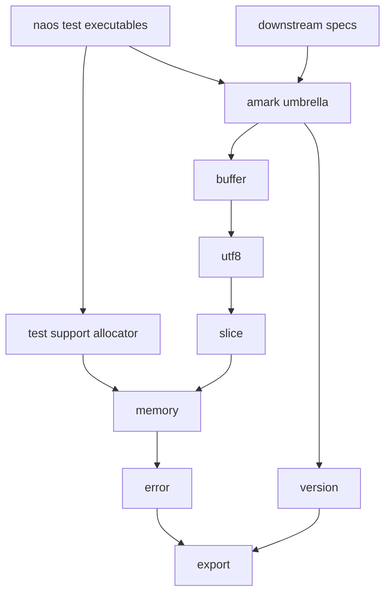
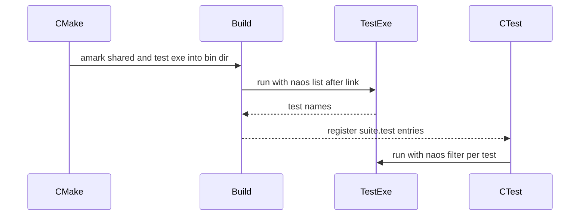

# Design Document: foundation

## Overview

**Purpose**: Amark の全 spec が共通して依存する基盤を提供する。ビルド（CMake、静的・動的ライブラリ、export マクロ）、インストールとパッケージ利用、Naos によるテスト基盤、3 OS の CI とリリース、ライセンス表記、そして横断的な約束事の正本となる公開 API（グローバルアロケータ、単一のエラーコード列挙、文字列スライス、可変長バッファ、UTF-8 基本操作、バージョン情報）を定める。

**Users**: 後続 spec（node-tree、parser-core、html-renderer、commonmark、markdown-renderer）の実装者は、ここで定めた API とビルド・テストの枠組みに自分のソースとテストを載せる。Amark を組み込む利用者は、静的・動的いずれかの形態でビルド・インストールし、`find_package(Amark)` で利用する。

**Impact**: kiro の設定と CLAUDE.md しかないリポジトリに、ソースツリー、ビルド定義、テスト、CI、ライセンス、整形設定を新設する。steering の structure.md / tech.md は本設計の確定内容に合わせて設計段階で更新済みであり、実装時は実際のファイル構成との差分だけを同期する。

### Goals
- 1 つの CMake プロジェクトから静的・動的のどちらでもビルドでき、インストール後に `Amark::amark` として使える
- Windows（MSVC）/ Linux（GCC、Clang）/ macOS（Clang）で、静的・動的の両方がビルド・テスト・インストール確認を通る
- 後続 spec が追加するだけで拡張できる単一のエラー列挙、グローバルアロケータ、文字列ユーティリティを提供する
- 規約を steering に文書化し、整形とソースヘッダ表記を機械的に検査する

### Non-Goals
- ノード、パーサ、レンダラ、CLI ツール、他言語バインディング
- Unicode の文字分類、大文字小文字の畳み込み、正規化。句読点・空白の分類は commonmark spec が所有する非公開モジュール `src/unicode_class.{h,c}`（生成データ `src/unicode_class_data.c`、関数 `amark_unicode_is_punctuation` / `amark_unicode_is_whitespace`）が提供し、markdown-renderer も利用する。公開の `amark/utf8.h` には分類を加えない。大文字小文字の畳み込みも必要とする spec が非公開モジュールとして持つ
- pkg-config ファイル、パッケージマネージャ（vcpkg、Conan など）向けの定義
- スレッドセーフなアロケータ差し替え、確保の統計やリーク検出をライブラリ本体で行うこと

## Boundary Commitments

### This Spec Owns
- リポジトリのトップレベル構成（`include/amark/`、`src/`、`tests/`、`cmake/`、`.github/workflows/`）とトップレベルの `CMakeLists.txt`
- ライブラリターゲット `amark`（別名 `Amark::amark`）、ビルドオプション、コンパイル設定（C99、拡張無効、警告、可視性）
- export マクロ `AMARK_API` と C リンケージ用マクロ `AMARK_BEGIN_DECLS` / `AMARK_END_DECLS`
- インストール規則、`AmarkConfig.cmake` / `AmarkConfigVersion.cmake` / `AmarkTargets.cmake`、バージョンの唯一の出所（`project(... VERSION ...)`）
- テスト基盤: Naos の取り込み、テスト用補助ライブラリ（差し替えアロケータ）、ヘッダ単独 include の検査、ソースヘッダ表記の検査
- CI とリリースのワークフロー、整形設定（`.clang-format`、`.editorconfig`、`.gitattributes`）
- `LICENSE` とソースヘッダの定型表記
- 公開 API: グローバルアロケータ（`amark/memory.h`）、エラー列挙（`amark/error.h`）、スライス（`amark/slice.h`）、UTF-8（`amark/utf8.h`）、バッファ（`amark/buffer.h`）、バージョン（`amark/version.h`）、包括ヘッダ（`amark/amark.h`）
- 文字列の所有権規約と、エラーコード一覧表（全 spec のコードの唯一の正本。「Error」節）と追加の規則
- 共有の骨組みファイル（追記専用）: `include/amark/amark.h`、`src/CMakeLists.txt`、`tests/CMakeLists.txt`、`tests/cxx_header_test.cpp`、`amark_test_support` のソース一覧。後続 spec は自分のブロックを追記するだけで、既存の行を書き換えない（「BuildSystem」「TestHarness」）
- テスト補助（`tests/support/`）の命名規則（「TestSupport」）

### Out of Boundary
- ノード種別、木の編集・走査、パーサエンジン、構文拡張、レンダラ、およびそれらのエラーコードの意味の決定（各 spec が決め、本 spec のエラーコード一覧表と列挙へ追記する）
- 特定の構文やノード種別に依存するユーティリティ
- テスト専用のフック・関数・条件コンパイルをライブラリ本体に入れること（テスト補助はすべて `tests/` に置く）
- CLI、バインディング、ドキュメントサイト

### Allowed Dependencies
- ライブラリ本体: C99 の標準ライブラリ（`<stddef.h>`、`<stdint.h>`、`<stdbool.h>`、`<stdlib.h>`、`<string.h>`）のみ
- ビルド: CMake 3.21 以上の標準モジュール（`GNUInstallDirs`、`CMakePackageConfigHelpers`、`FetchContent`、`CTest`）
- テスト: Naos v0.4.0（FetchContent、タグ固定、テスト有効時のみ）。C++ コンパイラ（C++ からの include 検査のみ）
- CI: GitHub Actions のホスト型ランナー、`clang-format-18`、`gh` CLI
- モジュール間の依存方向は「Architecture」に定める順を守る。逆向きの include を禁止する

### Revalidation Triggers
- 公開済みエラーコードの数値変更・削除（禁止。末尾追加のみ許可）、またはエラー文字列化の契約変更
- アロケータ関数の事前条件（0 サイズや空ポインタを渡さない）や差し替え API の形の変更
- 文字列の所有権規約（スライスの借用、NUL 終端付き所有文字列、`amark_free` による解放）の変更
- `AMARK_API` / `AMARK_SHARED` / `AMARK_BUILDING`、ターゲット名 `Amark::amark`、パッケージ名 `Amark`、ビルドオプション名の変更
- バッファの不変条件（NUL 終端、失敗時に内容を保つ）や `detach` の所有権移転の変更
- テスト登録方法（`naos_add_executable` の使い方、テスト補助ライブラリの API と統計の項目、`test_<area>_*` の命名規則）や CI 行列の変更
- 共有の骨組みファイルの追記規則（追記専用、各 spec が自分のブロックを持つ）の変更
- UTF-8 の不正バイト列の扱い（最大部分列の規則）の変更。`amark_utf8_decode` と `amark_utf8_decode_previous` の両方に及ぶ

## Architecture

### Architecture Pattern & Boundary Map

公開ヘッダとソースはモジュール単位で対にし、下位のモジュールだけを include する層構造とする。



**Architecture Integration**:
- Selected pattern: 層状モジュール構成。依存方向は `export → version, error → memory → slice → utf8 → buffer → amark.h`（左ほど下位）。各モジュールは自分より左のモジュールだけを include する。依存方向の違反はレビューでエラーとして扱う
- Domain/feature boundaries: ビルド・パッケージング、テスト基盤、CI/CD、規約・ツール設定、ランタイム API（アロケータ、エラー、スライス、UTF-8、バッファ、バージョン）を別ファイル群に分け、並行に実装できるようにする
- Existing patterns preserved: steering の命名（`amark_` / `AMARK_` / `_t` / `_init` / `_deinit` / `_create` / `_destroy`）、ディレクトリ構成（`include/amark/`、`src/`、`tests/`、`cmake/`）、include 規則（公開ヘッダは山括弧、非公開は二重引用符）
- New components rationale: すべて新設。各コンポーネントは要件のいずれかに直接対応する
- Steering compliance: C 標準ライブラリ以外に依存しない、確保はすべてグローバルアロケータ経由、エラーは単一列挙、テスト専用コードを本体に置かない

### Technology Stack

| Layer | Choice / Version | Role in Feature | Notes |
|-------|------------------|-----------------|-------|
| 言語 | C99（`C_STANDARD 99`、`C_EXTENSIONS OFF`） | ライブラリ本体とテスト | テストの一部（C++ 検査）は C++11 |
| ビルド | CMake 3.21 以上 | 構成、ビルド、インストール、パッケージ設定、CTest | `cmake_minimum_required(VERSION 3.21)` |
| テスト | Naos v0.4.0（FetchContent、`GIT_TAG v0.4.0`） | テスト記述と CTest 登録 | `Naos::naos`、`naos_add_executable` |
| CI/CD | GitHub Actions（`ubuntu-24.04`、`macos-latest`、`windows-latest`） | ビルド・テスト・インストール確認・整形検査・リリース | `gh release create` |
| 整形 | clang-format 18 | 整形規則の適用と検査 | CI では版を固定 |

## File Structure Plan

### Directory Structure
```
CMakeLists.txt                     # トップレベル: project(amark VERSION 0.1.0)、オプション、src/ と tests/ の取り込み、インストール
LICENSE                            # MIT 全文、Copyright (c) 2026 The Amark Authors
.clang-format                      # 整形規則（Allman、インデント 4、列上限 120 など）
.editorconfig                      # UTF-8、LF、末尾改行、インデント
.gitattributes                     # テキストの改行を LF に正規化
cmake/
├── AmarkConfig.cmake.in           # パッケージ設定テンプレート（AmarkTargets.cmake を読み込む）
├── AmarkCheckSourceHeaders.cmake  # cmake -P で実行するソースヘッダ表記の検査
├── AmarkCompilerWarnings.cmake    # amark_target_warnings(): コンパイラ別の警告と警告のエラー化
└── version.h.in                   # amark/version.h の生成テンプレート
include/amark/
├── amark.h                        # 包括ヘッダ: 本 spec の公開ヘッダをすべて include
├── export.h                       # AMARK_API、AMARK_BEGIN_DECLS / AMARK_END_DECLS
├── error.h                        # amark_error_t と amark_error_string
├── memory.h                       # amark_malloc ほか、amark_allocator_t と差し替え API
├── slice.h                        # amark_slice_t と操作
├── utf8.h                         # UTF-8 の復号・符号化・検証
└── buffer.h                       # amark_buffer_t と操作
src/
├── CMakeLists.txt                 # ライブラリターゲット amark の定義
├── error.c
├── memory.c                       # 既定アロケータと現在のアロケータ（唯一のグローバル状態）
├── slice.c
├── utf8.c
├── buffer.c
└── version.c                      # 実行時のバージョン問い合わせ
tests/
├── CMakeLists.txt                 # Naos の取得、テスト補助ライブラリ、各テスト実行ファイルの登録、ヘッダ検査、ソースヘッダ検査
├── support/                       # 静的ライブラリ amark_test_support。ファイルは test_<area>.{h,c}（後続 spec が追記）
│   ├── test_allocator.h           # テスト用差し替えアロケータの API
│   └── test_allocator.c           # 確保回数・生存数・バイト数の計測と、N 回目以降の確保失敗の注入
├── error_test.c
├── memory_test.c
├── slice_test.c
├── utf8_test.c
├── buffer_test.c
├── version_test.c
├── cxx_header_test.cpp            # C++ から amark.h を include して主要 API を呼ぶ
└── package/
    ├── CMakeLists.txt             # find_package(Amark) で利用する最小の利用者プロジェクト（CI 用、本体ビルドには含めない）
    └── main.c
.github/workflows/
├── ci.yml                         # push / pull_request / workflow_call: 行列ビルド、テスト、インストール確認、整形検査
└── release.yml                    # v* タグ: バージョン一致確認 → ci.yml 呼び出し → リリース公開
```

生成物: `${PROJECT_BINARY_DIR}/include/amark/version.h`（`cmake/version.h.in` から `configure_file`）。ヘッダ単独 include 検査の翻訳単位は `tests/CMakeLists.txt` がビルドツリーに生成する（公開ヘッダ 1 つにつき 1 つ）。

後続 spec が追加する主なファイルの置き場所（本 spec は作らない。配置の規則だけを定める）:
- `tests/support/test_<area>.{h,c}` — 後続 spec のテスト補助（例: node-tree の `test_tree`、`test_tree_dump`、commonmark の `test_spec_examples`）
- `tests/data/` — テストデータ（例: CommonMark 仕様の例）
- `tools/` — 生成スクリプト（例: Unicode 分類表、実体参照表）。手で実行し、生成物はリポジトリに含める。ビルドや CI からは実行しない

### Modified Files
- `.kiro/steering/structure.md` / `.kiro/steering/tech.md` — 本設計の確定内容（ディレクトリ構成、モジュールの依存方向、テスト配置と補助の命名、ビルドオプション、命名例の修正、文字列の所有権規約、エラーコード一覧表の規則、機械的に検査できる規約とできない規約、clang-format の版、リリース手順）を設計段階で反映済み。実装時は、実際に作ったファイル構成・オプション名・コマンドと食い違う箇所だけを同期する

## System Flows

### CI とリリース


- 行列: `{linux-gcc, linux-clang, macos-clang, windows-msvc} × {static, shared}` の 8 ジョブ。構成は Release。マルチコンフィグに備えて `cmake --build --config Release`、`ctest -C Release`、`cmake --install --config Release` を常に指定する
- いずれかのステップが失敗すればジョブが失敗し、実行全体が失敗となる（4.5）
- リリースは `Verify` と `CallCI` の両方が成功したときだけ `Publish` に進む（4.6、4.7）

### テスト実行ファイルのビルドと列挙（動的ライブラリ構成）



- トップレベル時、`CMAKE_RUNTIME_OUTPUT_DIRECTORY` 未設定なら `${PROJECT_BINARY_DIR}/bin` に設定し、Windows の DLL とテスト実行ファイルを同じディレクトリに出す（3.3）。Linux / macOS はビルドツリーの rpath で解決する

## Requirements Traceability

| Requirement | Summary | Components | Interfaces | Flows |
|-------------|---------|------------|------------|-------|
| 1.1, 1.2 | 静的・動的のビルド | BuildSystem | `BUILD_SHARED_LIBS`、ターゲット `amark` | — |
| 1.3 | C99、拡張無効 | BuildSystem | `C_STANDARD 99`、`C_EXTENSIONS OFF` | — |
| 1.4, 1.5 | 同一ヘッダ、公開関数のみ export | ExportMacros, BuildSystem | `AMARK_API`、`C_VISIBILITY_PRESET hidden` | — |
| 1.6 | CMake 3.21 未満で失敗 | BuildSystem | `cmake_minimum_required(VERSION 3.21)` | — |
| 1.7 | 警告のエラー化 | BuildSystem | `AMARK_WARNINGS_AS_ERRORS`、`amark_target_warnings` | CI |
| 2.1, 2.2, 2.3 | インストールと `find_package` | BuildSystem | `AmarkConfig.cmake`、`Amark::amark`、`SameMinorVersion` | CI |
| 2.4 | サブディレクトリ利用 | BuildSystem | `Amark::amark` 別名、`AMARK_BUILD_TESTS` 既定値 | — |
| 2.5, 2.6 | バージョン情報と唯一の出所 | VersionInfo, BuildSystem | `AMARK_VERSION_*`、`amark_version_number`、`amark_version_string` | — |
| 3.1, 3.2 | Naos 取得と CTest 連携 | TestHarness | `FetchContent`、`naos_add_executable` | テスト列挙 |
| 3.3 | 動的構成でのテスト | TestHarness, BuildSystem | `CMAKE_RUNTIME_OUTPUT_DIRECTORY` | テスト列挙 |
| 3.4 | テスト専用コードを本体に置かない | TestSupport, BuildSystem | `tests/support/` | — |
| 3.5 | 公開 API による検証 | TestHarness | 公開ヘッダのみを include | — |
| 3.6 | 確保失敗と釣り合いの検証 | TestSupport | `test_allocator_*` | — |
| 3.7 | ヘッダ単独 include と C++ | TestHarness | ヘッダ検査 TU、`cxx_header_test.cpp` | — |
| 4.1, 4.2, 4.3, 4.4, 4.5 | CI 行列とインストール確認 | CIWorkflow, PackageConsumer | `ci.yml` | CI |
| 4.6, 4.7 | リリース | ReleaseWorkflow | `release.yml` | CI |
| 5.1, 5.2 | ライセンスとソースヘッダ | LicenseNotice | `LICENSE`、定型ヘッダ | — |
| 5.3 | ソースヘッダ検査 | SourceHeaderCheck | `amark.source_headers` テスト | — |
| 6.1, 6.2, 6.3, 6.4, 6.5, 6.6, 6.7, 6.8, 6.9 | グローバルアロケータ | Memory | `amark_malloc` ほか、`amark_allocator_set`、`amark_allocator_get` | — |
| 7.1, 7.2, 7.3, 7.4, 7.5, 7.7 | エラー列挙、一覧表、文字列化 | Error | `amark_error_t`、`amark_error_string`、エラーコード一覧表 | — |
| 7.6 | 文字列の定義漏れ検出 | Error, BuildSystem | `default` なし `switch`、`-Wswitch`、CI の警告エラー化 | CI |
| 8.1, 8.2, 8.3, 8.4, 8.5, 8.6, 8.7 | スライスと所有権規約 | Slice | `amark_slice_t` ほか | — |
| 9.1, 9.2, 9.3, 9.4, 9.5, 9.6, 9.7, 9.8, 9.9 | 可変長バッファ | Buffer | `amark_buffer_t` ほか | — |
| 10.1, 10.2, 10.3, 10.4, 10.5, 10.6, 10.7 | UTF-8 | Utf8 | `amark_utf8_decode`、`amark_utf8_encode`、`amark_utf8_validate` | — |
| 10.8 | 逆方向の 1 文字復号 | Utf8 | `amark_utf8_decode_previous` | — |
| 11.1, 11.2 | 命名規約 | 全ランタイム API | 本書の各インターフェース | — |
| 11.3, 11.4, 11.5, 11.6 | ヘッダ構成と C++ | ExportMacros, Umbrella, TestHarness | `amark/amark.h`、`AMARK_BEGIN_DECLS` | — |
| 12.1, 12.4, 12.5 | 規約の文書化と steering 更新 | SteeringUpdate | `structure.md`、`tech.md` | — |
| 12.2 | 整形設定 | StyleConfig | `.clang-format`、`.editorconfig`、`.gitattributes` | — |
| 12.3 | 整形検査 | CIWorkflow | `ci.yml` の format ジョブ | CI |

## Components and Interfaces

| Component | Domain/Layer | Intent | Req Coverage | Key Dependencies (P0/P1) | Contracts |
|-----------|--------------|--------|--------------|--------------------------|-----------|
| BuildSystem | ビルド | ターゲット、オプション、コンパイル設定、インストール、パッケージ設定 | 1.1–1.7, 2.1–2.4, 2.6, 3.3, 3.4, 7.6 | CMake (P0) | Batch |
| ExportMacros | ランタイム API | export とリンケージのマクロ | 1.4, 1.5, 11.4 | — | Service |
| VersionInfo | ランタイム API | バージョン定数と実行時問い合わせ | 2.5, 2.6 | ExportMacros (P0) | Service |
| Error | ランタイム API | 単一のエラー列挙と文字列化 | 7.1–7.7 | ExportMacros (P0) | Service |
| Memory | ランタイム API | グローバルアロケータ | 6.1–6.9 | Error (P0) | Service, State |
| Slice | ランタイム API | 借用文字列と所有権規約 | 8.1–8.7 | Memory (P0) | Service |
| Utf8 | ランタイム API | UTF-8 の復号（前方・逆方向）・符号化・検証 | 10.1–10.8 | Slice (P0) | Service |
| Buffer | ランタイム API | 可変長バッファ | 9.1–9.9 | Utf8 (P0), Memory (P0) | Service, State |
| Umbrella | ランタイム API | 包括ヘッダ | 11.5 | 全ヘッダ (P0) | Service |
| TestHarness | テスト | Naos 取得、実行ファイル登録、ヘッダ検査 | 3.1, 3.2, 3.3, 3.5, 3.7, 11.3, 11.4, 11.6 | Naos (P0), BuildSystem (P0) | Batch |
| TestSupport | テスト | 差し替えアロケータ（失敗注入・計測） | 3.4, 3.6 | Memory (P0) | Service |
| SourceHeaderCheck | テスト | ソースヘッダ表記の検査 | 5.3 | CMake (P0) | Batch |
| PackageConsumer | テスト（CI 用） | `find_package` の利用確認 | 2.2, 4.4 | インストール済み Amark (P0) | Batch |
| CIWorkflow | CI/CD | 行列ビルド・テスト・インストール確認・整形検査 | 1.7, 4.1–4.5, 7.6, 12.3 | GitHub Actions (P0) | Batch |
| ReleaseWorkflow | CI/CD | タグからのリリース | 4.6, 4.7 | CIWorkflow (P0) | Batch |
| LicenseNotice | 規約 | LICENSE と定型ヘッダ | 5.1, 5.2 | — | — |
| StyleConfig | 規約 | 整形とエディタ設定 | 12.2 | clang-format (P1) | — |
| SteeringUpdate | 規約 | steering の更新 | 11.1, 11.2, 12.1, 12.4, 12.5 | 全コンポーネントの確定内容 (P1) | — |

### 共通の API 規約（全ランタイム API に適用）

- 失敗しうる公開関数は `amark_error_t` を返し、結果は出力引数で返す。成功時は `AMARK_OK`（7.7）
- `amark_error_t` を返す関数は、必須のポインタ引数が `NULL` なら `AMARK_ERROR_INVALID_ARGUMENT` を返し、何も変更しない
- `void` を返す後片付け系（`_deinit`、`_clear`）は `NULL` を受け取っても何もしない
- 失敗時、呼び出し側から見える状態（バッファの内容、現在のアロケータ、出力引数）は呼び出し前のまま保つ。ただし出力引数のうち、失敗の詳細を返すと明記したもの（`consumed`、`error_offset`、`codepoint`）は除く
- 公開ヘッダはすべて、include ガード `AMARK_<NAME>_H`、`#include <amark/export.h>`（直接または下位ヘッダ経由）、`AMARK_BEGIN_DECLS` / `AMARK_END_DECLS` で宣言を囲む（11.3、11.4）
- 公開ヘッダは `src/` のヘッダを include しない（11.6）
- 公開関数の宣言には `AMARK_API` を付ける

### ビルド・パッケージング

#### BuildSystem

| Field | Detail |
|-------|--------|
| Intent | ライブラリターゲット、ビルドオプション、インストールとパッケージ設定を定義する |
| Requirements | 1.1, 1.2, 1.3, 1.4, 1.5, 1.6, 1.7, 2.1, 2.2, 2.3, 2.4, 2.6, 3.3, 3.4, 7.6 |

**Responsibilities & Constraints**
- トップレベル `CMakeLists.txt`: `cmake_minimum_required(VERSION 3.21)`、`project(amark VERSION 0.1.0 LANGUAGES C)`。`VERSION` は同じ行に `VERSION <x.y.z>` の形で書く（リリースワークフローがこの行を読む）
- オプション:

| Option | Default | Content |
|---|---|---|
| `BUILD_SHARED_LIBS` | `OFF` | `ON` で動的ライブラリ（CMake 標準） |
| `AMARK_BUILD_TESTS` | `PROJECT_IS_TOP_LEVEL` | テストを構成する。`BUILD_TESTING`（`include(CTest)`）も `ON` のときだけ有効 |
| `AMARK_INSTALL` | `PROJECT_IS_TOP_LEVEL` | インストール規則を生成する |
| `AMARK_WARNINGS_AS_ERRORS` | `OFF` | 警告をエラーにする（CI では `ON`） |

- `include(CTest)` はトップレベル時のみ行う。トップレベルでないとき Naos は取得しない（2.4）
- トップレベル時に `CMAKE_RUNTIME_OUTPUT_DIRECTORY` が未定義なら `${PROJECT_BINARY_DIR}/bin` とする（3.3）
- `src/CMakeLists.txt` のターゲット `amark`:
  - ソース: `src/*.c`（本 spec では error、memory、slice、utf8、buffer、version）。テスト用のソースは含めない（3.4）
  - プロパティ: `C_STANDARD 99`、`C_STANDARD_REQUIRED ON`、`C_EXTENSIONS OFF`、`C_VISIBILITY_PRESET hidden`、`VISIBILITY_INLINES_HIDDEN ON`、`DEBUG_POSTFIX d`、`OUTPUT_NAME amark`、`VERSION ${PROJECT_VERSION}`、`SOVERSION`（1.0 前は `0.<minor>`、以後 `<major>`）、`EXPORT_NAME amark`
  - include ディレクトリ: `$<BUILD_INTERFACE:${PROJECT_SOURCE_DIR}/include>`、`$<BUILD_INTERFACE:${PROJECT_BINARY_DIR}/include>`、`$<INSTALL_INTERFACE:${CMAKE_INSTALL_INCLUDEDIR}>`
  - コンパイル定義: `AMARK_BUILDING`（PRIVATE）。`BUILD_SHARED_LIBS` が真なら `AMARK_SHARED`（PUBLIC）
  - `add_library(Amark::amark ALIAS amark)`
- `cmake/AmarkCompilerWarnings.cmake` の `amark_target_warnings(<target>)`: GCC / Clang は `-Wall -Wextra -Wpedantic`、MSVC は `/W4`。`AMARK_WARNINGS_AS_ERRORS` が真なら `-Werror` / `/WX` を加える。ライブラリとテストのターゲットにだけ PRIVATE で付け、利用者へ伝播させない（1.7）
- インストール（`AMARK_INSTALL` が真のとき）:
  - ターゲット: `install(TARGETS amark EXPORT AmarkTargets ...)`（`GNUInstallDirs` の標準ディレクトリ）
  - ヘッダ: `include/amark/*.h` と生成された `amark/version.h` を `${CMAKE_INSTALL_INCLUDEDIR}/amark`
  - パッケージ: `AmarkTargets.cmake`（`NAMESPACE Amark::`）、`configure_package_config_file` による `AmarkConfig.cmake`、`write_basic_package_version_file` による `AmarkConfigVersion.cmake` を `${CMAKE_INSTALL_LIBDIR}/cmake/Amark`
  - バージョン互換: メジャー 0 の間は `SameMinorVersion`、1 以上では `SameMajorVersion`（2.3）
  - ライセンス: `LICENSE` を `${CMAKE_INSTALL_DOCDIR}`（2.1）
- バージョンの唯一の出所は `project()` の `VERSION`。`version.h`、`amark_version_*()`、パッケージのバージョンはすべてここから生成する（2.6）

**Contracts**: Batch [x]
- Trigger: `cmake -S . -B build [-DBUILD_SHARED_LIBS=ON] [-DAMARK_WARNINGS_AS_ERRORS=ON]`、`cmake --build build --config Release`、`cmake --install build --config Release --prefix <dir>`
- Output: `libamark.a` / `amark.lib`（静的）、`libamark.so.*` / `libamark.*.dylib` / `amark.dll` + `amark.lib`（動的）、インストールツリー

**Implementation Notes**
- Integration: 後続 spec は `include/amark/` に自分の公開ヘッダを置き、`src/CMakeLists.txt` のソース一覧へ自分のブロックを追記するだけでビルドに載る
- 共有の骨組みファイル（追記専用、本 spec が所有）: `include/amark/amark.h`（包括ヘッダの include 一覧）、`src/CMakeLists.txt`（ライブラリのソース一覧）、`tests/CMakeLists.txt`（テストの登録）、`tests/cxx_header_test.cpp`（C++ からの呼び出し確認）、`amark_test_support` のソース一覧。規則:
  - 各 spec は spec 名をコメントにした自分のブロック（例: `# node-tree`、`/* node-tree */`）を末尾に追記し、他の spec のブロックや本 spec の行を書き換えない
  - 並行に実装される spec の変更が衝突したら、両方のブロックを残して追記順に並べることで解消する（内容の取捨選択をしない）
  - ブロック内の並びは依存の下位から上位の順とする
- Validation: CI の 8 ジョブとインストール確認で検証する
- Risks: `SOVERSION` の規則を誤るとインストール時に互換性の判定がずれる

#### ExportMacros

| Field | Detail |
|-------|--------|
| Intent | 公開関数の export / import とリンケージを 1 つのヘッダで切り替える |
| Requirements | 1.4, 1.5, 11.4 |

**Contracts**: Service [x]

##### Service Interface
```c
/* include/amark/export.h */
#if defined(AMARK_BUILDING) || defined(AMARK_SHARED)
#  if defined(_WIN32) || defined(__CYGWIN__)
#    if defined(AMARK_BUILDING) && defined(AMARK_SHARED)
#      define AMARK_API __declspec(dllexport)
#    elif defined(AMARK_SHARED)
#      define AMARK_API __declspec(dllimport)
#    else
#      define AMARK_API
#    endif
#  elif defined(__GNUC__) || defined(__clang__)
#    define AMARK_API __attribute__((visibility("default")))
#  else
#    define AMARK_API
#  endif
#else
#  define AMARK_API
#endif

#ifdef __cplusplus
#  define AMARK_BEGIN_DECLS extern "C" {
#  define AMARK_END_DECLS }
#else
#  define AMARK_BEGIN_DECLS
#  define AMARK_END_DECLS
#endif
```
- Preconditions: 利用者は何も定義しなくてよい。動的ライブラリの利用時は `Amark::amark` が `AMARK_SHARED` を伝播する。CMake 以外のビルドシステムから動的ライブラリを使う場合は利用者が `AMARK_SHARED` を定義する
- Invariants: `AMARK_BUILDING` はライブラリ自身のビルドでのみ定義される。静的ビルド時は `AMARK_API` が空になる

### ランタイム API

#### VersionInfo

| Field | Detail |
|-------|--------|
| Intent | ヘッダのバージョンとリンクされたライブラリのバージョンを提供する |
| Requirements | 2.5, 2.6 |

**Contracts**: Service [x]

##### Service Interface
```c
/* include/amark/version.h（cmake/version.h.in から生成） */
#define AMARK_VERSION_MAJOR @PROJECT_VERSION_MAJOR@
#define AMARK_VERSION_MINOR @PROJECT_VERSION_MINOR@
#define AMARK_VERSION_PATCH @PROJECT_VERSION_PATCH@
#define AMARK_VERSION_ENCODE(major, minor, patch) \
    ((((unsigned long)(major)) << 16) | (((unsigned long)(minor)) << 8) | ((unsigned long)(patch)))
#define AMARK_VERSION_NUMBER AMARK_VERSION_ENCODE(AMARK_VERSION_MAJOR, AMARK_VERSION_MINOR, AMARK_VERSION_PATCH)
#define AMARK_VERSION_STRING "@PROJECT_VERSION_MAJOR@.@PROJECT_VERSION_MINOR@.@PROJECT_VERSION_PATCH@"

AMARK_API unsigned long amark_version_number(void);
AMARK_API const char *amark_version_string(void);
```
- Postconditions: `amark_version_number()` はライブラリをビルドしたときの `AMARK_VERSION_NUMBER`、`amark_version_string()` は同じく `AMARK_VERSION_STRING` を返す。文字列は静的領域で解放不要
- Invariants: 各番号は 0〜255

#### Error

| Field | Detail |
|-------|--------|
| Intent | ライブラリ全体で単一のエラーコード列挙と、その文字列化を提供する |
| Requirements | 7.1, 7.2, 7.3, 7.4, 7.5, 7.6, 7.7 |

**Responsibilities & Constraints**
- 列挙はライブラリ全体で 1 つ。後続 spec は自分のコードを末尾に追加する。既存の値の変更・削除・再利用は禁止（7.5）
- 下の「エラーコード一覧表」が全 spec のコードの唯一の正本である。各 spec の設計は一覧表の行を参照し、値と文字列を独自に定義し直さない
- 新しいコードが必要な spec は、自分の設計の Cross-Spec Change Note で本表へ行を追記する（本 spec の改訂として扱う）。「次の空き番号」を各 spec が見込みで決めて使うことはしない。並行する spec が同じ番号を求めた場合は、本表への追記順で番号を確定させる
- 追加時は本表、`error.h` の列挙、`src/error.c` の `switch`、`tests/error_test.c` の確認を同時に更新する
- 個数を表す番兵定数は公開しない

**エラーコード一覧表**（正本、追記専用）

| 定数 | 値 | 所有 spec | 文字列（`amark_error_string`） | 意味 |
|---|---|---|---|---|
| `AMARK_OK` | 0 | foundation | `"success"` | 成功 |
| `AMARK_ERROR_NO_MEMORY` | 1 | foundation | `"out of memory"` | メモリ確保に失敗した |
| `AMARK_ERROR_INVALID_ARGUMENT` | 2 | foundation | `"invalid argument"` | 引数が契約に反する（必須ポインタが `NULL`、範囲外など） |
| `AMARK_ERROR_OVERFLOW` | 3 | foundation | `"size overflow"` | サイズ計算が `size_t` の範囲を超える |
| `AMARK_ERROR_INVALID_UTF8` | 4 | foundation | `"invalid UTF-8"` | UTF-8 として不正、または符号化できないコードポイント |
| `AMARK_ERROR_INVALID_CHILD` | 5 | node-tree | `"invalid child node"` | 編集操作が親子関係の規則に反する（親がその種別を受け入れない、循環、document を子にする） |
| `AMARK_ERROR_ALREADY_EXISTS` | 6 | node-tree | `"already exists"` | 同じ名前・鍵のものが既に登録されている（種別名、拡張名、定義の鍵などに再利用できる汎用の意味） |
| `AMARK_ERROR_INVALID_STATE` | 7 | parser-core | `"invalid state"` | オブジェクトの現在の状態ではその操作ができない（終了済みのパーサ、凍結された方言など。他 spec も同じ意味で再利用できる） |

- 意味の詳細と使い分けは所有 spec の設計に記す。所有 spec 以外も、意味が合えば既存のコードを再利用する（例: markdown-renderer は `AMARK_ERROR_INVALID_STATE` を再利用する）

**Contracts**: Service [x]

##### Service Interface
```c
/* include/amark/error.h */
typedef enum amark_error
{
    AMARK_OK = 0,
    AMARK_ERROR_NO_MEMORY = 1,        /* メモリ確保に失敗した */
    AMARK_ERROR_INVALID_ARGUMENT = 2, /* 引数が契約に反する（必須ポインタが NULL、範囲外など） */
    AMARK_ERROR_OVERFLOW = 3,         /* サイズ計算が size_t の範囲を超える */
    AMARK_ERROR_INVALID_UTF8 = 4,     /* UTF-8 として不正、または符号化できないコードポイント */
    /* node-tree */
    AMARK_ERROR_INVALID_CHILD = 5,    /* 親子関係の規則に反する */
    AMARK_ERROR_ALREADY_EXISTS = 6,   /* 同じ名前・鍵が既にある */
    /* parser-core */
    AMARK_ERROR_INVALID_STATE = 7     /* 現在の状態ではできない操作 */
    /* 追加はエラーコード一覧表への追記と同時に、表の値で末尾に行う。値の変更・再利用は禁止 */
} amark_error_t;

AMARK_API const char *amark_error_string(amark_error_t error);
```
- 本 spec の実装が定義するのは値 0〜4。値 5 以降は所有 spec の実装タスクが一覧表どおりに追加する（上の宣言は一覧表を反映した最終形）
- Postconditions: 定義済みのコードには一覧表の文字列（固有の英語の短い説明）を返す。未定義の値には `"unknown error"` を返す。戻り値は常に非 `NULL` の静的文字列で、解放不要（7.3、7.4）
- Invariants: `AMARK_OK == 0`。`if (error)` で失敗を判定できる

**Implementation Notes**
- Validation: `src/error.c` は `default` ラベルのない `switch` で各コードの文字列を返し、`switch` の後で `"unknown error"` を返す。GCC / Clang の `-Wswitch` と CI の警告エラー化により、列挙に追加されて文字列のないコードをビルド時に検出する（7.6）。テストは定義済みのすべてのコードについて、一覧表どおりの値と文字列（`"unknown error"` 以外の非空で互いに異なる文字列）を個別に確認する

#### Memory

| Field | Detail |
|-------|--------|
| Intent | ライブラリ内のすべての動的確保が経由する、差し替え可能なグローバルアロケータ |
| Requirements | 6.1, 6.2, 6.3, 6.4, 6.5, 6.6, 6.7, 6.8, 6.9 |

**Responsibilities & Constraints**
- ライブラリ内のソースは `malloc` / `realloc` / `calloc` / `free` を直接呼ばない。直接呼ぶのは `src/memory.c` の既定アロケータだけ（6.1、6.2）
- 現在のアロケータは `src/memory.c` の `static` 変数 1 つに持つ。これがライブラリ唯一の可変グローバル状態

**Contracts**: Service [x] / State [x]

##### Service Interface
```c
/* include/amark/memory.h */
typedef void *(*amark_allocate_fn_t)(size_t size, void *user_data);
typedef void *(*amark_reallocate_fn_t)(void *pointer, size_t size, void *user_data);
typedef void *(*amark_allocate_zeroed_fn_t)(size_t count, size_t size, void *user_data);
typedef void (*amark_deallocate_fn_t)(void *pointer, void *user_data);

typedef struct amark_allocator
{
    amark_allocate_fn_t allocate;
    amark_reallocate_fn_t reallocate;
    amark_allocate_zeroed_fn_t allocate_zeroed;
    amark_deallocate_fn_t deallocate;
    void *user_data;
} amark_allocator_t;

AMARK_API void *amark_malloc(size_t size);
AMARK_API void *amark_realloc(void *pointer, size_t size);
AMARK_API void *amark_calloc(size_t count, size_t size);
AMARK_API void amark_free(void *pointer);

AMARK_API amark_error_t amark_allocator_set(const amark_allocator_t *allocator);
AMARK_API void amark_allocator_get(amark_allocator_t *allocator);
```

ラッパの振る舞い（全プラットフォーム共通、6.7、6.8）:

| 呼び出し | 振る舞い |
|---|---|
| `amark_malloc(0)` | `allocate(1, user_data)` として扱う |
| `amark_malloc(n)` | `allocate(n, user_data)` の結果を返す |
| `amark_realloc(NULL, n)` | `amark_malloc(n)` と同じ |
| `amark_realloc(p, 0)` | `reallocate(p, 1, user_data)` として扱う |
| `amark_realloc(p, n)` | `reallocate(p, n, user_data)`。失敗時は `NULL` を返し、`p` は有効なまま |
| `amark_calloc(c, s)` で `c * s` があふれる | アロケータを呼ばずに `NULL` |
| `amark_calloc(c, s)` で `c == 0` または `s == 0` | `allocate_zeroed(1, 1, user_data)` として扱う |
| `amark_calloc(c, s)` | `allocate_zeroed(c, s, user_data)` |
| `amark_free(NULL)` | 何もしない（`deallocate` を呼ばない） |
| `amark_free(p)` | `deallocate(p, user_data)` |

- 確保系の戻り値 `NULL` は常に確保失敗を意味する
- 利用者関数への事前条件: `size`、`count` は 1 以上。`reallocate` と `deallocate` の `pointer` は非 `NULL`。戻り値はあらゆるオブジェクト型に適切に整列していること。`allocate_zeroed` は確保領域をゼロで埋めること
- `amark_allocator_set(allocator)`:
  - `allocator == NULL`: 既定アロケータ（C 標準ライブラリ）に戻し `AMARK_OK`（6.5）
  - 4 つの関数のいずれかが `NULL`: 現在のアロケータを変えずに `AMARK_ERROR_INVALID_ARGUMENT`（6.4）
  - それ以外: 内容を複製して現在のアロケータとし `AMARK_OK`。`user_data` はそのまま各関数へ渡す（6.3）
- `amark_allocator_get(allocator)`: 現在のアロケータ（既定時は既定関数と `user_data == NULL`）を書き込む。`NULL` なら何もしない（6.6）

##### State Management
- State model: 現在のアロケータ 1 つ。初期値は既定アロケータ
- Concurrency strategy: 差し替えはスレッドセーフでない。利用者は、Amark を使う他のスレッドが動いておらず、かつ以前のアロケータで確保された Amark のメモリが残っていない時点で差し替える。ライブラリはこれを検出しない。この制約を `memory.h` のコメントに明記する（6.9）
- 確保と差し替え以外の操作（`amark_malloc` などの呼び出し）は現在のアロケータを読むだけで、複数スレッドから同時に呼んでよい

#### Slice

| Field | Detail |
|-------|--------|
| Intent | 所有権を持たない長さ付き文字列と、文字列の所有権規約 |
| Requirements | 8.1, 8.2, 8.3, 8.4, 8.5, 8.6, 8.7 |

**Contracts**: Service [x]

##### Service Interface
```c
/* include/amark/slice.h */
typedef struct amark_slice
{
    const char *data;
    size_t length;
} amark_slice_t;

AMARK_API amark_slice_t amark_slice_make(const char *data, size_t length);
AMARK_API amark_slice_t amark_slice_from_cstr(const char *cstr);
AMARK_API bool amark_slice_equal(amark_slice_t left, amark_slice_t right);
AMARK_API amark_slice_t amark_slice_sub(amark_slice_t slice, size_t offset, size_t length);
AMARK_API char *amark_slice_dup(amark_slice_t slice);
```
- Invariants: `length > 0` なら `data != NULL`。空スライスは `data` が `NULL` でもよい。`data` は NUL 終端を仮定せず、NUL を含みうる
- `amark_slice_make(NULL, n)` は空スライスを返す。`amark_slice_from_cstr(NULL)` は空スライスを返す（8.2）
- `amark_slice_equal`: 長さが等しく、全バイトが一致するときだけ `true`。空同士は `true`（8.3）
- `amark_slice_sub`: `offset > slice.length` なら `offset = slice.length`。`length > slice.length - offset` なら `slice.length - offset` に切り詰める（8.4）
- `amark_slice_dup`: `slice.length + 1` バイトを `amark_malloc` で確保し、内容と末尾の NUL を書く。空スライスでも 1 バイトの `""` を返す。`slice.length == SIZE_MAX` または確保失敗なら `NULL` を返し、何も確保したまま残さない（8.5、8.6）

**文字列の所有権規約**（ライブラリ全体の正本、8.7）
- 借用: `amark_slice_t`。参照先の寿命は貸し手が保証する。借用した側は解放しない
- 所有: `amark_malloc` 系で確保した `char *` と `size_t` の長さの組。常に `data[length] == '\0'`。所有者が `amark_free` で解放する
- 入力・内部表現の文字コードは UTF-8 のバイト列とする。妥当性の検査と不正バイトの扱いは、入力を受け取るモジュールが `amark/utf8.h` を用いて定める

#### Utf8

| Field | Detail |
|-------|--------|
| Intent | UTF-8 の 1 文字復号（前方・逆方向）、符号化、全体検証 |
| Requirements | 10.1, 10.2, 10.3, 10.4, 10.5, 10.6, 10.7, 10.8 |

**Contracts**: Service [x]

##### Service Interface
```c
/* include/amark/utf8.h */
#define AMARK_UTF8_MAX_LENGTH 4
#define AMARK_UTF8_REPLACEMENT_CHARACTER 0xFFFDu

AMARK_API amark_error_t amark_utf8_decode(amark_slice_t input, uint32_t *codepoint, size_t *consumed);
AMARK_API amark_error_t amark_utf8_decode_previous(amark_slice_t input, size_t offset, uint32_t *codepoint,
                                                   size_t *consumed);
AMARK_API amark_error_t amark_utf8_encode(uint32_t codepoint, char *output, size_t *written);
AMARK_API amark_error_t amark_utf8_validate(amark_slice_t input, size_t *error_offset);
```
- 妥当性の基準は Unicode 標準 Table 3-7（先頭バイト `00–7F`、`C2–DF`、`E0–EF`、`F0–F4`。2 バイト目は `E0` → `A0–BF`、`ED` → `80–9F`、`F0` → `90–BF`、`F4` → `80–8F`、その他 `80–BF`。3・4 バイト目は `80–BF`）。これにより過長表現、サロゲート、U+10FFFF 超、途切れ、不正な先頭・継続バイトを排除する。U+0000 は妥当な 1 バイト文字（10.7）
- `amark_utf8_decode`:
  - `codepoint` または `consumed` が `NULL`、あるいは `input.length == 0`: `AMARK_ERROR_INVALID_ARGUMENT`、出力は変更しない（10.3）
  - 妥当: `AMARK_OK`、`*codepoint` にコードポイント、`*consumed` に 1〜4（10.1）
  - 不正: `AMARK_ERROR_INVALID_UTF8`、`*codepoint = AMARK_UTF8_REPLACEMENT_CHARACTER`、`*consumed` に最大部分列の長さ（妥当な並びの接頭辞として成立する最長のバイト数。成立しなければ 1）（10.2）
- `amark_utf8_decode_previous`（10.8）: 位置 `offset` の直前で終わる 1 文字（不正単位）を逆方向に復号する
  - `codepoint` または `consumed` が `NULL`、`offset == 0`、`offset > input.length`: `AMARK_ERROR_INVALID_ARGUMENT`、出力は変更しない
  - 結果の契約: `input` の先頭から `offset` までを `amark_utf8_decode` で前方へ順に復号したときの最後の単位と、戻り値・`*codepoint`・`*consumed` が一致する。したがって不正バイトの扱い（U+FFFD、最大部分列の長さ）は `amark_utf8_decode` と同じで、`*consumed` は 1〜4、その単位は `input.data[offset - *consumed]` から始まる
  - 手順: `[max(0, offset - 4), offset)` で継続バイト（`80–BF`）でない最後の位置 `p` を探す。見つからなければ不正（`*consumed = 1`）。見つかれば `input.data[p..offset)` に `amark_utf8_decode` を適用し、`consumed == offset - p` ならその結果を返す。そうでなければ（`p` の後ろに余った継続バイトがある）不正で `*consumed = 1`。継続バイトでないバイトは前方復号で必ず新しい単位を始めるため、この手順は上の契約を満たす
  - 読み取るのは `[offset - 4, offset)` の範囲（入力の先頭を下回らない）に限る
- `amark_utf8_encode`:
  - `output` は `AMARK_UTF8_MAX_LENGTH` バイト以上の領域。`output` または `written` が `NULL`: `AMARK_ERROR_INVALID_ARGUMENT`
  - `codepoint` が `0xD800–0xDFFF` または `0x10FFFF` 超: `AMARK_ERROR_INVALID_UTF8`、何も書かない（10.5）
  - 妥当: 1〜4 バイトを書き、`*written` にバイト数、`AMARK_OK`（10.4）。NUL 終端は書かない
- `amark_utf8_validate`:
  - 全体が妥当（空を含む）: `AMARK_OK`
  - 不正: `AMARK_ERROR_INVALID_UTF8`、`error_offset` が非 `NULL` なら最初の不正単位の先頭バイト位置を書く（10.6）
  - `input.length > 0` かつ `input.data == NULL` はスライスの不変条件違反として `AMARK_ERROR_INVALID_ARGUMENT`

#### Buffer

| Field | Detail |
|-------|--------|
| Intent | 追記で伸長する NUL 終端付きバイト列バッファ |
| Requirements | 9.1, 9.2, 9.3, 9.4, 9.5, 9.6, 9.7, 9.8, 9.9 |

**Contracts**: Service [x] / State [x]

##### Service Interface
```c
/* include/amark/buffer.h */
typedef struct amark_buffer
{
    char *data;      /* NULL または capacity + 1 バイトの領域 */
    size_t length;   /* 内容のバイト数 */
    size_t capacity; /* 再確保なしに保持できる内容の最大バイト数（NUL を除く） */
} amark_buffer_t;

AMARK_API void amark_buffer_init(amark_buffer_t *buffer);
AMARK_API void amark_buffer_deinit(amark_buffer_t *buffer);

AMARK_API amark_error_t amark_buffer_reserve(amark_buffer_t *buffer, size_t additional);
AMARK_API amark_error_t amark_buffer_append(amark_buffer_t *buffer, const char *data, size_t length);
AMARK_API amark_error_t amark_buffer_append_char(amark_buffer_t *buffer, char c);
AMARK_API amark_error_t amark_buffer_append_cstr(amark_buffer_t *buffer, const char *cstr);
AMARK_API amark_error_t amark_buffer_append_slice(amark_buffer_t *buffer, amark_slice_t slice);
AMARK_API amark_error_t amark_buffer_append_codepoint(amark_buffer_t *buffer, uint32_t codepoint);

AMARK_API void amark_buffer_clear(amark_buffer_t *buffer);
AMARK_API amark_error_t amark_buffer_truncate(amark_buffer_t *buffer, size_t length);
AMARK_API amark_error_t amark_buffer_detach(amark_buffer_t *buffer, char **data, size_t *length);
AMARK_API amark_slice_t amark_buffer_as_slice(const amark_buffer_t *buffer);
```

##### State Management
- State model: 「空（`data == NULL`、`length == 0`、`capacity == 0`）」と「領域あり（`data != NULL`、`length <= capacity`、`data[length] == '\0'`）」の 2 状態（9.3）
- `init`: 確保せず空にする（9.1）。`deinit`: 領域を `amark_free` で解放し空に戻す。`deinit` 後に再利用してよい（9.8）
- `reserve(additional)`: `length + additional + 1` があふれるなら `AMARK_ERROR_OVERFLOW`。必要容量 `length + additional` が `capacity` 以下なら何もしない。超えるなら新容量を `max(必要容量, capacity * 2, 16)`（`capacity * 2 + 1` が `size_t` であふれる場合は `capacity * 2` の候補を除く）として `amark_realloc` する。失敗なら `AMARK_ERROR_NO_MEMORY` で、`data`・`length`・`capacity` は変更しない（9.4、9.9）
- `append(data, length)`: `length > 0` かつ `data == NULL` は `AMARK_ERROR_INVALID_ARGUMENT`。`reserve` の後に内容をコピーし、NUL を書く（9.2）。`length == 0` は何もせず `AMARK_OK`
- `append_char`、`append_cstr`（`NULL` は `AMARK_ERROR_INVALID_ARGUMENT`）、`append_slice` は `append` に委ねる。`append_codepoint` は `amark_utf8_encode` で符号化してから `append` に委ね、不正なコードポイントは `AMARK_ERROR_INVALID_UTF8` で内容を変更しない
- `clear`: `length = 0`、領域があれば `data[0] = '\0'`。容量は保つ（9.5）
- `truncate(length)`: 現在の長さを超えるなら `AMARK_ERROR_INVALID_ARGUMENT` で変更しない（9.6）。それ以外は長さを変え NUL を書く（9.5）
- `detach(&data, &length)`: 領域があればその所有権を移す。空なら 1 バイトの `""` を `amark_malloc` で確保して渡す（失敗時 `AMARK_ERROR_NO_MEMORY`、バッファは変更しない）。成功後バッファは空。受け取った側は `amark_free` で解放する（9.7）
- `as_slice`: 現在の内容を借用するスライス。バッファを変更すると無効になる
- Concurrency strategy: 1 つのバッファを複数スレッドから同時に変更しない（呼び出し側の責任）

#### Umbrella

| Field | Detail |
|-------|--------|
| Intent | 本 spec の公開ヘッダをすべて include する包括ヘッダ |
| Requirements | 11.5 |

- `include/amark/amark.h` は `export.h`、`version.h`、`error.h`、`memory.h`、`slice.h`、`utf8.h`、`buffer.h` を include する。後続 spec は自分の公開ヘッダの include を、spec 名のコメント付きブロックとして末尾に追記する（共有の骨組みファイルの規則、「BuildSystem」）

### テスト

#### TestHarness

| Field | Detail |
|-------|--------|
| Intent | Naos の取得、テスト実行ファイルの登録、ヘッダ検査を行う |
| Requirements | 3.1, 3.2, 3.3, 3.5, 3.7, 11.3, 11.4, 11.6 |

**Responsibilities & Constraints**
- `tests/CMakeLists.txt` は `AMARK_BUILD_TESTS AND BUILD_TESTING` のときだけ読み込まれる
- Naos: `FetchContent_Declare(Naos GIT_REPOSITORY https://github.com/vabelorg/naos.git GIT_TAG v0.4.0)` と `FetchContent_MakeAvailable(Naos)`（3.1）
- モジュールごとに 1 実行ファイル: `naos_add_executable(amark_<module>_test SOURCES <module>_test.c LIBRARIES Amark::amark amark_test_support)`。CTest 名は `amark_<module>_test.<suite>.<test>`（3.2）。各テストターゲットに `amark_target_warnings` を適用する
- テストは `#include <amark/amark.h>` または個別の公開ヘッダだけを使い、`src/` を include しない。動的構成では非公開シンボルが見えないため、公開 API 以外を呼ぶテストはリンクに失敗する（3.5）
- ヘッダ単独 include 検査: 公開ヘッダ（`include/amark/*.h` と生成された `version.h`）ごとに、そのヘッダだけを include する翻訳単位をビルドツリーに生成し、オブジェクトライブラリ `amark_header_check` としてビルドする。どれかが単独でコンパイルできなければビルドが失敗する（11.3）。生成した翻訳単位は `src/` を include パスに含めずにコンパイルし、公開ヘッダが非公開ヘッダに依存していればコンパイルに失敗する（11.6）
- C++ 検査: `enable_language(CXX)` を `tests/` 内で行い、`cxx_header_test.cpp`（C++11）を `naos_add_executable(amark_cxx_header_test ...)` で登録する。`amark.h` を include し、`amark_error_string`、`amark_slice_from_cstr`、バッファの追記と後片付けを呼んでリンクできることを確認する（11.4）。後続 spec は自分の主要 API の呼び出しを、spec 名のコメント付きのテストまたはブロックとして追記する
- 後続 spec のテスト登録: `tests/CMakeLists.txt` の末尾に spec 名のコメント付きブロックを追記し、上と同じ `naos_add_executable` の形で自分のモジュールのテストを登録する。テスト補助を追加する場合は同じブロックで `amark_test_support` のソース一覧に `support/test_<area>.c` を追記する（`target_sources(amark_test_support PRIVATE ...)`）。いずれも追記専用（「BuildSystem」の共有の骨組みファイルの規則）

**Contracts**: Batch [x]
- Trigger: `ctest --test-dir build -C Release --output-on-failure`
- Output: 各テストの成否。失敗があれば非 0 で終了

#### TestSupport

| Field | Detail |
|-------|--------|
| Intent | テスト側でグローバルアロケータを差し替え、確保失敗の注入と確保・解放の釣り合い・バイト数の計測を行う。後続 spec のテスト補助の置き場所と命名を定める |
| Requirements | 3.4, 3.6 |

**Responsibilities & Constraints**
- `tests/support/` に置く静的ライブラリ `amark_test_support`。ライブラリ本体には含めない（3.4）
- 公開 API（`amark_allocator_set`）だけを使って差し替える
- 命名規則（後続 spec の補助にも適用）: ファイルは `tests/support/test_<area>.{h,c}`、外部に見える関数・型は `test_<area>_*`（型は `test_<area>_*_t`）。`<area>` は補助の対象（例: `allocator`、`tree`、`tree_dump`、`spec_examples`）。ライブラリ本体の公開名前空間 `amark_` は使わない
- バイト数の計測のため、計測アロケータは各ブロックの先頭に要求サイズを記録するヘッダ（`max_align_t` 相当の整列を保つ大きさ）を付けて確保し、利用者へはその直後のアドレスを返す。再確保・解放ではヘッダから旧サイズを読んで統計を更新する。ヘッダ分の加算があふれる要求は確保失敗として扱う

**Contracts**: Service [x]

##### Service Interface
```c
/* tests/support/test_allocator.h */
typedef struct test_allocator_stats
{
    size_t allocations;   /* 成功した確保・再確保の回数 */
    size_t deallocations; /* 解放の回数 */
    size_t live;          /* 生存中のブロック数 */
    size_t failures;      /* 注入した失敗の回数 */
    size_t bytes_live;    /* 生存中のブロックの要求バイト数の合計 */
    size_t bytes_total;   /* 成功した確保の要求バイト数の累計（再確保は新しいサイズを加える） */
    size_t bytes_peak;    /* bytes_live の最大値 */
} test_allocator_stats_t;

void test_allocator_install(void);                    /* 計測付きアロケータへ差し替え、統計を 0 にする */
void test_allocator_uninstall(void);                  /* 既定アロケータへ戻す */
void test_allocator_fail_after(size_t successes);     /* successes 回成功した後の確保要求をすべて失敗させる */
void test_allocator_never_fail(void);                 /* 失敗注入を解除する */
test_allocator_stats_t test_allocator_stats(void);
```
- 統計の更新: 確保（0 サイズは 1 バイトとしてラッパから届く）は `bytes_live` と `bytes_total` に要求サイズを加える。再確保の成功は `bytes_live` を旧サイズから新サイズへ置き換え、`bytes_total` に新サイズを加える。解放は `bytes_live` から旧サイズを引く。失敗した確保・再確保は統計を変えない（`failures` を除く）。いずれの更新後も `bytes_peak = max(bytes_peak, bytes_live)`
- 失敗注入付きの網羅パターン: `n = 0, 1, 2, ...` について `fail_after(n)` で操作を行い、成功するまで繰り返す。各回で「戻り値が `AMARK_ERROR_NO_MEMORY` かつ状態が呼び出し前のまま」または「成功」であり、後片付け後に `live == 0` かつ `bytes_live == 0` であることを確認する

#### SourceHeaderCheck

| Field | Detail |
|-------|--------|
| Intent | ソースヘッダ表記の欠落を検出する |
| Requirements | 5.3 |

**Contracts**: Batch [x]
- `cmake/AmarkCheckSourceHeaders.cmake` を `cmake -DAMARK_SOURCE_DIR=<dir> -P` で実行する。CTest テスト `amark.source_headers` として `tests/CMakeLists.txt` で登録する
- 対象: `include/`、`src/`、`tests/`、`cmake/version.h.in` の `*.c`、`*.h`、`*.cpp`、`*.h.in`
- 各ファイルの先頭 5 行以内に `Copyright (c) <年> The Amark Authors` と `SPDX-License-Identifier: MIT` があることを確認する。欠けたファイルがあれば、そのパスをすべて列挙して `message(FATAL_ERROR)` で失敗する

#### PackageConsumer

| Field | Detail |
|-------|--------|
| Intent | インストール済み Amark を `find_package` で使えることを確認する最小の利用者プロジェクト |
| Requirements | 2.2, 4.4 |

- `tests/package/CMakeLists.txt`: `find_package(Amark 0.1 REQUIRED)`、`add_executable(amark_package_consumer main.c)`、`target_link_libraries(... PRIVATE Amark::amark)`。Windows では `$<TARGET_RUNTIME_DLLS:...>` を実行ファイルのディレクトリへ POST_BUILD でコピーする
- `main.c`: `amark_version_number() == AMARK_VERSION_NUMBER` と、バッファへの追記・取り出し・解放が成功すれば 0、そうでなければ 1 を返す
- 本体のビルドには含めず、CI がインストール後に別途構成・ビルド・実行する

### CI/CD

#### CIWorkflow

| Field | Detail |
|-------|--------|
| Intent | 変更ごとに全プラットフォーム・全形態のビルド、テスト、インストール確認、整形検査を行う |
| Requirements | 1.7, 4.1, 4.2, 4.3, 4.4, 4.5, 7.6, 12.3 |

**Contracts**: Batch [x]
- Trigger: `push`（既定ブランチ）、`pull_request`、`workflow_call`（リリースから呼ばれる）
- `build` ジョブの行列:

| name | runner | compiler |
|---|---|---|
| linux-gcc | `ubuntu-24.04` | `CC=gcc`、`CXX=g++` |
| linux-clang | `ubuntu-24.04` | `CC=clang`、`CXX=clang++` |
| macos-clang | `macos-latest` | AppleClang |
| windows-msvc | `windows-latest` | MSVC（既定の Visual Studio ジェネレータ） |

  各行 × `shared: [OFF, ON]`。`fail-fast: false`
- ステップ: checkout → `cmake -S . -B build -DCMAKE_BUILD_TYPE=Release -DBUILD_SHARED_LIBS=<shared> -DAMARK_WARNINGS_AS_ERRORS=ON` → `cmake --build build --config Release` → `ctest --test-dir build -C Release --output-on-failure` → `cmake --install build --config Release --prefix <workspace>/install` → `cmake -S tests/package -B build-package -DCMAKE_PREFIX_PATH=<workspace>/install -DCMAKE_BUILD_TYPE=Release` → `cmake --build build-package --config Release` → 利用者実行ファイルの実行（Linux / macOS の動的構成では `LD_LIBRARY_PATH` / `DYLD_LIBRARY_PATH` にインストール先の lib を加える）
- `format` ジョブ: `ubuntu-24.04` で `clang-format-18` をインストールし、`git ls-files` で得た `include/`、`src/`、`tests/` の `*.c`、`*.h`、`*.cpp` に `clang-format-18 --dry-run --Werror` を適用する（12.3）
- 失敗は各ステップの終了コードでジョブの失敗になる（4.5）

#### ReleaseWorkflow

| Field | Detail |
|-------|--------|
| Intent | バージョンタグからリリースを公開する |
| Requirements | 4.6, 4.7 |

**Contracts**: Batch [x]
- Trigger: `push` の `tags: ['v*']`
- `verify` ジョブ: タグ名から先頭の `v` を除いた値と、`CMakeLists.txt` の `project(` 内の `VERSION x.y.z` が一致しなければ失敗する（4.7）
- `ci` ジョブ: `uses: ./.github/workflows/ci.yml`
- `publish` ジョブ: `needs: [verify, ci]`、`permissions: contents: write`、`gh release create "$GITHUB_REF_NAME" --verify-tag --generate-notes`（4.6）
- 手順（tech.md に記す）: `project()` の `VERSION` を上げてマージ → `vX.Y.Z` タグを push → ワークフローの成功を確認

### 規約とツール設定

#### LicenseNotice
- `LICENSE`: MIT ライセンス全文、`Copyright (c) 2026 The Amark Authors`（5.1）
- 定型ヘッダ（すべての `*.c`、`*.h`、`*.cpp`、`*.h.in` の先頭、5.2）:
```c
/*
 * Copyright (c) 2026 The Amark Authors
 * SPDX-License-Identifier: MIT
 */
```

#### StyleConfig
- `.clang-format`: `BasedOnStyle: LLVM` を基に `BreakBeforeBraces: Allman`、`IndentWidth: 4`、`UseTab: Never`、`ColumnLimit: 120`、`PointerAlignment: Right`、`AllowShortFunctionsOnASingleLine: None`、`AllowShortIfStatementsOnASingleLine: Never`、`AllowShortBlocksOnASingleLine: Never`、`SortIncludes: Never`（公開ヘッダと非公開ヘッダの並びを意図どおり保つ）、`MaxEmptyLinesToKeep: 1`、`KeepEmptyLinesAtTheStartOfBlocks: false`（12.2）
- `.editorconfig`: `charset = utf-8`、`end_of_line = lf`、`insert_final_newline = true`、`trim_trailing_whitespace = true`、C / C++ / CMake は 4 スペース、YAML は 2 スペース
- `.gitattributes`: `* text=auto eol=lf`

#### SteeringUpdate
- 以下は設計段階で steering に反映済み。実装時は実際のファイル構成・オプション名・コマンドとの差分だけを同期する（12.5）
- `structure.md`: 確定したディレクトリ構成（公開ヘッダはモジュール単位の `include/amark/<module>.h`）、モジュールの依存方向、テスト配置（モジュールごとの実行ファイル、`tests/support/` と `test_<area>` の命名、`tests/data/`、`tests/package/`）、`tools/` の生成スクリプト、レンダラ共通の内部層 `src/render_core.h`、公開ヘッダの規約（include ガード、`AMARK_BEGIN_DECLS`、`AMARK_API`）、共有の骨組みファイルの追記規則
- `tech.md`: ビルドオプション表、Common Commands（警告エラー化、インストール、利用者確認）、命名例の修正（`void amark_buffer_init`、出力引数で返す `amark_node_create`）、文字列の所有権規約、エラーコード一覧表の規則（本書が唯一の正本、末尾追加、4 か所同時更新）、機械的に検査する規約（整形、ソースヘッダ、`-Wswitch`、ヘッダ単独 include）と検査しない規約（演算順序の括弧付け、ステップ間の空行、命名の一部）、clang-format 18、リリース手順（12.1、12.4、12.5）
- 命名規約（11.1、11.2）は本書の全インターフェースで守り、steering にも明記する

## Error Handling

### Error Strategy
- 失敗は `amark_error_t` で返し、呼び出し側の状態を変えない（強い保証）。確保失敗は `AMARK_ERROR_NO_MEMORY`、サイズのあふれは確保を試みる前に `AMARK_ERROR_OVERFLOW`、契約違反の引数は `AMARK_ERROR_INVALID_ARGUMENT`、UTF-8 の不正は `AMARK_ERROR_INVALID_UTF8`
- 戻り値でポインタを返す関数（`amark_malloc` 系、`amark_slice_dup`）は `NULL` で確保失敗を表す
- ライブラリは `abort`、`assert`、標準出力・標準エラーへの出力を行わない

### Monitoring
- ライブラリ本体は記録を持たない。確保の計測はテスト側の `TestSupport` で行う

## Testing Strategy

### Unit Tests
- `memory_test.c`: 既定アロケータでの確保・再確保・解放（6.2）。計測アロケータの `bytes_live`・`bytes_total`・`bytes_peak` が確保・再確保（拡大と縮小）・解放の列に対して期待どおりに変化すること（3.6）。計測アロケータへの差し替え後に `amark_malloc` などが利用者関数へ `user_data` 付きで委ねられること（6.3）。関数欠落時に `AMARK_ERROR_INVALID_ARGUMENT` で現在のアロケータが変わらないこと（6.4）。`NULL` 指定で既定へ戻ること（6.5）。`amark_allocator_get` の値（6.6）。`amark_calloc(SIZE_MAX, 2)` がアロケータを呼ばず `NULL`（6.7）。0 サイズ要求と `amark_free(NULL)` の表どおりの振る舞い（6.8）
- `error_test.c`: `AMARK_OK == 0`（7.1）、定義済みのすべてのコード（その時点でエラーコード一覧表にあるもの。本 spec の実装時点では 0〜4）がそれぞれ異なる値で存在すること（7.2）、各コードの文字列が一覧表どおりで、非 `NULL`・非空・`"unknown error"` と異なり互いに異なること（7.3）、未定義値（例: `(amark_error_t)9999`）で `"unknown error"`（7.4）、各コードの数値が一覧表どおりであること（7.5）。コードを追加する spec は同じ形の確認を追記する
- `slice_test.c`: 生成（`NULL` を含む）（8.2）、NUL を含む比較・長さ違いの比較（8.3）、部分範囲の切り詰め（offset 超過、length 超過）（8.4）、複製の内容と NUL 終端（8.5）、失敗注入で `NULL` かつ `live == 0`（8.6）
- `utf8_test.c`: 1〜4 バイトの境界値（U+0000、U+007F、U+0080、U+07FF、U+0800、U+FFFF、U+10000、U+10FFFF）の復号と符号化の往復（10.1、10.4、10.7）、過長（`C0 80`、`E0 80 80`）、サロゲート（`ED A0 80`）、範囲外（`F4 90 80 80`、`F5`）、途切れ（`E3 81`）、孤立継続バイト（`80`）について `consumed` が Unicode 標準の例（Table 3-8）と一致すること（10.2）、空入力（10.3）、サロゲートと `0x110000` の符号化拒否（10.5）、検証の `error_offset`（10.6）。`amark_utf8_decode_previous` について、1〜4 バイトの各文字の直後からの逆方向復号、不正な並び（途切れ `E3 81`、孤立継続バイトの連続 `80 80`、継続バイトが 4 つ以上続く並び、過長 `C0 80`）を含む入力の各単位境界で、前方復号の最後の単位と戻り値・`codepoint`・`consumed` が一致すること、`offset == 0` と `offset > length` の拒否（10.8）
- `buffer_test.c`: 初期化直後に確保がないこと（計測アロケータで `allocations == 0`、`bytes_live == 0`）（9.1）、各種追記と NUL 終端（9.2、9.3）、失敗注入の網羅パターンで内容不変（9.4）、`reserve(SIZE_MAX)` が `AMARK_ERROR_OVERFLOW`（9.4）、clear / truncate（9.5、9.6）、detach（空と非空）と `amark_free` による解放（9.7）、deinit 後の再利用（9.8）、10 万回の 1 バイト追記で再確保回数が対数オーダー（例: 64 回以下）に収まること（9.9）、不正コードポイントの追記拒否

### Integration Tests
- `version_test.c`: `amark_version_number() == AMARK_VERSION_NUMBER`、`amark_version_string()` と `AMARK_VERSION_STRING` の一致、テストターゲットに渡した `PROJECT_VERSION` との一致（2.5、2.6）
- `cxx_header_test.cpp`: C++ から包括ヘッダを include し主要 API を呼べること（11.4、11.5）
- ヘッダ単独 include 検査（`amark_header_check`）: 各公開ヘッダ単独でのコンパイル（11.3、11.6）
- `amark.source_headers`: 全ソースのヘッダ表記（5.2、5.3）

### CI / E2E
- 8 ジョブの行列でビルド・テストが通ること（1.1、1.2、3.3、4.1、4.2）
- 警告エラー化で通ること、および `-Wswitch` による文字列漏れ検出（1.7、4.3、7.6）
- インストール後に `PackageConsumer` が構成・ビルド・実行に成功すること（2.1、2.2、4.4）
- 整形検査（12.3）
- リリース: タグとバージョンの不一致で `verify` が失敗すること（4.7）

### Performance
- バッファの追記は償却定数時間（9.9）。上記の再確保回数テストで退行を検出する

## Security Considerations
- サイズ計算はすべて確保前にあふれを確認する（`amark_calloc`、`amark_buffer_reserve`、`amark_slice_dup`）
- UTF-8 復号は入力長を超えて読まない。途切れた並びは不正として扱う
- 信頼できない入力を扱う後続 spec が、これらの関数を通すことであふれと範囲外読み取りを避けられるようにする
