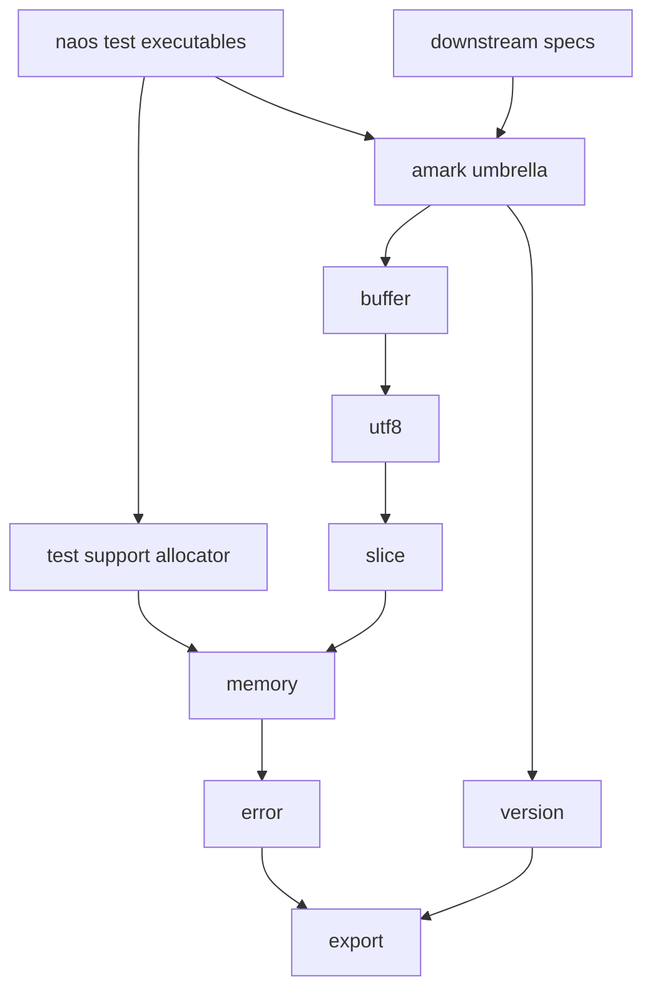
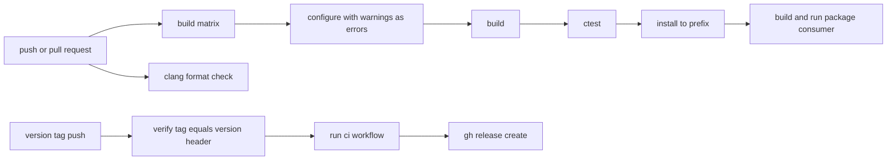
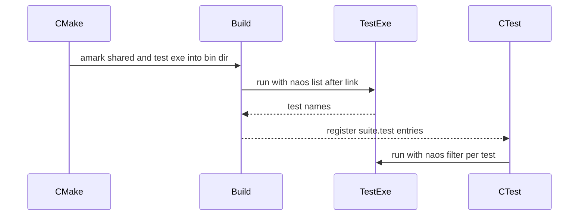

# Design Document: foundation

## Overview

**Purpose**: Amark の全 spec が共通して依存する基盤を提供する。ビルド（CMake、静的・動的ライブラリ、export マクロ）、インストールとパッケージ利用、Naos によるテスト基盤、3 OS の CI とリリース、ライセンス表記、そして横断的な約束事の正本となる公開 API（グローバルアロケータ、単一のエラーコード列挙、文字列スライス、可変長バッファ、UTF-8 基本操作、バージョン情報）を定める。

**Users**: 後続 spec（node-tree、parser-core、html-renderer、commonmark、markdown-renderer）の実装者は、ここで定めた API とビルド・テストの枠組みに自分のソースとテストを載せる。Amark を組み込む利用者は、静的・動的いずれかの形態でビルド・インストールし、`find_package(Amark)` で利用する。

**Impact**: kiro の設定と CLAUDE.md しかないリポジトリに、ソースツリー、ビルド定義、テスト、CI、ライセンス、整形設定を新設する。steering の structure.md / tech.md は本設計の確定内容に合わせて設計段階で更新済みであり、実装時は実際のファイル構成との差分だけを同期する。

### Goals
- 1 つの CMake プロジェクトから静的・動的のどちらでもビルドでき、インストール後に `Amark::amark` として使える
- Windows（MSVC）/ Linux（GCC、Clang）/ macOS（Clang）で、静的・動的の両方がビルド・テスト・インストール確認を通る
- 後続 spec が追加するだけで拡張できる単一のエラー列挙、グローバルアロケータ、文字列ユーティリティを提供する
- 規約を steering に文書化し、整形とソースヘッダ表記を機械的に検査する

### Non-Goals
- ノード、パーサ、レンダラ、CLI ツール、他言語バインディング
- Unicode の文字分類、大文字小文字の畳み込み、正規化。句読点・空白の分類は commonmark spec が所有する非公開モジュール `src/base/unicode_class.{h,c}`（生成データ `src/base/unicode_class_data.c`、関数 `amark_unicode_is_punctuation` / `amark_unicode_is_whitespace`）が提供し、markdown-renderer も利用する。公開の `amark/utf8.h` には分類を加えない。大文字小文字の畳み込みも必要とする spec が非公開モジュールとして持つ
- pkg-config ファイル、パッケージマネージャ（vcpkg、Conan など）向けの定義
- スレッドセーフなアロケータ差し替え、確保の統計やリーク検出をライブラリ本体で行うこと

## Boundary Commitments

### This Spec Owns
- リポジトリのトップレベル構成（`include/amark/`、`src/`、`tests/`、`cmake/`、`.github/workflows/`）とトップレベルの `CMakeLists.txt`
- ライブラリターゲット `amark`（別名 `Amark::amark`）、ビルドオプション、コンパイル設定（C99、拡張無効、警告、可視性）
- export マクロ `AMARK_API` と C リンケージ用マクロ `AMARK_BEGIN_DECLS` / `AMARK_END_DECLS`
- インストール規則、`AmarkConfig.cmake` / `AmarkConfigVersion.cmake` / `AmarkTargets.cmake`、バージョンの唯一の出所（手書きの公開ヘッダ `include/amark/version.h` の数値定数）と、それを `project()` へ読み込む規則
- テスト基盤: Naos の取り込み、テスト用補助ライブラリ（差し替えアロケータ）、ヘッダ単独 include の検査、ソースヘッダ表記の検査
- CI とリリースのワークフロー、整形設定（`.clang-format`、`.editorconfig`、`.gitattributes`）
- `LICENSE` とソースヘッダの定型表記
- 公開 API: グローバルアロケータ（`amark/memory.h`）、エラー列挙（`amark/error.h`）、スライス（`amark/slice.h`）、UTF-8（`amark/utf8.h`）、バッファ（`amark/buffer.h`）、バージョン（`amark/version.h`）、包括ヘッダ（`amark/amark.h`）
- 文字列の所有権規約と、エラーコード一覧表（全 spec のコードの唯一の正本。「Error」節）と追加の規則
- 共有の骨組みファイル（追記専用）: `include/amark/amark.h`、`src/CMakeLists.txt`、`tests/CMakeLists.txt`、`tests/cxx_header_test.cpp`、`amark_test_support` のソース一覧。後続 spec は自分のブロックを追記するだけで、既存の行を書き換えない（「BuildSystem」「TestHarness」）
- テスト補助（`tests/support/`）の命名規則（「TestSupport」）

### Out of Boundary
- ノード種別、木の編集・走査、パーサエンジン、構文拡張、レンダラ、およびそれらのエラーコードの意味の決定（各 spec が決め、本 spec のエラーコード一覧表と列挙へ追記する）
- 特定の構文やノード種別に依存するユーティリティ
- テスト専用のフック・関数・条件コンパイルをライブラリ本体に入れること（テスト補助はすべて `tests/` に置く）
- CLI、バインディング、ドキュメントサイト

### Allowed Dependencies
- ライブラリ本体: C99 の標準ライブラリ（`<stddef.h>`、`<stdint.h>`、`<stdbool.h>`、`<stdlib.h>`、`<string.h>`）のみ
- ビルド: CMake 3.21 以上の標準モジュール（`GNUInstallDirs`、`CMakePackageConfigHelpers`、`FetchContent`、`CTest`）
- テスト: Naos v0.4.0（FetchContent、タグ固定、テスト有効時のみ）。C++ コンパイラ（C++ からの include 検査のみ）
- CI: GitHub Actions のホスト型ランナー、`clang-format-18`、`gh` CLI
- モジュール間の依存方向は「Architecture」に定める順を守る。逆向きの include を禁止する

### Revalidation Triggers
- 公開済みエラーコードの並べ替え・削除・再利用（禁止。`AMARK_ERROR_LIST` の末尾追加のみ許可）、一覧の形（`X(名前, 文字列)`）、またはエラー文字列化の契約変更
- サイズ 0 の要求の扱い（アロケータを呼ばずに `NULL`、`amark_realloc(p, 0)` は解放）、アロケータ関数の事前条件（0 サイズや空ポインタを渡さない）、差し替え API の形の変更
- `include/amark/version.h` の数値定数の書き方（`#define AMARK_VERSION_<MAJOR|MINOR|PATCH> <10 進数>` の 1 行。CMake とリリースワークフローがこの形を読む）の変更
- 文字列の所有権規約（スライスの借用、NUL 終端付き所有文字列、`amark_free` による解放）の変更
- `AMARK_API` / `AMARK_SHARED` / `AMARK_BUILDING`、ターゲット名 `Amark::amark`、パッケージ名 `Amark`、ビルドオプション名の変更
- バッファの不変条件（NUL 終端、失敗時に内容を保つ）や `detach` の所有権移転の変更
- テスト登録方法（`naos_add_executable` の使い方、テスト補助ライブラリの API と統計の項目、`test_<area>_*` の命名規則）や CI 行列の変更
- 共有の骨組みファイルの追記規則（追記専用、各 spec が自分のブロックを持つ）の変更
- UTF-8 の不正バイト列の扱い（最大部分列の規則）の変更。`amark_utf8_decode` と `amark_utf8_decode_previous` の両方に及ぶ

## Architecture

### Architecture Pattern & Boundary Map

公開ヘッダとソースはモジュール単位で対にし、下位のモジュールだけを include する層構造とする。



**Architecture Integration**:
- Selected pattern: 層状モジュール構成。依存方向は `export → version, error → memory → slice → utf8 → buffer → amark.h`（左ほど下位）。各モジュールは自分より左のモジュールだけを include する。依存方向の違反はレビューでエラーとして扱う
- Domain/feature boundaries: ビルド・パッケージング、テスト基盤、CI/CD、規約・ツール設定、ランタイム API（アロケータ、エラー、スライス、UTF-8、バッファ、バージョン）を別ファイル群に分け、並行に実装できるようにする
- Existing patterns preserved: steering の命名（`amark_` / `AMARK_` / `_t` / `_init` / `_deinit` / `_create` / `_destroy`）、ディレクトリ構成（`include/amark/`、`src/`、`tests/`、`cmake/`）、include 規則（公開ヘッダは山括弧、非公開は二重引用符）
- New components rationale: すべて新設。各コンポーネントは要件のいずれかに直接対応する
- Steering compliance: C 標準ライブラリ以外に依存しない、確保はすべてグローバルアロケータ経由、エラーは単一列挙、テスト専用コードを本体に置かない

### Technology Stack

| Layer | Choice / Version | Role in Feature | Notes |
|-------|------------------|-----------------|-------|
| 言語 | C99（`C_STANDARD 99`、`C_EXTENSIONS OFF`） | ライブラリ本体とテスト | テストの一部（C++ 検査）は C++11 |
| ビルド | CMake 3.21 以上 | 構成、ビルド、インストール、パッケージ設定、CTest | `cmake_minimum_required(VERSION 3.21)` |
| テスト | Naos v0.4.0（FetchContent、`GIT_TAG v0.4.0`） | テスト記述と CTest 登録 | `Naos::naos`、`naos_add_executable` |
| CI/CD | GitHub Actions（`ubuntu-24.04`、`macos-latest`、`windows-latest`） | ビルド・テスト・インストール確認・整形検査・リリース | `gh release create` |
| 整形 | clang-format 18 | 整形規則の適用と検査 | CI では版を固定 |

## File Structure Plan

### Directory Structure
```
CMakeLists.txt                     # トップレベル: version.h からバージョンを読み project(amark VERSION ${AMARK_VERSION})、オプション、src/ と tests/ の取り込み、インストール
LICENSE                            # MIT 全文、Copyright (c) 2026 The Amark Authors
.clang-format                      # 整形規則（Allman、インデント 4、列上限 120 など）
.editorconfig                      # UTF-8、LF、末尾改行、インデント
.gitattributes                     # テキストの改行を LF に正規化
cmake/
├── AmarkConfig.cmake.in           # パッケージ設定テンプレート（AmarkTargets.cmake を読み込む）
├── AmarkCheckSourceHeaders.cmake  # cmake -P で実行するソースヘッダ表記の検査
└── AmarkCompilerWarnings.cmake    # amark_target_warnings(): コンパイラ別の警告と警告のエラー化
include/amark/
├── amark.h                        # 包括ヘッダ: 本 spec の公開ヘッダをすべて include
├── export.h                       # AMARK_API、AMARK_BEGIN_DECLS / AMARK_END_DECLS
├── version.h                      # 手書き。バージョンの唯一の出所（AMARK_VERSION_MAJOR/MINOR/PATCH と、そこから組み立てる文字列）
├── error.h                        # AMARK_ERROR_LIST（全コードの一覧）、そこから生成する amark_error_t、amark_error_string
├── memory.h                       # amark_malloc ほか、amark_allocator_t と差し替え API
├── slice.h                        # amark_slice_t と操作
├── utf8.h                         # UTF-8 の復号・符号化・検証
└── buffer.h                       # amark_buffer_t と操作
src/
├── CMakeLists.txt                 # ライブラリターゲット amark の定義
└── base/
    ├── error.c
    ├── memory.c                       # 既定アロケータと現在のアロケータ（唯一のグローバル状態）
    ├── slice.c
    ├── utf8.c
    ├── buffer.c
    └── version.c                      # 実行時のバージョン問い合わせ
tests/
├── CMakeLists.txt                 # Naos の取得、テスト補助ライブラリ、各テスト実行ファイルの登録、ヘッダ検査、ソースヘッダ検査
├── support/                       # 静的ライブラリ amark_test_support。ファイルは test_<area>.{h,c}（後続 spec が追記）
│   ├── test_allocator.h           # テスト用差し替えアロケータの API
│   └── test_allocator.c           # 確保回数・生存数・バイト数の計測と、N 回目以降の確保失敗の注入
├── error_test.c
├── memory_test.c
├── slice_test.c
├── utf8_test.c
├── buffer_test.c
├── version_test.c
├── cxx_header_test.cpp            # C++ から amark.h を include して主要 API を呼ぶ
└── package/
    ├── CMakeLists.txt             # find_package(Amark) で利用する最小の利用者プロジェクト（CI 用、本体ビルドには含めない）
    └── main.c
.github/workflows/
├── ci.yml                         # push / pull_request / workflow_call: 行列ビルド、テスト、インストール確認、整形検査
└── release.yml                    # v* タグ: バージョン一致確認 → ci.yml 呼び出し → リリース公開
```

生成物: ヘッダ単独 include 検査の翻訳単位だけを `tests/CMakeLists.txt` がビルドツリーに生成する（公開ヘッダ 1 つにつき 1 つ）。公開ヘッダはすべてソースツリーに手書きで置き、ビルドツリーに生成する公開ヘッダはない（IDE や CMake 以外のビルドシステムからも `include/` だけで使える）。

後続 spec が追加する主なファイルの置き場所（本 spec は作らない。配置の規則だけを定める）:
- `tests/support/test_<area>.{h,c}` — 後続 spec のテスト補助（例: html-renderer の `test_tree`、parser-core の `test_tree_dump`・`test_syntax`、commonmark の `test_spec_examples`）
- `tests/data/` — テストデータ（例: CommonMark 仕様の例）
- `tools/` — 生成スクリプト（例: Unicode 分類表、実体参照表）。手で実行し、生成物はリポジトリに含める。ビルドや CI からは実行しない

### Modified Files
- `.kiro/steering/structure.md` / `.kiro/steering/tech.md` — 本設計の確定内容（ディレクトリ構成、モジュールの依存方向、テスト配置と補助の命名、ビルドオプション、命名例の修正、文字列の所有権規約、エラーコード一覧表の規則、機械的に検査できる規約とできない規約、clang-format の版、リリース手順）を設計段階で反映済み。実装時は、実際に作ったファイル構成・オプション名・コマンドと食い違う箇所だけを同期する

## System Flows

### CI とリリース



- 行列: `{linux-gcc, linux-clang, macos-clang, windows-msvc} × {static, shared}` の 8 ジョブ。構成は Release。マルチコンフィグに備えて `cmake --build --config Release`、`ctest -C Release`、`cmake --install --config Release` を常に指定する
- いずれかのステップが失敗すればジョブが失敗し、実行全体が失敗となる（4.5）
- リリースは `Verify` と `CallCI` の両方が成功したときだけ `Publish` に進む（4.6、4.7）

### テスト実行ファイルのビルドと列挙（動的ライブラリ構成）



- トップレベル時、`CMAKE_RUNTIME_OUTPUT_DIRECTORY` 未設定なら `${PROJECT_BINARY_DIR}/bin` に設定し、Windows の DLL とテスト実行ファイルを同じディレクトリに出す（3.3）。Linux / macOS はビルドツリーの rpath で解決する

## Requirements Traceability

| Requirement | Summary | Components | Interfaces | Flows |
|-------------|---------|------------|------------|-------|
| 1.1, 1.2 | 静的・動的のビルド | BuildSystem | `BUILD_SHARED_LIBS`、ターゲット `amark` | — |
| 1.3 | C99、拡張無効 | BuildSystem | `C_STANDARD 99`、`C_EXTENSIONS OFF` | — |
| 1.4, 1.5 | 同一ヘッダ、公開関数のみ export | ExportMacros, BuildSystem | `AMARK_API`、`C_VISIBILITY_PRESET hidden` | — |
| 1.6 | CMake 3.21 未満で失敗 | BuildSystem | `cmake_minimum_required(VERSION 3.21)` | — |
| 1.7 | 警告のエラー化 | BuildSystem | `AMARK_WARNINGS_AS_ERRORS`、`amark_target_warnings` | CI |
| 2.1, 2.2, 2.3 | インストールと `find_package` | BuildSystem | `AmarkConfig.cmake`、`Amark::amark`、`SameMinorVersion` | CI |
| 2.4 | サブディレクトリ利用 | BuildSystem | `Amark::amark` 別名、`AMARK_BUILD_TESTS` 既定値 | — |
| 2.5, 2.6 | バージョン情報と唯一の出所 | VersionInfo, BuildSystem | `include/amark/version.h` の `AMARK_VERSION_*`、`file(STRINGS)` による読み込み、`amark_version_number`、`amark_version_string` | — |
| 3.1, 3.2 | Naos 取得と CTest 連携 | TestHarness | `FetchContent`、`naos_add_executable` | テスト列挙 |
| 3.3 | 動的構成でのテスト | TestHarness, BuildSystem | `CMAKE_RUNTIME_OUTPUT_DIRECTORY` | テスト列挙 |
| 3.4 | テスト専用コードを本体に置かない | TestSupport, BuildSystem | `tests/support/` | — |
| 3.5 | 公開 API による検証 | TestHarness | 公開ヘッダのみを include | — |
| 3.6 | 確保失敗と釣り合いの検証 | TestSupport | `test_allocator_*` | — |
| 3.7 | ヘッダ単独 include と C++ | TestHarness | ヘッダ検査 TU、`cxx_header_test.cpp` | — |
| 4.1, 4.2, 4.3, 4.4, 4.5 | CI 行列とインストール確認 | CIWorkflow, PackageConsumer | `ci.yml` | CI |
| 4.6, 4.7 | リリース | ReleaseWorkflow | `release.yml` | CI |
| 5.1, 5.2 | ライセンスとソースヘッダ | LicenseNotice | `LICENSE`、定型ヘッダ | — |
| 5.3 | ソースヘッダ検査 | SourceHeaderCheck | `amark.source_headers` テスト | — |
| 6.1, 6.2, 6.3, 6.4, 6.5, 6.6, 6.7, 6.8 | グローバルアロケータ | Memory | `amark_malloc` ほか、`amark_allocator_set` | — |
| 7.1, 7.2, 7.3, 7.4, 7.5, 7.7 | エラー列挙、一覧表、文字列化 | Error | `AMARK_ERROR_LIST`、`amark_error_t`、`amark_error_string`、エラーコード一覧表 | — |
| 7.6 | 名前と文字列の組による単一の一覧 | Error | `AMARK_ERROR_LIST(X)` からの列挙と文字列化の生成 | — |
| 8.1, 8.2, 8.3, 8.4, 8.5, 8.6, 8.7 | スライスと所有権規約 | Slice | `amark_slice_t` ほか | — |
| 9.1, 9.2, 9.3, 9.4, 9.5, 9.6, 9.7, 9.8, 9.9 | 可変長バッファ | Buffer | `amark_buffer_t` ほか | — |
| 10.1, 10.2, 10.3, 10.4, 10.5, 10.6, 10.7 | UTF-8 | Utf8 | `amark_utf8_decode`、`amark_utf8_encode`、`amark_utf8_validate` | — |
| 10.8 | 逆方向の 1 文字復号 | Utf8 | `amark_utf8_decode_previous` | — |
| 11.1, 11.2 | 命名規約 | 全ランタイム API | 本書の各インターフェース | — |
| 11.3, 11.4, 11.5, 11.6 | ヘッダ構成と C++ | ExportMacros, Umbrella, TestHarness | `amark/amark.h`、`AMARK_BEGIN_DECLS` | — |
| 12.1, 12.4, 12.5 | 規約の文書化と steering 更新 | SteeringUpdate | `structure.md`、`tech.md` | — |
| 12.2 | 整形設定 | StyleConfig | `.clang-format`、`.editorconfig`、`.gitattributes` | — |
| 12.3 | 整形検査 | CIWorkflow | `ci.yml` の format ジョブ | CI |

## Components and Interfaces

| Component | Domain/Layer | Intent | Req Coverage | Key Dependencies (P0/P1) | Contracts |
|-----------|--------------|--------|--------------|--------------------------|-----------|
| BuildSystem | ビルド | ターゲット、オプション、コンパイル設定、インストール、パッケージ設定 | 1.1–1.7, 2.1–2.4, 2.6, 3.3, 3.4 | CMake (P0) | Batch |
| ExportMacros | ランタイム API | export とリンケージのマクロ | 1.4, 1.5, 11.4 | — | Service |
| VersionInfo | ランタイム API | バージョン定数と実行時問い合わせ | 2.5, 2.6 | ExportMacros (P0) | Service |
| Error | ランタイム API | 単一のエラー列挙と文字列化 | 7.1–7.7 | ExportMacros (P0) | Service |
| Memory | ランタイム API | グローバルアロケータ | 6.1–6.8 | Error (P0) | Service, State |
| Slice | ランタイム API | 借用文字列と所有権規約 | 8.1–8.7 | Memory (P0) | Service |
| Utf8 | ランタイム API | UTF-8 の復号（前方・逆方向）・符号化・検証 | 10.1–10.8 | Slice (P0) | Service |
| Buffer | ランタイム API | 可変長バッファ | 9.1–9.9 | Utf8 (P0), Memory (P0) | Service, State |
| Umbrella | ランタイム API | 包括ヘッダ | 11.5 | 全ヘッダ (P0) | Service |
| TestHarness | テスト | Naos 取得、実行ファイル登録、ヘッダ検査 | 3.1, 3.2, 3.3, 3.5, 3.7, 11.3, 11.4, 11.6 | Naos (P0), BuildSystem (P0) | Batch |
| TestSupport | テスト | 差し替えアロケータ（失敗注入・計測） | 3.4, 3.6 | Memory (P0) | Service |
| SourceHeaderCheck | テスト | ソースヘッダ表記の検査 | 5.3 | CMake (P0) | Batch |
| PackageConsumer | テスト（CI 用） | `find_package` の利用確認 | 2.2, 4.4 | インストール済み Amark (P0) | Batch |
| CIWorkflow | CI/CD | 行列ビルド・テスト・インストール確認・整形検査 | 1.7, 4.1–4.5, 12.3 | GitHub Actions (P0) | Batch |
| ReleaseWorkflow | CI/CD | タグからのリリース | 4.6, 4.7 | CIWorkflow (P0) | Batch |
| LicenseNotice | 規約 | LICENSE と定型ヘッダ | 5.1, 5.2 | — | — |
| StyleConfig | 規約 | 整形とエディタ設定 | 12.2 | clang-format (P1) | — |
| SteeringUpdate | 規約 | steering の更新 | 11.1, 11.2, 12.1, 12.4, 12.5 | 全コンポーネントの確定内容 (P1) | — |

### 共通の API 規約（全ランタイム API に適用）

- 失敗しうる公開関数は `amark_error_t` を返し、結果は出力引数で返す。成功時は `AMARK_OK`（7.7）
- `amark_error_t` を返す関数は、必須のポインタ引数が `NULL` なら `AMARK_ERROR_INVALID_ARGUMENT` を返し、何も変更しない
- `void` を返す後片付け系（`_deinit`、`_clear`）は `NULL` を受け取っても何もしない
- 失敗時、呼び出し側から見える状態（バッファの内容、現在のアロケータ、出力引数）は呼び出し前のまま保つ。ただし出力引数のうち、失敗の詳細を返すと明記したもの（`consumed`、`error_offset`、`cp`）は除く
- 公開ヘッダはすべて、include ガード `AMARK_<NAME>_H`、`#include <amark/export.h>`（直接または下位ヘッダ経由）、`AMARK_BEGIN_DECLS` / `AMARK_END_DECLS` で宣言を囲む（11.3、11.4）
- 公開ヘッダは `src/` のヘッダを include しない（11.6）
- 公開関数の宣言には `AMARK_API` を付ける

### ビルド・パッケージング

#### BuildSystem

| Field | Detail |
|-------|--------|
| Intent | ライブラリターゲット、ビルドオプション、インストールとパッケージ設定を定義する |
| Requirements | 1.1, 1.2, 1.3, 1.4, 1.5, 1.6, 1.7, 2.1, 2.2, 2.3, 2.4, 2.6, 3.3, 3.4 |

**Responsibilities & Constraints**
- トップレベル `CMakeLists.txt`: `cmake_minimum_required(VERSION 3.21)` の後、`project()` の前に `include/amark/version.h` から 3 つの数値を読み、`project(amark VERSION ${AMARK_VERSION} LANGUAGES C)` とする。ビルド定義にバージョンの数値を書かない（2.6）

```cmake
file(STRINGS "${CMAKE_CURRENT_SOURCE_DIR}/include/amark/version.h" amark_version_lines
     REGEX "^#define AMARK_VERSION_(MAJOR|MINOR|PATCH) +[0-9]+$")
foreach(amark_part IN ITEMS MAJOR MINOR PATCH)
    string(REGEX REPLACE ".*#define AMARK_VERSION_${amark_part} +([0-9]+).*" "\\1"
           AMARK_VERSION_${amark_part} "${amark_version_lines}")
    if(NOT AMARK_VERSION_${amark_part} MATCHES "^[0-9]+$")
        message(FATAL_ERROR "include/amark/version.h does not define AMARK_VERSION_${amark_part}")
    endif()
endforeach()
set(AMARK_VERSION "${AMARK_VERSION_MAJOR}.${AMARK_VERSION_MINOR}.${AMARK_VERSION_PATCH}")
project(amark VERSION ${AMARK_VERSION} LANGUAGES C)
```
- オプション:

| Option | Default | Content |
|---|---|---|
| `BUILD_SHARED_LIBS` | `OFF` | `ON` で動的ライブラリ（CMake 標準） |
| `AMARK_BUILD_TESTS` | `PROJECT_IS_TOP_LEVEL` | テストを構成する。`BUILD_TESTING`（`include(CTest)`）も `ON` のときだけ有効 |
| `AMARK_INSTALL` | `PROJECT_IS_TOP_LEVEL` | インストール規則を生成する |
| `AMARK_WARNINGS_AS_ERRORS` | `OFF` | 警告をエラーにする（CI では `ON`） |

- `include(CTest)` はトップレベル時のみ行う。トップレベルでないとき Naos は取得しない（2.4）
- トップレベル時に `CMAKE_RUNTIME_OUTPUT_DIRECTORY` が未定義なら `${PROJECT_BINARY_DIR}/bin` とする（3.3）
- `src/CMakeLists.txt` のターゲット `amark`:
  - ソース: `src/<dir>/*.c` を `src/` からの相対パス（例: `base/buffer.c`）で列挙する。glob は使わない。本 spec では `base/` の error、memory、slice、utf8、buffer、version。テスト用のソースは含めない（3.4）
  - サブディレクトリ: モジュール群ごとに `src/base/`（基盤）、`src/tree/`（node-tree）、`src/parser/`（parser-core）、`src/html/`、`src/markdown/`、`src/syntax/`（規則）、`src/cmark/`（CommonMark 方言プリセット）。新しい構文は規則として `src/syntax/` に足し、新しい方言（例: 将来の GFM）はプリセットとして `src/<name>/` を足す。`src/` 全体でファイルのベース名を一意に保つ（静的ライブラリのメンバ名とオブジェクト名の衝突を避け、grep で所属が分かるようにする）
  - 非公開の include ディレクトリ: `${PROJECT_SOURCE_DIR}/src`（PRIVATE）。非公開ヘッダは `src/` からの相対パスで include する（例: `#include "tree/node_internal.h"`）。同じディレクトリ内でも同じ書き方にする
  - プロパティ: `C_STANDARD 99`、`C_STANDARD_REQUIRED ON`、`C_EXTENSIONS OFF`、`C_VISIBILITY_PRESET hidden`、`VISIBILITY_INLINES_HIDDEN ON`、`DEBUG_POSTFIX d`、`OUTPUT_NAME amark`、`VERSION ${PROJECT_VERSION}`、`SOVERSION`（1.0 前は `0.<minor>`、以後 `<major>`）、`EXPORT_NAME amark`
  - include ディレクトリ: `$<BUILD_INTERFACE:${PROJECT_SOURCE_DIR}/include>`、`$<INSTALL_INTERFACE:${CMAKE_INSTALL_INCLUDEDIR}>`（生成する公開ヘッダがないため、ビルドツリーの include ディレクトリは持たない）
  - コンパイル定義: `AMARK_BUILDING`（PRIVATE）。`BUILD_SHARED_LIBS` が真なら `AMARK_SHARED`（PUBLIC）
  - `add_library(Amark::amark ALIAS amark)`
- `cmake/AmarkCompilerWarnings.cmake` の `amark_target_warnings(<target>)`: GCC / Clang は `-Wall -Wextra -Wpedantic`、MSVC は `/W4`。`AMARK_WARNINGS_AS_ERRORS` が真なら `-Werror` / `/WX` を加える。ライブラリとテストのターゲットにだけ PRIVATE で付け、利用者へ伝播させない（1.7）
- インストール（`AMARK_INSTALL` が真のとき）:
  - ターゲット: `install(TARGETS amark EXPORT AmarkTargets ...)`（`GNUInstallDirs` の標準ディレクトリ）
  - ヘッダ: `include/amark/*.h`（`version.h` を含む）を `${CMAKE_INSTALL_INCLUDEDIR}/amark`
  - パッケージ: `AmarkTargets.cmake`（`NAMESPACE Amark::`）、`configure_package_config_file` による `AmarkConfig.cmake`、`write_basic_package_version_file` による `AmarkConfigVersion.cmake` を `${CMAKE_INSTALL_LIBDIR}/cmake/Amark`
  - バージョン互換: メジャー 0 の間は `SameMinorVersion`、1 以上では `SameMajorVersion`（2.3）
  - ライセンス: `LICENSE` を `${CMAKE_INSTALL_DOCDIR}`（2.1）
- バージョンの唯一の出所は `include/amark/version.h` の `AMARK_VERSION_MAJOR` / `AMARK_VERSION_MINOR` / `AMARK_VERSION_PATCH`。`project()` の `VERSION`（したがって `PROJECT_VERSION`、`SOVERSION`、`AmarkConfigVersion.cmake`）は上の手順でそこから読み、`AMARK_VERSION_STRING`、`AMARK_VERSION_NUMBER`、`amark_version_*()` は同じヘッダの数値から作る（2.6）

**Contracts**: Batch [x]
- Trigger: `cmake -S . -B build [-DBUILD_SHARED_LIBS=ON] [-DAMARK_WARNINGS_AS_ERRORS=ON]`、`cmake --build build --config Release`、`cmake --install build --config Release --prefix <dir>`
- Output: `libamark.a` / `amark.lib`（静的）、`libamark.so.*` / `libamark.*.dylib` / `amark.dll` + `amark.lib`（動的）、インストールツリー

**Implementation Notes**
- Integration: 後続 spec は `include/amark/` に自分の公開ヘッダを置き、`src/CMakeLists.txt` のソース一覧へ自分のブロックを追記するだけでビルドに載る
- 共有の骨組みファイル（追記専用、本 spec が所有）: `include/amark/amark.h`（包括ヘッダの include 一覧）、`src/CMakeLists.txt`（ライブラリのソース一覧）、`tests/CMakeLists.txt`（テストの登録）、`tests/cxx_header_test.cpp`（C++ からの呼び出し確認）、`amark_test_support` のソース一覧。規則:
  - 各 spec は spec 名をコメントにした自分のブロック（例: CMake では `# node-tree`、C / C++ では同じ spec 名のブロックコメント）を末尾に追記し、他の spec のブロックや本 spec の行を書き換えない
  - `include/amark/error.h` の `AMARK_ERROR_LIST` はこの規則の対象外で、spec 名のコメントを置かずに末尾へ項目を追記する（「Error」）
  - 並行に実装される spec の変更が衝突したら、両方のブロックを残して追記順に並べることで解消する（内容の取捨選択をしない）
  - ブロック内の並びは依存の下位から上位の順とする
- Validation: CI の 8 ジョブとインストール確認で検証する
- Risks: `SOVERSION` の規則を誤るとインストール時に互換性の判定がずれる

#### ExportMacros

| Field | Detail |
|-------|--------|
| Intent | 公開関数の export / import とリンケージを 1 つのヘッダで切り替える |
| Requirements | 1.4, 1.5, 11.4 |

**Contracts**: Service [x]

##### Service Interface
```c
/* include/amark/export.h */
#if defined(AMARK_BUILDING) || defined(AMARK_SHARED)
#  if defined(_WIN32) || defined(__CYGWIN__)
#    if defined(AMARK_BUILDING) && defined(AMARK_SHARED)
#      define AMARK_API __declspec(dllexport)
#    elif defined(AMARK_SHARED)
#      define AMARK_API __declspec(dllimport)
#    else
#      define AMARK_API
#    endif
#  elif defined(__GNUC__) || defined(__clang__)
#    define AMARK_API __attribute__((visibility("default")))
#  else
#    define AMARK_API
#  endif
#else
#  define AMARK_API
#endif

#ifdef __cplusplus
#  define AMARK_BEGIN_DECLS extern "C" {
#  define AMARK_END_DECLS }
#else
#  define AMARK_BEGIN_DECLS
#  define AMARK_END_DECLS
#endif
```
- Preconditions: 利用者は何も定義しなくてよい。動的ライブラリの利用時は `Amark::amark` が `AMARK_SHARED` を伝播する。CMake 以外のビルドシステムから動的ライブラリを使う場合は利用者が `AMARK_SHARED` を定義する
- Invariants: `AMARK_BUILDING` はライブラリ自身のビルドでのみ定義される。静的ビルド時は `AMARK_API` が空になる

### ランタイム API

#### VersionInfo

| Field | Detail |
|-------|--------|
| Intent | ヘッダのバージョンとリンクされたライブラリのバージョンを提供する |
| Requirements | 2.5, 2.6 |

**Contracts**: Service [x]

##### Service Interface
```c
/* include/amark/version.h（手書き。バージョンの唯一の出所で、数値はここに 1 回だけ書く） */
#include <amark/export.h>

#define AMARK_VERSION_MAJOR 0
#define AMARK_VERSION_MINOR 1
#define AMARK_VERSION_PATCH 0

#define AMARK_VERSION_ENCODE(major, minor, patch) \
    ((((unsigned long)(major)) << 16) | (((unsigned long)(minor)) << 8) | ((unsigned long)(patch)))
#define AMARK_VERSION_NUMBER AMARK_VERSION_ENCODE(AMARK_VERSION_MAJOR, AMARK_VERSION_MINOR, AMARK_VERSION_PATCH)

/* 内部用（末尾の _ は互換性の対象外を示す）: マクロを展開してから文字列にする */
#define AMARK_VERSION_STRINGIFY_(x) #x
#define AMARK_VERSION_XSTRINGIFY_(x) AMARK_VERSION_STRINGIFY_(x)
#define AMARK_VERSION_STRING                                                                                  \
    AMARK_VERSION_XSTRINGIFY_(AMARK_VERSION_MAJOR) "." AMARK_VERSION_XSTRINGIFY_(AMARK_VERSION_MINOR) "." \
        AMARK_VERSION_XSTRINGIFY_(AMARK_VERSION_PATCH)

AMARK_API unsigned long amark_version_number(void);
AMARK_API const char *amark_version_string(void);
```
- Postconditions: `amark_version_number()` はライブラリをビルドしたときの `AMARK_VERSION_NUMBER`、`amark_version_string()` は同じく `AMARK_VERSION_STRING` を返す。文字列は静的領域で解放不要
- Invariants: 各番号は 0〜255。`AMARK_VERSION_MAJOR` / `MINOR` / `PATCH` は `#define AMARK_VERSION_<PART> <数値>` の 1 行で、接尾辞・括弧・式を付けない 10 進の整数リテラルで書く（文字列化の結果が `"0.1.0"` の形になり、CMake とリリースワークフローの正規表現で読めるようにするため）
- リリースでバージョンを上げるときは、この 3 行だけを書き換える

#### Error

| Field | Detail |
|-------|--------|
| Intent | ライブラリ全体で単一のエラーコード列挙と、その文字列化を提供する |
| Requirements | 7.1, 7.2, 7.3, 7.4, 7.5, 7.6, 7.7 |

**Responsibilities & Constraints**
- 列挙はライブラリ全体で 1 つ。全コードは `include/amark/error.h` の X マクロ `AMARK_ERROR_LIST(X)` に `X(名前, 文字列)` の項目として 1 回だけ書き、列挙 `amark_error_t` と `amark_error_string` の文字列化はどちらもこの一覧から生成する。名前と文字列が 1 か所で組になるため、文字列を持たないコードは定義できない（7.5、7.6）
- 列挙定数に明示的な数値を書かない。値は一覧の並び順で決まる（C の規則で先頭が 0、以降 1 ずつ増える）。一覧へは末尾にだけ追加し、並べ替え・削除・再利用をしない。これにより公開済みのコードの値は暗黙に変わらない（7.5）
- `AMARK_OK` は常に一覧の先頭に置く。これで `AMARK_OK == 0` となり、`if (err)` で失敗を判定できる（7.1）
- 一覧の中に spec ごとの区切りコメントを置かない。どのコードもどの spec からも使えるためである。誰が追加したかは下の表にだけ記す
- 下の「エラーコード一覧表」は各コードの追加した spec・文字列・意味の正本で、行の並びは `AMARK_ERROR_LIST` の並びと同じにする。各 spec の設計は表の行を参照し、文字列や意味を独自に定義し直さない
- 新しいコードが必要な spec は、自分の設計の Cross-Spec Change Note で本表の末尾へ行を追記し（本 spec の改訂として扱う）、自分の実装タスクで `AMARK_ERROR_LIST` の末尾へ `X(...)` を 1 項目追記する。`src/base/error.c` と `tests/error_test.c` は一覧から生成・走査するため変更しない。並行する spec の追記が衝突したら、本表の行の順に並べて解消する
- 個数を表す番兵定数は公開しない（テストは必要なら一覧から自分で数える）

**エラーコード一覧表**（正本、追記専用）

| 定数 | 追加した spec | 文字列（`amark_error_string`） | 意味 |
|---|---|---|---|
| `AMARK_OK` | foundation | `"success"` | 成功 |
| `AMARK_ERROR_NO_MEMORY` | foundation | `"out of memory"` | メモリ確保に失敗した |
| `AMARK_ERROR_INVALID_ARGUMENT` | foundation | `"invalid argument"` | 引数が契約に反する（必須ポインタが `NULL`、範囲外など） |
| `AMARK_ERROR_OVERFLOW` | foundation | `"size overflow"` | サイズ計算が `size_t` の範囲を超える |
| `AMARK_ERROR_INVALID_UTF8` | foundation | `"invalid UTF-8"` | UTF-8 として不正、または符号化できないコードポイント |
| `AMARK_ERROR_INVALID_CHILD` | node-tree | `"invalid child node"` | 編集操作が親子関係の規則に反する（親がその種別を受け入れない、循環、document を子にする） |
| `AMARK_ERROR_ALREADY_EXISTS` | node-tree | `"already exists"` | 同じ名前・鍵のものが既に登録されている（種別名、拡張名、定義の鍵などに使える汎用の意味） |
| `AMARK_ERROR_INVALID_STATE` | parser-core | `"invalid state"` | オブジェクトの現在の状態ではその操作ができない（終了済みのパーサ、凍結された方言など） |

- どの spec も、意味が合えばどのコードでも使ってよい（例: markdown-renderer は `AMARK_ERROR_INVALID_STATE` を、parser-core は `AMARK_ERROR_ALREADY_EXISTS` を使う）。「追加した spec」はそのコードを誰が一覧へ加えたか、および意味の詳細と使い分けがどの設計に書かれているかを記録するだけで、使える spec を限定しない

**Contracts**: Service [x]

##### Service Interface
```c
/* include/amark/error.h */
/*
 * 全エラーコードの一覧（唯一の正本）。項目は X(名前, 文字列)。
 * 追加は末尾だけ。並べ替え・削除・再利用は禁止。AMARK_OK は常に先頭（値 0）。
 * 項目を追加したら foundation の設計のエラーコード一覧表にも同じ順で行を追加する。
 */
#define AMARK_ERROR_LIST(X)                             \
    X(AMARK_OK, "success")                              \
    X(AMARK_ERROR_NO_MEMORY, "out of memory")           \
    X(AMARK_ERROR_INVALID_ARGUMENT, "invalid argument") \
    X(AMARK_ERROR_OVERFLOW, "size overflow")            \
    X(AMARK_ERROR_INVALID_UTF8, "invalid UTF-8")        \
    X(AMARK_ERROR_INVALID_CHILD, "invalid child node")  \
    X(AMARK_ERROR_ALREADY_EXISTS, "already exists")     \
    X(AMARK_ERROR_INVALID_STATE, "invalid state")

/* 内部用（末尾の _ は互換性の対象外を示す）: 一覧の 1 項目を列挙子 1 つに展開する */
#define AMARK_ERROR_ENUM_ENTRY_(name, string) name,

typedef enum amark_error
{
    AMARK_ERROR_LIST(AMARK_ERROR_ENUM_ENTRY_)
} amark_error_t;

#undef AMARK_ERROR_ENUM_ENTRY_

AMARK_API const char *amark_error_string(amark_error_t err);
```
- 列挙子は明示値を持たず、一覧の並び順に 0 から連番になる。展開結果は末尾にカンマの付いた列挙子の並びになる（C99 と C++11 で許される）。ヘルパマクロ `AMARK_ERROR_ENUM_ENTRY_` は列挙の直後で `#undef` し、利用者の名前空間に残さない
- `AMARK_ERROR_LIST` は公開ヘッダにあるため利用者も展開できるが、互換性の約束は各定数の値と文字列であり、一覧の展開結果は末尾追加によって増える
- 本 spec の実装が一覧に置くのは先頭の 5 項目（`AMARK_OK`〜`AMARK_ERROR_INVALID_UTF8`）。以降の項目は、表で「追加した spec」とされる spec の実装タスクが表の順で末尾に追記する（上の一覧は表を反映した最終形）
- Postconditions: 定義済みのコードには一覧の文字列（固有の英語の短い説明）を返す。未定義の値には `"unknown error"` を返す。戻り値は常に非 `NULL` の静的文字列で、解放不要（7.3、7.4）
- Invariants: `AMARK_OK == 0`。`if (err)` で失敗を判定できる

**Implementation Notes**
- Integration: `src/base/error.c` は同じ一覧から `switch` の `case` を生成し、一覧にない値は `switch` の後で `"unknown error"` を返す。ヘルパマクロは使用後に `#undef` する

```c
/* src/base/error.c */
const char *amark_error_string(amark_error_t err)
{
    switch (err)
    {
#define AMARK_ERROR_STRING_CASE_(name, string) \
    case name:                                 \
        return string;
        AMARK_ERROR_LIST(AMARK_ERROR_STRING_CASE_)
#undef AMARK_ERROR_STRING_CASE_
    default:
        break;
    }

    return "unknown error";
}
```
- Validation: 名前と文字列は一覧の 1 項目で組になるため、文字列のないコードは書けない（7.6）。`tests/error_test.c` も同じ一覧をテスト内のヘルパマクロで展開して全コードを走査するため、コードの追加時にテストを変更する必要はない（「Testing Strategy」）

#### Memory

| Field | Detail |
|-------|--------|
| Intent | ライブラリ内のすべての動的確保が経由する、差し替え可能なグローバルアロケータ |
| Requirements | 6.1, 6.2, 6.3, 6.4, 6.5, 6.6, 6.7, 6.8 |

**Responsibilities & Constraints**
- ライブラリ内のソースは `malloc` / `realloc` / `calloc` / `free` を直接呼ばない。直接呼ぶのは `src/base/memory.c` の既定アロケータだけ（6.1、6.2）
- 現在のアロケータは `src/base/memory.c` の `static` 変数 1 つに持つ。これがライブラリ唯一の可変グローバル状態
- アロケータはプロセス全体で 1 つのため、関数へ渡す利用者データは持たない。利用者のアロケータが状態を必要とするなら、利用者側の静的変数などに持つ
- 既定アロケータは、C 標準ライブラリの `malloc` / `realloc` / `calloc` / `free` へ中継する `src/base/memory.c` 内の `static` 関数 4 つとする。標準ライブラリの関数を直接設定しないのは、現在のアロケータを既定アロケータで静的に初期化するため（MSVC の C では dllimport された関数のアドレスを静的初期化子に書けない）

**Contracts**: Service [x] / State [x]

##### Service Interface
```c
/* include/amark/memory.h */
typedef void *(*amark_malloc_fn_t)(size_t size);
typedef void *(*amark_realloc_fn_t)(void *ptr, size_t size);
typedef void *(*amark_calloc_fn_t)(size_t n, size_t size);
typedef void (*amark_free_fn_t)(void *ptr);

typedef struct amark_allocator
{
    amark_malloc_fn_t malloc_fn;
    amark_realloc_fn_t realloc_fn;
    amark_calloc_fn_t calloc_fn;
    amark_free_fn_t free_fn;
} amark_allocator_t;

AMARK_API void *amark_malloc(size_t size);
AMARK_API void *amark_realloc(void *ptr, size_t size);
AMARK_API void *amark_calloc(size_t n, size_t size);
AMARK_API void amark_free(void *ptr);

AMARK_API amark_error_t amark_allocator_set(const amark_allocator_t *allocator);
```

ラッパの振る舞い（全プラットフォーム共通、6.6、6.7）:

| 呼び出し | 振る舞い |
|---|---|
| `amark_malloc(0)` | `malloc_fn` を呼ばずに `NULL` を返す |
| `amark_malloc(n)` | `malloc_fn(n)` の結果を返す |
| `amark_realloc(NULL, n)` | `amark_malloc(n)` と同じ（`n == 0` なら `NULL`） |
| `amark_realloc(p, 0)` | `free_fn(p)` で解放し、`NULL` を返す（`realloc_fn` を呼ばない） |
| `amark_realloc(p, n)` | `realloc_fn(p, n)`。失敗時は `NULL` を返し、`p` は有効なまま |
| `amark_calloc(c, s)` で `c == 0` または `s == 0` | `calloc_fn` を呼ばずに `NULL` を返す |
| `amark_calloc(c, s)` で `c * s` があふれる | `calloc_fn` を呼ばずに `NULL` を返す |
| `amark_calloc(c, s)` | `calloc_fn(c, s)` |
| `amark_free(NULL)` | 何もしない（`free_fn` を呼ばない） |
| `amark_free(p)` | `free_fn(p)` |

- 確保系の戻り値 `NULL` は、要求サイズ（`amark_calloc` では `n * size`）が 0 でないときに限り確保失敗を意味する。サイズ 0 の要求は常に `NULL` を返す
- 利用者関数への事前条件: ラッパが上の表で 0 サイズと `NULL` を処理するため、`size`、`n` は常に 1 以上、`realloc_fn` と `free_fn` の `ptr` は常に非 `NULL` で届く。戻り値はあらゆるオブジェクト型に適切に整列していること。`calloc_fn` は確保領域をゼロで埋めること
- **ライブラリ内の規則**（全 spec に適用）: ライブラリのコードは、戻り値の `NULL` を `AMARK_ERROR_NO_MEMORY` と解釈する箇所で、サイズ 0 の確保（`amark_malloc(0)`、要素数 0 の `amark_calloc`、`amark_realloc(p, 0)`）を要求しない。要素数が 0 になりうる配列・表・スタックは、確保の前に個数を確かめ、空は `NULL` と個数 0 で表す（確保は個数が 1 以上のときだけ行う）。縮めて空にするときは `amark_realloc(p, 0)` ではなく `amark_free` で解放し `NULL` と 0 に戻す
- 本 spec の確保はこの規則に該当しない: `amark_slice_dup` は `len + 1`（1 以上）、`amark_buffer_reserve` は新容量 + 1（新容量は 16 以上）、`amark_buffer_detach` の空文字列は 1 バイトを要求する
- `amark_allocator_set(allocator)`:
  - `allocator == NULL`: 既定アロケータ（C 標準ライブラリへの中継）に戻し `AMARK_OK`（6.5）
  - 4 つの関数のいずれかが `NULL`: 現在のアロケータを変えずに `AMARK_ERROR_INVALID_ARGUMENT`（6.4）
  - それ以外: 内容を複製して現在のアロケータとし `AMARK_OK`。以降の確保と解放は指定された 4 関数へ委ねる（6.3）
- 現在のアロケータを問い合わせる API は持たない。既存のアロケータを包む（計測やログの層を重ねる）具体的な利用者が現れたら追加する（追加は互換性を壊さない）

##### State Management
- State model: 現在のアロケータ 1 つ。既定アロケータで静的に初期化する
- Concurrency strategy: 差し替えはスレッドセーフでない。利用者は、Amark を使う他のスレッドが動いておらず、かつ以前のアロケータで確保された Amark のメモリが残っていない時点で差し替える。ライブラリはこれを検出しない。この制約を `memory.h` のコメントに明記する（6.8）
- 確保と差し替え以外の操作（`amark_malloc` などの呼び出し）は現在のアロケータを読むだけで、複数スレッドから同時に呼んでよい

#### Slice

| Field | Detail |
|-------|--------|
| Intent | 所有権を持たない長さ付き文字列と、文字列の所有権規約 |
| Requirements | 8.1, 8.2, 8.3, 8.4, 8.5, 8.6, 8.7 |

**Contracts**: Service [x]

##### Service Interface
```c
/* include/amark/slice.h */
typedef struct amark_slice
{
    const char *data;
    size_t len;
} amark_slice_t;

AMARK_API amark_slice_t amark_slice_make(const char *data, size_t len);
AMARK_API amark_slice_t amark_slice_from_cstr(const char *cstr);
AMARK_API bool amark_slice_equal(amark_slice_t a, amark_slice_t b);
AMARK_API amark_slice_t amark_slice_sub(amark_slice_t slice, size_t offset, size_t len);
AMARK_API char *amark_slice_dup(amark_slice_t slice);
```
- Invariants: `len > 0` なら `data != NULL`。空スライスは `data` が `NULL` でもよい。`data` は NUL 終端を仮定せず、NUL を含みうる
- `amark_slice_make(NULL, n)` は空スライスを返す。`amark_slice_from_cstr(NULL)` は空スライスを返す（8.2）
- `amark_slice_equal`: 長さが等しく、全バイトが一致するときだけ `true`。空同士は `true`（8.3）
- `amark_slice_sub`: `offset > slice.len` なら `offset = slice.len`。`len > slice.len - offset` なら `slice.len - offset` に切り詰める（8.4）
- `amark_slice_dup`: `slice.len + 1` バイトを `amark_malloc` で確保し、内容と末尾の NUL を書く。空スライスでも 1 バイトの `""` を返す。`slice.len == SIZE_MAX` または確保失敗なら `NULL` を返し、何も確保したまま残さない（8.5、8.6）

**文字列の所有権規約**（ライブラリ全体の正本、8.7）
- 借用: `amark_slice_t`。参照先の寿命は貸し手が保証する。借用した側は解放しない
- 所有: `amark_malloc` 系で確保した `char *` と `size_t` の長さの組。常に `data[len] == '\0'`。所有者が `amark_free` で解放する
- 入力・内部表現の文字コードは UTF-8 のバイト列とする。妥当性の検査と不正バイトの扱いは、入力を受け取るモジュールが `amark/utf8.h` を用いて定める

#### Utf8

| Field | Detail |
|-------|--------|
| Intent | UTF-8 の 1 文字復号（前方・逆方向）、符号化、全体検証 |
| Requirements | 10.1, 10.2, 10.3, 10.4, 10.5, 10.6, 10.7, 10.8 |

**Contracts**: Service [x]

##### Service Interface
```c
/* include/amark/utf8.h */
#define AMARK_UTF8_MAX_LENGTH 4
#define AMARK_UTF8_REPLACEMENT_CHARACTER 0xFFFDu

AMARK_API amark_error_t amark_utf8_decode(amark_slice_t src, uint32_t *cp, size_t *consumed);
AMARK_API amark_error_t amark_utf8_decode_previous(amark_slice_t src, size_t offset, uint32_t *cp,
                                                   size_t *consumed);
AMARK_API amark_error_t amark_utf8_encode(uint32_t cp, char *dst, size_t *written);
AMARK_API amark_error_t amark_utf8_validate(amark_slice_t src, size_t *error_offset);
```
- 妥当性の基準は Unicode 標準 Table 3-7（先頭バイト `00–7F`、`C2–DF`、`E0–EF`、`F0–F4`。2 バイト目は `E0` → `A0–BF`、`ED` → `80–9F`、`F0` → `90–BF`、`F4` → `80–8F`、その他 `80–BF`。3・4 バイト目は `80–BF`）。これにより過長表現、サロゲート、U+10FFFF 超、途切れ、不正な先頭・継続バイトを排除する。U+0000 は妥当な 1 バイト文字（10.7）
- `amark_utf8_decode`:
  - `cp` または `consumed` が `NULL`、あるいは `src.len == 0`: `AMARK_ERROR_INVALID_ARGUMENT`、出力は変更しない（10.3）
  - 妥当: `AMARK_OK`、`*cp` にコードポイント、`*consumed` に 1〜4（10.1）
  - 不正: `AMARK_ERROR_INVALID_UTF8`、`*cp = AMARK_UTF8_REPLACEMENT_CHARACTER`、`*consumed` に最大部分列の長さ（妥当な並びの接頭辞として成立する最長のバイト数。成立しなければ 1）（10.2）
- `amark_utf8_decode_previous`（10.8）: 位置 `offset` の直前で終わる 1 文字（不正単位）を逆方向に復号する
  - `cp` または `consumed` が `NULL`、`offset == 0`、`offset > src.len`: `AMARK_ERROR_INVALID_ARGUMENT`、出力は変更しない
  - 結果の契約: `src` の先頭から `offset` までを `amark_utf8_decode` で前方へ順に復号したときの最後の単位と、戻り値・`*cp`・`*consumed` が一致する。したがって不正バイトの扱い（U+FFFD、最大部分列の長さ）は `amark_utf8_decode` と同じで、`*consumed` は 1〜4、その単位は `src.data[offset - *consumed]` から始まる
  - 手順: `[max(0, offset - 4), offset)` で継続バイト（`80–BF`）でない最後の位置 `p` を探す。見つからなければ不正（`*consumed = 1`）。見つかれば `src.data[p..offset)` に `amark_utf8_decode` を適用し、`consumed == offset - p` ならその結果を返す。そうでなければ（`p` の後ろに余った継続バイトがある）不正で `*consumed = 1`。継続バイトでないバイトは前方復号で必ず新しい単位を始めるため、この手順は上の契約を満たす
  - 読み取るのは `[offset - 4, offset)` の範囲（入力の先頭を下回らない）に限る
- `amark_utf8_encode`:
  - `dst` は `AMARK_UTF8_MAX_LENGTH` バイト以上の領域。`dst` または `written` が `NULL`: `AMARK_ERROR_INVALID_ARGUMENT`
  - `cp` が `0xD800–0xDFFF` または `0x10FFFF` 超: `AMARK_ERROR_INVALID_UTF8`、何も書かない（10.5）
  - 妥当: 1〜4 バイトを書き、`*written` にバイト数、`AMARK_OK`（10.4）。NUL 終端は書かない
- `amark_utf8_validate`:
  - 全体が妥当（空を含む）: `AMARK_OK`
  - 不正: `AMARK_ERROR_INVALID_UTF8`、`error_offset` が非 `NULL` なら最初の不正単位の先頭バイト位置を書く（10.6）
  - `src.len > 0` かつ `src.data == NULL` はスライスの不変条件違反として `AMARK_ERROR_INVALID_ARGUMENT`

#### Buffer

| Field | Detail |
|-------|--------|
| Intent | 追記で伸長する NUL 終端付きバイト列バッファ |
| Requirements | 9.1, 9.2, 9.3, 9.4, 9.5, 9.6, 9.7, 9.8, 9.9 |

**Contracts**: Service [x] / State [x]

##### Service Interface
```c
/* include/amark/buffer.h */
typedef struct amark_buffer
{
    char *data; /* NULL または cap + 1 バイトの領域 */
    size_t len; /* 内容のバイト数 */
    size_t cap; /* 再確保なしに保持できる内容の最大バイト数（NUL を除く） */
} amark_buffer_t;

AMARK_API void amark_buffer_init(amark_buffer_t *buf);
AMARK_API void amark_buffer_deinit(amark_buffer_t *buf);

AMARK_API amark_error_t amark_buffer_reserve(amark_buffer_t *buf, size_t additional);
AMARK_API amark_error_t amark_buffer_append(amark_buffer_t *buf, const char *data, size_t len);
AMARK_API amark_error_t amark_buffer_append_char(amark_buffer_t *buf, char c);
AMARK_API amark_error_t amark_buffer_append_cstr(amark_buffer_t *buf, const char *cstr);
AMARK_API amark_error_t amark_buffer_append_slice(amark_buffer_t *buf, amark_slice_t slice);
AMARK_API amark_error_t amark_buffer_append_codepoint(amark_buffer_t *buf, uint32_t cp);

AMARK_API void amark_buffer_clear(amark_buffer_t *buf);
AMARK_API amark_error_t amark_buffer_truncate(amark_buffer_t *buf, size_t len);
AMARK_API amark_error_t amark_buffer_detach(amark_buffer_t *buf, char **data, size_t *len);
AMARK_API amark_slice_t amark_buffer_as_slice(const amark_buffer_t *buf);
```

##### State Management
- 公開構造体の扱い: 呼び出し側の領域に置けるよう中身を公開する（`_init` / `_deinit`）。そのためフィールドの名前・型・並びは API かつ ABI の一部である。利用者は `data` と `len` を読んでよいが、フィールドを直接書き換えてはならず、変更は必ず関数を通す。`cap` は読めるが値は実装の伸長方針に依存し、契約ではない。1.0 までは互換性を約束しない
- State model: 「空（`data == NULL`、`len == 0`、`cap == 0`）」と「領域あり（`data != NULL`、`len <= cap`、`data[len] == '\0'`）」の 2 状態（9.3）
- `init`: 確保せず空にする（9.1）。`deinit`: 領域を `amark_free` で解放し空に戻す。`deinit` 後に再利用してよい（9.8）
- `reserve(additional)`: `len + additional + 1` があふれるなら `AMARK_ERROR_OVERFLOW`。必要容量 `len + additional` が `cap` 以下なら何もしない。超えるなら新容量を `max(必要容量, cap * 2, 16)`（`cap * 2 + 1` が `size_t` であふれる場合は `cap * 2` の候補を除く）として `amark_realloc` する。失敗なら `AMARK_ERROR_NO_MEMORY` で、`data`・`len`・`cap` は変更しない（9.4、9.9）
- `append(data, len)`: `len > 0` かつ `data == NULL` は `AMARK_ERROR_INVALID_ARGUMENT`。`reserve` の後に内容をコピーし、NUL を書く（9.2）。`len == 0` は何もせず `AMARK_OK`
- `append_char`、`append_cstr`（`NULL` は `AMARK_ERROR_INVALID_ARGUMENT`）、`append_slice` は `append` に委ねる。`append_codepoint` は `amark_utf8_encode` で符号化してから `append` に委ね、不正なコードポイントは `AMARK_ERROR_INVALID_UTF8` で内容を変更しない
- `clear`: `len = 0`、領域があれば `data[0] = '\0'`。容量は保つ（9.5）
- `truncate(len)`: 現在の長さを超えるなら `AMARK_ERROR_INVALID_ARGUMENT` で変更しない（9.6）。それ以外は長さを変え NUL を書く（9.5）
- `detach(&data, &len)`: 領域があればその所有権を移す。空なら 1 バイトの `""` を `amark_malloc` で確保して渡す（失敗時 `AMARK_ERROR_NO_MEMORY`、バッファは変更しない）。成功後バッファは空。受け取った側は `amark_free` で解放する（9.7）
- `as_slice`: 現在の内容を借用するスライス。バッファを変更すると無効になる
- Concurrency strategy: 1 つのバッファを複数スレッドから同時に変更しない（呼び出し側の責任）

#### Umbrella

| Field | Detail |
|-------|--------|
| Intent | 本 spec の公開ヘッダをすべて include する包括ヘッダ |
| Requirements | 11.5 |

- `include/amark/amark.h` は `export.h`、`version.h`、`error.h`、`memory.h`、`slice.h`、`utf8.h`、`buffer.h` を include する。後続 spec は自分の公開ヘッダの include を、spec 名のコメント付きブロックとして末尾に追記する（共有の骨組みファイルの規則、「BuildSystem」）

### テスト

#### TestHarness

| Field | Detail |
|-------|--------|
| Intent | Naos の取得、テスト実行ファイルの登録、ヘッダ検査を行う |
| Requirements | 3.1, 3.2, 3.3, 3.5, 3.7, 11.3, 11.4, 11.6 |

**Responsibilities & Constraints**
- `tests/CMakeLists.txt` は `AMARK_BUILD_TESTS AND BUILD_TESTING` のときだけ読み込まれる
- Naos: `FetchContent_Declare(Naos GIT_REPOSITORY https://github.com/vabelorg/naos.git GIT_TAG v0.4.0)` と `FetchContent_MakeAvailable(Naos)`（3.1）
- モジュールごとに 1 実行ファイル: `naos_add_executable(amark_<module>_test SOURCES <module>_test.c LIBRARIES Amark::amark amark_test_support)`。CTest 名は `amark_<module>_test.<suite>.<test>`（3.2）。各テストターゲットに `amark_target_warnings` を適用する
- テストは `#include <amark/amark.h>` または個別の公開ヘッダだけを使い、`src/` を include しない。動的構成では非公開シンボルが見えないため、公開 API 以外を呼ぶテストはリンクに失敗する（3.5）。唯一の例外は node-tree の `amark_node_walk_test` で、公開 API から到達できない非公開モジュール `src/tree/node_walk.c`（公開 API だけを呼ぶ）をテスト実行ファイルに直接コンパイルして検証する（node-tree の設計の NodeWalk）。ライブラリ本体には何も加えない（3.4）
- ヘッダ単独 include 検査: 公開ヘッダ（`include/amark/*.h`）ごとに、そのヘッダだけを include する翻訳単位をビルドツリーに生成し、オブジェクトライブラリ `amark_header_check` としてビルドする。どれかが単独でコンパイルできなければビルドが失敗する（11.3）。生成した翻訳単位は `src/` を include パスに含めずにコンパイルし、公開ヘッダが非公開ヘッダに依存していればコンパイルに失敗する（11.6）
- C++ 検査: `enable_language(CXX)` を `tests/` 内で行い、`cxx_header_test.cpp`（C++11）を `naos_add_executable(amark_cxx_header_test ...)` で登録する。`amark.h` を include し、`amark_error_string`、`amark_slice_from_cstr`、バッファの追記と後片付けを呼んでリンクできることを確認する（11.4）。後続 spec は自分の主要 API の呼び出しを、spec 名のコメント付きのテストまたはブロックとして追記する
- 後続 spec のテスト登録: `tests/CMakeLists.txt` の末尾に spec 名のコメント付きブロックを追記し、上と同じ `naos_add_executable` の形で自分のモジュールのテストを登録する。テスト補助を追加する場合は同じブロックで `amark_test_support` のソース一覧に `support/test_<area>.c` を追記する（`target_sources(amark_test_support PRIVATE ...)`）。いずれも追記専用（「BuildSystem」の共有の骨組みファイルの規則）

**Contracts**: Batch [x]
- Trigger: `ctest --test-dir build -C Release --output-on-failure`
- Output: 各テストの成否。失敗があれば非 0 で終了

#### TestSupport

| Field | Detail |
|-------|--------|
| Intent | テスト側でグローバルアロケータを差し替え、確保失敗の注入と確保・解放の釣り合い・バイト数の計測を行う。後続 spec のテスト補助の置き場所と命名を定める |
| Requirements | 3.4, 3.6 |

**Responsibilities & Constraints**
- `tests/support/` に置く静的ライブラリ `amark_test_support`。ライブラリ本体には含めない（3.4）
- 公開 API（`amark_allocator_set`）だけを使って差し替える
- グローバルアロケータは利用者データを持たないため、計測アロケータの状態（統計、失敗注入の設定、差し替え済みかどうか）は `tests/support/test_allocator.c` の `static` 変数に持つ
- 命名規則（後続 spec の補助にも適用）: ファイルは `tests/support/test_<area>.{h,c}`、外部に見える関数・型は `test_<area>_*`（型は `test_<area>_*_t`）。`<area>` は補助の対象（例: `allocator`、`tree`、`tree_dump`、`spec_examples`）。ライブラリ本体の公開名前空間 `amark_` は使わない
- バイト数の計測のため、計測アロケータは各ブロックの先頭に要求サイズを記録するヘッダ（`max_align_t` 相当の整列を保つ大きさ）を付けて確保し、利用者へはその直後のアドレスを返す。再確保・解放ではヘッダから旧サイズを読んで統計を更新する。ヘッダ分の加算があふれる要求は確保失敗として扱う

**Contracts**: Service [x]

##### Service Interface
```c
/* tests/support/test_allocator.h */
typedef struct test_allocator_stats
{
    size_t allocations;   /* 成功した確保・再確保の回数 */
    size_t deallocations; /* 解放の回数 */
    size_t live;          /* 生存中のブロック数 */
    size_t failures;      /* 注入した失敗の回数 */
    size_t bytes_live;    /* 生存中のブロックの要求バイト数の合計 */
    size_t bytes_total;   /* 成功した確保の要求バイト数の累計（再確保は新しいサイズを加える） */
    size_t bytes_peak;    /* bytes_live の最大値 */
} test_allocator_stats_t;

void test_allocator_install(void);                    /* 計測付きアロケータへ差し替え、統計を 0 にする */
void test_allocator_uninstall(void);                  /* 既定アロケータへ戻す */
void test_allocator_fail_after(size_t successes);     /* successes 回成功した後の確保要求をすべて失敗させる */
void test_allocator_never_fail(void);                 /* 失敗注入を解除する */
test_allocator_stats_t test_allocator_stats(void);
```
- 統計の更新: サイズ 0 の要求はラッパが `NULL` を返すため計測アロケータには届かず、統計を変えない。`amark_realloc(p, 0)` はラッパが `free_fn` を呼ぶため解放として数える。確保は `bytes_live` と `bytes_total` に要求サイズを加える。再確保の成功は `bytes_live` を旧サイズから新サイズへ置き換え、`bytes_total` に新サイズを加える。解放は `bytes_live` から旧サイズを引く。失敗した確保・再確保は統計を変えない（`failures` を除く）。いずれの更新後も `bytes_peak = max(bytes_peak, bytes_live)`
- 失敗注入付きの網羅パターン: `n = 0, 1, 2, ...` について `fail_after(n)` で操作を行い、成功するまで繰り返す。各回で「戻り値が `AMARK_ERROR_NO_MEMORY` かつ状態が呼び出し前のまま」または「成功」であり、後片付け後に `live == 0` かつ `bytes_live == 0` であることを確認する

#### SourceHeaderCheck

| Field | Detail |
|-------|--------|
| Intent | ソースヘッダ表記の欠落を検出する |
| Requirements | 5.3 |

**Contracts**: Batch [x]
- `cmake/AmarkCheckSourceHeaders.cmake` を `cmake -DAMARK_SOURCE_DIR=<dir> -P` で実行する。CTest テスト `amark.source_headers` として `tests/CMakeLists.txt` で登録する
- 対象: `include/`、`src/`、`tests/` の `*.c`、`*.h`、`*.cpp`
- 各ファイルの先頭 5 行以内に `Copyright (c) <年> The Amark Authors` と `SPDX-License-Identifier: MIT` があることを確認する。欠けたファイルがあれば、そのパスをすべて列挙して `message(FATAL_ERROR)` で失敗する

#### PackageConsumer

| Field | Detail |
|-------|--------|
| Intent | インストール済み Amark を `find_package` で使えることを確認する最小の利用者プロジェクト |
| Requirements | 2.2, 4.4 |

- `tests/package/CMakeLists.txt`: `find_package(Amark 0.1 REQUIRED)`、`add_executable(amark_package_consumer main.c)`、`target_link_libraries(... PRIVATE Amark::amark)`。Windows では `$<TARGET_RUNTIME_DLLS:...>` を実行ファイルのディレクトリへ POST_BUILD でコピーする
- `main.c`: `amark_version_number() == AMARK_VERSION_NUMBER` と、バッファへの追記・取り出し・解放が成功すれば 0、そうでなければ 1 を返す
- 本体のビルドには含めず、CI がインストール後に別途構成・ビルド・実行する

### CI/CD

#### CIWorkflow

| Field | Detail |
|-------|--------|
| Intent | 変更ごとに全プラットフォーム・全形態のビルド、テスト、インストール確認、整形検査を行う |
| Requirements | 1.7, 4.1, 4.2, 4.3, 4.4, 4.5, 12.3 |

**Contracts**: Batch [x]
- Trigger: `push`（既定ブランチ）、`pull_request`、`workflow_call`（リリースから呼ばれる）
- `build` ジョブの行列:

| name | runner | compiler |
|---|---|---|
| linux-gcc | `ubuntu-24.04` | `CC=gcc`、`CXX=g++` |
| linux-clang | `ubuntu-24.04` | `CC=clang`、`CXX=clang++` |
| macos-clang | `macos-latest` | AppleClang |
| windows-msvc | `windows-latest` | MSVC（既定の Visual Studio ジェネレータ） |

  各行 × `shared: [OFF, ON]`。`fail-fast: false`
- ステップ: checkout → `cmake -S . -B build -DCMAKE_BUILD_TYPE=Release -DBUILD_SHARED_LIBS=<shared> -DAMARK_WARNINGS_AS_ERRORS=ON` → `cmake --build build --config Release` → `ctest --test-dir build -C Release --output-on-failure` → `cmake --install build --config Release --prefix <workspace>/install` → `cmake -S tests/package -B build-package -DCMAKE_PREFIX_PATH=<workspace>/install -DCMAKE_BUILD_TYPE=Release` → `cmake --build build-package --config Release` → 利用者実行ファイルの実行（Linux / macOS の動的構成では `LD_LIBRARY_PATH` / `DYLD_LIBRARY_PATH` にインストール先の lib を加える）
- `format` ジョブ: `ubuntu-24.04` で `clang-format-18` をインストールし、`git ls-files` で得た `include/`、`src/`、`tests/` の `*.c`、`*.h`、`*.cpp` に `clang-format-18 --dry-run --Werror` を適用する（12.3）
- 失敗は各ステップの終了コードでジョブの失敗になる（4.5）

#### ReleaseWorkflow

| Field | Detail |
|-------|--------|
| Intent | バージョンタグからリリースを公開する |
| Requirements | 4.6, 4.7 |

**Contracts**: Batch [x]
- Trigger: `push` の `tags: ['v*']`
- `verify` ジョブ: `include/amark/version.h` の `#define AMARK_VERSION_MAJOR` / `MINOR` / `PATCH` の行から数値を読んで `x.y.z` を組み立て、タグ名から先頭の `v` を除いた値と一致しなければ失敗する。3 つのいずれかが読めない場合も失敗する（4.7）
- `ci` ジョブ: `uses: ./.github/workflows/ci.yml`
- `publish` ジョブ: `needs: [verify, ci]`、`permissions: contents: write`、`gh release create "$GITHUB_REF_NAME" --verify-tag --generate-notes`（4.6）
- 手順（tech.md に記す）: `include/amark/version.h` の 3 つの数値を上げてマージ → `vX.Y.Z` タグを push → ワークフローの成功を確認

### 規約とツール設定

#### LicenseNotice
- `LICENSE`: MIT ライセンス全文、`Copyright (c) 2026 The Amark Authors`（5.1）
- 定型ヘッダ（すべての `*.c`、`*.h`、`*.cpp` の先頭、5.2）:
```c
/*
 * Copyright (c) 2026 The Amark Authors
 * SPDX-License-Identifier: MIT
 */
```

#### StyleConfig
- `.clang-format`: `BasedOnStyle: LLVM` を基に `BreakBeforeBraces: Allman`、`IndentWidth: 4`、`UseTab: Never`、`ColumnLimit: 120`、`PointerAlignment: Right`、`AllowShortFunctionsOnASingleLine: None`、`AllowShortIfStatementsOnASingleLine: Never`、`AllowShortBlocksOnASingleLine: Never`、`SortIncludes: Never`（公開ヘッダと非公開ヘッダの並びを意図どおり保つ）、`MaxEmptyLinesToKeep: 1`、`KeepEmptyLinesAtTheStartOfBlocks: false`（12.2）
- `.editorconfig`: `charset = utf-8`、`end_of_line = lf`、`insert_final_newline = true`、`trim_trailing_whitespace = true`、C / C++ / CMake は 4 スペース、YAML は 2 スペース
- `.gitattributes`: `* text=auto eol=lf`

#### SteeringUpdate
- 以下は設計段階で steering に反映済み。実装時は実際のファイル構成・オプション名・コマンドとの差分だけを同期する（12.5）
- `structure.md`: 確定したディレクトリ構成（公開ヘッダはモジュール単位の `include/amark/<module>.h`。`version.h` も手書き）、モジュールの依存方向、テスト配置（モジュールごとの実行ファイル、`tests/support/` と `test_<area>` の命名、`tests/data/`、`tests/package/`）、`tools/` の生成スクリプト、レンダラが共有する非公開の振り分け走査 `src/tree/node_walk.h`（node-tree 所有）、公開ヘッダの規約（include ガード、`AMARK_BEGIN_DECLS`、`AMARK_API`）、共有の骨組みファイルの追記規則
- `tech.md`: ビルドオプション表、Common Commands（警告エラー化、インストール、利用者確認）、命名例の修正（`void amark_buffer_init`、出力引数で返す `amark_node_create`）、文字列の所有権規約、メモリの規則（サイズ 0 の要求は `NULL`、ライブラリ内でサイズ 0 を要求しない）、エラーコードの規則（`AMARK_ERROR_LIST` と本書の一覧表が正本、明示値なし、末尾追加のみ）、機械的に検査する規約（整形、ソースヘッダ、ヘッダ単独 include）と検査しない規約（演算順序の括弧付け、ステップ間の空行、命名の一部）、clang-format 18、リリース手順（`version.h` の数値を上げる）（12.1、12.4、12.5）
- 命名規約（11.1、11.2）は本書の全インターフェースで守り、steering にも明記する

## Error Handling

### Error Strategy
- 失敗は `amark_error_t` で返し、呼び出し側の状態を変えない（強い保証）。確保失敗は `AMARK_ERROR_NO_MEMORY`、サイズのあふれは確保を試みる前に `AMARK_ERROR_OVERFLOW`、契約違反の引数は `AMARK_ERROR_INVALID_ARGUMENT`、UTF-8 の不正は `AMARK_ERROR_INVALID_UTF8`
- 戻り値でポインタを返す関数（`amark_malloc` 系、`amark_slice_dup`）は `NULL` で確保失敗を表す。ただし `amark_malloc` 系はサイズ 0 の要求にも `NULL` を返すため、ライブラリ内ではサイズ 0 を要求しない（「Memory」のライブラリ内の規則）
- ライブラリは `abort`、`assert`、標準出力・標準エラーへの出力を行わない

### Monitoring
- ライブラリ本体は記録を持たない。確保の計測はテスト側の `TestSupport` で行う

## Testing Strategy

### Unit Tests
- `memory_test.c`: 既定アロケータでの確保・再確保・解放（6.2）。計測アロケータの `bytes_live`・`bytes_total`・`bytes_peak` が確保・再確保（拡大と縮小）・解放の列に対して期待どおりに変化すること（3.6）。計測アロケータへの差し替え後に `amark_malloc` などが指定した関数へ委ねられること（6.3）。関数欠落時に `AMARK_ERROR_INVALID_ARGUMENT` で現在のアロケータが変わらないこと（6.4）。`NULL` 指定で既定へ戻ること（6.5）。`amark_calloc(SIZE_MAX, 2)` がアロケータを呼ばず `NULL`（6.6）。`amark_malloc(0)`、`amark_calloc(0, n)`、`amark_calloc(n, 0)`、`amark_realloc(NULL, 0)` がアロケータを呼ばずに `NULL` を返すこと（計測アロケータの `allocations` と `failures` が増えない）、`amark_realloc(p, 0)` が `free_fn` で解放して `NULL` を返すこと（`deallocations` が増え `live` が減る）、`amark_free(NULL)` が何もしないこと（6.7）
- `error_test.c`: テスト内のヘルパマクロで `AMARK_ERROR_LIST` を展開し、コードの配列とテスト内の個数（例: `enum { test_error_count = 0 AMARK_ERROR_LIST(TEST_ERROR_COUNT_ENTRY) };`、各項目を `+ 1` に展開）を作る。`AMARK_OK == 0`（7.1）、本 spec の 4 つのコードが存在すること（7.2）、一覧の i 番目のコードの値が i であること（並び順で連番、7.5）、各コードの文字列が一覧の文字列と一致し、非 `NULL`・非空・`"unknown error"` と異なり互いに異なること（7.3、7.6）、一覧の最後の次の値（`(amark_error_t)test_error_count`）で `"unknown error"`（7.4）。一覧を走査するため、コードを追加する spec はこのテストを変更しない
- `slice_test.c`: 生成（`NULL` を含む）（8.2）、NUL を含む比較・長さ違いの比較（8.3）、部分範囲の切り詰め（offset 超過、len 超過）（8.4）、複製の内容と NUL 終端（8.5）、失敗注入で `NULL` かつ `live == 0`（8.6）
- `utf8_test.c`: 1〜4 バイトの境界値（U+0000、U+007F、U+0080、U+07FF、U+0800、U+FFFF、U+10000、U+10FFFF）の復号と符号化の往復（10.1、10.4、10.7）、過長（`C0 80`、`E0 80 80`）、サロゲート（`ED A0 80`）、範囲外（`F4 90 80 80`、`F5`）、途切れ（`E3 81`）、孤立継続バイト（`80`）について `consumed` が Unicode 標準の例（Table 3-8）と一致すること（10.2）、空入力（10.3）、サロゲートと `0x110000` の符号化拒否（10.5）、検証の `error_offset`（10.6）。`amark_utf8_decode_previous` について、1〜4 バイトの各文字の直後からの逆方向復号、不正な並び（途切れ `E3 81`、孤立継続バイトの連続 `80 80`、継続バイトが 4 つ以上続く並び、過長 `C0 80`）を含む入力の各単位境界で、前方復号の最後の単位と戻り値・`cp`・`consumed` が一致すること、`offset == 0` と `offset > len` の拒否（10.8）
- `buffer_test.c`: 初期化直後に確保がないこと（計測アロケータで `allocations == 0`、`bytes_live == 0`）（9.1）、各種追記と NUL 終端（9.2、9.3）、失敗注入の網羅パターンで内容不変（9.4）、`reserve(SIZE_MAX)` が `AMARK_ERROR_OVERFLOW`（9.4）、clear / truncate（9.5、9.6）、detach（空と非空）と `amark_free` による解放（9.7）、deinit 後の再利用（9.8）、10 万回の 1 バイト追記で再確保回数が対数オーダー（例: 64 回以下）に収まること（9.9）、不正コードポイントの追記拒否

### Integration Tests
- `version_test.c`: `amark_version_number() == AMARK_VERSION_NUMBER`、`amark_version_string()` と `AMARK_VERSION_STRING` の一致、`AMARK_VERSION_STRING` が `AMARK_VERSION_MAJOR` / `MINOR` / `PATCH` を `.` でつないだ文字列であること、CMake が `version.h` から読んでテストターゲットに渡した `PROJECT_VERSION` との一致（2.5、2.6）
- `cxx_header_test.cpp`: C++ から包括ヘッダを include し主要 API を呼べること（11.4、11.5）
- ヘッダ単独 include 検査（`amark_header_check`）: 各公開ヘッダ単独でのコンパイル（11.3、11.6）
- `amark.source_headers`: 全ソースのヘッダ表記（5.2、5.3）

### CI / E2E
- 8 ジョブの行列でビルド・テストが通ること（1.1、1.2、3.3、4.1、4.2）
- 警告エラー化で通ること（1.7、4.3）
- インストール後に `PackageConsumer` が構成・ビルド・実行に成功すること（2.1、2.2、4.4）
- 整形検査（12.3）
- リリース: タグと `version.h` のバージョンの不一致で `verify` が失敗すること（4.7）

### Performance
- バッファの追記は償却定数時間（9.9）。上記の再確保回数テストで退行を検出する

## Security Considerations
- サイズ計算はすべて確保前にあふれを確認する（`amark_calloc`、`amark_buffer_reserve`、`amark_slice_dup`）
- UTF-8 復号は入力長を超えて読まない。途切れた並びは不正として扱う
- 信頼できない入力を扱う後続 spec が、これらの関数を通すことであふれと範囲外読み取りを避けられるようにする
