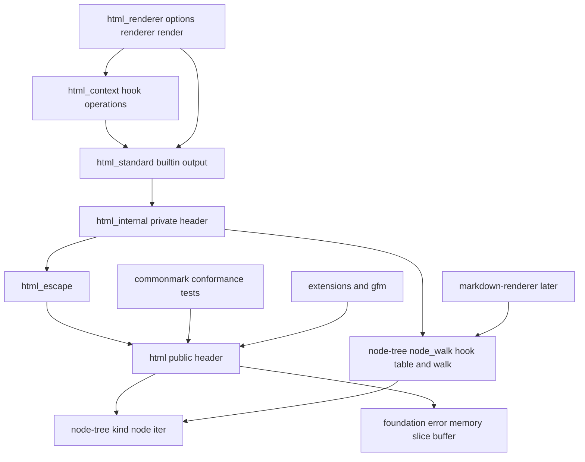
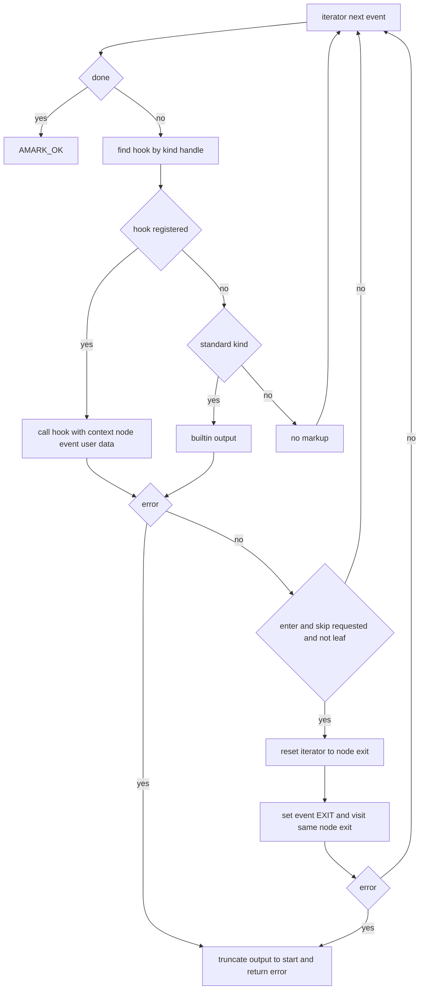
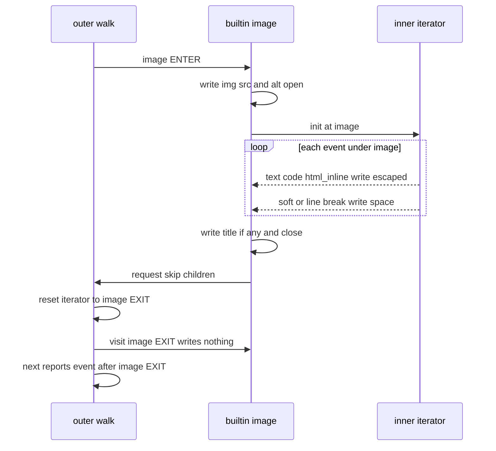
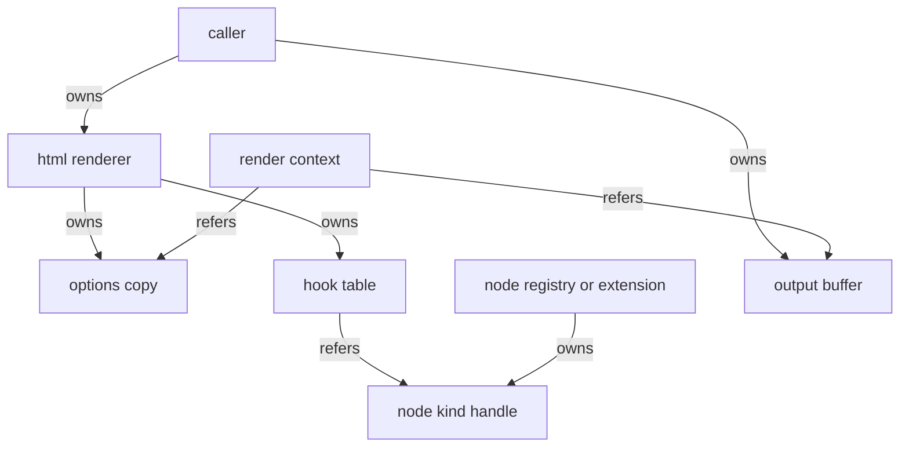

# Design Document: html-renderer

## Overview

**Purpose**: Amark の木（または部分木）を HTML 文字列へレンダリングする。node-tree の enter / exit イテレータで木を反復走査し、ノード種別ごとにフック表を引いて、なければ組み込みの出力規則（cmark の `html.c` と同一）を適用する。出力は foundation の `amark_buffer_t` に追記する。生 HTML と危険な URL は既定で抑止し、soft break の出し方を選べる。拡張はノード種別ハンドルをキーに出力関数（フック）を登録して、拡張種別の出力を追加し、標準種別の出力を上書きできる。

**Users**: ライブラリ利用者は木を HTML に変換する。commonmark は仕様適合テストで、パース結果を本レンダラで HTML にしてバイト比較する。拡張の作者（将来の gfm を含む）はフックで出力を追加する。markdown-renderer は本仕様のフックの形を揃え、node-tree の非公開の振り分け走査（NodeWalk）を本仕様と共有する。

**Impact**: foundation・node-tree の上に公開ヘッダ `amark/html.h`、HTML 用のソース群、テストを追加する。フック表と走査駆動部は node-tree が所有する非公開モジュール `src/tree/node_walk.h`（NodeWalk）を使う。包括ヘッダ、ビルド・テストの登録、C++ 検査、テスト補助ライブラリを更新する。foundation と node-tree の公開 API とエラー列挙は変更しない。

### Goals
- 標準 18 種別の木を、CommonMark 仕様（commonmark spec が固定する版。現時点の想定は 0.31.2）の期待 HTML とバイト単位で一致させる（生 HTML と危険な URL を許可した設定で）
- 何も設定しない利用者が生 HTML や `javascript:` URL を出力しない
- 拡張種別の追加と標準種別の上書きを、種別ハンドルをキーとする 1 つの登録 API で行える
- 深さ 10 万段の木でもスタックあふれなく、ノード数と出力長に線形な時間で出力する
- markdown-renderer が同じ形のフック機構を、同じ駆動部（node-tree の NodeWalk）の上に作れる

### Non-Goals
- パース、CommonMark 仕様の例の抽出と適合テストの実行（commonmark）
- XML、LaTeX、man、Markdown など他形式の出力
- 生 HTML の内容を検査・変形するサニタイズ、GFM の tagfilter（次フェーズ。上書きフックで実装可能な形にはする）
- ソース位置属性（`data-sourcepos`）、構文ハイライト、smart punctuation（パーサの責務）
- 1 つの種別に複数のフックを優先順位付きで重ねること

## Boundary Commitments

### This Spec Owns
- 公開ヘッダ `amark/html.h`: 設定 `amark_html_options_t`、レンダラ `amark_html_renderer_t`、フック型 `amark_html_render_fn_t`、コンテキスト `amark_html_context_t` とその操作、単発の描画関数、エスケープ・URL 符号化・危険な URL 判定のユーティリティ
- 標準 18 種別の HTML 出力規則（本書の「組み込み出力の表」）、HTML エスケープ表、URL 安全文字表、危険な URL の判定規則
- 安全性の既定値（生 HTML・危険な URL を抑止）と soft break の出力方法
- フックの呼び出し規則（ENTER / EXIT、葉は ENTER のみ、子の省略、組み込みへの委譲、未登録の拡張種別は透過、エラー伝播、失敗時の出力の巻き戻し）
- Cross-Spec Contract（markdown-renderer が揃えるべき形、拡張・parser-core との結び付け方、commonmark の適合テストの設定）

### Out of Boundary
- 木の構造・値・種別の定義と、イテレータ・レジストリの振る舞い（node-tree）。本仕様は読むだけで木を変更しない
- フック表と走査駆動部（node-tree の非公開モジュール `src/tree/node_walk.h`、NodeWalk。子の省略後の EXIT の訪問を含む）。本仕様はこれを使い、要件 10・11 の HTML 側の振る舞いをその上に作る。NodeWalk の契約の正本は node-tree の設計
- エラー列挙、アロケータ、バッファ、スライス、UTF-8 の定義（foundation）。本仕様はエラーコードを追加しない
- 拡張（構文＋ノード種別＋フック）をまとめて登録する単位と、その単位からレンダラへフックを登録する手順（parser-core と各拡張）。html-renderer は parser-core のヘッダを include しない
- 仕様の例の抽出・比較の基盤と spec.txt の固定（commonmark）
- Markdown 出力とその文脈依存のエスケープ（markdown-renderer）

### Allowed Dependencies
- foundation の公開ヘッダ: `amark/export.h`、`amark/error.h`、`amark/memory.h`、`amark/slice.h`、`amark/buffer.h`
- node-tree の公開ヘッダ: `amark/node_kind.h`、`amark/node.h`、`amark/node_iter.h`（`src/tree/node_internal.h` は include しない）
- node-tree の非公開ヘッダ: `src/tree/node_walk.h`（NodeWalk。レンダラ間で共有する内部契約）
- C 標準ライブラリ: `<stddef.h>`、`<stdint.h>`、`<stdbool.h>`、`<string.h>`
- テスト: Naos、foundation の `amark_test_support`（差し替えアロケータ）と本仕様が追加する木の組み立て補助
- 依存方向（左ほど下位。右から左への include のみ許可）: `foundation, node-tree（node_walk を含む） → html_escape → html_internal → html_standard → html_context → html_renderer`。`amark/html.h` は foundation と node-tree の公開ヘッダだけを include する（`node_walk.h` は `html_internal.h` だけが include する）

### Revalidation Triggers
- フック型の引数・戻り値、コンテキスト操作の意味（子の省略、委譲、行頭保証）、ENTER / EXIT の呼び出し規則の変更（markdown-renderer と拡張に影響）
- 組み込み出力の表、エスケープ表、URL 安全文字表、危険な URL 判定の変更（commonmark の適合テストに影響）
- 安全性の既定値、設定構造体のフィールドの変更
- 失敗時の出力の巻き戻し規則、フック登録の置き換え・解除の規則の変更
- node-tree のイテレータのイベント列と `amark_node_iter_reset` の意味、`amark_node_kind_is_leaf`、`src/tree/node_walk.h` の内部契約（型、関数、走査の手順、子の省略後の EXIT の訪問）、標準種別の値・親子規則、種別ハンドルの同一性の規則の変更（本仕様が再検証する側）

## Architecture

### Architecture Pattern & Boundary Map



**Architecture Integration**:
- Selected pattern: 反復走査＋表引き。駆動部（node-tree の NodeWalk）が node-tree のイテレータを回し、各イベントでフック表を引いて HTML 側の訪問関数に渡す。訪問関数はフックがあればフックを、なければ組み込み出力を呼ぶ
- Domain/feature boundaries: レンダラ非依存の走査とフック表は node-tree の NodeWalk を使い、本仕様では文字列の符号化（`html_escape`）、標準種別の出力規則（`html_standard`）、フックに渡す操作（`html_context`）、公開の入口と設定（`html_renderer`）を別ファイルにする
- Existing patterns preserved: foundation の共通 API 規約（エラー戻り値＋出力引数、必須ポインタの `NULL` で `AMARK_ERROR_INVALID_ARGUMENT`、失敗時の強い保証、`void` の後片付けは `NULL` で何もしない）、命名（`amark_<module>_<verb>`、`_t`、opaque は `_create` / `_destroy`、呼び出し側領域は `_init`）、ヘッダ規約（include ガード、`AMARK_BEGIN_DECLS`、`AMARK_API`）
- New components rationale: 各コンポーネントは要件群に対応する（Components 表）
- Steering compliance: レンダラはパーサに依存しない。可変のグローバル状態を持たない（表はすべて `static const`）。確保は `amark_*` 経由。木の深さに比例する再帰を使わない。テスト専用コードを本体に置かない

### Technology Stack

| Layer | Choice / Version | Role in Feature | Notes |
|-------|------------------|-----------------|-------|
| 言語 | C99（foundation の設定を継承） | 本体とテスト | 新しい依存なし |
| ランタイム API | foundation（エラー、アロケータ、スライス、バッファ） | 出力先、確保、借用文字列 | `amark_buffer_append`、`amark_buffer_truncate` |
| 木 | node-tree（種別ハンドル、アクセサ、イテレータ、非公開の NodeWalk） | 入力の走査と値の取得、フック表と走査駆動部 | `amark_node_iter_*`、`amark_node_kind_is_leaf`、`amark_node_walk_*` |
| テスト | Naos v0.4.0、`amark_test_support` | テスト実行ファイル、失敗注入 | foundation の `naos_add_executable` 規約 |
| 出力規則の基準 | cmark `html.c` / houdini（規則のみ採用、コードは取り込まない） | 期待 HTML との一致 | 詳細は `research.md` |

## File Structure Plan

### Directory Structure
```
include/amark/
└── html.h                    # 設定、レンダラ、フック型、コンテキスト操作、単発描画、エスケープ・URL ユーティリティ、利用者の義務（コメント）
src/
└── html/                         # フック表と走査駆動部は node-tree の src/tree/node_walk.{h,c} を使う（本仕様では作らない）
    ├── html_escape.c             # amark_html_escape、amark_html_escape_url、amark_html_url_is_dangerous（static const の表）
    ├── html_internal.h           # 非公開: struct amark_html_context、struct amark_html_renderer、設定の検証、組み込み出力の宣言
    ├── html_standard.c           # 標準 18 種別の組み込み出力、行頭保証、tight 判定、画像の alt 平坦化
    ├── html_context.c            # amark_html_context_* の公開関数
    └── html_renderer.c           # 設定の初期化、レンダラの生成・破棄・フック登録、描画の入口（巻き戻し）、訪問関数
tests/
├── support/
│   ├── test_tree.h           # テスト用: 木を簡潔に組み立てる補助の宣言（本体には含めない）
│   └── test_tree.c           # 公開 API だけで標準種別のノードを生成・値設定・追加する補助
├── html_escape_test.c        # エスケープ・URL 符号化・危険な URL 判定（要件 6、7.5）
├── html_block_test.c         # ブロック種別と tight / loose（要件 2、3）
├── html_inline_test.c        # インライン種別と画像（要件 4、5）
├── html_options_test.c       # 安全性と soft break の設定、設定の検証（要件 7、8）
├── html_hook_test.c          # フックの登録・置換・解除・呼び出し規則・委譲・子の省略・エラー伝播（要件 10、11）
├── html_render_test.c        # 入口の引数、部分木、追記、決定性、失敗注入と巻き戻し、深い木、決定的な計数による線形性（要件 1、12、13）
└── html_commonmark_test.c    # 仕様の代表例を手組みの木で再現し期待 HTML とバイト比較（要件 9）
```

### Modified Files
実装時に html-renderer のタスクとして変更する（本 spec の作成時には変更しない）。
- `include/amark/amark.h` — `amark/html.h` を include に追加
- `src/CMakeLists.txt` — `html/html_escape.c`、`html/html_standard.c`、`html/html_context.c`、`html/html_renderer.c` をソース一覧に追加
- `tests/CMakeLists.txt` — `amark_test_support` に `support/test_tree.c` を追加し、7 つのテスト実行ファイル `amark_html_escape_test` ほかを `naos_add_executable` で登録
- `tests/cxx_header_test.cpp` — C++ から木を組んで `amark_html_render` とフック登録を呼ぶ確認を追加

## System Flows

### 描画の 1 イベントの処理



- 子の省略の要求はイベントごとに初期化する。葉（`amark_node_kind_is_leaf` が真）の ENTER では無視する（葉には EXIT がない）
- 子の省略後の EXIT の訪問（11.3）: node-tree の `amark_node_iter_reset(iter, node, EXIT)` は「次の `next` はその位置の続きを報告する」ため、リセットだけでは同じノードの EXIT が報告されない。node-tree の NodeWalk（駆動部）はリセットの直後に `walk->event = EXIT`、`skip_children = false` として同じノードの EXIT で訪問関数を自ら呼ぶ。続く `next` は EXIT の続き（次の兄弟の ENTER または親の EXIT）を報告するため、EXIT は二重に訪問されない（node-tree 要件 14.7。本仕様の 11.3 はこの手順で満たす）
- EXIT の訪問はフックのある種別ではフックを（11.3 の「出るときの呼び出し」）、ない種別では組み込み出力を呼ぶ。組み込みで子を省略するのは image だけで、その EXIT は何も出さないため HTML の出力は変わらない
- 組み込みの image は ENTER で子の省略を自ら要求する（「画像の alt 平坦化」）。フックが image の ENTER で `render_default` を呼んだ場合も同じ
- エラー時は `amark_buffer_truncate(output, start)` で出力先を呼び出し前の長さに戻す（`start` は呼び出し時の `output->len`）

### 画像の alt 平坦化



- 外側の走査は子の省略を受けて画像の EXIT へ位置を移し、同じ画像の EXIT を 1 回だけ訪問する（「1 イベントの処理」）。image の EXIT にフックがあればそのフックが EXIT で呼ばれる
- 内側のイテレータは確保を行わず、画像の部分木を 1 回だけ走査する。入れ子の画像は内側の走査にそのまま含まれ、タグを出さず子孫の文字列だけが連結される。フックは呼ばない（5.5）

## Requirements Traceability

| Requirement | Summary | Components | Interfaces | Flows |
|-------------|---------|------------|------------|-------|
| 1.1, 1.2, 1.3, 1.4, 1.5, 1.6 | 入口、部分木、追記、木を変えない、引数、決定性 | HtmlRenderer, node-tree NodeWalk | `amark_html_render`、`amark_html_renderer_render` | 1 イベントの処理 |
| 1.7 | 行頭保証はこの描画の出力だけを見る | HtmlStandard, HtmlContext | `amark_html_context_ensure_newline` | — |
| 2.1, 2.2, 2.3, 2.4, 2.5, 2.6, 2.7, 2.8, 2.9, 2.10, 2.11, 2.12 | ブロック種別 | HtmlStandard | 組み込み出力の表 | — |
| 3.1, 3.2, 3.3, 3.4 | tight / loose | HtmlStandard | tight 判定 | — |
| 4.1, 4.2, 4.3, 4.4, 4.5, 4.6, 4.7, 4.8 | インライン種別 | HtmlStandard, HtmlEscape | 組み込み出力の表 | — |
| 5.1, 5.2, 5.3, 5.4, 5.5 | 画像と alt | HtmlStandard | 画像の alt 平坦化 | alt 平坦化 |
| 6.1, 6.2, 6.3, 6.4, 6.5 | エスケープと URL 符号化 | HtmlEscape | `amark_html_escape`、`amark_html_escape_url` | — |
| 7.1, 7.2, 7.3, 7.4, 7.5, 7.6, 7.7 | 安全性の設定 | HtmlRenderer, HtmlStandard, HtmlEscape, HtmlContext | `amark_html_options_t`、`amark_html_url_is_dangerous`、`amark_html_context_write_url` | — |
| 8.1, 8.2, 8.3, 8.4 | soft break | HtmlRenderer, HtmlStandard | `amark_html_softbreak_t`、設定の検証 | — |
| 9.1, 9.2, 9.3 | 仕様との一致 | HtmlStandard, HtmlEscape, CommonmarkFixtureTest | 組み込み出力の表 | — |
| 10.1, 10.2, 10.3, 10.4, 10.5, 10.6, 10.7, 10.8, 10.9 | フックの登録 | HtmlRenderer, node-tree NodeWalk | `amark_html_renderer_set_hook`、`amark_node_walk_table_*` | — |
| 11.1, 11.2, 11.3, 11.4, 11.5, 11.6, 11.7, 11.8 | フックの呼び出しと制御 | HtmlRenderer, HtmlContext, node-tree NodeWalk | `amark_html_render_fn_t`、`amark_html_context_*` | 1 イベントの処理 |
| 12.1, 12.2, 12.3, 12.4, 12.5, 12.6 | エラーと資源 | 全コンポーネント | 共通 API 規約、巻き戻し | 1 イベントの処理 |
| 13.1, 13.2, 13.3, 13.4 | 深い木、線形、スレッド、グローバル状態なし | HtmlRenderer, HtmlStandard, node-tree NodeWalk | 反復走査、`static const` の表、決定的な計数による線形性の検査 | alt 平坦化 |

## Components and Interfaces

| Component | Domain/Layer | Intent | Req Coverage | Key Dependencies (P0/P1) | Contracts |
|-----------|--------------|--------|--------------|--------------------------|-----------|
| HtmlPublicHeader | 公開 API | 型・関数・利用者の義務の宣言 | 10.8, 11.8, 12.1 | foundation, node-tree (P0) | Service |
| HtmlEscape | 符号化 | HTML エスケープ、URL 符号化、危険な URL 判定 | 6.1–6.5, 7.5 | Buffer (P0) | Service |
| HtmlInternal | 非公開 | 構造体と内部関数の共有定義 | 全体の前提 | node-tree NodeWalk, HtmlEscape (P0) | State |
| HtmlStandard | 出力規則 | 標準 18 種別の組み込み出力 | 1.2, 1.7, 2.1–2.12, 3.1–3.4, 4.1–4.8, 5.1–5.5, 7.1–7.4, 8.1–8.3, 9.1–9.3, 13.2 | HtmlInternal (P0), node-tree Node (P0) | Service |
| HtmlContext | フック操作 | フックに渡す出力・制御・参照の手段 | 1.7, 11.3–11.5 | HtmlStandard (P0) | Service |
| HtmlRenderer | 入口 | 設定、レンダラ、フック登録、訪問関数、描画、巻き戻し | 1.1–1.6, 7.6, 8.4, 10.1–10.9, 11.1–11.3, 11.6, 11.7, 12.2–12.6, 13.1, 13.3, 13.4 | node-tree NodeWalk (P0), HtmlStandard (P0), HtmlContext (P0) | Service, State |
| TestTreeSupport | テスト補助 | 手組みの木を簡潔に作る | 1.3 | node-tree 公開 API (P0) | Service |
| CommonmarkFixtureTest | テスト | 仕様の代表例のバイト比較 | 9.1, 9.2, 9.3 | TestTreeSupport (P0) | Batch |
| HtmlIntegration | ビルド・テスト登録 | 包括ヘッダ、ビルド、テスト、C++ 検査 | 12.1, 12.2 | foundation BuildSystem, TestHarness (P0) | Batch |

### 共通の API 規約（本仕様の全公開関数）
- foundation の共通 API 規約に従う。`amark_error_t` を返す関数は、必須のポインタ引数が `NULL` なら `AMARK_ERROR_INVALID_ARGUMENT` を返し何も変更しない
- 出力先 `amark_buffer_t *` に書く関数は、失敗時に出力先の内容（`len` と `data[0..len]`）を呼び出し前に戻す（容量の増加は残ってよい）（12.3）
- 木は `const amark_node_t *` で受け取り、変更しない（1.4）。node-tree のイテレータが非 const の根を取るため、内部でだけ const を外して走査する（イテレータは木を変更しない）
- 確保は `amark_malloc` / `amark_realloc` / `amark_free` だけを使う（12.2）。表はすべて `static const`（13.4）
- 確保するのはレンダラの構造体（固定長）、フック表（node-tree の NodeWalk。空の表は確保せず、最初の登録で確保する）、出力先の伸長（foundation のバッファ）だけで、いずれもサイズ 0 を要求しない（foundation の Memory のライブラリ内の規則）

### 公開 API

#### HtmlPublicHeader

| Field | Detail |
|-------|--------|
| Intent | `amark/html.h` に本仕様の公開型・関数と、利用者の義務を宣言する |
| Requirements | 10.8, 11.8, 12.1 |

**Contracts**: Service [x]

##### Service Interface
```c
/* include/amark/html.h */
#include <amark/buffer.h>
#include <amark/error.h>
#include <amark/node_iter.h>
#include <amark/slice.h>
#include <stdbool.h>

typedef enum amark_html_softbreak
{
    AMARK_HTML_SOFTBREAK_NEWLINE = 0,   /* 既定: "\n" */
    AMARK_HTML_SOFTBREAK_SPACE = 1,     /* " " */
    AMARK_HTML_SOFTBREAK_HARDBREAK = 2  /* "<br />\n" */
} amark_html_softbreak_t;

typedef struct amark_html_options
{
    bool allow_raw_html;              /* 偽（既定）: HTML block / inline を "<!-- raw HTML omitted -->" に置き換える */
    bool allow_dangerous_urls;        /* 偽（既定）: 危険な URL の href / src を空にする */
    amark_html_softbreak_t softbreak; /* 既定: AMARK_HTML_SOFTBREAK_NEWLINE */
} amark_html_options_t;

typedef struct amark_html_renderer amark_html_renderer_t; /* opaque: 設定とフック表 */
typedef struct amark_html_context amark_html_context_t;   /* opaque: 1 回の描画中だけ有効 */

typedef amark_error_t (*amark_html_render_fn_t)(amark_html_context_t *context, const amark_node_t *node,
                                                amark_node_iter_event_t event, void *user_data);

AMARK_API void amark_html_options_init(amark_html_options_t *options);

AMARK_API amark_error_t amark_html_renderer_create(const amark_html_options_t *options,
                                                   amark_html_renderer_t **renderer);
AMARK_API void amark_html_renderer_destroy(amark_html_renderer_t *renderer);
AMARK_API amark_error_t amark_html_renderer_set_hook(amark_html_renderer_t *renderer, const amark_node_kind_t *kind,
                                                     amark_html_render_fn_t render, void *user_data);
AMARK_API amark_error_t amark_html_renderer_render(const amark_html_renderer_t *renderer, const amark_node_t *root,
                                                   amark_buffer_t *output);

AMARK_API amark_error_t amark_html_render(const amark_node_t *root, const amark_html_options_t *options,
                                          amark_buffer_t *output);

AMARK_API amark_error_t amark_html_context_write(amark_html_context_t *context, amark_slice_t raw);
AMARK_API amark_error_t amark_html_context_write_escaped(amark_html_context_t *context, amark_slice_t text);
AMARK_API amark_error_t amark_html_context_write_url(amark_html_context_t *context, amark_slice_t url);
AMARK_API amark_error_t amark_html_context_ensure_newline(amark_html_context_t *context);
AMARK_API void amark_html_context_skip_children(amark_html_context_t *context);
AMARK_API amark_error_t amark_html_context_render_default(amark_html_context_t *context);
AMARK_API const amark_html_options_t *amark_html_context_get_options(const amark_html_context_t *context);

AMARK_API amark_error_t amark_html_escape(amark_buffer_t *output, amark_slice_t text);
AMARK_API amark_error_t amark_html_escape_url(amark_buffer_t *output, amark_slice_t url);
AMARK_API bool amark_html_url_is_dangerous(amark_slice_t url);
```
- ヘッダ冒頭のコメントに記す利用者の義務（11.8）:
  - フックとフックから呼ぶ処理は、描画中の木を変更してはならない
  - `amark_html_context_t *` はフックの呼び出し中だけ有効で、保持して後で使ってはならない
  - 描画中に同じレンダラへ `set_hook` / `destroy` を行ってはならない
  - フックを登録した種別ハンドルの出所（node-tree のレジストリ、または parser-core の拡張。方言に追加済みならその拡張を所有する方言）は、そのレンダラより長く生きなければならない（先にレンダラを破棄するか、フックを解除する）
  - 登録が終わったレンダラは、異なる出力先に対して複数スレッドから同時に描画してよい（13.3）
- フックの登録はパーサ・拡張の仕組みを使わず、種別ハンドルだけで行う（10.8）。ハンドルは `amark_node_kind_get_standard(type)`（標準）、node-tree の `amark_node_registry_add` / `amark_node_registry_find` の結果、または parser-core の `amark_extension_find_kind` / `amark_extension_get_kind_at` / `amark_dialect_find_kind` の結果で得る（後者は拡張パッケージの側が呼び、html-renderer のコードは parser-core のヘッダを include しない）

### 上流の非公開部品（参照のみ）

- **NodeWalk**（node-tree 所有、要件 14）: `src/tree/node_walk.h` の処理の表 `amark_node_walk_table_*`（種別ハンドルをキーに設定・置き換え・解除・検索）と走査駆動部 `amark_node_walk_run` / `amark_node_walk_skip_children`。型・関数・手順の正本は node-tree の設計の NodeWalk であり、本仕様は使うだけで変更しない
- 本仕様の要件との対応: 表の設定の規則が 10.3〜10.5・10.7・12.4（表を変えない確保失敗）を、駆動部の ENTER / EXIT（葉は ENTER のみ）が 11.1・11.2 を、子の省略後に同じノードの EXIT を 1 回訪問する手順が 11.3 を、訪問関数のエラーで直ちに止める手順が 11.7 を、反復の走査が 13.1 を満たす。出力の巻き戻し（12.3）は HtmlRenderer が行う
- 本仕様は HTML のフック型 `amark_html_render_fn_t` を `amark_node_walk_hook_fn_t` に変換して登録し、訪問関数の中で元の型へ戻して呼ぶ（変換は `html_renderer.c` の 2 か所に限る）
- Validation: NodeWalk 自体の振る舞いは node-tree の `node_walk_test.c` が検証する。本仕様は HTML のフックを通して公開 API から同じ契約を確認する（`html_hook_test.c`、`html_render_test.c`）。子の省略後の EXIT の訪問（11.3）は、子を取る種別のフックが ENTER で子を省略したとき、同じノードの EXIT でフックがちょうど 1 回呼ばれ子孫のフックが呼ばれないことで確認する

### 符号化

#### HtmlEscape

| Field | Detail |
|-------|--------|
| Intent | HTML エスケープ、URL 符号化、危険な URL 判定 |
| Requirements | 6.1, 6.2, 6.3, 6.4, 6.5, 7.5 |

**Contracts**: Service [x]

##### Service Interface
（`amark/html.h` の `amark_html_escape`、`amark_html_escape_url`、`amark_html_url_is_dangerous`）

エスケープ表（6.1）:

| バイト | 出力 |
|---|---|
| `&` | `&amp;` |
| `<` | `&lt;` |
| `>` | `&gt;` |
| `"` | `&quot;` |
| その他 | そのまま（`'`、`/`、NUL、0x80 以上を含む） |

URL 符号化（6.2、6.3）:

| バイト | 出力 |
|---|---|
| `A–Z`、`a–z`、`0–9`、`- _ . ! ~ * ( ) # $ % + , / : ; = ? @` | そのまま（`%` は再符号化しない） |
| `&` | `&amp;` |
| `'` | `&#x27;` |
| その他（0x00–0x20、`" < > [ \ ] ^` バッククォート `{ | }`、0x7F、0x80–0xFF） | `%` と大文字 16 進 2 桁 |

- `amark_html_escape(output, text)` / `amark_html_escape_url(output, url)`: `output == NULL`、または `text.len > 0 && text.data == NULL` は `AMARK_ERROR_INVALID_ARGUMENT`。安全文字の連続は 1 回の `amark_buffer_append` でまとめて追記する。途中で失敗したら呼び出し時の長さへ `amark_buffer_truncate` して `AMARK_ERROR_NO_MEMORY` / `AMARK_ERROR_OVERFLOW` を返す。長さどおりに処理し NUL で止まらない（6.5）。空入力は何もせず `AMARK_OK`
- `amark_html_url_is_dangerous(url)`（7.5）: ASCII の大文字小文字を区別しない接頭辞一致で、`data:image/png`、`data:image/gif`、`data:image/jpeg`、`data:image/webp` のいずれかで始まれば偽。そうでなく `javascript:`、`vbscript:`、`file:`、`data:` のいずれかで始まれば真。それ以外（空、不正なスライスを含む）は偽。先頭の空白を除去しない（cmark と同一。空白・制御文字は符号化で `%XX` になる）
- 公開することで、フックの作者と利用者が木の外の文字列にも使える（6.4）

### 出力規則

#### HtmlInternal

| Field | Detail |
|-------|--------|
| Intent | HTML の `.c` が共有する構造体定義と内部関数 |
| Requirements | 全体の前提 |

**Contracts**: State [x]

##### State Management
```c
/* src/html/html_internal.h（非公開。宣言は AMARK_API を付けず export しない） */
#include <amark/html.h>
#include "tree/node_walk.h"

struct amark_html_renderer
{
    amark_html_options_t options;
    amark_node_walk_table_t hooks;
};

struct amark_html_context
{
    const amark_html_options_t *options;
    amark_buffer_t *output;
    size_t start;            /* 描画開始時の output->len（行頭保証と巻き戻しの基準） */
    amark_node_walk_t *walk; /* 現在のノード・イベント・子の省略 */
};

bool amark_html_options_valid(const amark_html_options_t *options);                    /* html_renderer.c */
amark_error_t amark_html_standard_render(amark_html_context_t *context);               /* html_standard.c: 現在の (node, event) の組み込み出力 */
amark_error_t amark_html_standard_newline(amark_html_context_t *context);              /* html_standard.c: 行頭保証（cr）の本体 */
amark_error_t amark_html_standard_write_url(amark_html_context_t *context, amark_slice_t url); /* html_standard.c: 安全性の設定を適用した URL 出力 */
```
- 依存の向き: `html_standard.c` は `html_context.c` に依存しない。`html_context.c` は `html_standard.c` の内部関数を呼ぶ。`html_renderer.c` は両方を呼ぶ（実装順: html_escape → html_standard → html_context → html_renderer。node-tree の node_walk は実装済みの前提）。`amark_html_options_valid` は `html_renderer.c` だけが使う
- `amark_html_options_valid`: `softbreak` が定義済みの 3 値のいずれかなら真（8.4）

#### HtmlStandard

| Field | Detail |
|-------|--------|
| Intent | 標準 18 種別の組み込み出力 |
| Requirements | 1.2, 1.7, 2.1–2.12, 3.1–3.4, 4.1–4.8, 5.1–5.5, 7.1–7.4, 8.1–8.3, 9.1–9.3, 13.2 |

**Responsibilities & Constraints**
- `amark_html_standard_render(context)` は `context->walk` の現在の (ノード, イベント) について下表の出力を行う。拡張種別（`AMARK_NODE_EXTENSION`）には何も出さず `AMARK_OK`（11.6 の透過）
- 「cr」は行頭保証: `output->len > start` かつ `output->data[output->len - 1] != '\n'` のときだけ `\n` を追記する（1.7、2.11）。出力先に既にあった内容は見ない
- 値は node-tree のアクセサで読む（見出しレベル、リスト種別・開始番号・tight、literal、info、url、title）。部分木を起点にしても親リンクから tight を判定するため、木の中と同じ出力になる（1.2、3.4）

組み込み出力の表（ENTER / EXIT。葉は ENTER のみ。`esc(x)` はエスケープ、`url(x)` は安全性の設定を適用した URL 出力）:

| 種別 | ENTER | EXIT |
|---|---|---|
| document | なし | なし |
| block_quote | cr、`<blockquote>\n` | cr、`</blockquote>\n` |
| list（箇条書き） | cr、`<ul>\n` | `</ul>\n` |
| list（番号付き） | cr、開始番号 1 なら `<ol>\n`、それ以外 `<ol start="N">\n`（N は 10 進） | `</ol>\n` |
| item | cr、`<li>` | `</li>\n` |
| paragraph（tight でない） | cr、`<p>` | `</p>\n` |
| paragraph（tight） | なし | なし |
| heading | cr、`<hN>` | `</hN>\n` |
| thematic_break | cr、`<hr />\n` | — |
| code_block | cr、info が空なら `<pre><code>`、空でなければ `<pre><code class="` ＋（info が `language-` で始まらなければ `language-`）＋ `esc(語)` ＋ `">`。続けて `esc(literal)`、`</code></pre>\n` | — |
| html_block | cr、`allow_raw_html` なら literal そのまま、そうでなければ `<!-- raw HTML omitted -->`、cr | — |
| text | `esc(literal)` | — |
| soft_break | NEWLINE: `\n`、SPACE: ` `、HARDBREAK: `<br />\n` | — |
| line_break | `<br />\n` | — |
| code | `<code>`、`esc(literal)`、`</code>` | — |
| html_inline | `allow_raw_html` なら literal そのまま、そうでなければ `<!-- raw HTML omitted -->` | — |
| emphasis | `<em>` | `</em>` |
| strong | `<strong>` | `</strong>` |
| link | `<a href="`、`url(url)`、`"`、title が空でなければ ` title="`、`esc(title)`、`"`、`>` | `</a>` |
| image | ``、子の省略を要求 | なし |

- 語（code_block）: info の先頭から、最初の空白文字（0x20、`\t`、`\n`、`\v`、`\f`、`\r`）の直前まで（2.9）
- tight（3.1〜3.3）: 段落の親が item で、その親が list かつ `amark_node_get_list_tight` が真のとき tight。判定は段落にだけ適用する
- 子を持たないコンテナは表どおり開始と終了だけを出す（2.12。例: 空の item は `<li></li>\n`）
- `url(x)`（7.3、7.4）: `!allow_dangerous_urls && amark_html_url_is_dangerous(x)` なら何も出さない（属性値は空）。それ以外は `amark_html_escape_url`
- alt 平坦化（5.2〜5.5）: 画像ノードを起点に `amark_node_iter_t` を初期化し、各 ENTER で text・code・html_inline の literal を `esc` で、soft_break・line_break を ` ` で出力する。他の種別（強調、リンク、入れ子の画像、拡張種別）は何も出さない。フック表は引かない
- 本コンポーネントのすべての出力は `amark_buffer_append` 系を直接使う。失敗は戻り値で返し、巻き戻しは HtmlRenderer が行う

**Implementation Notes**
- Integration: 画像の ENTER で `amark_node_walk_skip_children` を呼ぶ。フックが image の ENTER で `render_default` を呼んだ場合も同じ関数を通るため子は省略される
- Validation: `html_block_test.c`・`html_inline_test.c` で表の全行（list の開始番号 0・1・2、見出し 1〜6、info の各形、空のコンテナ、tight / loose の入れ子、部分木起点の tight 段落）、`html_commonmark_test.c` で仕様の代表例を確認する
- Risks: 仕様の版の更新で期待出力が変わる（Revalidation Trigger）

#### HtmlContext

| Field | Detail |
|-------|--------|
| Intent | フックに渡す出力・制御・参照の手段 |
| Requirements | 1.7, 11.3, 11.4, 11.5 |

**Contracts**: Service [x]

- `amark_html_context_write(context, raw)`: `raw` をそのまま追記（`context == NULL`、`raw` の不変条件違反は `AMARK_ERROR_INVALID_ARGUMENT`）
- `amark_html_context_write_escaped(context, text)`: `amark_html_escape(context->output, text)`
- `amark_html_context_write_url(context, url)`: `amark_html_standard_write_url`（組み込みの `url(x)` と同じ。安全性の設定を適用）
- `amark_html_context_ensure_newline(context)`: `amark_html_standard_newline`（組み込みの cr と同じ、1.7）
- `amark_html_context_skip_children(context)`: `amark_node_walk_skip_children(context->walk)`。現在のイベントが ENTER で葉でないときだけ効果を持つ。`NULL` は何もしない（11.3）
- `amark_html_context_render_default(context)`: `amark_html_standard_render(context)`。現在の (ノード, イベント) の組み込み出力（拡張種別は何もしない）。同じフック内で複数回呼べば複数回出力する（11.4）
- `amark_html_context_get_options(context)`: 描画に使っている設定。`NULL` は `NULL`（11.5）
- 書き込みの失敗は戻り値で返す。フックがそれを返せば描画が中止され、出力先が巻き戻される

#### HtmlRenderer

| Field | Detail |
|-------|--------|
| Intent | 設定、レンダラの寿命とフック登録、描画の入口、訪問関数と巻き戻し |
| Requirements | 1.1, 1.2, 1.3, 1.4, 1.5, 1.6, 7.6, 8.4, 10.1–10.9, 11.6, 11.7, 12.2–12.6, 13.3, 13.4 |

**Contracts**: Service [x] / State [x]

- `amark_html_options_init(options)`: `{allow_raw_html = false, allow_dangerous_urls = false, softbreak = NEWLINE}`。`NULL` は何もしない（7.1、7.3、7.6、8.1）
- `amark_html_renderer_create(options, renderer)`: `renderer == NULL` は `AMARK_ERROR_INVALID_ARGUMENT`。`options` が `NULL` なら既定値、非 `NULL` で `!amark_html_options_valid` なら `AMARK_ERROR_INVALID_ARGUMENT`（8.4）。1 回の `amark_malloc` で確保し（失敗で `AMARK_ERROR_NO_MEMORY`、`*renderer` は変更しない、12.4）、設定を複製し、フック表を初期化して `*renderer` に書く（10.9）
- `amark_html_renderer_destroy(renderer)`: フック表を deinit して解放する。`NULL` は何もしない（12.5）
- `amark_html_renderer_set_hook(renderer, kind, render, user_data)`: `renderer` または `kind` が `NULL` なら `AMARK_ERROR_INVALID_ARGUMENT`。`amark_node_walk_table_set(&renderer->hooks, kind, (amark_node_walk_hook_fn_t)render, user_data)` の結果を返す。`render == NULL` は解除（10.1、10.2、10.4〜10.7）
- `amark_html_renderer_render(renderer, root, output)`: `renderer`、`root`、`output` のいずれかが `NULL` なら `AMARK_ERROR_INVALID_ARGUMENT`（1.5）。描画の手順:
  1. `start = output->len`、`amark_node_walk_t walk`、コンテキスト `{&renderer->options, output, start, &walk}` をスタック上に用意する（確保なし、12.6）
  2. `amark_node_walk_run(&walk, root, &renderer->hooks, visit, &context)`
  3. 結果が非 `AMARK_OK` なら `amark_buffer_truncate(output, start)` してその結果を返す（12.3）
- `amark_html_render(root, options, output)`: `root`、`output` の `NULL` と設定の検証は同上。空のフック表を持つ一時的なレンダラ相当（スタック上、確保なし）で `amark_html_renderer_render` と同じ手順を行う（1.1）
- 訪問関数 `visit(context, walk, hook)`（`static`）: `hook` があれば `((amark_html_render_fn_t)hook->fn)(context, walk->node, walk->event, hook->user_data)`、なければ `amark_html_standard_render(context)` を呼び、結果を返す（10.1、10.2、10.6、11.6、11.7）
- 決定性（1.6）: 出力は木・設定・フックだけで決まり、時刻・アドレス・グローバル状態に依存しない

##### State Management
- State model: レンダラは設定とフック表を持つ。描画中は読み取りのみ
- Concurrency strategy: 描画はレンダラを変更しないため、同じレンダラで異なる出力先・異なる（または同じ読み取り専用の）木を複数スレッドから同時に描画してよい。`set_hook` / `destroy` と描画を同時に行わない（13.3）。可変のグローバル状態はない（13.4）

**Implementation Notes**
- Integration: 拡張・利用者はレンダラを生成してフックを登録し、描画を繰り返す（10.9）
- Validation: `html_render_test.c`・`html_hook_test.c`・`html_options_test.c`
- Risks: フックの関数ポインタの型変換は `html_renderer.c` の 2 か所（登録と呼び出し）に限定する

### テスト補助

#### TestTreeSupport

| Field | Detail |
|-------|--------|
| Intent | テストで手組みの木を簡潔に作る（本体には含めない） |
| Requirements | 1.3 |

**Contracts**: Service [x]

```c
/* tests/support/test_tree.h（テスト専用。amark_test_support に含める） */
amark_node_t *test_tree_node(amark_node_type_t type);                       /* 生成。失敗時 NULL */
amark_node_t *test_tree_literal(amark_node_type_t type, const char *literal); /* text / code / html_* / code_block */
amark_node_t *test_tree_add(amark_node_t *parent, amark_node_t *child);    /* 追加して parent を返す。失敗時は child を破棄し NULL */
amark_node_t *test_tree_link(amark_node_type_t type, const char *url, const char *title); /* link / image */
```
- node-tree の公開 API だけを使う。失敗時の後片付けを補助側で行い、テストは結果の `NULL` を検査する

#### CommonmarkFixtureTest

| Field | Detail |
|-------|--------|
| Intent | 仕様の代表例を手組みの木で再現し、期待 HTML とバイト比較する |
| Requirements | 9.1, 9.2, 9.3 |

**Contracts**: Batch [x]
- Trigger: `ctest` の `amark_html_commonmark_test.*`
- Input: CommonMark 仕様の各節から代表例を少なくとも 1 つずつ（thematic break、ATX / setext 見出し、インデント / フェンスコードブロック（info あり・なし・特殊文字）、HTML ブロック、段落、ブロック引用、リスト（tight・loose・開始番号・入れ子・空の項目）、バックスラッシュエスケープ由来の特殊文字、エンティティ由来の非 ASCII、コードスパン、強調・強い強調の入れ子、リンク（タイトル、`%` を含む URL、非 ASCII、バックスラッシュ、`&`）、画像（入れ子の強調と画像を含む alt）、オートリンク、生 HTML、ハード / ソフト改行）。例番号と期待 HTML を仕様から転記し、ファイル冒頭に出典（仕様の版とライセンス表記）を記す
- 検証: 生 HTML と危険な URL を許可した設定で全例が期待 HTML と一致すること（9.1）。生 HTML・危険な URL を含まない例は既定設定でも一致すること（9.2）
- 全仕様例による適合テストは commonmark が所有する（本テストはレンダラ単体での回帰検出）

### 統合

#### HtmlIntegration

| Field | Detail |
|-------|--------|
| Intent | 包括ヘッダ、ビルド、テスト登録、C++ 検査 |
| Requirements | 12.1, 12.2 |

**Contracts**: Batch [x]
- Trigger: `cmake -S . -B build && cmake --build build && ctest --test-dir build`（静的・動的の両方）
- Output: Modified Files の変更により、7 つのテスト実行ファイルが CTest に登録され成功する。foundation のヘッダ単独 include 検査が `amark/html.h` に自動で適用される。C++ 検査が木の描画とフック登録を呼んでリンクできる。動的ライブラリの公開シンボルに `node_walk.h` と `html_internal.h` の内部関数が含まれない

## Data Models

### Domain Model
- **レンダラ**（集約）: 設定（値オブジェクト、生成時に複製）とフック表（種別ハンドル → 関数＋利用者データ）。フック表は種別ハンドルを所有せず参照する
- **描画コンテキスト**: 1 回の描画の間だけスタック上に存在する。出力先、開始位置、走査状態、設定への参照
- **不変条件**: フック表に同じ種別は高々 1 件。`fn` は非 `NULL`。描画は木とレンダラを変更しない。描画が失敗したとき出力先の長さと内容は呼び出し前と同じ



## Error Handling

### Error Strategy
- 共通規約どおり。描画の失敗は出力先を巻き戻す（12.3）。フック登録の失敗は表を変えない（12.4）
- 新しいエラーコードは追加しない（12.1）

### Error Categories and Responses

| エラー | 返す操作と条件 |
|---|---|
| `AMARK_ERROR_INVALID_ARGUMENT` | 必須引数が `NULL`、種別が `NULL`、soft break の未定義値、スライスの不変条件違反 |
| `AMARK_ERROR_NO_MEMORY` | レンダラの確保、フック表の伸長、出力先の伸長 |
| `AMARK_ERROR_OVERFLOW` | フック表の容量計算、出力先の容量計算（`amark_buffer_reserve` 由来） |
| フックが返した任意のコード | そのまま呼び出し側へ返す（11.7） |

- 判定の優先順位: `INVALID_ARGUMENT`（引数・設定）→ 描画中に発生した順

### Monitoring
- ライブラリ本体は記録を持たない。確保の釣り合いはテスト側の計測アロケータで確認する

## Testing Strategy

すべて公開 API と手組みの木だけを使う。確保失敗は foundation の `test_allocator_*` で注入する。

### Unit Tests
- `html_escape_test.c`: 4 文字の置換と `'`・`/`・非 ASCII・NUL の素通し（6.1、6.5）、URL の安全文字・`&`・`'`・空白・`"<>[\]^` バッククォート `{|}`・制御文字・0x7F・`ä`（`%C3%A4`）・既存の `%`（6.2、6.3）、危険な URL の 4 スキームと大文字混在・`data:image/` の 4 種の許可・`data:image/svg+xml` の拒否・先頭空白・空（7.5）、引数エラー、失敗注入で長さが戻ること（6.4、12.3）
- `html_block_test.c`: 組み込み出力の表のブロック全行、list の開始番号 0・1・2・999999999、見出し 1〜6、info の空・1 語・複数語・タブ区切り・`language-` 始まり・特殊文字、空のコンテナ、cr の挿入位置（2.1〜2.12）、tight / loose と入れ子のリスト内のコードブロック、部分木起点の tight 段落（3.1〜3.4）
- `html_inline_test.c`: text・code・emphasis・strong・line break・link（title あり・なし・特殊文字）（4.1〜4.8）、image の属性順、alt の平坦化（強調・リンク・入れ子の画像・code・html_inline・改行を含む）、alt 内でフックが呼ばれないこと（5.1〜5.5）
- `html_options_test.c`: 既定値、生 HTML の抑止と許可（block の改行規則を含む）、危険な URL の抑止と許可（link と image）、2 つの許可の独立性、soft break の 3 方式、未定義の soft break で `INVALID_ARGUMENT`（7.1〜7.4、7.6、7.7、8.1〜8.4）
- `html_hook_test.c`: 拡張種別への追加（ENTER / EXIT の 2 回、葉は 1 回）、標準種別の上書き、置き換え、解除で元に戻ること、`kind == NULL`、利用者データの受け渡し、子の省略（ENTER で子を省略したノードについて、同じノードの EXIT でフックがちょうど 1 回呼ばれ、子孫のフックは呼ばれず、続く兄弟・親の EXIT は通常どおり 1 回ずつ呼ばれること。子を省略した EXIT のフックがエラーを返すと中止され出力先が戻ること。image のフックが ENTER で `render_default` に委譲した場合も image の EXIT でフックが呼ばれること）、`render_default` への委譲（image を含む）、未登録の拡張種別の透過、フックのエラーで中止され出力先が戻ること、コンテキストの各書き込み操作、`get_options`、パーサなしで登録できること（10.1〜10.9、11.1〜11.7）
- `html_render_test.c`: 追記（既存内容の保持と、既存内容が改行で終わらなくても先頭に改行を足さないこと）、部分木の起点、引数エラー、同一出力の再現（1.1〜1.7）、描画の前後で木の値とリンクが不変、レンダラ生成・フック登録・描画の失敗注入の網羅パターン（各回で出力先・表が不変、後片付け後 `live == 0`）（12.2〜12.6）、深さ 10 万段の block quote と emphasis の木（13.1）、10 万ノードの平坦な文書と 1 万段の入れ子の画像での決定的な計数による線形性（13.2、Performance 参照）

### Integration Tests
- `html_commonmark_test.c`: 仕様の代表例のバイト比較（9.1〜9.3）
- 文書シナリオ（`html_hook_test.c` 内）: レジストリに拡張ブロック種別を登録し、その種別を含む文書を手組みし、拡張にフックを登録したレンダラと、標準の link を上書きしたレンダラで描画して期待 HTML と一致し、後片付け後 `live == 0`（10.1〜10.3、11.6）
- C++ 検査とヘッダ単独 include 検査（HtmlIntegration）

### Performance
- 深さ 10 万段の描画が完了する（13.1）
- 線形性（13.2）は壁時計の時間の比ではなく、決定的な計数で検査する（parser-core と同じ方針。時間の比は環境と負荷で揺れるため使わない）。ノード数 n と 10n の 2 つの入力（平坦な文書、深い入れ子の画像、深い block quote）について次を確認する:
  - 訪問回数: テスト用のフックで数えた訪問関数の呼び出し回数（ENTER / EXIT）が、木のイベント数（非葉 2 回、葉 1 回）とちょうど等しい。子を省略した image の部分木の子孫は外側の走査で 0 回
  - 出力のバイト数: 出力長が入力から計算した期待値（各ノードの出力の和）と一致し、n に対して線形に増える
  - 確保回数: 計測アロケータ（`test_allocator_*`）で数えた描画中の確保回数が、出力先の伸長による O(log 出力長) 回以下で、フック表・走査・alt 平坦化による確保が 0 回

## Security Considerations
- 既定で生 HTML を出さず、`javascript:` などの URL を空にする。判定は cmark と同一で、許可は 2 つの独立した設定で明示する
- テキストと属性値は常にエスケープし、URL は安全文字以外を符号化する。属性値は常に `"` で囲み、`"` は値の中に現れない（エスケープまたは `%22`）
- 生 HTML を許可した場合の内容の安全性は保証しない（サニタイズは対象外。GFM の tagfilter は上書きフックで実装する）
- 深い木・大きな木でもスタックと時間が爆発しない（反復走査、alt の 1 回走査）

## Cross-Spec Contract

### markdown-renderer が揃えるもの
markdown-renderer は次を同じ形で提供する。フック表と走査駆動部は本仕様と同じく node-tree の `src/tree/node_walk.h`（NodeWalk）を使い（複製しない）、本仕様の非公開ファイルには依存しない。
- 型: `amark_markdown_options_t`（`_init` で既定値）、opaque な `amark_markdown_renderer_t`、opaque な `amark_markdown_context_t`
- フック型: `typedef amark_error_t (*amark_markdown_render_fn_t)(amark_markdown_context_t *context, const amark_node_t *node, amark_node_iter_event_t event, void *user_data);`
- 関数: `amark_markdown_renderer_create(const amark_markdown_options_t *options, amark_markdown_renderer_t **renderer)`、`amark_markdown_renderer_destroy`、`amark_markdown_renderer_set_hook(renderer, kind, render, user_data)`、`amark_markdown_renderer_render(renderer, root, output)`、単発の `amark_markdown_render(root, options, output)`
- コンテキスト操作（意味を同じにする）: `_write`、`_ensure_newline`、`_skip_children`、`_render_default`、`_get_options`。Markdown 固有の操作（行頭プレフィックス、文脈依存のエスケープ）はこれらに加えて定義してよい
- 規則: 種別ハンドルをキーにする（標準種別は `amark_node_kind_get_standard`）、同じ種別の再登録は置き換え、`render == NULL` は解除、ENTER / EXIT の 2 回（葉は ENTER のみ）、子の省略は ENTER でだけ有効、`render_default` は現在の (ノード, イベント) に限る、未登録の拡張種別は自身を出さず子を出す、フックのエラーで中止し出力先を呼び出し前の長さに戻す、`const` の木を変更しない、新しいエラーコードを作らない
- NodeWalk に Markdown 固有の処理は入れない。Markdown の行の書き出し（プレフィックス、折り返し）は markdown-renderer に置く。NodeWalk の変更が必要になった場合は node-tree の改訂として扱い、node-tree の Revalidation Trigger により本仕様と markdown-renderer を再検証する

### 拡張・parser-core との結び付け
- html-renderer は parser-core に依存しない（本仕様のコードは parser-core のヘッダを include せず、parser-core もレンダラに依存しない）。拡張の単位（構文＋ノード種別）からレンダラへの結び付けは、両方に依存する拡張パッケージの側が「種別ハンドルを得て `amark_html_renderer_set_hook` を呼ぶ」ことで行う
- parser-core はノードのレジストリを拡張ごとに内部に持ち、公開しない。推奨形: 拡張パッケージは `<ext>_html_register(amark_html_renderer_t *renderer, const amark_extension_t *extension)` のような関数を提供し、`amark_extension_find_kind(extension, name)`（または `amark_extension_get_kind_at`）で得たハンドルに登録する。方言から得る場合は `amark_dialect_find_kind` を使う。種別ハンドルそのものを受け取る形でもよい（関数の所在と形は各拡張パッケージが決める）
- 寿命: フックを登録した種別ハンドルの出所の拡張（方言に追加済みなら、その拡張を所有する方言）は、その種別のフックを保持するレンダラより長く生きなければならない（parser-core の寿命の義務と同じ）。先にレンダラを破棄するか、フックを解除する
- 1 つの拡張が HTML と Markdown の出力を提供する場合、同じ種別ハンドルに対してそれぞれのレンダラの `set_hook` を呼ぶ

### commonmark の適合テスト
- 適合テストは `amark_html_options_init` の後に `allow_raw_html = true`、`allow_dangerous_urls = true` を設定して描画し、正規化なしで期待 HTML とバイト比較する（cmark の仕様テストが `CMARK_OPT_UNSAFE` を付けるのと同じ）。他の設定は既定のままとする
- 期待出力との差がレンダラ側の規則に起因する場合は、本仕様の組み込み出力の表を修正する（commonmark の brief の約束）

### Cross-Spec Change Note
- 新しいエラーコード: なし（既存の `AMARK_ERROR_INVALID_ARGUMENT`、`AMARK_ERROR_NO_MEMORY`、`AMARK_ERROR_OVERFLOW` を再利用）
- foundation・node-tree の API への変更要求: なし。フック表と走査駆動部は node-tree の非公開モジュール NodeWalk（node-tree 要件 14）を使い、葉の判定は node-tree が公開する `amark_node_kind_is_leaf` による
- 共有ファイル: `include/amark/amark.h`、`src/CMakeLists.txt`、`tests/CMakeLists.txt`、`tests/cxx_header_test.cpp`、`amark_test_support` のソース一覧は foundation が所有する追記専用のファイルであり、本仕様は自分のブロックを追記するだけで既存の行を変更しない
- テスト補助: `tests/support/test_tree.{h,c}`、関数名 `test_tree_*`（テスト補助の命名規約 `test_<area>_*` どおり）
- 子の省略後の EXIT の訪問（11.3）は node-tree の NodeWalk の手順（node-tree 要件 14.7）で実現する。本仕様と markdown-renderer はこれを前提にし、NodeWalk を変更しない
