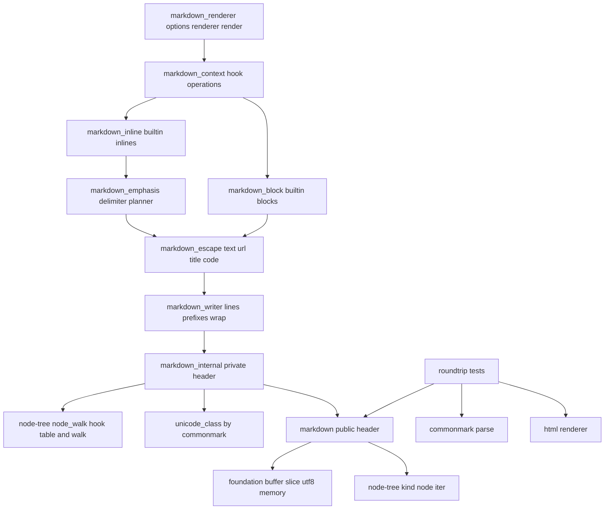
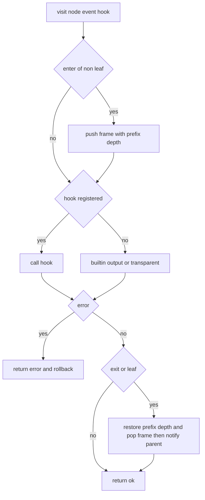
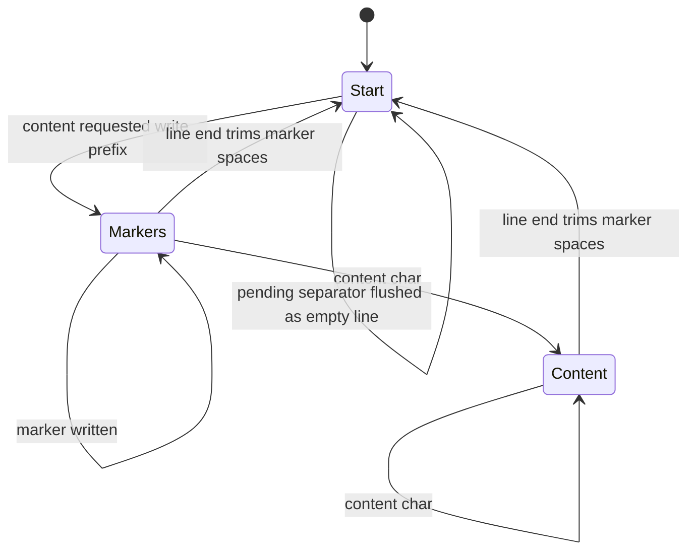

# Design Document: markdown-renderer

## Overview

**Purpose**: Amark の木（または部分木）を CommonMark 方言の Markdown 文字列へレンダリングする。html-renderer と共有する node-tree の非公開の振り分け走査（NodeWalk、`src/tree/node_walk.h`）で木を反復走査し、ノード種別ごとにフック表を引いて、なければ組み込みの出力規則を適用する。行頭プレフィックス（ブロック引用の `> `、リスト項目の字下げ）をノード単位のスタックで管理し、行頭・インライン・リンク先・title・info string で文脈に応じたエスケープを行い、強調の区切り文字を flanking の規則から計画する。出力は原文の記法を保持しない正規化した記法で、再パースした木が元の木と同じ HTML になることを正しさの基準とする。

**Users**: ライブラリ利用者は編集した木を Markdown として書き戻す。拡張の作者（将来の gfm を含む）はフックで拡張種別の Markdown 出力を追加する。保守者は CommonMark 仕様の全例による往復テストで再パースの正しさを確かめる。

**Impact**: 公開ヘッダ `amark/markdown.h`、Markdown 用のソース群、テストを追加する。node-tree の非公開モジュール `node_walk`（子の省略後の EXIT の訪問を含む）、commonmark が作る非公開モジュール `src/base/unicode_class.h`、foundation の `amark_utf8_decode_previous` をそのまま使い、上流の仕様には変更を求めない。エラーコードとノード種別は追加しない。

### Goals
- CommonMark 方言のパーサが生成した木について、出力の再パースで HTML がバイト単位で一致し（全 652 例、除外 0 件を目標）、2 回目のレンダリングが 1 回目と同一になる
- 記法の選択（箇条書き記号、区切り文字、強調記号、見出し形式、フェンス文字、区切り線、line break、オートリンク、折り返し幅）を設定で行える
- html-renderer と同じ形のフック機構を、同じ駆動部の上に提供する
- 深さ 10 万段の木でもスタックあふれなく、ノード数と出力長に線形な時間で出力する

### Non-Goals
- ロスレス出力、原文の記法の記憶、参照リンクの再構成、表の桁揃え
- パース（parser-core / commonmark）、HTML 出力（html-renderer）
- GFM のノード種別の出力（gfm。フックで追加できる形にだけする）
- 東アジアの全角文字の表示幅を考慮した折り返し（幅はコードポイント数で数える）
- フックが書いた内容の再パースの正しさの保証

## Boundary Commitments

### This Spec Owns
- 公開ヘッダ `amark/markdown.h`: 設定 `amark_markdown_options_t` と列挙、レンダラ `amark_markdown_renderer_t`、フック型 `amark_markdown_render_fn_t`、コンテキスト `amark_markdown_context_t` とその操作、単発の描画関数
- 標準 18 種別の Markdown 出力規則（本書の「組み込み出力の規則」）、ブロックの区切りの規則、リスト記号の選択規則
- 文脈依存のエスケープ表（text、行頭、ATX 見出し、リンク先、title、info string）、コードスパンのバッククォート数と詰め物、フェンスの文字と長さの決定
- 強調の区切り文字の計画（flanking の判定、記号の選択、隣接文字の数値文字参照による置換）
- 行の書き出し（行頭プレフィックスのスタック、区切りの遅延、行末の空白の除去、折り返し）
- 表現できない木の近似規則の一覧
- 往復テスト・冪等性テストと、その除外一覧（空を目標）

### Out of Boundary
- 走査駆動部とフック表の実装（node-tree の NodeWalk。子を省略したノードの EXIT を訪問する規則を含む）。本仕様は NodeWalk を変更せず、Markdown 固有の処理（行の書き出し）を入れない
- 木の構造・値・種別とイテレータの振る舞い（node-tree）。本仕様は木を変更しない
- エラー列挙、アロケータ、バッファ、スライス、UTF-8（foundation）。新しいエラーコードを追加しない
- CommonMark の構文の解釈と仕様の例の抽出器（commonmark）。往復テストで見つかったパーサ側の不具合の修正は commonmark の作業
- Unicode の句読点・空白の分類の実装・表・生成（commonmark が `src/base/unicode_class.{h,c}` と生成物 `src/base/unicode_class_data.c` として所有する。版と内容は commonmark が決める）
- UTF-8 の後方復号（foundation の `amark_utf8_decode_previous`）
- 拡張の単位からレンダラへのフックの結び付け（parser-core と各拡張）

### Allowed Dependencies
- foundation の公開ヘッダ: `amark/export.h`、`amark/error.h`、`amark/memory.h`、`amark/slice.h`、`amark/utf8.h`、`amark/buffer.h`
- node-tree の公開ヘッダ: `amark/node_kind.h`、`amark/node.h`、`amark/node_iter.h`（`src/tree/node_internal.h` は include しない）
- 非公開: `src/tree/node_walk.h`（node-tree 所有のレンダラ間の内部契約）、`src/base/unicode_class.h`（commonmark 所有。`amark_unicode_is_punctuation` / `amark_unicode_is_whitespace`）
- C 標準ライブラリ: `<stddef.h>`、`<stdint.h>`、`<stdbool.h>`、`<string.h>`
- テストだけ: `amark/commonmark.h`、`amark/html.h`、`tests/support/test_spec_examples.h`、`tests/support/test_tree.h`、`tests/support/test_allocator.h`、Naos
- 依存方向（左ほど下位。右から左への include のみ）: `foundation, node-tree（node_walk を含む）, unicode_class → markdown_internal.h → markdown_writer → markdown_escape → markdown_emphasis → markdown_block, markdown_inline → markdown_context → markdown_renderer`。`amark/markdown.h` は foundation と node-tree の公開ヘッダだけを include する。ライブラリ本体の Markdown のソースは html-renderer・parser-core・commonmark のヘッダを include しない

### Revalidation Triggers
- フック型・コンテキスト操作の意味・ENTER / EXIT の規則の変更（拡張、gfm に影響。html-renderer と同時に変える）
- 組み込み出力の規則、エスケープ表、強調の計画の規則、設定のフィールドと既定値の変更（往復テストの再実行、利用者の出力差分）
- 表現できない木の近似規則、往復テストの除外一覧の変更
- 上流側: node-tree の `node_walk.h` の内部契約（どの変更でも本仕様を再検証する）、イテレータと標準種別の値、html-renderer のフックの形（Cross-Spec Contract）、foundation の `amark_utf8_decode_previous` の意味、commonmark の仕様の版・構文の規則・`unicode_class` の分類と表の版の変更（本仕様が再検証する側）

## Architecture

### Architecture Pattern & Boundary Map



**Architecture Integration**:
- Selected pattern: 反復走査＋表引き（html-renderer と同じ）。訪問関数が ENTER / EXIT ごとにノードフレームを積み降ろし、フックがあればフックを、なければ組み込み出力を呼ぶ。組み込み出力は行の書き出し部（Writer）を通してだけ出力する
- Domain/feature boundaries: 行の管理（Writer）、文字列の符号化（Escape）、強調の計画（Emphasis）、ブロックとインラインの出力規則（Block / Inline）、フック操作（Context）、入口と設定（Renderer）を別ファイルにする
- Existing patterns preserved: foundation の共通 API 規約（エラー戻り値、必須ポインタの `NULL` で `AMARK_ERROR_INVALID_ARGUMENT`、失敗時の強い保証、`void` の後片付けは `NULL` で何もしない）、命名（`amark_<module>_<verb>`、`_t`、opaque は `_create` / `_destroy`、呼び出し側領域は `_init`）、html-renderer の Cross-Spec Contract の形
- Steering compliance: レンダラはパーサに依存しない（commonmark はテストだけが使う）。可変のグローバル状態を持たない。確保は `amark_*` 経由。木の深さに比例する再帰を使わない。テスト専用コードを本体に置かない

### Technology Stack

| Layer | Choice / Version | Role in Feature | Notes |
|-------|------------------|-----------------|-------|
| 言語 | C99（foundation の設定を継承） | 本体とテスト | 新しい依存なし |
| ランタイム API | foundation（バッファ、スライス、UTF-8、アロケータ） | 出力先、作業領域、復号 | `amark_buffer_truncate`、`amark_utf8_decode`、`amark_utf8_decode_previous`（出力の最後の文字の後方復号） |
| 木と走査 | node-tree（公開 API と非公開の NodeWalk） | 入力の走査、フック表 | 子を省略したノードの EXIT も訪問される |
| 文字分類 | `unicode_class`（commonmark 所有、Unicode 16.0.0 の表） | flanking の判定 | 本仕様は使うだけ |
| テスト | Naos v0.4.0、`amark_test_support`、commonmark、html-renderer、spec 0.31.2 | 往復・冪等性・単体・失敗注入 | `AMARK_COMMONMARK_SPEC_PATH` |
| 出力規則の基準 | cmark `commonmark.c`（規則の一部のみ採用、コードは取り込まない） | エスケープ、フェンス、コードスパン | 詳細は `research.md` |

## File Structure Plan

### Directory Structure
```
include/amark/
└── markdown.h                  # 設定と列挙、レンダラ、フック型、コンテキスト操作、単発描画、利用者の義務（コメント）
src/
└── markdown/
    ├── markdown_internal.h         # 非公開: struct amark_markdown_renderer / context、フレーム、Writer の状態、内部関数の宣言
    ├── markdown_writer.c           # 行の書き出し: 遅延区切り、プレフィックス、行末の空白の除去、桁、折り返し、直前の文字の置換、数値文字参照
    ├── markdown_escape.c           # text の文脈依存エスケープ、リンク先・title・info の書式、コードスパンとフェンスの計算、オートリンクの判定
    ├── markdown_emphasis.c         # 文字の分類、先読み、区切り文字の計画（開き・閉じ）
    ├── markdown_block.c            # 標準ブロック種別の組み込み出力、区切り、リスト記号の選択
    ├── markdown_inline.c           # 標準インライン種別の組み込み出力
    ├── markdown_context.c          # amark_markdown_context_* の公開関数
    └── markdown_renderer.c         # 設定の初期化と検証、レンダラの生成・破棄・フック登録、訪問関数（フレーム）、描画の入口と巻き戻し
tests/
├── markdown_escape_test.c      # text・行頭・ATX・リンク先・title・info・コードスパン・フェンス・オートリンク（要件 2.11, 2.12, 4.5, 4.6, 4.10, 5）
├── markdown_block_test.c       # ブロック種別、区切り、リスト、tight / loose、プレフィックスの入れ子（要件 2, 3）
├── markdown_inline_test.c      # インライン種別、改行の形式、表現できない木の近似（要件 4, 9.6）
├── markdown_emphasis_test.c    # 強調の隣接・入れ子・単語内・句読点・日本語（要件 6）
├── markdown_options_test.c     # 既定値、各記法の選択、検証、折り返し（要件 7, 8）
├── markdown_hook_test.c        # フックの登録・呼び出し・委譲・省略・プレフィックス操作・エラー（要件 10, 11）
├── markdown_render_test.c      # 入口、部分木、追記、決定性、失敗注入と巻き戻し、深い木、決定的な計数による線形性（要件 1, 12, 13）
└── markdown_roundtrip_test.c   # 仕様の全例の往復と冪等性（4 組の設定）、除外一覧、報告（要件 9.1–9.3, 14）
```

### Modified Files
実装時に本仕様のタスクとして変更する（本 spec の作成時には変更しない）。
- `include/amark/amark.h` — `amark/markdown.h` を include に追加
- `src/CMakeLists.txt` — `markdown/markdown_*.c` 7 ファイルを追加（`base/unicode_class.c` / `base/unicode_class_data.c` は commonmark が追加済み）
- `tests/CMakeLists.txt` — 8 つのテスト実行ファイル `amark_markdown_escape_test` ほかを `naos_add_executable` で登録。往復テストに `AMARK_COMMONMARK_SPEC_PATH` のコンパイル定義を与える
- `tests/cxx_header_test.cpp` — C++ から木を組んで `amark_markdown_render` とフック登録を呼ぶ確認を追加
- `include/amark/amark.h`、`src/CMakeLists.txt`、`tests/CMakeLists.txt`、`tests/cxx_header_test.cpp` は foundation が所有する追記専用のファイルで、本仕様は自分のブロックを追記するだけで既存の行を変更しない
- html-renderer・commonmark・foundation のファイルは変更しない

## System Flows

### 1 イベントの処理（訪問関数）



- フレームはフックの有無にかかわらず子を取りうるノードの ENTER で積み、EXIT で降ろす。node-tree の NodeWalk は子を省略したノードでも同じノードの EXIT を訪問する（node-tree 設計の NodeWalk 手順 3、node-tree 要件 14.7）ため釣り合う
- 「parent に通知」: 降ろしたノードが emphasis / strong / list なら、親フレームに「最後に終えた子」と、その記号（区切り文字・箇条書き記号・番号の区切り文字）を記録する（隣接の判定に使う）

### 行の書き出しの状態



- 区切り（行頭保証・空行保証）は保留として記録し、次に内容を書くときにまとめて書き出す。このため最後のブロックの後に空行が残らず、ブロックの起点では先頭に改行が入らない
- 行末では、その行に書いたプレフィックスとリスト記号に由来する末尾の空白だけを取り除く（内容の空白は残す、2.15）

## Requirements Traceability

| Requirement | Summary | Components | Interfaces | Flows |
|-------------|---------|------------|------------|-------|
| 1.1, 1.2, 1.3, 1.4, 1.5, 1.6 | 入口、部分木、追記、木を変えない、引数、決定性 | MarkdownRenderer, MarkdownBlock | `amark_markdown_render`、`amark_markdown_renderer_render` | 1 イベント |
| 1.7, 1.8, 1.9 | 末尾の改行、出力済み範囲だけを見る | MarkdownWriter | 終了処理、行の状態 | 行の状態 |
| 2.1–2.15 | ブロック種別 | MarkdownBlock, MarkdownWriter, MarkdownEscape | 組み込み出力の規則（ブロック） | 行の状態 |
| 3.1–3.9 | リスト | MarkdownBlock, MarkdownWriter | リスト記号の選択、プレフィックス | 1 イベント |
| 4.1–4.11 | インライン種別 | MarkdownInline, MarkdownEscape, MarkdownEmphasis | 組み込み出力の規則（インライン） | — |
| 5.1–5.11 | 文脈依存のエスケープ | MarkdownEscape, MarkdownWriter | エスケープ表 | — |
| 6.1–6.6 | 強調の区切り文字 | MarkdownEmphasis, MarkdownWriter（commonmark の `unicode_class`、foundation の `amark_utf8_decode_previous` を使用） | 区切り文字の計画 | — |
| 7.1–7.4 | 整形オプション | MarkdownRenderer | `amark_markdown_options_t`、検証 | — |
| 8.1–8.5 | 折り返し | MarkdownWriter, MarkdownEscape, MarkdownInline | 折り返し候補の規則 | 行の状態 |
| 9.1–9.5 | 再パースの正しさ | 全組み込み, RoundTripTest | 組み込み出力の規則 | — |
| 9.6 | 表現できない木 | MarkdownBlock, MarkdownInline, MarkdownEmphasis | 近似規則の表 | — |
| 10.1–10.9 | フックの登録 | MarkdownRenderer, node-tree NodeWalk | `amark_markdown_renderer_set_hook` | — |
| 11.1–11.4, 11.8, 11.9 | 呼び出しと制御 | MarkdownRenderer, MarkdownContext, node-tree NodeWalk | `amark_markdown_render_fn_t`、`_skip_children`、`_render_default` | 1 イベント |
| 11.5, 11.6, 11.7 | コンテキスト操作とプレフィックス | MarkdownContext, MarkdownWriter | `amark_markdown_context_*` | 1 イベント |
| 11.10 | 利用者の義務 | MarkdownPublicHeader | ヘッダのコメント | — |
| 12.1–12.6 | エラーと資源 | 全コンポーネント | 共通 API 規約、巻き戻し、作業領域の解放 | 1 イベント |
| 13.1–13.4 | 深い木、線形、スレッド、グローバル状態なし | MarkdownRenderer, node-tree NodeWalk, MarkdownWriter, MarkdownEmphasis | 反復走査、フレーム、償却定数の判定、決定的な計数による線形性の検査 | — |
| 14.1–14.7 | 往復・冪等性テスト | RoundTripTest, 単体テスト群 | `test_spec_examples_load`、除外一覧 | — |

## Components and Interfaces

| Component | Domain/Layer | Intent | Req Coverage | Key Dependencies (P0/P1) | Contracts |
|-----------|--------------|--------|--------------|--------------------------|-----------|
| MarkdownPublicHeader | 公開 API | 型・関数・利用者の義務の宣言 | 7.1, 10.8, 11.5, 11.10, 12.1 | foundation, node-tree (P0) | Service |
| MarkdownInternal | 非公開 | 構造体と内部関数の共有定義 | 全体の前提 | node-tree NodeWalk, commonmark UnicodeClass (P0) | State |
| MarkdownWriter | 行の管理 | 区切り・プレフィックス・行末・折り返し・置換 | 1.7–1.9, 2.2, 2.14, 2.15, 3.9, 8.1–8.5, 11.6, 11.7 | Buffer, Utf8 `amark_utf8_decode_previous` (P0) | Service, State |
| MarkdownEscape | 符号化 | エスケープ、リンク先・title・info、コード計算 | 2.11, 2.12, 4.5, 4.6, 4.10, 5.1–5.11 | MarkdownWriter (P0) | Service |
| MarkdownEmphasis | 強調 | 分類・先読み・区切り文字の計画 | 4.7, 6.1–6.6 | MarkdownEscape, commonmark UnicodeClass (P0), Utf8 (P0) | Service |
| MarkdownBlock | 出力規則 | 標準ブロック種別 | 1.2, 2.1–2.15, 3.1–3.9, 9.6 | MarkdownWriter, MarkdownEscape (P0) | Service |
| MarkdownInline | 出力規則 | 標準インライン種別 | 4.1–4.11, 8.3, 9.6 | MarkdownEmphasis, MarkdownEscape (P0) | Service |
| MarkdownContext | フック操作 | フックに渡す出力・制御・参照 | 11.3–11.7 | MarkdownBlock, MarkdownInline, MarkdownWriter (P0) | Service |
| MarkdownRenderer | 入口 | 設定、レンダラ、フック登録、訪問関数、描画、巻き戻し | 1.1–1.6, 7.1–7.4, 10.1–10.9, 11.1–11.4, 11.8, 11.9, 12.2–12.6, 13.1–13.4 | node-tree NodeWalk (P0), MarkdownContext (P0) | Service, State |
| RoundTripTest | テスト | 全例の往復と冪等性 | 9.1–9.3, 14.1–14.6 | commonmark, html-renderer, SpecExamples (P0) | Batch |
| UnitTests | テスト | 手組みの木による単体・失敗注入・性能 | 14.7 ほか各要件 | TestTreeSupport, test_allocator (P0) | Batch |
| MarkdownIntegration | ビルド・テスト登録 | 包括ヘッダ、ビルド、テスト、C++ 検査 | 12.1, 12.2 | foundation BuildSystem (P0) | Batch |

### 共通の API 規約（本仕様の全公開関数）
- foundation と html-renderer の共通 API 規約に従う。必須のポインタ引数が `NULL`、スライスの不変条件違反（`len > 0 && data == NULL`）は `AMARK_ERROR_INVALID_ARGUMENT` で何も変更しない
- 出力先に書く関数は、失敗時に出力先の内容を呼び出し前に戻す（容量の増加は残ってよい）（12.3）
- 木は `const amark_node_t *` で受け取り変更しない（1.4）
- 確保は `amark_malloc` / `amark_realloc` / `amark_free` だけ（12.2）。サイズ 0 は要求しない（foundation の Memory のライブラリ内の規則）: `frames` は番兵のフレームを置く時点で 1 以上の容量を確保し、`prefix_ends` は最初の `push_prefix` で確保する（段が 0 の間は `NULL` と容量 0）。伸長は 2 倍で、容量 0 からは 1 以上の初期容量にする。`prefix` と `scratch` は foundation のバッファ（予約は常に 1 以上）。描画中の作業領域（フレーム、プレフィックス、折り返し用の一時領域）は描画の終わりに成功・失敗とも解放する（12.6）。表はすべて `static const`（13.4）

### 公開 API

#### MarkdownPublicHeader

| Field | Detail |
|-------|--------|
| Intent | `amark/markdown.h` に本仕様の公開型・関数と利用者の義務を宣言する |
| Requirements | 7.1, 10.8, 11.5, 11.10, 12.1 |

**Contracts**: Service [x]

##### Service Interface
```c
/* include/amark/markdown.h */
#include <amark/buffer.h>
#include <amark/error.h>
#include <amark/node_iter.h>
#include <amark/slice.h>
#include <stdbool.h>
#include <stddef.h>

typedef enum amark_markdown_heading_style
{
    AMARK_MARKDOWN_HEADING_ATX,   /* 既定 */
    AMARK_MARKDOWN_HEADING_SETEXT /* レベル 1・2 だけ。他は ATX */
} amark_markdown_heading_style_t;

typedef enum amark_markdown_line_break
{
    AMARK_MARKDOWN_LINE_BREAK_BACKSLASH, /* 既定: "\\\n" */
    AMARK_MARKDOWN_LINE_BREAK_SPACES     /* "  \n" */
} amark_markdown_line_break_t;

typedef struct amark_markdown_options
{
    size_t wrap_width;        /* 0（既定）: 折り返さない */
    char bullet_char;         /* '-'（既定）、'*'、'+' */
    char ordered_delimiter;   /* '.'（既定）、')' */
    char emphasis_char;       /* '*'（既定）、'_' */
    char strong_char;         /* '*'（既定）、'_' */
    char fence_char;          /* '`'（既定）、'~' */
    char thematic_break_char; /* '-'（既定）、'*'、'_' */
    amark_markdown_heading_style_t heading_style;
    amark_markdown_line_break_t line_break;
    bool use_autolinks;                       /* 真（既定） */
} amark_markdown_options_t;

typedef struct amark_markdown_renderer amark_markdown_renderer_t; /* opaque: 設定とフック表 */
typedef struct amark_markdown_context amark_markdown_context_t;   /* opaque: 1 回の描画中だけ有効 */

typedef amark_error_t (*amark_markdown_render_fn_t)(amark_markdown_context_t *ctx, const amark_node_t *node,
                                                    amark_node_iter_event_t event, void *user_data);

AMARK_API void amark_markdown_options_init(amark_markdown_options_t *opts);

AMARK_API amark_error_t amark_markdown_renderer_create(const amark_markdown_options_t *opts,
                                                       amark_markdown_renderer_t **renderer);
AMARK_API void amark_markdown_renderer_destroy(amark_markdown_renderer_t *renderer);
AMARK_API amark_error_t amark_markdown_renderer_set_hook(amark_markdown_renderer_t *renderer,
                                                         const amark_node_kind_t *kind,
                                                         amark_markdown_render_fn_t render, void *user_data);
AMARK_API amark_error_t amark_markdown_renderer_render(const amark_markdown_renderer_t *renderer,
                                                       const amark_node_t *root, amark_buffer_t *out);

AMARK_API amark_error_t amark_markdown_render(const amark_node_t *root, const amark_markdown_options_t *opts,
                                              amark_buffer_t *out);

/* html-renderer と同じ意味の操作 */
AMARK_API amark_error_t amark_markdown_context_write(amark_markdown_context_t *ctx, amark_slice_t raw);
AMARK_API amark_error_t amark_markdown_context_write_escaped(amark_markdown_context_t *ctx, amark_slice_t text);
AMARK_API amark_error_t amark_markdown_context_write_url(amark_markdown_context_t *ctx, amark_slice_t url);
AMARK_API amark_error_t amark_markdown_context_ensure_newline(amark_markdown_context_t *ctx);
AMARK_API void amark_markdown_context_skip_children(amark_markdown_context_t *ctx);
AMARK_API amark_error_t amark_markdown_context_render_default(amark_markdown_context_t *ctx);
AMARK_API const amark_markdown_options_t *amark_markdown_context_get_options(const amark_markdown_context_t *ctx);

/* Markdown 固有の操作 */
AMARK_API amark_error_t amark_markdown_context_write_title(amark_markdown_context_t *ctx, amark_slice_t title);
AMARK_API amark_error_t amark_markdown_context_ensure_blank_line(amark_markdown_context_t *ctx);
AMARK_API amark_error_t amark_markdown_context_push_prefix(amark_markdown_context_t *ctx, amark_slice_t prefix);
AMARK_API amark_error_t amark_markdown_context_pop_prefix(amark_markdown_context_t *ctx);
```
- ヘッダ冒頭のコメントに記す利用者の義務と注意（11.10）: フックとフックから呼ぶ処理は描画中の木を変更してはならない。`amark_markdown_context_t *` はフックの呼び出し中だけ有効。描画中に同じレンダラへ `set_hook` / `destroy` を行ってはならない。フックの種別ハンドルの出所（node-tree のレジストリ、または parser-core の拡張。方言に追加済みならその拡張を所有する方言）はレンダラより長く生きなければならない。登録が終わったレンダラは異なる出力先へ複数スレッドから同時に描画してよい（13.3）。フックが書いた内容と、フックを持つ種別に隣接する強調の区切りは、再パースの正しさ（要件 9）の保証の対象外である
- フックの登録は種別ハンドルだけで行う（10.8）。標準は `amark_node_kind_get_standard(type)`、拡張は node-tree の `amark_node_registry_add` / `amark_node_registry_find` の結果、または parser-core の `amark_extension_find_kind` / `amark_extension_get_kind_at` / `amark_dialect_find_kind` の結果（後者は拡張パッケージの側が呼ぶ。本仕様のコードは parser-core のヘッダを include しない。html-renderer の Cross-Spec Contract と同じ結び付け方）

### 上流の非公開部品（参照のみ）

- **UnicodeClass**（commonmark 所有）: `src/base/unicode_class.h` の `bool amark_unicode_is_punctuation(uint32_t c)`（ASCII 句読点、または一般カテゴリ P / S）と `bool amark_unicode_is_whitespace(uint32_t c)`（Zs、タブ、LF、FF、CR）。表は生成物 `src/base/unicode_class_data.c`。commonmark が最初からこのモジュールとして作り、パーサの flanking 判定と本仕様の flanking 判定が同一の分類を使う（6.5）。本仕様は include して呼ぶだけで、実装・表・生成器を変更しない
- **後方復号**（foundation）: `amark/utf8.h` の `amark_utf8_decode_previous`。出力の末尾から最後の 1 文字を復号するのに使い、本仕様は独自の後方復号を持たない
- **NodeWalk**（node-tree 所有、要件 14）: `src/tree/node_walk.h` の処理の表 `amark_node_walk_table_*` と走査駆動部 `amark_node_walk_run` / `amark_node_walk_skip_children`。子を省略したノードでも同じノードの EXIT が 1 回訪問される（node-tree 要件 14.7）。葉の判定は node-tree の `amark_node_kind_is_leaf`。行の書き出しは持たない（MarkdownWriter が本仕様に残る）

### 非公開

#### MarkdownInternal

| Field | Detail |
|-------|--------|
| Intent | Markdown の `.c` が共有する構造体定義と内部関数 |
| Requirements | 全体の前提 |

**Contracts**: State [x]

##### State Management
```c
/* src/markdown/markdown_internal.h（非公開。宣言は AMARK_API を付けず export しない） */
#include <amark/markdown.h>
#include "tree/node_walk.h"
#include "base/unicode_class.h"

struct amark_markdown_renderer
{
    amark_markdown_options_t opts;
    amark_node_walk_table_t hooks;
};

typedef enum amark_md_class { AMARK_MD_CLASS_SPACE, AMARK_MD_CLASS_PUNCT, AMARK_MD_CLASS_OTHER } amark_md_class_t;

typedef struct amark_md_frame
{
    const amark_node_t *node;
    size_t prefix_depth;            /* ENTER 時のプレフィックスの段数（EXIT でここへ戻す） */
    size_t scope;                   /* 最も内側の強調スコープのフレーム番号（block / link / image のフレーム） */
    uint32_t open_emphasis[4];      /* スコープのフレームだけ: (記号 * / _) × (長さ 1 / 2) の開いている数 */
    char mark;                      /* 自分の記号: 強調の区切り文字、リストの箇条書き記号・区切り文字。未決定は 0 */
    uint32_t next_number;           /* 番号付きリスト: 次の項目の番号 */
    const amark_node_t *last_child; /* 最後に終えた強調 / リストの子と、その記号 */
    char last_child_mark;
} amark_md_frame_t;

typedef enum amark_md_line_state { AMARK_MD_LINE_START, AMARK_MD_LINE_MARKERS, AMARK_MD_LINE_CONTENT } amark_md_line_state_t;

typedef struct amark_md_writer
{
    amark_buffer_t *out;
    size_t start;   /* 描画開始時の output->len（巻き戻しの基準） */
    bool wrote_any; /* この描画で内容を書いたか */
    amark_md_line_state_t line;
    int pending;           /* 0: なし、1: 行頭保証、2: 空行保証 */
    size_t marker_tail;    /* 現在の行でプレフィックス・記号に由来する末尾の空白の開始位置 */
    size_t column;         /* 現在の行の桁（コードポイント数） */
    unsigned line_bullets; /* 現在の行に書いた箇条書き記号の集合（ビット: - * +） */
    bool begin_content;    /* 行の内容の先頭（数字の並びの間は真のまま） */
    amark_buffer_t prefix; /* 継続行のプレフィックスを連結したもの */
    size_t *prefix_ends;   /* 段ごとの prefix の終わりの位置 */
    size_t prefix_depth, prefix_cap;
    size_t break_at;            /* 現在の行の最後の折り返し候補の空白の位置（SIZE_MAX でなし） */
    size_t last_text_char;      /* 組み込みの text が書いた最後の文字の位置（出力の末尾でなければ SIZE_MAX） */
    bool entity_next_text_char; /* 次に組み込みの text が書く最初の文字を数値文字参照にする */
    amark_buffer_t scratch;     /* 折り返しの挿入用の一時領域 */
} amark_md_writer_t;

struct amark_markdown_context
{
    const amark_markdown_renderer_t *renderer;  /* 設定とフック表（単発描画ではスタック上の一時レンダラ） */
    amark_md_writer_t writer;
    amark_node_walk_t *walk;
    amark_md_frame_t *frames;     /* 子を取りうる開いているノードのフレーム（深さ順） */
    size_t frame_count, frame_cap;
    const amark_node_t *root;
    bool in_atx_heading; /* ATX 見出しの内容の中 */
    bool wrap_enabled;   /* 段落の中で、かつ wrap_width > 0 */
};
```
- 内部関数（定義するファイル）: Writer（`amark_md_writer_*`: init / deinit / content / marker / raw / newline / ensure / flush_end / push_prefix / pop_prefix / restore_prefix / entity / replace_last_text_char）、Escape（`amark_md_escape_text`、`_url`、`_title`、`_info`、`amark_md_code_ticks`、`amark_md_fence_len`、`amark_md_autolink_form`）、Emphasis（`amark_md_classify`、`amark_md_first_class`、`amark_md_next_class`、`amark_md_plan_open`、`amark_md_plan_close`）、Block / Inline（`amark_md_block_render`、`amark_md_inline_render`）、Renderer（`amark_md_standard_render`: 現在の (node, event) の組み込み出力）
- 依存の向き: Writer は他の Markdown ファイルに依存しない。Escape は Writer、Emphasis は Escape と Writer、Block と Inline は Escape・Emphasis・Writer、Context は Block・Inline・Writer、Renderer は全部を使う（実装順もこの順）

### 行の管理

#### MarkdownWriter

| Field | Detail |
|-------|--------|
| Intent | 遅延区切り、行頭プレフィックス、行末の空白の除去、桁と折り返し、直前の文字の置換 |
| Requirements | 1.7, 1.8, 1.9, 2.2, 2.14, 2.15, 3.9, 8.1, 8.2, 8.3, 8.4, 8.5, 11.6, 11.7 |

**Contracts**: Service [x] / State [x]

- **内容の書き込み**（`content`）: 書く前に `flush` する。`flush`: `pending > 0` なら行末処理（下記）を `pending` 回行い（2 回目は空行。空行の行末処理でプレフィックスは末尾の空白を除いた形になる）、`pending = 0`。`line == START` ならプレフィックス全体を書き（`marker_tail` をその直前に置く）`MARKERS` にする。続けて内容を書き `CONTENT`、`wrote_any = true`、`marker_tail` を行末へ進める
- **記号の書き込み**（`marker`）: `flush` の後に書くが `marker_tail` を進めない（リスト記号の後の空白、`> ` が行末に残れば除去される）。箇条書き記号は `line_bullets` に加える。状態は `MARKERS`、`begin_content = true`
- **生の書き込み**（`raw`）: データ中の `\n` ごとに行末処理を行い、次の文字の前でプレフィックスを書く（コードブロック・HTML block・HTML inline の複数行）。`last_text_char = SIZE_MAX`
- 組み込みの text 以外による書き込み（記号、生、参照、フックの書き込み）は `last_text_char = SIZE_MAX` とし、`entity_next_text_char` を偽に戻す
- **行末処理**: `marker_tail` から行末までが空白だけならそこまで切り詰め、`\n` を書き、`line = START`、`column = 0`、`line_bullets = 0`、`break_at = SIZE_MAX`、`last_text_char = SIZE_MAX`
- **区切り**: `ensure(1)`（行頭保証）: `line == CONTENT` なら `pending = max(pending, 1)`。`ensure(2)`（空行保証）: `wrote_any` が偽、または `line == MARKERS` なら何もしない。`CONTENT` なら `pending = 2`、`START` なら `pending = max(pending, 1)`。保留は内容を書くときにだけ書き出す（1.7: 末尾に空行を残さない）
- **終了処理**（`flush_end`）: 保留を捨て、起点がブロックの種別で `line != START` なら行末処理を 1 回行う（1.7）。インラインの起点では何もしない（1.8）
- **プレフィックス**: `push_prefix(p)`（`p` が `\n` を含めば `AMARK_ERROR_INVALID_ARGUMENT`）は `prefix` に連結して段を積む。以後 `START` から始まる行に付く（11.6）。`pop_prefix` は現在のノードのフレームの `prefix_depth` より深い段がなければ `AMARK_ERROR_INVALID_STATE`（11.7）。`restore_prefix(depth)` は訪問関数が EXIT（葉では呼び出しの後）で呼ぶ。プレフィックスは出力の最初の行にも付くが、ブロック引用・リスト項目の最初の行の印（`> `、`- `）は組み込みが `marker` で書き、プレフィックスは継続行だけのために積む（3.9: すべての行に付き、遅延継続行に頼らない）
- **行頭の判定**（1.9）: 状態はこの描画の書き込みだけで決まり、`out` の `start` より前の内容を見ない
- **数値文字参照**（`entity(c)`）: `&#` と 10 進の `c` と `;` を内容として書く
- **直前の文字の置換**（`replace_last_text_char`）: `last_text_char != SIZE_MAX` のとき、その位置の 1 文字を `amark_utf8_decode` で復号し、出力をその位置へ切り詰めて `entity` で書き直す。強調の計画だけが使う
- **折り返し**（8.2〜8.5）: `wrap_enabled` のとき、組み込みの text が折り返し候補の空白を書いたら `break_at` に位置を記録する。内容の書き込みで `column > wrap_width` かつ `break_at` があれば、`break_at` の後ろを `scratch` へ移し、`break_at` まで切り詰めて行末処理、プレフィックス、`scratch` の内容の順に書き直す（空白は消える）。候補の後ろには候補がないため各バイトは高々 1 回だけ移され、線形時間を保つ。候補がなければ幅を超えたまま書く（8.5）
- 桁は UTF-8 の先頭バイトの数で数える

### 符号化

#### MarkdownEscape

| Field | Detail |
|-------|--------|
| Intent | text の文脈依存のエスケープ、リンク先・title・info の書式、コードスパンとフェンスの計算、オートリンクの判定 |
| Requirements | 2.11, 2.12, 4.5, 4.6, 4.10, 5.1–5.11, 8.4 |

**Contracts**: Service [x]

**text のエスケープ**（`amark_md_escape_text(ctx, text, flags)`。`flags` は「text の後が行末」「text の後に link が続く」。組み込みの text と `write_escaped` が使う）

| 対象 | 条件 | 出力 |
|---|---|---|
| `\` `` ` `` `*` `[` `]` `<` | 常に | `\` を前置（5.1） |
| `_` | 同じ text の中で前後がともに ASCII 英数字でない | `\` を前置（5.1） |
| `!` | 同じ text の中で直後が `[`、または text の末尾で後に link が続く | `\` を前置（5.1、5.6） |
| `&` | 直後が ASCII 英数字または `#` | `\` を前置（5.1） |
| `#` | 行の内容の先頭、または ATX 見出しの内容の中 | `\` を前置（5.2、5.5） |
| `>` `-` `+` `=` `~` | 行の内容の先頭（`begin_content`） | `\` を前置（5.2） |
| `.` `)` | 行の内容の先頭から数字だけが 1 個以上続いた直後 | `\` を前置（5.2） |
| 空白・タブ | 行の内容の先頭、または行末の直前（text の最後の文字で「後が行末」） | `&#32;` / `&#9;`（5.3） |
| 制御文字（0x00–0x1F のタブ以外、0x7F） | 常に | `&#N;`（5.4。`\n` は `&#10;`） |
| その他 | — | そのまま |

- `begin_content` は Writer がプレフィックス・記号の直後に真にし、数字以外の内容を書くと偽にする（数字の間は真のまま）
- 「後が行末」: 次の兄弟がなく親がブロック（または起点）、または次の兄弟が soft break / line break。フックのない拡張インラインの親は 1 段上へ同じ判定を進める
- `entity_next_text_char` が立っていれば最初の文字を表に関係なく `entity` で書く（強調の計画）
- 折り返し候補: `wrap_enabled` のとき、同じ text の中で前後の文字が空白でない単一の空白で、直後の文字が `- + = # > ~` と数字のいずれでもない（8.4）

**リンク先**（`amark_md_escape_url`。5.7、5.8）
- 空、または空白・制御文字（0x00–0x20、0x7F）を含む: `<` と `>` で囲み、中の `<` `>` `\` に `\` を前置、改行と他の制御文字は `&#N;`
- それ以外: `(` `)` `\` `<` `>` と、英数字または `#` が続く `&` に `\` を前置

**title**（`amark_md_escape_title`。5.9）: `"` で囲み、`"` `\` と、英数字または `#` が続く `&` に `\` を前置、改行と制御文字は `&#N;`（title を複数行に書かない）

**info string**（`amark_md_escape_info`。5.10）: `\` と、英数字または `#` が続く `&` に `\` を前置、改行・制御文字と先頭・末尾の空白は `&#N;`

**コードスパン**（4.5、4.6）: `amark_md_code_ticks(literal)` は内容に現れる長さの集合に含まれない最小の長さ（1 以上）。内容がバッククォートで始まるか終わる、または空白で始まりかつ空白で終わり空白以外を含むなら、両側に空白 1 つを入れる。内容の改行は空白として書く（9.6）。内容はエスケープしない（5.11）

**フェンス**（2.11、2.12）: 文字は設定の `fence_char`。それが `` ` `` で info が `` ` `` を含めば `~`。長さは内容中のその文字の最長の連続 + 1、最小 3

**オートリンク**（`amark_md_autolink_form`、4.10）: `use_autolinks` が真、title が空、子がちょうど 1 つの text で、(a) text == url かつ url が「英字で始まり英数字と `+ . -` からなる 2〜32 文字のスキーム、`:`、空白・`<`・`>`・制御文字を含まない並び」、または (b) url == `mailto:` + text かつ text が 0.31.2 のメールアドレスの文法を満たす、のとき真。`<` と（(a) は url、(b) は text）と `>` を生で書く

### 強調

#### MarkdownEmphasis

| Field | Detail |
|-------|--------|
| Intent | 文字の分類、先読み、区切り文字の計画 |
| Requirements | 4.7, 6.1, 6.2, 6.3, 6.4, 6.5, 6.6 |

**Contracts**: Service [x]

**分類**（`amark_md_classify(c)`）: `amark_unicode_is_whitespace` なら W、`amark_unicode_is_punctuation` なら P、それ以外 O。行頭・出力の先頭・行末・出力の終わりは W（6.5）

**直前の文字の分類 B**: Writer が `MARKERS` / `START`、または `wrote_any` が偽なら W。それ以外は出力の最後の 1 文字を foundation の `amark_utf8_decode_previous(src, offset, &cp, &consumed)` で後方から復号して分類する。`src` はこの描画で書いた範囲 `output->data[start..len)` のスライス、`offset` はその長さ（4 バイトを超えて遡らない）。`AMARK_ERROR_INVALID_UTF8` のときは foundation の規則どおり U+FFFD として分類する（O）。置換可能なのは `last_text_char` がその文字を指し、分類が O のとき

**内容の最初の出力文字の分類**（`amark_md_first_class(node)`。反復で下りる）

| 最初の子（なければ下表の「子なし」） | 分類 | 置換可能 |
|---|---|---|
| text | 最初の文字がエスケープ（`\`）または参照（`&`）で書かれるなら P、それ以外はその文字の分類 | 分類が W または O なら可 |
| emphasis / strong / link / image / code / HTML inline | P（区切り、`[`、`!`、`` ` ``、`<`） | 不可 |
| soft break | P（区切りの隣の soft break は `&#10;` で書く。近似規則の表） | 不可 |
| line break | バックスラッシュ形式は P、空白形式は W | 不可 |
| フックのない拡張インライン | その最初の子へ下りる（子がなければ O） | 下りた先に従う |
| フックを持つ種別 | O（保証の対象外） | 不可 |
| 子なし（空の強調） | O | 不可 |

**次の出力文字の分類 A**（閉じ用、`amark_md_next_class(node)`）: 次の兄弟があればその兄弟自身を最初の子とみなして上表で分類。なければ親による: emphasis / strong は P（閉じの区切り）、link / image は P（`]`）、ブロックまたは起点は W、フックのない拡張インラインは 1 段上で同じ判定を続ける、フックを持つ親は O

**開きの計画**（`amark_md_plan_open`、emphasis / strong の ENTER。長さ k は 1 / 2）
1. 除外する記号 E: 親が emphasis / strong で N がその最初または最後の子なら親の記号。直前の兄弟が親フレームの `last_child` と一致すれば `last_child_mark`（6.2）
2. 候補の記号の順: 優先記号（`emphasis_char` / `strong_char`）、もう一方。E に含まれるものは除く（両方除かれたら優先記号だけを候補にする）
3. 置換の順: なし → A 側（内容の最初の text の文字）→ B 側（直前の text の文字）→ 両方。置換すると分類は P になる
4. 記号ごとに置換の順で、`can_open(c, B', A')` が真で、かつ `can_close(c, B', A')` が偽か「現在のスコープの `open_emphasis[c][k] == 0`」である最初の組を採る（記号を先に、置換を後に試す: (優先, なし)、(他方, なし)、(優先, A)、(優先, B)、(優先, 両方)、(他方, A)、…）（6.3、6.4）
5. どれも満たさなければ (優先記号, 置換なし) を採る（近似規則の表）
6. 採った置換を実行（B は `replace_last_text_char`、A は `entity_next_text_char = true`）し、記号を k 個書き、フレームの `mark` を記録し、スコープの `open_emphasis[c][k]` を増やす

`can_open` / `can_close` は 0.31.2 の定義: `left = A≠W ∧ (A≠P ∨ B∈{W,P})`、`right = B≠W ∧ (B≠P ∨ A∈{W,P})`。`*`: `can_open = left`、`can_close = right`。`_`: `can_open = left ∧ (¬right ∨ B=P)`、`can_close = right ∧ (¬left ∨ A=P)`

**閉じの計画**（`amark_md_plan_close`、EXIT）: 記号はフレームの `mark`。置換の順（なし → A → B → 両方）で `can_close` が真になる最初を採り、なければ置換なし。採った置換を実行し記号を k 個書き、`open_emphasis` を減らす

- 安全性の根拠（6.3）: 開き専用・閉じ専用の並びは木の入れ子どおりに対になる。両用の開きは、同じ記号・同じ長さの開いている祖先がなければ、長さの異なる祖先とは長さの和（3）の規則で対にならないため安全。両用の閉じは自分の開きと長さの和が 2k（3 の倍数でない）で必ず対になり、使い切られる。リンク・画像の中のデリミタはパーサがブラケットごとに処理するため、スコープはブロック・link・image のフレームで区切る
- 決定性（6.6）: 判定は木・設定・この描画の出力だけで決まる
- 計算量: 先読みはフックのない拡張インラインの連鎖だけを下り・上るため、各ノードは定数回しか先読みされない。スコープの判定は定数時間（13.2）

### 出力規則

#### MarkdownBlock

| Field | Detail |
|-------|--------|
| Intent | 標準ブロック種別の組み込み出力 |
| Requirements | 1.2, 2.1–2.15, 3.1–3.9, 9.6 |

**Contracts**: Service [x]

**区切り**（2.2、3.4、3.5）: ブロックの種別（標準、フックのない拡張ブロック）の ENTER で、前の兄弟があれば、tight な文脈なら `ensure(1)`、それ以外 `ensure(2)`。前の兄弟がなければ何もしない（親の印の直後、または出力の先頭）。tight な文脈: ノードが item で親の list が tight、またはノードの親が item でその親の list が tight。「改行だけの区切り」とはこの tight な文脈で前の兄弟がある場合をいう

組み込み出力の規則（ENTER / EXIT。葉は ENTER のみ）:

| 種別 | ENTER | EXIT |
|---|---|---|
| document | なし | なし |
| paragraph | 区切り。`wrap_enabled` を設定 | `wrap_enabled` を解除 |
| heading（ATX） | 区切り、印 `#`×レベルと空白 1 つ（内容が空なら末尾の空白は行末処理で除かれる）、`in_atx_heading` を設定 | 解除 |
| heading（Setext） | 区切り | 行頭保証、`===`（レベル 1）または `---`（レベル 2） |
| thematic break | 区切り、区切り線の文字 ×3 | — |
| code block | 区切り、フェンスと info（エスケープ）、行頭保証、内容を生で書き（末尾が `\n` でなければ補う）、フェンス | — |
| HTML block | 区切り、内容を生で書く（末尾の `\n` 1 つは書かない） | — |
| block quote | 区切り、印 `> `、プレフィックス `> ` を積む | なし（訪問関数がプレフィックスを戻す） |
| list | 区切り、記号を決めてフレームに記録 | なし |
| item | 区切り、印（記号と空白 1 つ）、プレフィックス（印の幅の空白）を積む | なし |

- **見出しの形式の選択**（2.4〜2.7）: 「改行だけの区切り」で前の兄弟が paragraph の場合は常に ATX（Setext では段落と結合するため）。そうでなく内容が soft break または line break を含み、レベルが 1・2 なら Setext。そうでなく、設定が Setext で、レベルが 1・2、内容が空でなく、「改行だけの区切り」で前の兄弟が paragraph でなければ Setext。それ以外は ATX（ATX では内容の soft break を `&#10;` で書く。近似規則の表）。判定は直接の子だけを見るのではなく見出しの子孫の inline を反復で調べる（見出しごとに 1 回、子孫の数に比例）
- **区切り線の文字**（2.8、2.9）: 設定の文字 c。`line_bullets` に c が含まれる（同じ行のリスト記号と同じ文字）、または c が `-` で「改行だけの区切り」で前の兄弟が paragraph なら `_` を使う（`_` はリスト記号にならず Setext の下線にもならない）
- **リストの記号**（3.1、3.2、3.6、3.7）: 箇条書き: 直前の兄弟が箇条書きのリストでその記号が x なら、`[設定の記号, '-', '*', '+']` から x と異なる最初のもの、そうでなければ設定の記号。番号付き: 直前の兄弟が番号付きのリストでその区切り文字が x なら x でない方、そうでなければ設定の区切り文字。直前の兄弟の記号は親フレームの `last_child` / `last_child_mark` から得る。親フレームがない（起点）か記録がない場合は、直前の兄弟の連なり（同種のリストが続く範囲）の先頭まで木をさかのぼり、先頭から同じ規則で順に決める（起点ごとに 1 回）
- **項目の印**（3.1〜3.3）: 箇条書きは `記号 + ' '`、番号付きは `番号 + 区切り文字 + ' '`。番号は最初の項目が開始番号、以後は 1 ずつ増やし、999999999 を超えるなら開始番号（3.2）。番号はリストのフレームの `next_number` で数える。リストのフレームが組み込みで初期化されていない（リストをフックが出力した、または項目が起点）場合は、前の兄弟の数を数えて求める。印は `marker` で書き、継続行のプレフィックスは印と同じ幅の空白。子のない項目は印だけ（末尾の空白は行末処理で除かれる、3.3）
- **最初の子を印と同じ行に置く**（3.8）: 最初の子は区切りを行わないため、印の直後（`MARKERS`）から書かれる。リスト・ブロック引用・見出し・コードブロック・HTML block・区切り線も同じ
- **ブロック引用**（2.14）: 印 `> `、継続行は `> `、空行は行末処理で `>` になる
- **コードブロック**（2.10〜2.12）: 内容の空行はプレフィックスだけの行になり、行末処理で末尾の空白が除かれる（内容の空白は `marker_tail` の後ろなので残る、2.15）
- **HTML block**（2.13）: 内容の各行にプレフィックスが付く。変換しない（5.11）
- 部分木の起点（1.2）: tight の判定、リストの記号・番号、見出しの直前の兄弟の判定は木の親・兄弟から行うため、木の中と同じ出力になる。ただし起点より前の兄弟との区切りは出さない

#### MarkdownInline

| Field | Detail |
|-------|--------|
| Intent | 標準インライン種別の組み込み出力 |
| Requirements | 4.1–4.11, 8.3, 9.6 |

**Contracts**: Service [x]

| 種別 | ENTER | EXIT |
|---|---|---|
| text | エスケープして書く（4.1） | — |
| soft break | 空行を生む位置（直前・直後も soft break、親の段落・見出し・強調の最初または最後の子）と ATX 見出しの中では `&#10;`。それ以外は行末処理（次の行にプレフィックス）。`wrap_enabled` では、次の出力文字が行頭で安全（下記）なら折り返し候補の空白 1 つ、そうでなければ行末処理（4.2、8.3） | — |
| line break | バックスラッシュ形式 `\` + 行末処理、空白形式 `  ` + 行末処理（4.3、4.4） | — |
| code | バッククォート n 個、詰め物、内容、詰め物、n 個（4.5、4.6） | — |
| emphasis / strong | 開きの計画（4.7） | 閉じの計画 |
| link | オートリンクの形なら `<…>` を書き子の省略を要求。そうでなければ `[`（4.8、4.10） | `](`、リンク先、title が空でなければ空白と title、`)` |
| image | `![` | link と同じ（4.9） |
| HTML inline | 内容を生で書く（4.11） | — |

- 行頭で安全な次の出力: 次の兄弟が text で最初の文字が `- + = # > ~` と数字でない、または次の兄弟が emphasis / strong / code / link（オートリンクの形を除く）/ image。それ以外（HTML inline、オートリンク、フックを持つ種別、拡張）は安全でない（8.4）
- link / image の ENTER で強調のスコープのフレームとし、`open_emphasis` を 0 で始める。paragraph / heading も同じ
- 空の強調・コードスパンなどの近似は下の表

**表現できない木の近似規則**（9.6。エラーにしない）

| 形 | 出力 | 再パースの結果 |
|---|---|---|
| 空の emphasis / strong | 区切りを書かない | 子がない（何も出ない） |
| 空の code span | 何も書かない | 消える |
| 改行を含む code span | 改行を空白として書く | 空白になる（パーサと同じ正規化） |
| 隣接する code span | 区切りなしで続けて書く | バッククォートの並びがつながり変わりうる |
| 末尾が改行でない code block の内容 | 改行を補って閉じる | 内容の末尾に改行が付く |
| 段落・見出しの末尾の line break | 書かない | 消える |
| 空行を生む soft break（連続、段落・見出しの先頭と末尾、強調の区切りの直内側）、ATX 見出しの中の soft break | `&#10;` | 内容が `\n` の text（HTML は同一） |
| レベル 3 以上の見出しの line break | `&#10;` | `\n` の text（`<br />` が失われる） |
| tight なリストの項目の中で隣接する段落 | 空行で区切る | loose なリストになる |
| tight な文脈で段落の直後の開始番号 1 以外の番号付きリスト・空の項目のリスト・ブロック引用の後の段落など | 改行だけで区切る | 遅延継続・下線として解釈が変わる |
| 空の paragraph、項目のない list | 区切りだけ | 消える |
| text の NUL | `&#0;` | U+FFFD |
| 項目の中のコードブロックの空白だけの行 | そのまま | 空行になる |
| link の中の link | そのまま書く | 外側がリンクでなくなる |
| 強調の計画を満たす組がない（偶数個の隣接する強調が親の強調の子を占める、両用で同記号同長の祖先がある等） | 優先記号、置換なし | 強調の範囲が変わりうる |
| 終了条件のない HTML block の内容 | そのまま | 後続のブロックを取り込む |

- パーサが生成した木にこれらの形は現れない（往復テストで確認する。現れた場合は除外一覧に理由とともに載せ、規則を見直す）

### フック操作

#### MarkdownContext

| Field | Detail |
|-------|--------|
| Intent | フックに渡す出力・制御・参照の手段 |
| Requirements | 11.3, 11.4, 11.5, 11.6, 11.7 |

**Contracts**: Service [x]

- `write(ctx, raw)`: Writer の `raw`。`\n` の後に行頭プレフィックスが付く
- `write_escaped(ctx, text)`: text のエスケープ表（後が行末・link の判定はしない）
- `write_url(ctx, url)` / `write_title(ctx, title)`: リンク先 / title の書式（title は引用符を含めて書く）
- `ensure_newline(ctx)` / `ensure_blank_line(ctx)`: Writer の `ensure(1)` / `ensure(2)`
- `push_prefix(ctx, prefix)` / `pop_prefix(ctx)`: Writer のプレフィックス操作。ノードを出るときに自動で戻る（11.6）。積んでいない段の pop は `AMARK_ERROR_INVALID_STATE`（11.7）
- `skip_children(ctx)`: `amark_node_walk_skip_children`。ENTER で葉でないときだけ効果。`NULL` は何もしない（11.3）
- `render_default(ctx)`: `amark_md_standard_render`。現在の (ノード, イベント) の組み込み出力（拡張種別は区切りだけ）（11.4）
- `get_options(ctx)`: 描画に使っている設定。`NULL` は `NULL`
- `ctx == NULL` は `AMARK_ERROR_INVALID_ARGUMENT`（`void` / ポインタを返すものを除く）。書き込みの失敗は戻り値で返し、フックがそれを返せば描画が中止され巻き戻される

### 入口

#### MarkdownRenderer

| Field | Detail |
|-------|--------|
| Intent | 設定、レンダラの寿命とフック登録、訪問関数、描画の入口と巻き戻し |
| Requirements | 1.1–1.6, 7.1–7.4, 10.1–10.9, 11.1–11.4, 11.8, 11.9, 12.2–12.6, 13.1–13.4 |

**Contracts**: Service [x] / State [x]

- `amark_markdown_options_init(opts)`: 7.1 の既定値（`wrap_width = 0`、`'-'`、`'.'`、`'*'`、`'*'`、`` '`' ``、`'-'`、ATX、BACKSLASH、`use_autolinks = true`）。`NULL` は何もしない
- 設定の検証（7.3）: 各 `char` が定義された値のいずれか、列挙が定義済みの値なら有効。`wrap_width` は任意の値
- `amark_markdown_renderer_create(opts, renderer)`: `renderer == NULL`、非 `NULL` の `opts` が無効なら `AMARK_ERROR_INVALID_ARGUMENT`。`opts == NULL` は既定値。1 回の `amark_malloc`（失敗で `AMARK_ERROR_NO_MEMORY`、`*renderer` は変更しない、12.4）、設定の複製、フック表の初期化（7.4、10.9）
- `amark_markdown_renderer_destroy`: フック表を deinit して解放。`NULL` は何もしない（12.5）
- `amark_markdown_renderer_set_hook(renderer, kind, render, user_data)`: `renderer` / `kind` の `NULL` は `AMARK_ERROR_INVALID_ARGUMENT`（10.7）。`amark_node_walk_table_set` の結果を返す（置き換え・解除・追加の規則は html-renderer と同じ、10.1〜10.6）
- `amark_markdown_renderer_render(renderer, root, out)`（1.5: いずれかの `NULL` は `AMARK_ERROR_INVALID_ARGUMENT`）:
  1. コンテキストをスタック上に用意し、Writer を初期化（`start = output->len`）。起点のフレームの外側に、強調のスコープとなる番兵のフレームを 1 つ置く
  2. `amark_node_walk_run(&walk, root, &renderer->hooks, visit, &ctx)`
  3. 成功なら `flush_end`
  4. 作業領域（フレーム、プレフィックス、`scratch`）を解放する（12.6）
  5. 2・3 が失敗なら `amark_buffer_truncate(out, start)` してその結果を返す（12.3）
- `amark_markdown_render(root, opts, out)`: 引数と設定の検証は同上。空のフック表を持つスタック上の一時レンダラで同じ手順（1.1）
- 訪問関数 `visit(ctx, walk, hook)`（`static`）: 「1 イベントの処理」の図どおり。フレームの積み増しの確保失敗は `AMARK_ERROR_NO_MEMORY`。フックがあれば `((amark_markdown_render_fn_t)hook->fn)(ctx, walk->node, walk->event, hook->user_data)`、なければ `amark_md_standard_render(ctx)`。フックのない拡張種別は、ブロックなら区切りだけを行い、インラインなら何もしない（11.8）。エラーは直ちに返す（11.9）
- 決定性（1.6）: 出力は木・設定・フックだけで決まる

##### State Management
- レンダラは設定とフック表を持ち、描画中は読み取りだけ。描画の状態はすべてコンテキスト（スタック上）とその作業領域にある。可変のグローバル状態はない（13.3、13.4）
- 深さ d の木のフレームは O(d) の領域で、反復で処理する（13.1）

## Data Models

### Domain Model
- **レンダラ**（集約）: 設定（生成時に複製）とフック表（種別ハンドル → 関数＋利用者データ）
- **描画コンテキスト**: 1 回の描画の間だけ存在する。Writer の状態、フレームのスタック、作業領域
- **フレーム**: 子を取りうる開いているノード 1 つにつき 1 つ。プレフィックスの段数、強調のスコープ、記号、番号、最後に終えた子
- **不変条件**: フレームの数は開いているノードの数と等しい。プレフィックスの段数は各ノードを出た時点で ENTER 時と等しい。描画が失敗したとき出力先の長さと内容は呼び出し前と同じで、作業領域はすべて解放されている

## Error Handling

### Error Strategy
- 共通規約どおり。描画の失敗は出力先を巻き戻し作業領域を解放する（12.3、12.6）。フック登録の失敗は表を変えない（12.4）
- 表現できない木はエラーにしない（9.6）
- 新しいエラーコードは追加しない（12.1）

### Error Categories and Responses

| エラー | 返す操作と条件 |
|---|---|
| `AMARK_ERROR_INVALID_ARGUMENT` | 必須引数の `NULL`、種別の `NULL`、設定の未定義値、スライスの不変条件違反、`\n` を含むプレフィックス |
| `AMARK_ERROR_INVALID_STATE`（foundation 設計のエラーコード一覧表が正本で、本仕様はそれを使う） | そのノードで積んでいないプレフィックスの pop |
| `AMARK_ERROR_NO_MEMORY` | レンダラ、フック表、フレーム、プレフィックス、一時領域、出力先の伸長 |
| `AMARK_ERROR_OVERFLOW` | 容量計算のあふれ（`amark_buffer_reserve`、フレームの配列） |
| フックが返した任意のコード | そのまま呼び出し側へ返す（11.9） |

## Testing Strategy

すべて公開 API を通す。手組みの木は html-renderer が追加する `tests/support/test_tree.h` を使い、確保失敗は `test_allocator_*` で注入する。

### Unit Tests
- `markdown_escape_test.c`: エスケープ表の各行（`\` `` ` `` `*` `[` `]` `<`、単語内と単語の端の `_`、`![` と text 末尾の `!` + link、`&amp` `&#` と `& `）、行頭の `# > - + = ~` と `1.` `10)` `1234567890.` と `-1.`、行頭・行末の空白とタブの参照、`\n` `\r` `\x01` の参照、ATX 内の `#`、リンク先（空 → `<>`、空白 → `<a b>`、括弧・`\`・`<` の bare 形、改行の参照）、title（`"`・`\`・改行）、info（`\`、`&ouml;`、先頭・末尾の空白、バッククォートでチルダ）、コードスパン（`a`、`` a`b ``、`` `a ``、` a `、`  `、内容の改行）、フェンス長（内容に ``` ```` ``` がある場合 5）、オートリンク（URI、メール、`MAILTO:`、空白を含む URL で inline 形、title ありで inline 形、`use_autolinks = false`）（2.11、2.12、4.5、4.6、4.10、5.1〜5.11）
- `markdown_block_test.c`: 各ブロック種別の出力、区切り（document 直下・ブロック引用内・loose / tight の項目）、Setext / ATX の選択（soft break を含む見出し、レベル 3、空、tight で段落の直後）、区切り線の文字の切り替え（`- ___`、`* ___`、段落の直後の `-`）、リストの記号と番号（開始番号 0 と 999999999 の 2 項目、10 項目の字下げ幅）、隣接する 3 つの箇条書きリストと 2 つの番号付きリスト、項目の最初の子が各ブロック、空の項目、入れ子の引用とリストのプレフィックス、空行の `>`、行末の空白の除去とコード内の空白の保持、部分木の起点（tight な項目、番号付きの 3 番目の項目）（2.1〜2.15、3.1〜3.9、1.2）
- `markdown_inline_test.c`: 各インライン種別、line break の 2 形式、オートリンクの子の省略、近似規則の表の各行（再パースした結果も確認）（4.1〜4.11、9.6）
- `markdown_emphasis_test.c`: `*a*`、単語内 `a*b*c`、日本語 `これは*強調*です` と `本*「強調」*` が置換なしと置換ありの期待どおりになること、`***a***` → `*__a__*`、隣接する兄弟の強調 3 つ、`*foo**bar***`、`foo***bar***baz`、`foo-*(bar)*`、同記号同長の祖先がある両用の開き、内容の先頭・末尾の空白、リンクの中の強調、優先記号 `_` の設定。各ケースを commonmark で再パースして同じ HTML になること（6.1〜6.6）
- `markdown_options_test.c`: 既定値、各記法の選択の出力、未定義値で `INVALID_ARGUMENT`、折り返し（幅 20 での段落、行頭が `-` `#` `1` になる位置で折り返さない、連続する空白、ブロック引用内の桁、長い単語、soft break の詰め直しと直後が HTML inline の soft break の保持、見出し・コード・リンク先で折り返さない）（7.1〜7.4、8.1〜8.5）
- `markdown_hook_test.c`: 拡張種別への追加（ENTER / EXIT の 2 回、葉は 1 回）、標準種別の上書き、置き換え、解除、`kind == NULL`、利用者データ、子の省略の後に EXIT が呼ばれること、`render_default` への委譲（item と emphasis）、未登録の拡張ブロック・インラインの透過と区切り、フックのエラーで中止・巻き戻し、各コンテキスト操作、`push_prefix` の自動の戻し、積んでいない pop で `INVALID_STATE`、`\n` を含むプレフィックス、パーサなしの登録（10.1〜10.9、11.1〜11.9）
- `markdown_render_test.c`: 追記（既存内容が改行で終わらなくても先頭に改行を足さない）、ブロックの起点の末尾の改行 1 つ、インラインの起点の改行なし、引数エラー、同一出力の再現、描画前後で木が不変（1.1〜1.9）、レンダラ生成・フック登録・描画の失敗注入の網羅パターン（各回で出力先・表が不変、後片付け後 `live == 0`）（12.2〜12.6）、深さ 10 万段のブロック引用・リスト・強調（13.1）、10 万個の隣接するリストと強調・10 万ノードの文書での決定的な計数による線形性（13.2、Performance 参照）

### Integration Tests
- `markdown_roundtrip_test.c`（RoundTripTest、Batch）:
  - Trigger: `ctest` の `amark_markdown_roundtrip_test.*`
  - Input: `test_spec_examples_load(AMARK_COMMONMARK_SPEC_PATH)` の全 652 例
  - 設定 4 組: 既定 / 別記法 A（`*`、`)`、`_`、`_`、`~`、`*`、Setext、SPACES、オートリンクなし）/ 別記法 B（`+`、`_` の区切り線）/ 折り返し（既定 + `wrap_width = 20`）
  - 各例: `amark_commonmark_parse` → `amark_markdown_render` → `amark_commonmark_parse` → 両方の木を `allow_raw_html = allow_dangerous_urls = true`（折り返しの組では `softbreak = AMARK_HTML_SOFTBREAK_SPACE`）で `amark_html_render` してバイト比較（9.1、9.2、14.1、14.2）。再パースした木を同じ設定で再びレンダリングし 1 回目とバイト比較（9.3、14.3）
  - 失敗は例の番号・節・入力・出力した Markdown・比較した 2 つの出力を表示し、件数が 1 以上ならテストを失敗させる（14.4）
  - 除外一覧: 例の番号と理由の静的な表（初期は空）。載った例だけを比較から外し、外した数を表示する（14.5）。除外を加えるときは本書の「表現できない木」に理由を記す
  - 全例の処理後、計測アロケータで `live == 0`
- C++ 検査とヘッダ単独 include 検査（MarkdownIntegration）
- 上流の前提の確認: `markdown_hook_test.c` で子を省略したノードの EXIT でフックが呼ばれ、フレームとプレフィックスが釣り合うこと（NodeWalk の規則の検証は node-tree の `node_walk_test.c` が所有する）

### Performance
- 深さ 10 万段の描画が完了する（13.1）
- 線形性（13.2）は壁時計の時間の比ではなく、決定的な計数で検査する（parser-core・html-renderer と同じ方針）。ノード数 n と 10n の 2 つの入力（隣接するリスト、隣接する強調、平坦な文書、深い入れ子、折り返しを有効にした長い段落）について次を確認する:
  - 訪問回数: テスト用のフックで数えた訪問の回数が木のイベント数（非葉 2 回、葉 1 回）と一致する
  - 出力のバイト数: 出力長が期待値と一致し、n に対して線形に増える。折り返しで `scratch` へ移したバイト数の合計（テストからは出力長と行数で間接に確認）が出力長以下
  - 確保回数: 計測アロケータ（`test_allocator_*`）で数えた描画中の確保回数が、出力先・フレーム・プレフィックス・一時領域の倍々の伸長による O(log) 回以下

## Security Considerations
- 信頼できない木でも、深さに比例する再帰を使わない（フレームは確保した配列）
- 出力は生 HTML（HTML block / inline の内容）をそのまま含みうる。Markdown の出力自体は無害化を行わず、表示時の安全性は HTML 側の設定に委ねる
- サイズ計算は確保前にあふれを確かめる

## Upstream Dependencies

本仕様は上流の仕様に変更を求めない。次の上流の提供物を前提にする。
- node-tree: `src/tree/node_walk.h`（NodeWalk、レンダラ間の内部契約）。子の省略を要求した非葉ノードについても、同じノードの EXIT で訪問関数が 1 回呼ばれる（node-tree 要件 14.7）。この契約の変更は本仕様の再検証を要する（node-tree の Revalidation Trigger）
- html-renderer: フックの形（Cross-Spec Contract）、テストで使う `amark_html_render` と `tests/support/test_tree.h`。本仕様は html-renderer の非公開ファイルに依存しない
- commonmark: `src/base/unicode_class.{h,c}` と生成物 `src/base/unicode_class_data.c`（`amark_unicode_is_punctuation` / `amark_unicode_is_whitespace`）。commonmark が最初から作る
- foundation: `amark_utf8_decode_previous`（後方復号）と、エラーコード一覧表（`AMARK_ERROR_INVALID_STATE` を含む）
- node-tree: `amark_node_kind_is_leaf`、`amark_node_iter_reset` の意味
- 新しいエラーコード: なし

## Downstream Integration Guidance
- **gfm**: 拡張の Markdown 出力は `amark_markdown_renderer_set_hook` で種別ハンドルに登録する（HTML と同じハンドルに両方のレンダラで登録）。取り消し線の `~~` のように flanking の規則を持つ区切りは、本仕様の区切り文字の計画を公開操作として追加する必要がある（gfm の作業として本仕様の API 追加を依頼する。Revalidation Trigger）。表のセルの `|` のエスケープも同様に追加を依頼する
