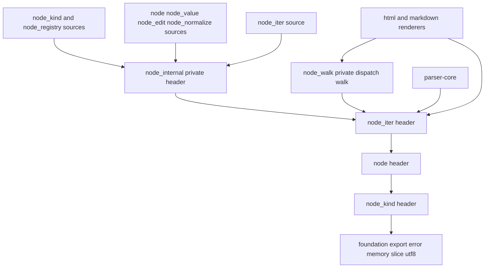
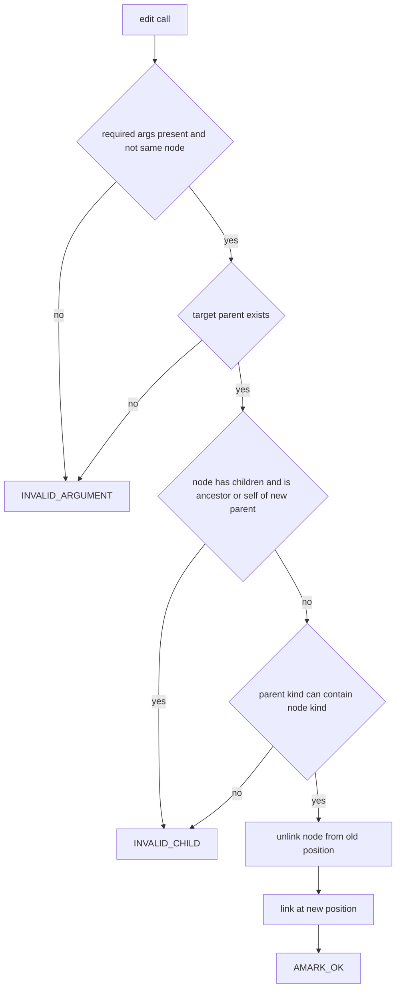
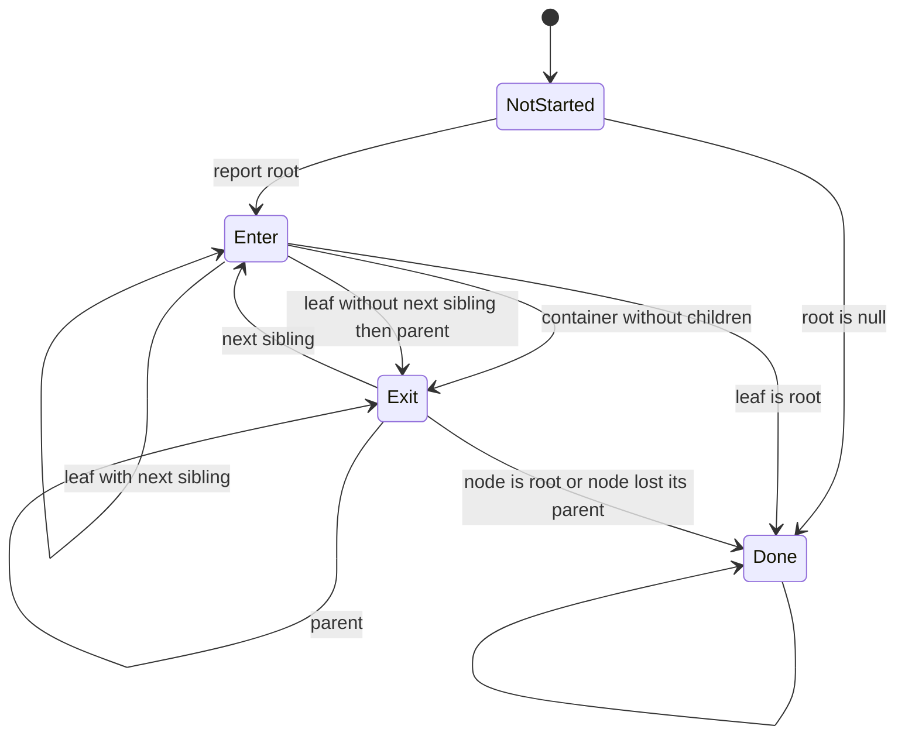
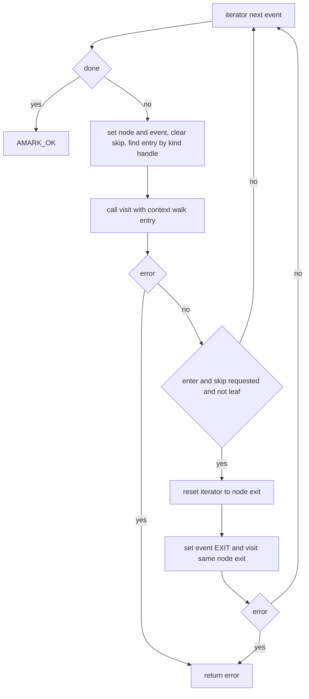
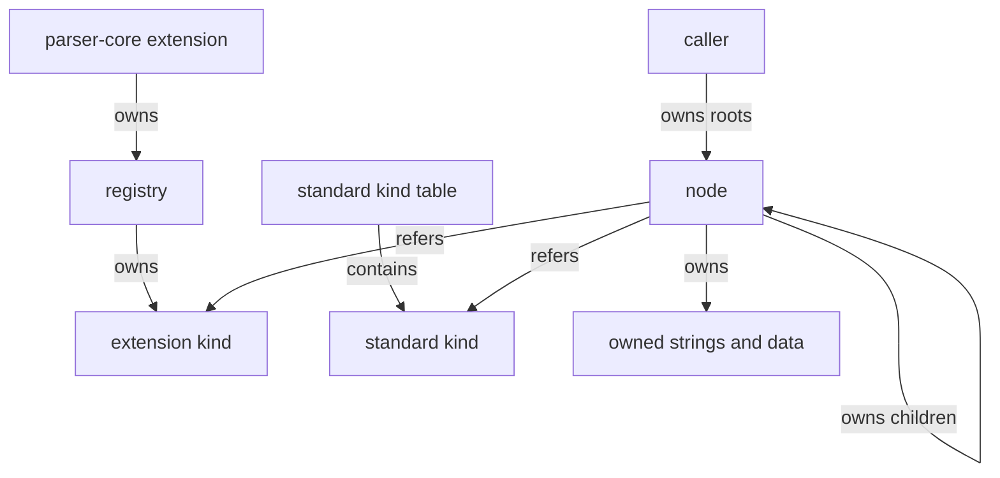

# Design Document: node-tree

## Overview

**Purpose**: Amark の文書木を提供する。opaque なノード `amark_node_t` が親・兄弟・子へのリンクと自分の値を持ち（cmark 方式）、CommonMark に必要な 18 の標準ノード種別、拡張ノード種別の登録場所（レジストリ）、親子関係を検証する編集 API、enter / exit 型のイテレータ、テキストノードの正規化を定める。加えて、両レンダラが共有する非公開の振り分け走査（種別ハンドルをキーとする処理の表と走査の駆動部）を所有する。

**Users**: ライブラリ利用者は API だけで木を組み立て・編集する。parser-core / commonmark は木を出力先として使い、拡張のノード種別をレジストリへ登録する。html-renderer / markdown-renderer は非公開の振り分け走査 `src/tree/node_walk.h`（内部でイテレータを使う）で木を走査し、種別ごとに出力を選ぶ。

**Impact**: foundation の上に `node_kind`、`node`、`node_iter` の 3 つの公開ヘッダと対応するソース・テスト、および非公開モジュール `src/tree/node_walk.{h,c}` とそのテストを追加する。foundation のエラー列挙へ 2 つのコードを末尾追加し、包括ヘッダ、ビルド・テストの登録、steering の例を更新する。

### Goals
- パーサなしに、標準種別と拡張種別を混ぜた任意の妥当な木を API だけで組み立て・編集・破棄できる
- 不正な親子関係・循環を、木を変更せずにエラーとして拒否する
- 木の値は常に木が所有し、妥当な UTF-8 で NUL 終端付きである
- 深さ 10 万段の木でも、破棄・走査・正規化がスタックあふれなく完了する
- 下流（parser-core、両レンダラ）が、標準種別は列挙で、拡張種別はハンドルで安定して識別できる

### Non-Goals
- テキストからの木の構築、文字列への出力
- ソース位置、原文の記法（フェンス文字・長さ、強調記号の種類、リストの区切り記号、見出しの形式）の保持
- 木の複製・比較、ノードごとの利用者データ（拡張種別の付随データのみ提供）
- GFM のノード種別そのもの（登録機構のみ提供）
- スレッドセーフな単一の木の同時変更

## Boundary Commitments

### This Spec Owns
- opaque なノード型 `amark_node_t` と、その生成・破棄・所有の規則（根は呼び出し側、子は親が所有）
- ノード種別の表現: 識別値の列挙 `amark_node_type_t`、種別ハンドル `amark_node_kind_t`、ブロック/インラインの別 `amark_node_category_t`、子の内容モデル `amark_node_content_t`
- 18 の標準種別の識別値・名前・分類・親子規則（ライブラリ内の定数データ）
- 拡張ノード種別のレジストリ `amark_node_registry_t`、種別記述子 `amark_node_kind_desc_t`、名前の規則と一意性、付随データの所有と後片付け
- 親子関係の判定（`amark_node_kind_can_contain`）と、編集操作（追加・挿入・取り外し・置換・破棄）の検証
- 参照（親・子・兄弟）、イテレータ `amark_node_iter_t` と走査中の編集の安全性規則
- 正規化（隣接 text の結合と空 text の除去）
- 非公開の振り分け走査 `src/tree/node_walk.{h,c}`（NodeWalk）: 種別ハンドルをキーとする処理の表と、表を引きながらイテレータを回す反復の駆動部（子の省略と、省略したノードの EXIT の訪問を含む）。html-renderer と markdown-renderer が共有する内部契約であり、公開しない（要件 14）
- foundation のエラー列挙へ追加する `AMARK_ERROR_INVALID_CHILD`、`AMARK_ERROR_ALREADY_EXISTS` を node-tree で返す条件と、実装時の追記（値・文字列・意味の定義元は foundation design.md のエラー表）

### Out of Boundary
- 構文の解析、解析中の一時状態、拡張（構文＋ノード種別）の単位・方言の定義（parser-core）。本仕様はレジストリを提供するだけで、どの拡張がいつ登録するかは決めない
- レンダラの公開のフック機構（フックの型、コンテキストとその操作、登録の API）と出力、Markdown の行の書き出し（プレフィックスのスタック、折り返し、改行の保証）（html-renderer / markdown-renderer）。NodeWalk はレンダラ固有の処理を持たない
- NodeWalk の公開、部分木の絞り込みなどの機能追加、共有の文字列ライター（実際の第 2 の利用者が現れるまで行わない。`research.md`）
- CommonMark の構文上の制約のうち木の構造の妥当性に関わらないもの（リンクの入れ子禁止、見出しの中の改行など）。パーサとレンダラが扱う
- foundation の既存 API（アロケータ、エラー文字列化の仕組み、スライス、UTF-8、バッファ）の変更。本仕様は使うだけで、変更するのはエラー列挙への末尾追加のみ
- GFM 用の種別、標準種別への付随データ

### Allowed Dependencies
- foundation の公開ヘッダ: `amark/export.h`、`amark/error.h`、`amark/memory.h`、`amark/slice.h`、`amark/utf8.h`（`amark/buffer.h` は使わない）
- C 標準ライブラリ: `<stddef.h>`、`<stdint.h>`、`<stdbool.h>`、`<string.h>`
- テスト: Naos、`tests/support/` の差し替えアロケータ（foundation 提供）。`node_walk_test` だけは非公開の `src/tree/node_walk.c` をテスト実行ファイルに直接コンパイルする（NodeWalk の Validation）
- 依存方向（左ほど下位。右から左への include のみ許可）: `foundation → node_kind → node → node_iter → node_walk`。`src/tree/node_internal.h` は node-tree の `.c` だけが include し、公開ヘッダからは include しない。`node_walk.{h,c}` は公開ヘッダ（`amark/error.h`、`amark/memory.h`、`amark/node_kind.h`、`amark/node_iter.h`）だけを include し、`node_internal.h` を include しない。公開ヘッダは `node_walk.h` を include しない。node-tree は parser-core やレンダラのヘッダを include しない

### Revalidation Triggers
- `amark_node_type_t` の既存値の変更・削除（禁止。標準種別の追加は 19〜254 に末尾追加）、`AMARK_NODE_EXTENSION` の値の変更
- 標準種別の親子規則の変更（例: gfm フェーズで list が拡張の子を受け入れるようにする）
- 種別記述子 `amark_node_kind_desc_t` のフィールド、判定関数・後片付け関数の型、名前の規則の変更
- レジストリの寿命規則（ノードより長く生きる義務）、スレッド利用の規則の変更
- 文字列 getter の契約（値を持つ種別で `data` 非 `NULL`・NUL 終端、持たない種別で `{NULL, 0}`）の変更
- イテレータのイベント列（葉は ENTER のみ）、公開の葉の判定 `amark_node_kind_is_leaf` の定義（html-renderer が使う）、走査中の編集の安全性規則の変更
- 追加エラーコードの値・意味の変更
- `src/tree/node_walk.h` の内部契約（型、関数、走査の手順、子の省略後の EXIT の訪問、表の設定の規則）の変更。どのような変更でも html-renderer と markdown-renderer の再検証を要する

## Architecture

### Architecture Pattern & Boundary Map



**Architecture Integration**:
- Selected pattern: foundation と同じ層状モジュール構成。公開ヘッダは `node_kind.h → node.h → node_iter.h` の順に積み、各 `.c` は非公開ヘッダ `node_internal.h` で構造体の定義を共有する
- Domain/feature boundaries: 種別とレジストリ（`node_kind.c`、`node_registry.c`）、ノードの寿命と参照（`node.c`）、値（`node_value.c`）、編集（`node_edit.c`）、正規化（`node_normalize.c`）、走査（`node_iter.c`）、レンダラ向けの振り分け走査（`node_walk.c`。公開 API だけの上に置く）を別ファイルにし、構造体定義の確定後は並行に実装できるようにする
- Existing patterns preserved: foundation の共通 API 規約（エラー戻り値＋出力引数、`NULL` 引数で `AMARK_ERROR_INVALID_ARGUMENT`、失敗時の強い保証、`void` の後片付けは `NULL` で何もしない）、命名（`amark_<module>_<verb>`、`_t`、`_create` / `_destroy`、`_init`）、ヘッダ規約（include ガード、`AMARK_BEGIN_DECLS`、`AMARK_API`）
- New components rationale: 各コンポーネントは要件群に 1 対 1 で対応する（Components 表を参照）
- Steering compliance: 可変のグローバル状態を追加しない（標準種別の表は `static const`）。確保はすべて `amark_malloc` 系。テスト専用コードを本体に置かない。木の深さに比例する再帰を使わない

### Technology Stack

| Layer | Choice / Version | Role in Feature | Notes |
|-------|------------------|-----------------|-------|
| 言語 | C99（foundation の設定を継承） | 本体とテスト | 新しい依存なし |
| ランタイム API | foundation（アロケータ、エラー、スライス、UTF-8） | 確保、エラー、借用文字列、UTF-8 検査 | `amark_utf8_validate`、`amark_slice_dup` |
| テスト | Naos v0.4.0、`amark_test_support` | モジュールごとのテスト実行ファイル、失敗注入 | foundation の `naos_add_executable` 規約に従う |

## File Structure Plan

### Directory Structure
```
include/amark/
├── node_kind.h          # amark_node_type_t、amark_node_kind_t、分類・内容モデル、種別記述子、レジストリ API、種別の問い合わせと受け入れ判定
├── node.h               # amark_node_t、生成・破棄、種別・参照、値のアクセサ、付随データ、編集、正規化
└── node_iter.h          # amark_node_iter_t とイベント、走査 API、走査中の編集の安全性規則（コメント）
src/
└── tree/
    ├── node_internal.h      # 非公開: struct amark_node_kind、struct amark_node、所有文字列、内部関数の宣言（export しない）
    ├── node_kind.c          # 標準種別の static const 表、種別の問い合わせ、受け入れ判定 can_contain
    ├── node_registry.c      # レジストリの生成・破棄、種別の登録（記述子と名前の検証、複製）、名前による検索
    ├── node.c               # ノードの生成（標準・拡張）、取り外し、値の解放と反復による破棄、種別の取得、親・子・兄弟の参照
    ├── node_value.c         # 見出し・リスト・文字列値のアクセサ、付随データの設定と取得、所有文字列の置き換え
    ├── node_edit.c          # 追加・挿入・置換、循環と親子規則の検証、移動（取り外しは node.c を使う）
    ├── node_normalize.c     # 反復走査による隣接 text の結合と空 text の除去
    ├── node_iter.c          # イテレータの初期化、次イベントの遅延計算、位置の再設定
    ├── node_walk.h          # 非公開（レンダラ間の内部契約）: 処理の表と走査駆動部の型・関数。AMARK_API を付けず export しない
    └── node_walk.c          # 表の init/deinit/set/find、走査駆動部（イテレータ、子の省略と省略後の EXIT の訪問。葉の判定は amark_node_kind_is_leaf）。公開ヘッダだけを include する
tests/
├── node_kind_test.c       # 標準種別の識別値・名前・分類・内容モデル、受け入れ判定の全組み合わせ
├── node_registry_test.c   # 登録・検索・名前規則・重複・記述子の矛盾、失敗注入、ハンドルの安定性
├── node_test.c            # 生成・破棄・所有、参照、深い木の破棄、失敗注入
├── node_value_test.c      # 各種別の値の既定値・読み書き・範囲・UTF-8・種別不一致、付随データと後片付け
├── node_edit_test.c       # 各編集操作、移動、検証エラーと状態不変、循環、深い木の構築
├── node_normalize_test.c  # 結合・空除去・冪等性・他ノード不変・失敗注入での基本保証・深い木
├── node_iter_test.c       # イベント列、部分木限定、終了の継続、位置の再設定、走査中の編集
└── node_walk_test.c       # 表の設定・置き換え・解除・検索、走査のイベント列、子の省略後の EXIT、エラーの中止、確保の回数（src/tree/node_walk.c を直接コンパイル）
```

### Modified Files
実装時に node-tree のタスクとして変更する（本 spec の作成時には変更しない）。
- `include/amark/error.h` — `AMARK_ERROR_INVALID_CHILD = 5`、`AMARK_ERROR_ALREADY_EXISTS = 6` を末尾に追加（値は foundation design.md のエラー表で登録済み。Cross-Spec Change Note 参照）
- `src/base/error.c` — 追加コードの文字列を `switch` に追加
- `tests/error_test.c` — 追加コードの値と文字列の確認を追加
- `include/amark/amark.h` — `node_kind.h`、`node.h`、`node_iter.h` の include を node-tree のブロックとして追記
- `src/CMakeLists.txt` — `tree/node_kind.c`、`tree/node_registry.c`、`tree/node.c`、`tree/node_value.c`、`tree/node_edit.c`、`tree/node_normalize.c`、`tree/node_iter.c`、`tree/node_walk.c` をソース一覧に追記
- `tests/CMakeLists.txt` — 8 つのテスト実行ファイル `amark_node_kind_test` ほかを `naos_add_executable` で追記登録。`amark_node_walk_test` だけは `SOURCES node_walk_test.c ${PROJECT_SOURCE_DIR}/src/tree/node_walk.c` とし、`target_include_directories(amark_node_walk_test PRIVATE ${PROJECT_SOURCE_DIR}/src)` を加える（NodeWalk の Validation）
- `tests/cxx_header_test.cpp` — C++ から木の生成・追加・走査・破棄を呼ぶ確認を追記
- 上の 4 つ（と `error.h`・`src/base/error.c`・`tests/error_test.c`）は foundation が所有する追記専用の共有ファイルである。node-tree は自分のブロックを末尾に追記するだけで、既存の行を変更・並べ替えしない
- `.kiro/steering/tech.md` — 命名の例 `amark_node_t *amark_node_create(amark_node_type_t type);` を確定した `amark_error_t amark_node_create(amark_node_type_t type, amark_node_t **node);` に直す

## Cross-Spec Change Note（foundation のエラー列挙）

本仕様が使う追加コード `AMARK_ERROR_INVALID_CHILD = 5`（`"invalid child node"`）と `AMARK_ERROR_ALREADY_EXISTS = 6`（`"already exists"`）は、foundation design.md のエラー表（0〜7 と所有 spec の一覧。値・文字列・意味の唯一の定義元）に登録済みである。本書では再定義しない。

- 本仕様での使い方: `INVALID_CHILD` は編集操作の親子規則違反・循環・document を子にする場合、`ALREADY_EXISTS` は種別名の重複（標準名を含む）。`ALREADY_EXISTS` は parser-core の拡張名などにも再利用される汎用の意味である
- 実装時は node-tree のタスクとして `error.h`、`src/base/error.c`、`tests/error_test.c` に 2 コードを同時に追記する（追記専用。既存の値は変えない）
- 種別の不一致（値を持たない種別へのアクセス）、範囲外の値、親を持たない兄弟への挿入などは既存の `AMARK_ERROR_INVALID_ARGUMENT` を使う

## System Flows

### 編集操作の検証と適用



- 検証はすべてリンクの変更前に行う。失敗時は何も変わらない（7.8）。確保を伴わないため、編集操作が `AMARK_ERROR_NO_MEMORY` を返すことはない
- 循環検査は挿入するノードが子を持つ場合だけ、新しい親から祖先をたどる。子を持たないノードは自分自身以外の祖先になり得ない（13.2）

### イテレータの次イベント



- 次の位置は `amark_node_iter_next` の呼び出し時に、現在ノードの `first_child`・`next`・`parent` から計算する。過去に報告した位置や先の位置を保持しないため、現在ノードとその祖先以外の編集は走査に影響しない（10.2）
- 現在ノードが起点でないのに親を失っていれば（取り外された）、終了を報告する（10.5 の安全でない操作の定義済みの結果）

### 振り分け走査の 1 イベント（NodeWalk）



- `amark_node_iter_reset(iter, node, EXIT)` は「次の `next` はその位置の続きを報告する」（9.5）ため、リセットだけでは同じノードの EXIT が報告されない。駆動部はリセットの直後に同じノードの EXIT で訪問関数を自ら呼ぶ。続く `next` は EXIT の続きを報告するため、EXIT は二重に訪問されない（14.7）
- 出力の巻き戻しなど、エラー時の後始末は呼び出し側（各レンダラ）が行う

## Requirements Traceability

| Requirement | Summary | Components | Interfaces | Flows |
|-------------|---------|------------|------------|-------|
| 1.1, 1.2, 1.3 | 標準・拡張種別のノード生成、未知種別の拒否 | NodeCore | `amark_node_create`、`amark_node_create_with_kind` | — |
| 1.4, 1.5, 1.6, 1.7 | 部分木の破棄、先に取り外す、所有規則、`NULL` | NodeCore | `amark_node_destroy`、`amark_node_unlink` | — |
| 2.1, 2.2, 2.3 | 18 の標準種別、固定の識別値と名前 | NodeKind | `amark_node_type_t`、標準種別表 | — |
| 2.4, 2.5, 2.6 | 種別の問い合わせ、名前と分類、標準ハンドル | NodeKind, NodeCore | `amark_node_get_type`、`amark_node_get_kind`、`amark_node_kind_get_*` | — |
| 2.7 | 葉の種別の判定（公開） | NodeKind | `amark_node_kind_is_leaf` | 次イベント |
| 3.1, 3.4, 3.5, 3.7, 3.8 | 種別ごとの値、既定値、範囲、種別不一致 | NodeValue | `amark_node_get_heading_level` ほか | — |
| 3.2, 3.3, 3.6, 3.9 | 文字列の複製・借用・UTF-8 検査・NUL | NodeValue | `amark_node_set_literal` ほか | — |
| 4.1, 4.2, 4.8, 4.9, 4.10 | レジストリの生成・破棄・登録、複製、寿命の義務 | NodeRegistry | `amark_node_registry_*`、`amark_node_kind_desc_t` | — |
| 4.3, 4.4, 4.5 | 名前の重複・形式、記述子の矛盾 | NodeRegistry | `amark_node_registry_add` | — |
| 4.6, 4.7 | 名前による検索、ハンドルの安定性 | NodeRegistry, NodeKind | `amark_node_registry_find` | — |
| 5.1, 5.2, 5.3, 5.4, 5.5, 5.6 | 付随データの所有と後片付け | NodeValue, NodeCore | `amark_node_set_data`、`amark_node_get_data`、`destroy_data` | — |
| 6.1, 6.2, 6.3, 6.4, 6.5, 6.6 | 親子規則と受け入れ判定 | NodeKind | `amark_node_kind_can_contain`、`amark_node_content_t` | 編集の検証 |
| 6.7, 6.8 | 規則違反・循環の拒否 | NodeEdit | 編集 API | 編集の検証 |
| 7.1, 7.2, 7.3, 7.6, 7.7, 7.8 | 追加・挿入・移動・置換と失敗時の不変 | NodeEdit | `amark_node_append_child` ほか | 編集の検証 |
| 7.4, 7.5 | 取り外し | NodeCore | `amark_node_unlink` | — |
| 8.1, 8.2, 8.3 | 親・子・兄弟の参照、順序 | NodeCore, NodeEdit | `amark_node_get_parent` ほか | — |
| 9.1, 9.2, 9.3, 9.4, 9.5, 9.6 | enter / exit 走査、部分木、終了、再設定、確保なし | NodeIter | `amark_node_iter_*` | 次イベント |
| 10.1, 10.2, 10.3, 10.4, 10.5 | 走査中の編集の安全性 | NodeIter, NodeEdit | `amark_node_iter_next`、`amark_node_iter_reset`、`node_iter.h` の規則 | 次イベント |
| 11.1, 11.2, 11.3, 11.4, 11.5 | 正規化と基本保証 | NodeNormalize | `amark_node_normalize` | — |
| 12.1 | 共通エラーコードと追加 | 全コンポーネント, ErrorCodeAddition | `AMARK_ERROR_INVALID_CHILD`、`AMARK_ERROR_ALREADY_EXISTS` | — |
| 12.2, 12.3, 12.6 | アロケータ経由、確保失敗時の強い保証、全解放 | 全コンポーネント | `amark_malloc` 系 | — |
| 12.4, 12.5 | `NULL` 引数、サイズのあふれ | 全コンポーネント | 共通 API 規約 | — |
| 13.1 | 深い木で再帰なし | NodeCore, NodeIter, NodeNormalize | 反復アルゴリズム | 次イベント |
| 13.2 | 挿入の計算量 | NodeEdit | 循環検査の省略規則 | 編集の検証 |
| 13.3, 13.4 | スレッドの規則 | NodeRegistry, NodeCore | `node_kind.h` と `node.h` のコメント | — |
| 14.1, 14.2, 14.3, 14.4 | 処理の表の設定・置き換え・解除・検索とエラー | NodeWalk | `amark_node_walk_table_*` | — |
| 14.5, 14.6, 14.7, 14.8 | 反復の振り分け走査、ENTER / EXIT、子の省略後の EXIT、エラーの中止 | NodeWalk | `amark_node_walk_run`、`amark_node_walk_skip_children` | 振り分け走査の 1 イベント |
| 14.9, 14.10 | 確保は表の伸長だけ、非公開 | NodeWalk, NodeIntegration | `src/tree/node_walk.h`（`AMARK_API` なし） | — |

## Components and Interfaces

| Component | Domain/Layer | Intent | Req Coverage | Key Dependencies (P0/P1) | Contracts |
|-----------|--------------|--------|--------------|--------------------------|-----------|
| NodeInternal | 非公開 | 構造体と内部関数の共有定義 | 全体の前提 | foundation (P0) | State |
| NodeKind | 種別 | 種別表現、標準種別表、葉の判定、受け入れ判定 | 2.1–2.7, 4.7, 6.1–6.6 | NodeInternal (P0) | Service |
| NodeRegistry | 種別 | 拡張種別の登録と検索 | 4.1–4.10, 13.4 | NodeKind (P0), Slice/Utf8 (P0) | Service, State |
| NodeCore | ノード | 生成・取り外し・破棄・所有・種別取得・参照 | 1.1–1.7, 2.4, 7.4, 7.5, 8.1, 8.2, 13.1, 13.3 | NodeKind (P0), Memory (P0) | Service, State |
| NodeValue | ノード | 値のアクセサと付随データ | 3.1–3.9, 5.1–5.6 | NodeCore (P0), Utf8 (P0) | Service |
| NodeEdit | ノード | 追加・挿入・置換と検証 | 6.7, 6.8, 7.1–7.3, 7.6–7.8, 8.3, 13.2 | NodeKind (P0), NodeCore (P0) | Service |
| NodeNormalize | ノード | 隣接 text の結合と空 text の除去 | 11.1–11.5, 13.1 | NodeCore (P0), NodeValue (P1) | Service |
| NodeIter | 走査 | enter / exit イテレータと走査中の編集規則 | 9.1–9.6, 10.1–10.5, 13.1 | NodeCore (P0) | Service, State |
| NodeWalk | 走査（非公開） | 種別ハンドルをキーとする処理の表と振り分け走査の駆動部（レンダラ間の内部契約） | 14.1–14.10 | NodeIter (P0), NodeKind (P0), Memory (P0) | Service, State |
| ErrorCodeAddition | foundation への追加 | 2 つのエラーコード | 12.1 | foundation Error (P0) | Service |
| NodeIntegration | ビルド・テスト登録 | 包括ヘッダ、ビルド、テスト登録、C++ 検査、steering の例 | 12.1, 12.2, 14.10 | foundation BuildSystem, TestHarness (P0) | Batch |

### 共通の API 規約（本仕様の全公開関数）
- foundation の共通 API 規約に従う。`amark_error_t` を返す関数は、必須のポインタ引数が `NULL` なら `AMARK_ERROR_INVALID_ARGUMENT` を返し何も変更しない（12.4）。失敗時は呼び出し前の状態を保つ（12.3。正規化を除く）
- 値を返す問い合わせ関数（getter、参照、種別の問い合わせ）は失敗しない。`NULL` を渡されたときは「ない」を表す値（`NULL`、`{NULL, 0}`、`0`、`false`、`AMARK_NODE_NONE`、`AMARK_NODE_CATEGORY_NONE`）を返す
- `const amark_node_t *` を受け取ってノードを返す参照関数は、非 const の `amark_node_t *` を返す（`strchr` と同じ慣習。木は呼び出し側がもともと非 const で所有している）
- 確保は `amark_malloc` / `amark_calloc` / `amark_realloc` / `amark_free` だけを使う（12.2）
- コールバック（受け入れ判定、付随データの後片付け）の中から、そのコールバックを呼んだ木やレジストリを変更してはならない。ライブラリはこれを検出しない
- 公開ヘッダは `AMARK_<NAME>_H` の include ガード、`AMARK_BEGIN_DECLS` / `AMARK_END_DECLS`、`AMARK_API` を付ける

### 非公開

#### NodeInternal

| Field | Detail |
|-------|--------|
| Intent | node-tree の `.c` が共有する構造体定義と内部関数 |
| Requirements | 全体の前提 |

**Contracts**: State [x]

##### State Management
```c
/* src/tree/node_internal.h（公開ヘッダから include しない。宣言は AMARK_API を付けず export しない） */
typedef struct amark_node_string
{
    char *data;    /* NULL（未設定 = 空文字列）または amark_malloc で確保した length + 1 バイト */
    size_t length; /* data が NULL なら 0 */
} amark_node_string_t;

struct amark_node_kind
{
    amark_node_type_t type;                    /* 標準種別の値、または AMARK_NODE_EXTENSION */
    const char *name;                          /* 標準: 文字列リテラル。拡張: 所有（NUL 終端） */
    size_t name_length;
    amark_node_category_t category;
    amark_node_content_t content;
    bool requires_explicit_parent;
    bool root_only;                            /* document だけが真。どの親の子にもなれない */
    amark_node_can_contain_fn_t can_contain;   /* content == CUSTOM のときだけ非 NULL */
    amark_node_destroy_data_fn_t destroy_data;
    void *user_data;
};

struct amark_node
{
    const amark_node_kind_t *kind;
    amark_node_t *parent;
    amark_node_t *first_child;
    amark_node_t *last_child;
    amark_node_t *previous;
    amark_node_t *next;
    union
    {
        struct { int level; } heading;
        struct { amark_node_list_type_t type; uint32_t start; bool tight; } list;
        struct { amark_node_string_t info; amark_node_string_t literal; } code_block;
        amark_node_string_t literal;           /* html_block、text、code、html_inline */
        struct { amark_node_string_t url; amark_node_string_t title; } link; /* link、image */
        void *data;                            /* 拡張種別 */
    } as;
};

/* 内部関数（定義するファイル）。葉の判定 amark_node_kind_is_leaf は公開 API（node_kind.h）に移した */
void amark_node_string_deinit(amark_node_string_t *string);           /* node.c: 解放して未設定に戻す */
void amark_node_release_values(amark_node_t *node);                   /* node.c: 文字列の解放と destroy_data の呼び出し */
amark_error_t amark_node_string_set(amark_node_string_t *string, amark_slice_t value); /* node_value.c: 検査・複製・置換 */
amark_slice_t amark_node_string_get(const amark_node_string_t *string);                /* node_value.c: 未設定なら "" */
```
- 依存の向き: `node.c` は `node_kind.c` だけに、`node_value.c` と `node_edit.c` は `node.c` と `node_kind.c` に、`node_normalize.c` は `node.c`・`node_value.c` に、`node_iter.c` は `node.c` と `node_kind.c` に依存する。`node.c` は `node_value.c` と `node_edit.c` に依存しない（実装順: node_kind → node_registry → node → node_value / node_edit → node_iter / node_normalize → node_walk。`node_walk.c` は公開 API だけを使い、この非公開ヘッダを include しない）
- Invariants: `first_child == NULL` と `last_child == NULL` は同値。兄弟リストは双方向で、`first_child->previous == NULL`、`last_child->next == NULL`、各子の `parent` は親を指す。根は `parent`、`previous`、`next` がすべて `NULL`
- `amark_node_string_set`: `value.length > 0 && value.data == NULL` は `AMARK_ERROR_INVALID_ARGUMENT`、`value.length == SIZE_MAX` は `AMARK_ERROR_OVERFLOW`、`amark_utf8_validate` が失敗なら `AMARK_ERROR_INVALID_UTF8`、空なら旧値を解放して未設定に戻す、それ以外は `amark_slice_dup` で複製（失敗で `AMARK_ERROR_NO_MEMORY`）してから旧値を解放する。いずれの失敗でも旧値は残る

### 種別

#### NodeKind

| Field | Detail |
|-------|--------|
| Intent | 種別の表現、18 の標準種別の定数表、種別の問い合わせ、葉の判定と受け入れ判定 |
| Requirements | 2.1, 2.2, 2.3, 2.4, 2.5, 2.6, 2.7, 4.7, 6.1, 6.2, 6.3, 6.4, 6.5, 6.6 |

**Responsibilities & Constraints**
- 標準種別は `src/tree/node_kind.c` の `static const struct amark_node_kind` の表に持つ。可変のグローバル状態ではない。ハンドルはプロセス内で常に同一（2.6）
- 受け入れ判定は本コンポーネントだけが持つ。編集（NodeEdit）は必ずこれを呼ぶ（6.6 の「編集と同じ判定」を構造的に保証する）

**Contracts**: Service [x]

##### Service Interface
```c
/* include/amark/node_kind.h */
#include <amark/export.h>
#include <amark/slice.h>
#include <stdbool.h>

typedef enum amark_node_type
{
    AMARK_NODE_NONE = 0,            /* 種別なし（NULL の問い合わせ結果） */
    AMARK_NODE_DOCUMENT = 1,
    AMARK_NODE_BLOCK_QUOTE = 2,
    AMARK_NODE_LIST = 3,
    AMARK_NODE_ITEM = 4,
    AMARK_NODE_CODE_BLOCK = 5,
    AMARK_NODE_HTML_BLOCK = 6,
    AMARK_NODE_PARAGRAPH = 7,
    AMARK_NODE_HEADING = 8,
    AMARK_NODE_THEMATIC_BREAK = 9,
    AMARK_NODE_TEXT = 10,
    AMARK_NODE_SOFT_BREAK = 11,
    AMARK_NODE_LINE_BREAK = 12,
    AMARK_NODE_CODE = 13,           /* code span */
    AMARK_NODE_HTML_INLINE = 14,
    AMARK_NODE_EMPHASIS = 15,
    AMARK_NODE_STRONG = 16,
    AMARK_NODE_LINK = 17,
    AMARK_NODE_IMAGE = 18,
    /* 標準種別の追加は 19〜254 に末尾追加。既存値の変更・再利用は禁止 */
    AMARK_NODE_EXTENSION = 255      /* すべての拡張種別に共通の値 */
} amark_node_type_t;

typedef enum amark_node_category
{
    AMARK_NODE_CATEGORY_NONE = 0,
    AMARK_NODE_CATEGORY_BLOCK = 1,
    AMARK_NODE_CATEGORY_INLINE = 2
} amark_node_category_t;

typedef enum amark_node_content
{
    AMARK_NODE_CONTENT_NONE = 0,    /* 子を取らない（葉） */
    AMARK_NODE_CONTENT_BLOCKS = 1,  /* 明示親限定でない任意のブロック */
    AMARK_NODE_CONTENT_INLINES = 2, /* 明示親限定でない任意のインライン */
    AMARK_NODE_CONTENT_CUSTOM = 3   /* 種別の判定関数で決める */
} amark_node_content_t;

typedef struct amark_node_kind amark_node_kind_t;

AMARK_API const amark_node_kind_t *amark_node_kind_get_standard(amark_node_type_t type);
AMARK_API amark_node_type_t amark_node_kind_get_type(const amark_node_kind_t *kind);
AMARK_API amark_slice_t amark_node_kind_get_name(const amark_node_kind_t *kind);
AMARK_API amark_node_category_t amark_node_kind_get_category(const amark_node_kind_t *kind);
AMARK_API amark_node_content_t amark_node_kind_get_content(const amark_node_kind_t *kind);
AMARK_API bool amark_node_kind_is_leaf(const amark_node_kind_t *kind);
AMARK_API bool amark_node_kind_can_contain(const amark_node_kind_t *parent, const amark_node_kind_t *child);
```

標準種別の表（2.1、2.2、2.3、6.1、6.2）:

| type | name | category | content | 明示親限定 | 備考 |
|---|---|---|---|---|---|
| DOCUMENT | `document` | BLOCK | BLOCKS | — | `root_only`: どの親の子にもなれない |
| BLOCK_QUOTE | `block_quote` | BLOCK | BLOCKS | — | |
| LIST | `list` | BLOCK | CUSTOM | — | 内部の判定関数: 子が標準の ITEM のときだけ真 |
| ITEM | `item` | BLOCK | BLOCKS | 真 | list（または受け入れる CUSTOM 拡張）の下だけ |
| CODE_BLOCK | `code_block` | BLOCK | NONE | — | |
| HTML_BLOCK | `html_block` | BLOCK | NONE | — | |
| PARAGRAPH | `paragraph` | BLOCK | INLINES | — | |
| HEADING | `heading` | BLOCK | INLINES | — | |
| THEMATIC_BREAK | `thematic_break` | BLOCK | NONE | — | |
| TEXT | `text` | INLINE | NONE | — | |
| SOFT_BREAK | `soft_break` | INLINE | NONE | — | |
| LINE_BREAK | `line_break` | INLINE | NONE | — | |
| CODE | `code` | INLINE | NONE | — | |
| HTML_INLINE | `html_inline` | INLINE | NONE | — | |
| EMPHASIS | `emphasis` | INLINE | INLINES | — | |
| STRONG | `strong` | INLINE | INLINES | — | |
| LINK | `link` | INLINE | INLINES | — | リンクの入れ子は木の規則では拒否しない |
| IMAGE | `image` | INLINE | INLINES | — | 子は alt テキストの元 |

- `amark_node_kind_get_standard(type)`: 1〜18 なら標準種別のハンドル、それ以外（`NONE`、`EXTENSION`、未定義値）は `NULL`（2.6）
- `amark_node_kind_get_type`: 標準種別はその値、拡張種別は `AMARK_NODE_EXTENSION`、`NULL` は `AMARK_NODE_NONE`（2.4）
- `amark_node_kind_get_name`: 名前を借用スライスで返す（`data[length] == '\0'`）。寿命は種別と同じ。`NULL` は `{NULL, 0}`（2.5）
- `amark_node_kind_is_leaf(kind)`: `content == AMARK_NODE_CONTENT_NONE`（子を取らない種別）なら真、それ以外は偽。`NULL` は偽（2.7）。標準・拡張で同じ方法で答える。イテレータが ENTER だけを報告する種別（9.1）はちょうどこの判定が真の種別であり、NodeIter と NodeWalk（レンダラの走査）は同じ関数を使って「葉か」を判定する
- `amark_node_kind_can_contain(parent, child)` の判定（6.1〜6.6）:
  1. どちらかが `NULL`、または `child` が `root_only` なら偽
  2. `parent->content` が `NONE` なら偽
  3. `BLOCKS` なら `child->category == BLOCK` かつ `!child->requires_explicit_parent`
  4. `INLINES` なら `child->category == INLINE` かつ `!child->requires_explicit_parent`
  5. `CUSTOM` なら `parent->can_contain(parent, child, parent->user_data)` の結果（明示親限定の種別も判定関数が受け入れれば置ける）
- Invariants: 判定は木を変更せず、同じ組には常に同じ結果を返す（判定関数が決定的である限り）。判定関数は決定的でなければならないと `node_kind.h` に明記する

**Implementation Notes**
- Integration: 下流のレンダラはフックのキーに種別ハンドルを使う。標準種別のハンドルは `amark_node_kind_get_standard` で得られるため、標準・拡張を同じ表で扱える
- Validation: `node_kind_test.c` で 18 種別すべての値・名前・分類・内容モデル・`amark_node_kind_is_leaf` の結果（`NULL` で偽を含む）と、18 × 18 の受け入れ判定表を確認する。拡張種別の `is_leaf` は `node_registry_test.c` で確認する
- Risks: 標準種別の規則を変えると下流の木の妥当性が変わる（Revalidation Trigger）

#### NodeRegistry

| Field | Detail |
|-------|--------|
| Intent | 拡張ノード種別を登録・保持・検索するオブジェクト |
| Requirements | 4.1, 4.2, 4.3, 4.4, 4.5, 4.6, 4.7, 4.8, 4.9, 4.10, 13.4 |

**Responsibilities & Constraints**
- レジストリは利用者が生成・破棄する独立したオブジェクトで、グローバルな登録状態はない（4.1）。**登録の所在の決定**: 拡張ノード種別はレジストリに属する。parser-core は**拡張ごとに 1 つ**のレジストリを所有し（拡張が自分の宣言したノード種別を自分のレジストリへ `amark_node_registry_add` する）、そのレジストリを parser-core の公開 API には出さない。拡張間の種別名の重複は、方言が拡張の追加時に検査する（1 つのレジストリ内の一意性は本コンポーネント、レジストリをまたぐ一意性は parser-core の方言の責務）。レンダラはレジストリを所有せず、parser-core の `amark_extension_find_kind` / `amark_dialect_find_kind`（または `amark_extension_get_kind_at`）で得た種別ハンドルでフックを結び付ける
- 寿命: レジストリを所有する拡張（または拡張を所有する方言）は、その種別のノードと、その種別のフックを保持するレンダラより長く生きなければならない。これは 4.10 の義務を parser-core が拡張・方言の寿命として利用者に約束する形で引き継ぐ
- 種別は個別に確保し、レジストリはそのポインタの配列を持つ。配列の伸長でハンドルは移動しない（4.7）
- レジストリはその種別のノードがすべて破棄されるまで破棄してはならない。ライブラリは検出しない（4.10）。`node_kind.h` に明記する

**Contracts**: Service [x] / State [x]

##### Service Interface
```c
/* include/amark/node_kind.h（続き） */
typedef struct amark_node_registry amark_node_registry_t;

typedef bool (*amark_node_can_contain_fn_t)(const amark_node_kind_t *parent, const amark_node_kind_t *child,
                                            void *user_data);
typedef void (*amark_node_destroy_data_fn_t)(void *data, void *user_data);

typedef struct amark_node_kind_desc
{
    amark_slice_t name;                        /* 1〜64 バイト、[a-z][a-z0-9_]* */
    amark_node_category_t category;            /* BLOCK または INLINE */
    amark_node_content_t content;
    bool requires_explicit_parent;             /* 真なら BLOCKS / INLINES の親には置けない */
    amark_node_can_contain_fn_t can_contain;   /* content == CUSTOM なら必須、それ以外は NULL */
    amark_node_destroy_data_fn_t destroy_data; /* NULL 可（付随データを解放しない） */
    void *user_data;                           /* 両関数に渡す。所有しない。レジストリより長く生きること */
} amark_node_kind_desc_t;

#define AMARK_NODE_KIND_NAME_MAX_LENGTH 64

AMARK_API amark_error_t amark_node_registry_create(amark_node_registry_t **registry);
AMARK_API void amark_node_registry_destroy(amark_node_registry_t *registry);
AMARK_API amark_error_t amark_node_registry_add(amark_node_registry_t *registry, const amark_node_kind_desc_t *desc,
                                                const amark_node_kind_t **kind);
AMARK_API const amark_node_kind_t *amark_node_registry_find(const amark_node_registry_t *registry, amark_slice_t name);
```
- `amark_node_registry_create`: 空のレジストリを確保して `*registry` に書く。確保失敗は `AMARK_ERROR_NO_MEMORY` で `*registry` は変更しない
- `amark_node_registry_destroy`: 登録された拡張種別（名前を含む）をすべて解放する。`NULL` は何もしない（4.9）
- `amark_node_registry_add` の検証順（すべて失敗時はレジストリと `*kind` を変更しない）:
  1. `registry`、`desc`、`kind` のいずれかが `NULL`: `AMARK_ERROR_INVALID_ARGUMENT`
  2. 名前が空、64 バイト超、先頭が `a-z` でない、`a-z0-9_` 以外を含む（`desc->name.length > 0 && data == NULL` を含む）: `AMARK_ERROR_INVALID_ARGUMENT`（4.4）
  3. 記述子の矛盾: `category` が BLOCK / INLINE 以外、`content` が未定義値、`CUSTOM` で `can_contain == NULL`、`CUSTOM` 以外で `can_contain != NULL`、`INLINE` で `content == BLOCKS`: `AMARK_ERROR_INVALID_ARGUMENT`（4.5）
  4. 名前が標準種別の名前または登録済みの名前と一致: `AMARK_ERROR_ALREADY_EXISTS`（4.3）
  5. 種別・名前の複製・配列の伸長のいずれかの確保失敗: `AMARK_ERROR_NO_MEMORY`。途中で確保したものはすべて解放する
  6. 成功: 名前を複製した新しい種別（`type = AMARK_NODE_EXTENSION`、`root_only = false`）を配列の末尾に加え、`*kind` にハンドルを書いて `AMARK_OK`（4.2、4.8）
- `amark_node_registry_find(registry, name)`: 名前がバイト単位で一致する標準種別、次に登録済みの拡張種別を返す。どれにも一致しない、または `registry` が `NULL` なら `NULL`（4.6）。種別数に対して線形時間

##### State Management
- State model: 登録済み拡張種別のハンドル配列（`amark_node_kind_t **items`、`count`、`capacity`。容量は 2 倍で伸長）
- Persistence & consistency: ハンドルはレジストリの破棄まで有効で不変（4.7）
- Concurrency strategy: `amark_node_registry_add` と他の操作を同時に行わない。登録が終わった後は、`find` と、そのレジストリの種別を使うノードの生成・操作（異なる木）を複数スレッドから同時に行ってよい（13.4）。種別は登録後に変更されない

**Implementation Notes**
- Integration: parser-core は拡張の生成時に自分のレジストリへこの API を呼び、`AMARK_ERROR_ALREADY_EXISTS`（拡張内または標準種別との重複）をそのまま利用者へ返せる。方言は拡張の追加時に、他の拡張のレジストリを `amark_node_registry_find` で引いて名前の重複を検査できる
- Validation: `node_registry_test.c` で登録・検索・重複（標準名と拡張名）・名前規則の境界（64 / 65 バイト、先頭数字、大文字、ハイフン）・記述子の矛盾・失敗注入の網羅パターン（失敗時 `live` が呼び出し前と同じ）を確認する
- Risks: レジストリを先に破棄する誤用は検出できない。テストでは扱わず、ヘッダの文書で防ぐ

### ノード

#### NodeCore

| Field | Detail |
|-------|--------|
| Intent | ノードの生成・取り外し・破棄・所有、種別の取得、親・子・兄弟の参照 |
| Requirements | 1.1, 1.2, 1.3, 1.4, 1.5, 1.6, 1.7, 2.4, 7.4, 7.5, 8.1, 8.2, 13.1, 13.3 |

**Responsibilities & Constraints**
- 所有規則（1.6）: 親を持たないノード（根）は、生成した、または取り外し・置換で受け取った呼び出し側が所有し、`amark_node_destroy` で破棄する。親を持つノードは親が所有し、親の破棄とともに破棄される
- 破棄は反復で行い、木の深さに比例するスタックを使わない（13.1）
- 異なる木は別スレッドから同時に操作してよい。同じ木を複数スレッドから同時に操作してはならない（読み取りだけの同時実行は可）（13.3）。`node.h` に明記する

**Contracts**: Service [x] / State [x]

##### Service Interface
```c
/* include/amark/node.h */
#include <amark/error.h>
#include <amark/node_kind.h>
#include <stdint.h>

typedef struct amark_node amark_node_t;

AMARK_API amark_error_t amark_node_create(amark_node_type_t type, amark_node_t **node);
AMARK_API amark_error_t amark_node_create_with_kind(const amark_node_kind_t *kind, amark_node_t **node);
AMARK_API void amark_node_destroy(amark_node_t *node);
AMARK_API void amark_node_unlink(amark_node_t *node);

AMARK_API amark_node_type_t amark_node_get_type(const amark_node_t *node);
AMARK_API const amark_node_kind_t *amark_node_get_kind(const amark_node_t *node);

AMARK_API amark_node_t *amark_node_get_parent(const amark_node_t *node);
AMARK_API amark_node_t *amark_node_get_first_child(const amark_node_t *node);
AMARK_API amark_node_t *amark_node_get_last_child(const amark_node_t *node);
AMARK_API amark_node_t *amark_node_get_next(const amark_node_t *node);
AMARK_API amark_node_t *amark_node_get_previous(const amark_node_t *node);
```
- `amark_node_create(type, node)`: `amark_node_kind_get_standard(type)` が `NULL`（`NONE`、`EXTENSION`、未定義値）なら `AMARK_ERROR_INVALID_ARGUMENT`（1.3）。それ以外は `amark_node_create_with_kind` と同じ（1.1）
- `amark_node_create_with_kind(kind, node)`: `kind` または `node` が `NULL` なら `AMARK_ERROR_INVALID_ARGUMENT`。`amark_calloc` で 1 ノードを確保し（失敗で `AMARK_ERROR_NO_MEMORY`、`*node` は変更しない）、リンクをすべて `NULL`、値を既定値（見出しレベル 1、リスト種別 BULLET・開始番号 1・tight 偽、文字列は未設定 = 空、付随データ `NULL`）にして `*node` に書く（1.2、3.4）。`kind` は標準種別のハンドルか、破棄されていないレジストリが返したハンドルでなければならない（任意のポインタを検証する手段はない）
- `amark_node_destroy(node)`: `NULL` は何もしない（1.7）。親を持つなら先に `amark_node_unlink` と同じ取り外しを行う（1.5）。続いて部分木を後行順に反復で解放する: 現在ノードに子があれば最初の子を親の子リストから外してそこへ降り、子がなければ値を解放（文字列の解放、拡張種別で付随データが非 `NULL` かつ `destroy_data` があれば `destroy_data(data, user_data)` を 1 回呼ぶ）して `amark_free` し、親へ戻る。起点を解放したら終わる（1.4、5.2、13.1）
- `amark_node_unlink(node)`: 親を持てば兄弟の前後をつなぎ直し、親の `first_child` / `last_child` を更新して、`node` の `parent`・`previous`・`next` を `NULL` にする。子孫は保ち、所有権は呼び出し側へ移る（7.4）。親を持たないか `NULL` なら何もしない（7.5）。編集操作の移動と置換もこの関数で取り外す
- `amark_node_get_type`: `amark_node_kind_get_type(node->kind)`。`NULL` は `AMARK_NODE_NONE`（2.4）
- `amark_node_get_kind`: 種別ハンドル。`NULL` は `NULL`
- 参照 5 関数: 対応するリンクを返す。ない場合と `NULL` を渡した場合は `NULL`。木を変更しない（8.1、8.2）

##### State Management
- State model: ノードは「根（親なし）」と「子（親あり）」の 2 状態。取り外し・置換で子から根へ、追加・挿入で根または子から子へ移る
- Concurrency strategy: 上記（13.3）

**Implementation Notes**
- Integration: 値の解放（`amark_node_release_values`）は値の種類ごとの所有文字列と付随データを知る必要があるため、構造体定義を共有する `node.c` に置く。`node.c` は他の node-tree ソースに依存しない
- Validation: `node_test.c` で生成の既定状態（リンクがすべて `NULL`）、未知種別の拒否（`NONE`、`EXTENSION`、`0x7fff`）、`NULL` 引数、生成の失敗注入、根の破棄後に `live == 0`、根の取り外しが何もしないことを確認する。木を組む必要がある確認（親を持つノードの破棄、取り外し後の兄弟の整合、参照、深さ 10 万段の破棄）は編集 API ができた後の `node_edit_test.c` で行う
- Risks: `destroy_data` が木を操作する誤用（共通規約で禁止）

#### NodeValue

| Field | Detail |
|-------|--------|
| Intent | 種別ごとの値と拡張種別の付随データの読み書き |
| Requirements | 3.1, 3.2, 3.3, 3.4, 3.5, 3.6, 3.7, 3.8, 3.9, 5.1, 5.2, 5.3, 5.4, 5.5, 5.6 |

**Contracts**: Service [x]

##### Service Interface
```c
/* include/amark/node.h（続き） */
typedef enum amark_node_list_type
{
    AMARK_NODE_LIST_NONE = 0,    /* list 以外への問い合わせ結果 */
    AMARK_NODE_LIST_BULLET = 1,
    AMARK_NODE_LIST_ORDERED = 2
} amark_node_list_type_t;

#define AMARK_NODE_HEADING_LEVEL_MIN 1
#define AMARK_NODE_HEADING_LEVEL_MAX 6
#define AMARK_NODE_LIST_START_MAX 999999999u

AMARK_API int amark_node_get_heading_level(const amark_node_t *node);
AMARK_API amark_error_t amark_node_set_heading_level(amark_node_t *node, int level);

AMARK_API amark_node_list_type_t amark_node_get_list_type(const amark_node_t *node);
AMARK_API amark_error_t amark_node_set_list_type(amark_node_t *node, amark_node_list_type_t type);
AMARK_API uint32_t amark_node_get_list_start(const amark_node_t *node);
AMARK_API amark_error_t amark_node_set_list_start(amark_node_t *node, uint32_t start);
AMARK_API bool amark_node_get_list_tight(const amark_node_t *node);
AMARK_API amark_error_t amark_node_set_list_tight(amark_node_t *node, bool tight);

AMARK_API amark_slice_t amark_node_get_literal(const amark_node_t *node);
AMARK_API amark_error_t amark_node_set_literal(amark_node_t *node, amark_slice_t literal);
AMARK_API amark_slice_t amark_node_get_info(const amark_node_t *node);
AMARK_API amark_error_t amark_node_set_info(amark_node_t *node, amark_slice_t info);
AMARK_API amark_slice_t amark_node_get_url(const amark_node_t *node);
AMARK_API amark_error_t amark_node_set_url(amark_node_t *node, amark_slice_t url);
AMARK_API amark_slice_t amark_node_get_title(const amark_node_t *node);
AMARK_API amark_error_t amark_node_set_title(amark_node_t *node, amark_slice_t title);

AMARK_API void *amark_node_get_data(const amark_node_t *node);
AMARK_API amark_error_t amark_node_set_data(amark_node_t *node, void *data);
```

値を持つ種別（3.1）:

| 値 | 種別 | 既定値（3.4） | 設定の制約 |
|---|---|---|---|
| heading_level | HEADING | 1 | 1〜6（3.5） |
| list_type | LIST | BULLET | BULLET / ORDERED（3.5） |
| list_start | LIST | 1 | 0〜999999999（3.5） |
| list_tight | LIST | 偽 | — |
| literal | CODE_BLOCK、HTML_BLOCK、TEXT、CODE、HTML_INLINE | 空文字列 | 妥当な UTF-8（3.6） |
| info | CODE_BLOCK | 空文字列 | 妥当な UTF-8 |
| url、title | LINK、IMAGE | 空文字列 | 妥当な UTF-8 |
| data | 拡張種別（`AMARK_NODE_EXTENSION`） | `NULL` | — |

- setter 共通: `node` が `NULL`、またはその値を持たない種別なら `AMARK_ERROR_INVALID_ARGUMENT` でノードを変更しない（3.7）。範囲外は `AMARK_ERROR_INVALID_ARGUMENT`（3.5）
- 文字列 setter: `amark_node_string_set` の順序（スライス不変条件 → あふれ → UTF-8 → 複製 → 旧値解放）で強い保証を守る（3.2、3.6、12.3、12.5）。NUL バイトを含む値も長さどおり保持する（3.9）
- 文字列 getter: 値を持つ種別では `data` は非 `NULL` で `data[length] == '\0'`（未設定時は静的な `""` で長さ 0）。値は次にその値を設定するか、ノードが破棄されるまで有効（3.3）。値を持たない種別と `NULL` は `{NULL, 0}`（3.8）
- 数値・真偽値 getter: 値を持たない種別と `NULL` では、heading_level と list_start は 0、list_type は `AMARK_NODE_LIST_NONE`、list_tight は偽（3.8）。list_start の 0 は有効値でもあるため、種別は `amark_node_get_type` で確認する
- `amark_node_set_data(node, data)`（5.1〜5.5）:
  - `node` が `NULL` または標準種別: `AMARK_ERROR_INVALID_ARGUMENT`。`data` の所有権は移らない（5.5）
  - `data` が現在の付随データと同じ: 何もせず `AMARK_OK`（5.3）
  - それ以外: 旧データが非 `NULL` で `destroy_data` があれば `destroy_data(old, user_data)` を呼び（5.2、5.4）、`data` を保持して `AMARK_OK`。`data == NULL` は付随データの解除
- `amark_node_get_data`: 拡張種別の付随データ。設定がない、標準種別、`NULL` は `NULL`（5.6）

**Implementation Notes**
- Validation: `node_value_test.c` で各値の既定値・往復・範囲の境界（0、1、6、7、999999999、1000000000）・未定義のリスト種別・UTF-8 不正（`C0 80`、途切れ）・NUL を含む値・呼び出し側バッファの書き換え後も値が変わらないこと・種別不一致（setter のエラーと getter の「ない」値）・文字列 setter の失敗注入（旧値が残り `live` が変わらない）・付随データの後片付け回数（置換、同一値の再設定、破棄、`destroy_data == NULL`）を確認する
- Risks: getter のスライスを保持したまま値を設定し直すと無効になる。ヘッダに明記する

#### NodeEdit

| Field | Detail |
|-------|--------|
| Intent | 親子規則を検証したうえでの追加・挿入・置換・取り外し |
| Requirements | 6.7, 6.8, 7.1, 7.2, 7.3, 7.6, 7.7, 7.8, 8.3, 13.2 |

**Contracts**: Service [x]

##### Service Interface
```c
/* include/amark/node.h（続き） */
AMARK_API amark_error_t amark_node_append_child(amark_node_t *parent, amark_node_t *child);
AMARK_API amark_error_t amark_node_prepend_child(amark_node_t *parent, amark_node_t *child);
AMARK_API amark_error_t amark_node_insert_before(amark_node_t *sibling, amark_node_t *node);
AMARK_API amark_error_t amark_node_insert_after(amark_node_t *sibling, amark_node_t *node);
AMARK_API amark_error_t amark_node_replace(amark_node_t *target, amark_node_t *replacement);
```
- 引数の順序は「位置の基準（親・兄弟・置換対象）、動かすノード」で統一する
- 新しい親 `P` は、`append_child` / `prepend_child` では `parent`、`insert_before` / `insert_after` では `sibling->parent`、`replace` では `target->parent`
- 検証（「編集操作の検証と適用」の図。すべてリンク変更前、失敗時は何も変えない、7.8）:
  1. いずれかの引数が `NULL`、または動かすノードと基準ノードが同一（`append_child(n, n)` を含む）: `AMARK_ERROR_INVALID_ARGUMENT`（7.7、12.4）
  2. `P == NULL`（兄弟挿入・置換の基準が根）: `AMARK_ERROR_INVALID_ARGUMENT`（7.7）
  3. 動かすノードが子を持ち、かつ `P` またはその祖先のいずれかと一致: `AMARK_ERROR_INVALID_CHILD`（6.8）。子を持たない場合、手順 1 で自己参照を除外済みのため検査を省く（13.2）
  4. `!amark_node_kind_can_contain(P->kind, node->kind)`: `AMARK_ERROR_INVALID_CHILD`（6.7）
- 適用: 動かすノードが親を持てば取り外し（移動、7.3）、指定位置にリンクする（7.1、7.2）。`replace` は、`replacement` を（`target` の部分木内にあっても）先に取り外し、`target` の位置に置き、`target` を子孫ごと根にする（7.6）。`replacement` が `target` の部分木内にあってもよい（「中身で包みを置き換える」操作）
- 子の順序はこれらの操作で指定されたとおりに保たれ、他の操作で並べ替えない（8.3）
- 計算量: 手順 3 の祖先たどりが `P` の深さに比例する以外は定数時間（13.2）

**Implementation Notes**
- Integration: 受け入れ判定は NodeKind の `amark_node_kind_can_contain` だけを使う
- Validation: `node_edit_test.c` で各操作の位置とリンクの整合（親・兄弟・first / last）と参照 5 関数の結果、取り外し（先頭・中間・末尾の子）と元の兄弟のつなぎ直し、親を持つノードの破棄後の残りの木の整合と `live == 0`、深さ 10 万段の破棄、移動（同じ親内・別の親・別の木）、`insert_before(s, s)`・`append_child(n, n)`、根を基準にした兄弟挿入、規則違反（paragraph に paragraph、list に paragraph、document を子に、item を block quote の下に、拡張の明示親限定）、循環（祖先を子孫へ）、失敗時に全ノードのリンクが不変、`replace` で中身が包みを置き換える場合、深さ 10 万段を上から下へ組む操作が線形時間で終わることを確認する
- Risks: 走査中に現在ノードや祖先を動かす誤用（NodeIter の規則で扱う）

#### NodeNormalize

| Field | Detail |
|-------|--------|
| Intent | 部分木の隣接 text の結合と空 text の除去 |
| Requirements | 11.1, 11.2, 11.3, 11.4, 11.5, 13.1 |

**Contracts**: Service [x]

##### Service Interface
```c
/* include/amark/node.h（続き） */
AMARK_API amark_error_t amark_node_normalize(amark_node_t *root);
```
- `root == NULL`: `AMARK_ERROR_INVALID_ARGUMENT`
- 起点の部分木を反復で走査し（13.1）、子を持つ各ノードの子の並びを先頭から調べ、連続する text の並び（run）ごとに:
  1. 内容が空の text を取り外して破棄する（確保なし、11.2）
  2. 残りが 2 つ以上なら、合計長 + 1 があふれれば `AMARK_ERROR_OVERFLOW`、そうでなければ 1 回の `amark_malloc` で連結した内容を作り（失敗で `AMARK_ERROR_NO_MEMORY`）、先頭の text の値をそれに置き換え、残りを取り外して破棄する（11.1）
- 起点自身が text でも取り除かない（「子孫のうち」、11.2）。text 以外のノードの種別・値・順序は変えない（11.3）。結合済みの並びは再度の正規化で変化しない（11.4）
- エラーを返した時点で処理を止める。止めた並びは手順 1 だけが適用された状態で、それまでの並びは正規化済み。いずれも親子規則を満たし、各並びの連結内容は正規化前と同じ（基本保証、11.5）
- 計算量: ノード数と text の総バイト数に比例

**Implementation Notes**
- Integration: パーサは解析後の後処理として呼べる。取り外しと破棄は NodeCore の関数を使う
- Validation: `node_normalize_test.c` で `[a][b][c]` → `[abc]`、`[a][""][b]` → `[ab]`、text でない兄弟で区切られた並び、ネストした強調の中の並び、起点が空 text、冪等性、他ノードの値の不変、失敗注入の網羅パターンで各回の連結内容が元と同じで後片付け後 `live == 0`、深さ 10 万段の木の正規化が完了することを確認する

### 走査

#### NodeIter

| Field | Detail |
|-------|--------|
| Intent | 確保なしの enter / exit イテレータと、走査中の編集の安全性規則 |
| Requirements | 9.1, 9.2, 9.3, 9.4, 9.5, 9.6, 10.1, 10.2, 10.3, 10.4, 10.5, 13.1 |

**Responsibilities & Constraints**
- 呼び出し側が領域を持つ構造体で、`_init` で初期化する。所有する資源がないため `_deinit` は設けない（不要になれば捨ててよい）（9.6）
- 次の位置は `next` の呼び出し時に現在ノードのリンクから計算する（「イテレータの次イベント」の図）

**Contracts**: Service [x] / State [x]

##### Service Interface
```c
/* include/amark/node_iter.h */
#include <amark/node.h>

typedef enum amark_node_iter_event
{
    AMARK_NODE_ITER_NONE = 0,  /* まだ next を呼んでいない */
    AMARK_NODE_ITER_ENTER = 1,
    AMARK_NODE_ITER_EXIT = 2,
    AMARK_NODE_ITER_DONE = 3
} amark_node_iter_event_t;

typedef struct amark_node_iter
{
    /* 非公開扱い。直接読み書きせず、下の関数を使う */
    amark_node_t *root;
    amark_node_t *node;
    amark_node_iter_event_t event;
} amark_node_iter_t;

AMARK_API void amark_node_iter_init(amark_node_iter_t *iter, amark_node_t *root);
AMARK_API amark_node_iter_event_t amark_node_iter_next(amark_node_iter_t *iter);
AMARK_API amark_node_t *amark_node_iter_get_node(const amark_node_iter_t *iter);
AMARK_API amark_node_iter_event_t amark_node_iter_get_event(const amark_node_iter_t *iter);
AMARK_API amark_error_t amark_node_iter_reset(amark_node_iter_t *iter, amark_node_t *node, amark_node_iter_event_t event);
```
- `amark_node_iter_init(iter, root)`: `{root, NULL, NONE}` にする。`iter == NULL` は何もしない。`root == NULL` なら最初の `next` で `DONE`
- `amark_node_iter_next(iter)`（9.1〜9.4）:
  - `iter == NULL` または `DONE`: `DONE` を返す（9.3）
  - `NONE`: 根があれば `(root, ENTER)`、なければ `DONE`
  - `ENTER` かつ現在ノードが葉でない（`!amark_node_kind_is_leaf(kind)`）: 最初の子があれば `(first_child, ENTER)`、なければ `(node, EXIT)`（9.2）
  - それ以外（`EXIT`、または葉の `ENTER`）: 現在ノードが起点なら `DONE`。次の兄弟があれば `(next, ENTER)`。親があれば `(parent, EXIT)`。親もなければ（起点でないノードが取り外された）`DONE`
  - 葉の種別は `ENTER` だけを報告する（9.1）。起点の外へは出ない（9.4）
- `amark_node_iter_get_node` / `get_event`: 現在の位置。`NONE` と `DONE` では `NULL` を返す / 現在のイベント
- `amark_node_iter_reset(iter, node, event)`（9.5、10.4）: `iter` または `node` が `NULL`、`event` が `ENTER` / `EXIT` 以外、`node` が起点またはその子孫でない（親をたどって起点に達しない）、葉の種別に `EXIT` を指定: `AMARK_ERROR_INVALID_ARGUMENT` で変更しない。成功時は `(node, event)` を現在位置とし、次の `next` はその続きを報告する（例: `(node, EXIT)` に設定すると子を飛ばす）
- 確保を行わず、`next` は失敗しない（9.6）。反復で動き、深さに比例するスタックを使わない（13.1）

**走査中の編集の安全性規則**（10.1〜10.5。`node_iter.h` の冒頭コメントにこの一覧を載せる）

| 操作（現在位置 `(N, E)`、起点 `R`） | 扱い |
|---|---|
| 任意のノードの値・付随データの変更 | 安全。走査結果に影響しない（10.1） |
| `N` とその祖先（`R` まで）以外のノードの挿入・取り外し・置換・破棄 | 安全。未報告の位置は編集後の木に従う（10.2）。報告済みの位置へ加えたノードは報告しない |
| `E == ENTER` で `N` の子の追加・取り外し・置換・破棄 | 安全。編集後の子を報告する（10.3） |
| `E == EXIT` で `N` の子の編集 | 安全。子はもう報告しない |
| `N` の後ろへの兄弟の挿入 | 安全。挿入した兄弟を報告する |
| `N` またはその祖先の取り外し | 安全でない。次の `next` は `DONE` を返す（`N` が `R` でない場合）。続けるには先に `reset` で `R` の部分木内の有効な位置へ設定し直す（10.4） |
| `N` またはその祖先の置換・移動 | 安全でない。`reset` で設定し直すまで結果は未規定 |
| `N` またはその祖先の破棄 | 安全でない。`reset` で設定し直すまで `next` を呼んではならない（未定義動作） |
| `R` の破棄 | 以後イテレータを使ってはならない |

- 典型パターン（ヘッダのコメントに例示）: 現在ノード `N`（`R` でない）を破棄して走査を続けるには、破棄の**前に**、前の兄弟 `P` があれば `reset(iter, P, P が葉なら ENTER、そうでなければ EXIT)`、なければ `reset(iter, N の親, ENTER)` で位置を移す。これで `N` は「未報告の位置にあるノード」になり、破棄しても安全である。次の `next` は `N` の元の次の兄弟の ENTER（なければ親の EXIT）を報告する（10.4、10.5）

**Implementation Notes**
- Integration: html-renderer の画像の alt テキストは、画像ノードを起点にした別のイテレータで子を平坦化し、外側のイテレータは `reset(iter, image, EXIT)` で子を飛ばせる
- Validation: `node_iter_test.c` で代表的な文書木のイベント列の完全一致、葉は ENTER のみ、空の段落の ENTER・EXIT、起点が葉、部分木外の兄弟を報告しないこと、`DONE` の継続、`reset` の正常系とエラー（部分木外、葉に EXIT）、走査中の各安全操作の結果、現在ノード取り外し後の `DONE` と `reset` による再開、深さ 10 万段の走査、計測アロケータで走査中の確保回数が 0 であることを確認する

### 振り分け走査（非公開）

#### NodeWalk

| Field | Detail |
|-------|--------|
| Intent | 種別ハンドルをキーとする処理の表と、表を引きながらイテレータを回す反復の駆動部。html-renderer と markdown-renderer が共有する |
| Requirements | 14.1, 14.2, 14.3, 14.4, 14.5, 14.6, 14.7, 14.8, 14.9, 14.10 |

**Responsibilities & Constraints**
- レンダラ固有の知識（HTML の表、Markdown のプレフィックス・折り返し、出力の巻き戻し）を持たない。処理（フック）の関数はレンダラごとに型が異なるため、汎用の関数ポインタ型で保持し、取り出した側が元の型へ戻す（C99 で往復が保証される関数ポインタ間の変換）
- 宣言に `AMARK_API` を付けず、動的ライブラリから export しない。公開ヘッダから include しない（14.10）
- 公開 API（`amark_node_iter_*`、`amark_node_get_kind`、`amark_node_kind_is_leaf`、`amark_malloc` 系）だけの上に作り、`node_internal.h` を include しない。葉の判定は `amark_node_kind_is_leaf` を使い、独自の判定関数を持たない
- 機能は現在の 2 つのレンダラが必要とするものに限る（部分木の絞り込み、公開 API、文字列の書き出しは持たない。`research.md`）

**Contracts**: Service [x] / State [x]

##### Service Interface
```c
/* src/tree/node_walk.h（非公開） */
#include <amark/error.h>
#include <amark/node_iter.h>

typedef void (*amark_node_walk_hook_fn_t)(void);  /* 保持用の汎用型。呼び出し側がレンダラの型へ戻す */

typedef struct amark_node_walk_hook
{
    const amark_node_kind_t *kind;
    amark_node_walk_hook_fn_t fn;
    void *user_data;
} amark_node_walk_hook_t;

typedef struct amark_node_walk_table
{
    amark_node_walk_hook_t *items;
    size_t count;
    size_t capacity;
} amark_node_walk_table_t;

void amark_node_walk_table_init(amark_node_walk_table_t *table);
void amark_node_walk_table_deinit(amark_node_walk_table_t *table);
amark_error_t amark_node_walk_table_set(amark_node_walk_table_t *table, const amark_node_kind_t *kind,
                                        amark_node_walk_hook_fn_t fn, void *user_data);
const amark_node_walk_hook_t *amark_node_walk_table_find(const amark_node_walk_table_t *table,
                                                         const amark_node_kind_t *kind);

typedef struct amark_node_walk
{
    amark_node_iter_t iter;
    const amark_node_t *node;        /* 現在のノード */
    amark_node_iter_event_t event;   /* 現在のイベント（ENTER / EXIT） */
    bool skip_children;              /* 現在のイベントで子の省略が要求されたか */
} amark_node_walk_t;

typedef amark_error_t (*amark_node_walk_visit_fn_t)(void *context, amark_node_walk_t *walk,
                                                    const amark_node_walk_hook_t *hook);

amark_error_t amark_node_walk_run(amark_node_walk_t *walk, const amark_node_t *root,
                                  const amark_node_walk_table_t *table, amark_node_walk_visit_fn_t visit,
                                  void *context);
void amark_node_walk_skip_children(amark_node_walk_t *walk);
```
- `amark_node_walk_table_set(table, kind, fn, user_data)`:
  - `table == NULL` または `kind == NULL`: `AMARK_ERROR_INVALID_ARGUMENT`（14.4）
  - 既存の項目あり・`fn != NULL`: その項目の `fn` と `user_data` を置き換える。確保なし（14.1）
  - 既存の項目あり・`fn == NULL`: 項目を取り除く（末尾と入れ替え）（14.2）
  - 既存の項目なし・`fn == NULL`: 何もせず `AMARK_OK`（14.2）
  - 既存の項目なし・`fn != NULL`: 必要なら容量を 2 倍（初期 4）に伸長して末尾に追加。容量計算のあふれは `AMARK_ERROR_OVERFLOW`、確保失敗は `AMARK_ERROR_NO_MEMORY` で表を変更しない（14.1、14.4）
- `amark_node_walk_table_find`: `kind` とポインタが等しい項目を返す。なければ、`table` または `kind` が `NULL`、または `count == 0` なら `NULL`（14.3）。計算量は登録数 h に比例
- `amark_node_walk_table_init` / `_deinit`: 空の表にする / `items` を解放して空に戻す（14.9）。`NULL` は何もしない
- `amark_node_walk_run(walk, root, table, visit, context)`（`walk`、`root`、`table`、`visit` が `NULL` なら `AMARK_ERROR_INVALID_ARGUMENT`。引数の検査は各レンダラの入口でも行う）:
  1. `amark_node_iter_init(&walk->iter, (amark_node_t *)root)`（const を外すのはここだけ。イテレータは木を変更しない、14.5）
  2. `amark_node_iter_next` が `DONE` を返すまで: `walk->node`・`walk->event` を設定し `skip_children = false`、`hook = find(table, kind)`、`visit(context, walk, hook)` を呼ぶ。非 `AMARK_OK` ならその値を直ちに返す（14.5、14.8）
  3. `event == ENTER` かつ `skip_children` かつ `!amark_node_kind_is_leaf(kind)` なら、`amark_node_iter_reset(&walk->iter, node, EXIT)` の後、`walk->event = EXIT`、`walk->skip_children = false` として同じノードについて `visit(context, walk, hook)` を呼ぶ（`hook` は ENTER で引いたものと同じ項目）。非 `AMARK_OK` ならその値を直ちに返す。続く `amark_node_iter_next` は EXIT の続きを報告する（14.7）
  4. 終われば `AMARK_OK`
- `amark_node_walk_skip_children(walk)`: `walk->skip_children = true`。`NULL` は何もしない。効果は手順 3 の条件（ENTER かつ葉でない）を満たすときだけ（14.7）
- イベント列は NodeIter のとおりで、葉は ENTER のみ（14.6）。子を省略したノードでも ENTER と EXIT はちょうど 1 回ずつ訪問され、子孫は訪問されない（14.7）。反復で動き深さに比例するスタックを使わない。走査の実行は確保しない（14.5、14.9）

**Implementation Notes**
- Integration: html-renderer と markdown-renderer は `tree/node_walk.h` を include し、同じ表と駆動部を使う（複製しない）。各レンダラは自分のフック型の関数を `amark_node_walk_hook_fn_t` に変換して登録し、訪問関数の中で元の型へ戻して呼ぶ。出力の巻き戻しと、子を取りうるノードごとの状態（Markdown のフレームなど）は訪問関数の側が持つ
- Validation: NodeWalk は非公開で、node-tree の段階では公開 API から到達できない（使う側の html-renderer は後に実装される）。foundation の TestHarness は「テストは公開 API だけを使い `src/` を include しない」を原則とするが、その例外として `tests/node_walk_test.c` は `src/tree/node_walk.c` をテスト実行ファイルに直接コンパイルし、`tree/node_walk.h` を include して振る舞いを検証する。`node_walk.c` は公開 API だけを呼ぶため、静的・動的のどちらの構成でも公開シンボルだけでリンクでき、ライブラリ本体にはテスト専用のコードも export も加えない（foundation 要件 3.4）。木はテスト内で node-tree の公開 API で直接組む（`tests/support/test_tree` は html-renderer が後で作るため使わない）。加えて html-renderer の `html_hook_test.c` と markdown-renderer の `markdown_hook_test.c` が、各レンダラの公開 API を通して同じ契約（特に子の省略後の EXIT）を確認する
- Risks: 走査中に木を変更する処理は走査を壊す（各レンダラが利用者の義務として文書化する）

### foundation への追加・統合

#### ErrorCodeAddition

| Field | Detail |
|-------|--------|
| Intent | foundation の列挙へ 2 コードを追加する |
| Requirements | 12.1 |

- foundation design.md のエラー表に登録済みの値（5、6）と文字列どおりに、`error.h`・`src/base/error.c`・`tests/error_test.c` へ同時に追記する。foundation の `-Wswitch` による文字列漏れ検出がそのまま働く

#### NodeIntegration

| Field | Detail |
|-------|--------|
| Intent | 包括ヘッダ、ビルド、テスト登録、C++ 検査、steering の例の更新 |
| Requirements | 12.1, 12.2, 14.10 |

**Contracts**: Batch [x]
- Trigger: `cmake -S . -B build && cmake --build build && ctest --test-dir build`（静的・動的の両方）
- Input: Modified Files の一覧
- Output: 8 つのテスト実行ファイル（`amark_node_kind_test`、`amark_node_registry_test`、`amark_node_test`、`amark_node_value_test`、`amark_node_edit_test`、`amark_node_normalize_test`、`amark_node_iter_test`、`amark_node_walk_test`）が CTest に登録され成功する。foundation のヘッダ単独 include 検査が 3 つの新しい公開ヘッダにも自動で適用される。C++ 検査が木の生成・追加・走査・破棄を呼んでリンクできる。動的ライブラリの公開シンボルは本設計の `AMARK_API` 関数だけで、`node_internal.h` の内部関数と `node_walk.h` の関数は公開されない（14.10）

## Data Models

### Domain Model
- **集約**: 根ノードを頂点とする木。木の一貫性（双方向リンク、親子規則）は根単位で保たれ、編集操作 1 回が整合の単位
- **値オブジェクト**: 種別（不変。標準は定数、拡張はレジストリが所有）、所有文字列
- **不変条件**: すべての親子関係は `amark_node_kind_can_contain(parent->kind, child->kind)` を満たす。木に循環はない。document は常に根。文字列の値は妥当な UTF-8 で NUL 終端付き



## Error Handling

### Error Strategy
- 共通規約どおり強い保証（12.3）。唯一の例外は正規化の基本保証（11.5）
- 編集操作は確保を伴わず、失敗は `AMARK_ERROR_INVALID_ARGUMENT` か `AMARK_ERROR_INVALID_CHILD` だけ

### Error Categories and Responses

| エラー | 返す操作と条件 |
|---|---|
| `AMARK_ERROR_INVALID_ARGUMENT` | 必須引数が `NULL`、未知の種別での生成、値を持たない種別へのアクセス・範囲外・未定義の列挙値、標準種別への付随データ、兄弟挿入・置換の基準が根、動かすノードと基準が同一、名前の形式・記述子の矛盾、`reset` の不正な位置 |
| `AMARK_ERROR_INVALID_CHILD`（追加） | 親子規則違反、循環、document を子にする |
| `AMARK_ERROR_ALREADY_EXISTS`（追加） | 種別名の重複（標準名を含む） |
| `AMARK_ERROR_NO_MEMORY` | ノード・レジストリ・種別・文字列の確保失敗、正規化の連結 |
| `AMARK_ERROR_OVERFLOW` | 文字列の複製（長さ `SIZE_MAX`）、正規化の連結長 |
| `AMARK_ERROR_INVALID_UTF8` | 文字列の値が UTF-8 として不正 |

- 判定の優先順位: `INVALID_ARGUMENT`（引数の形）→ `INVALID_CHILD` / `ALREADY_EXISTS`（規則）→ `OVERFLOW` / `INVALID_UTF8`（値）→ `NO_MEMORY`（確保）。文字列 setter では `INVALID_ARGUMENT` → `OVERFLOW` → `INVALID_UTF8` → `NO_MEMORY`

### Monitoring
- ライブラリ本体は記録を持たない。確保の釣り合いはテスト側の計測アロケータで確認する

## Testing Strategy

すべて公開 API だけを使い、確保失敗はテスト側の差し替えアロケータ（foundation の `test_allocator_*`）で注入する。例外は非公開の NodeWalk を検証する `node_walk_test.c` で、`src/tree/node_walk.c` を直接コンパイルする（NodeWalk の Validation）。

### Unit Tests
- `node_kind_test.c`: 18 標準種別の識別値（1〜18）・名前・分類・内容モデル（2.1〜2.3）、`amark_node_kind_is_leaf` が葉の 8 種別だけで真・`NULL` で偽（2.7）、`get_standard` が `NONE`・`EXTENSION`・未定義値で `NULL` を返し同じ値で常に同じハンドルを返すこと（2.6）、18 × 18 の受け入れ判定表が設計の表どおりであること（6.1、6.2、6.6）
- `node_registry_test.c`: 登録とハンドル・名前・分類の問い合わせ（2.5、4.2）、名前の境界（64 バイト可・65 バイト不可・先頭数字・大文字・ハイフン・空）（4.4）、標準名・既登録名の重複（4.3）、記述子の矛盾 5 パターン（4.5）、名前による検索（標準・拡張・該当なし）（4.6）、多数登録後も先に得たハンドルが同じで検索結果と一致（4.7）、登録に渡した名前バッファを書き換えても名前が変わらない（4.8）、拡張の内容モデル・明示親限定・独自判定の受け入れ判定（6.3〜6.5）、拡張種別の `amark_node_kind_is_leaf`（内容モデル NONE だけ真、2.7）、失敗注入の網羅パターンと破棄後の `live == 0`（4.9、12.3、12.6）
- `node_test.c`: 標準・拡張の生成と初期リンク（1.1、1.2）、未知種別（1.3）、根の破棄と `live == 0`（1.4、12.6）、`NULL` の破棄（1.7）、根の参照がすべて `NULL`（8.1、8.2）、根の取り外しが何もしない（7.5）、生成の失敗注入（12.3）
- `node_value_test.c`: 既定値（3.4）、各値の往復と借用スライスの NUL 終端（3.1〜3.3）、範囲の境界と未定義のリスト種別（3.5）、UTF-8 不正（3.6）、種別不一致（3.7、3.8）、NUL を含む値（3.9）、長さ `SIZE_MAX` のスライスで `OVERFLOW`（12.5）、失敗注入で旧値が残る（12.3）、付随データの所有・後片付け回数・同一値・`destroy_data == NULL`・標準種別の拒否・未設定時 `NULL`（5.1〜5.6）
- `node_edit_test.c`: 追加・先頭追加・前後挿入・置換・取り外しの位置とリンクの整合と参照（7.1、7.2、7.4〜7.6、8.1〜8.3）、子を持つ木の破棄と親を持つノードの破棄（1.4、1.5、1.6）、深さ 10 万段の破棄（13.1）、移動（7.3）、引数エラー（7.7）、規則違反と循環（6.7、6.8）、失敗時の全リンク不変（7.8）、深い木の構築が線形時間で終わる（13.2）
- `node_normalize_test.c`: 結合・空除去・区切り・ネスト（11.1、11.2）、他ノード不変（11.3）、冪等性（11.4）、失敗注入の基本保証（11.5）、深さ 10 万段（13.1）
- `node_iter_test.c`: イベント列の完全一致と葉・空コンテナの扱い（9.1、9.2）、終了の継続（9.3）、部分木限定（9.4）、`reset`（9.5）、走査中の確保 0 回（9.6）、走査中の安全な編集の結果（10.1〜10.3）、現在ノード取り外し後の `DONE` と `reset` による再開（10.4）、深さ 10 万段（13.1）
- `node_walk_test.c`: 表の追加・置き換え（確保なし）・解除（末尾との入れ替え後も残りを検索できる）・未登録の解除・検索（一致なし、登録 0 件）、`kind == NULL`、伸長の失敗注入で表が不変（14.1〜14.4）。テスト用の訪問関数で記録したイベント列が NodeIter と一致し、葉は ENTER のみ、各イベントで引いた項目が登録どおり（14.5、14.6）。子を取りうるノードの ENTER で子を省略すると子孫は訪問されず、同じノードの EXIT がちょうど 1 回訪問され、続く兄弟・親の EXIT が通常どおり 1 回ずつ訪問されること。葉の ENTER と EXIT での省略の要求は無視されること（14.7）。ENTER と、子を省略した EXIT のそれぞれでの訪問関数のエラーがそのまま返り以後訪問されないこと（14.8）。計測アロケータで走査の実行中の確保 0 回、`deinit` 後の `live == 0`、深さ 10 万段の走査（14.9）

### Integration Tests
- C++ 検査（`cxx_header_test.cpp`）: 包括ヘッダから木の生成・追加・走査・破棄を呼べる
- ヘッダ単独 include 検査: `node_kind.h`、`node.h`、`node_iter.h` がそれぞれ単独でコンパイルできる
- `node_iter_test.c` の文書木シナリオ: API だけで「見出し・段落（強調・リンク・コードスパン）・リスト（2 項目）・コードブロック・拡張ブロック（独自判定で拡張の行だけを受け入れる表）」を組み、走査・編集（特定種別の置換）・正規化・破棄を通して `live == 0` になる（1.6、12.6）
- `error_test.c`: 追加 2 コードの値と固有の文字列（12.1）

### Concurrency
- スレッドの規則（13.3、13.4）は C99 標準にスレッド API がないため自動テストの対象にせず、`node.h` と `node_kind.h` の文書で約束する。実装は可変のグローバル状態を持たない（標準種別の表は `const`）ことをレビューで確認する

### Performance
- 深さ 10 万段の構築・走査・正規化・破棄がそれぞれ完了すること（13.1）。上から下への構築で、挿入ごとの祖先たどりが発生しないこと（構築時間が深さに対して線形、13.2）

## Security Considerations
- 信頼できない入力から作られた深い木でもスタックあふれを起こさない（反復アルゴリズム、13.1）
- 文字列の値は常に妥当な UTF-8 に保たれ、レンダラが範囲外読み取りをせずに復号できる
- サイズ計算は確保前にあふれを確認する（文字列の複製、正規化の連結）

## Downstream Integration Guidance
- **parser-core**: **拡張ごとに** `amark_node_registry_t` を 1 つ所有し、拡張が宣言したノード種別をそのレジストリへ `amark_node_registry_add` する。レジストリは parser-core の公開 API に出さない。方言は拡張の追加時に、拡張間の種別名の重複を検査する。拡張（または拡張を所有する方言）は、その種別のノードを含む文書と、その種別のフックを保持するレンダラより長く生きなければならないことを parser-core が利用者に約束する（標準種別だけの文書はこの制約を受けない）。解析中の状態はノードに持たせず parser-core が別に持つ。解析後に `amark_node_normalize` を呼べる
- **html-renderer / markdown-renderer**: 非公開の NodeWalk（`tree/node_walk.h`）で走査し（複製しない）、標準種別は `amark_node_get_type` の `switch`、フック（追加・上書き）は `const amark_node_kind_t *` をキーに引く。拡張種別のハンドルは parser-core の `amark_extension_find_kind` / `amark_dialect_find_kind`（または `amark_extension_get_kind_at`）で得る。標準種別の上書きは `amark_node_kind_get_standard` のハンドルで同じ表に入れられる。葉の判定（ENTER だけが報告される種別か）は公開の `amark_node_kind_is_leaf` を使い、内容モデルから独自に導かない
