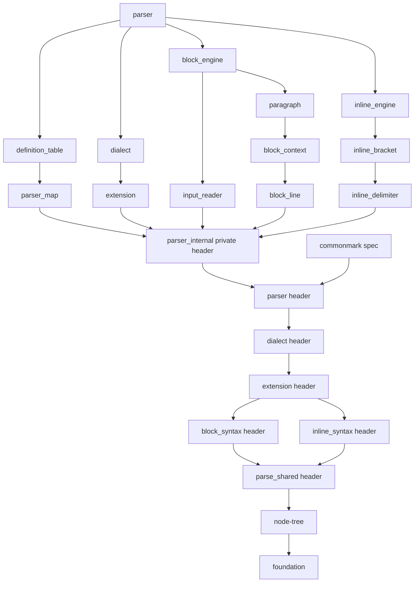
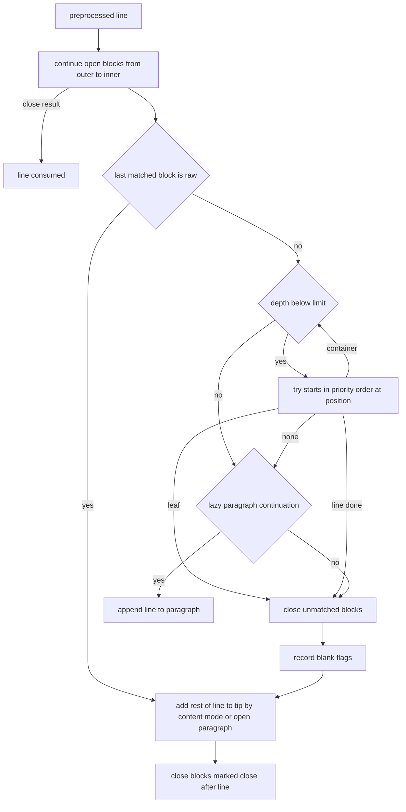
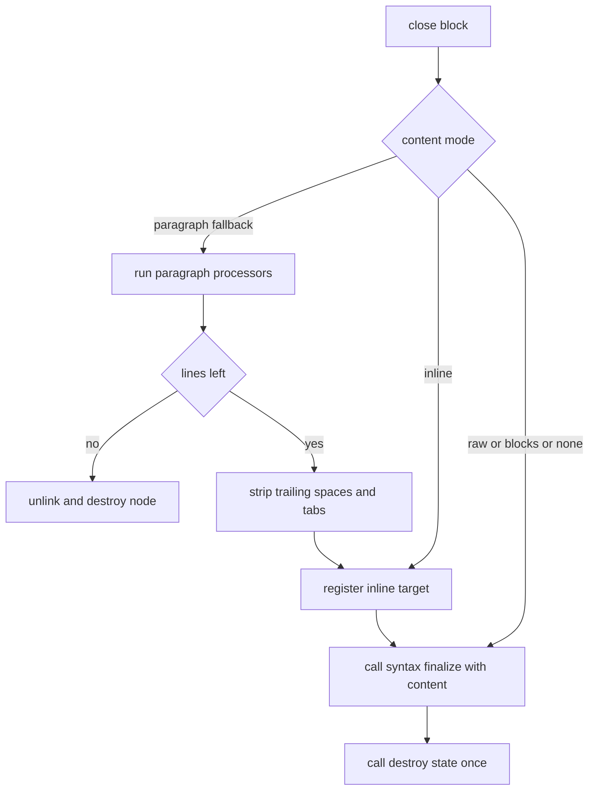
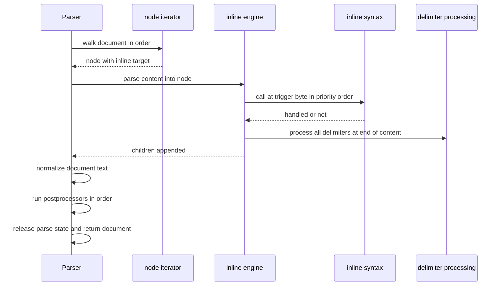
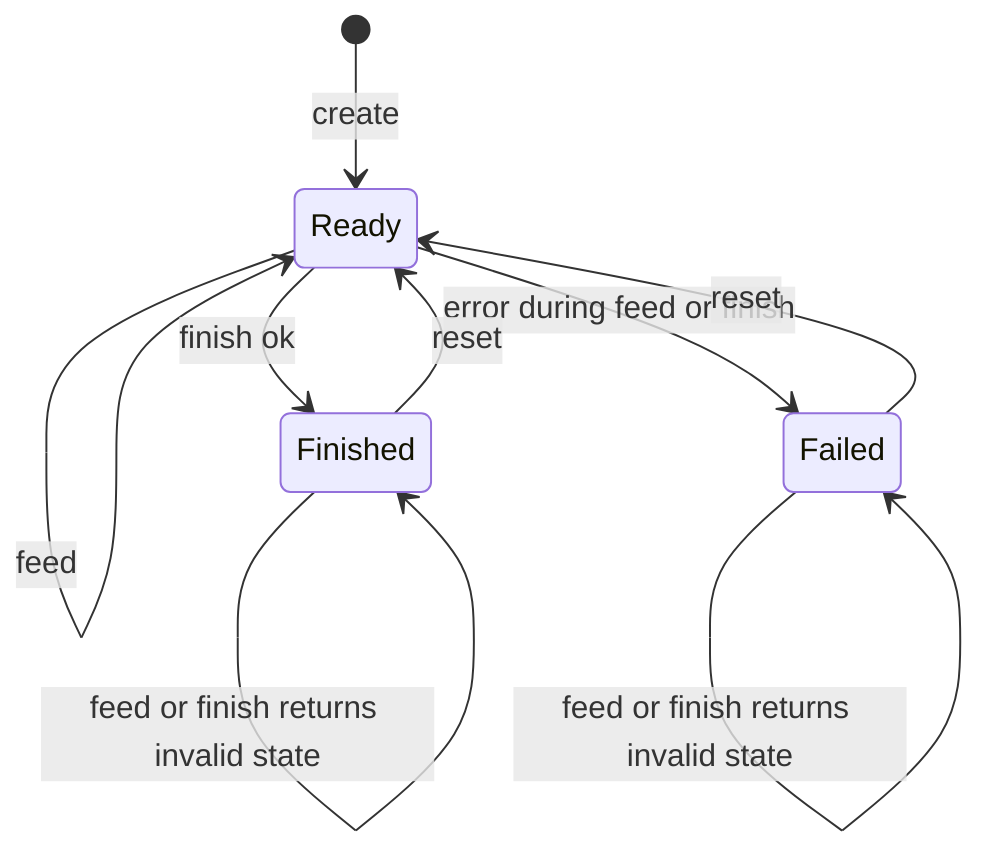
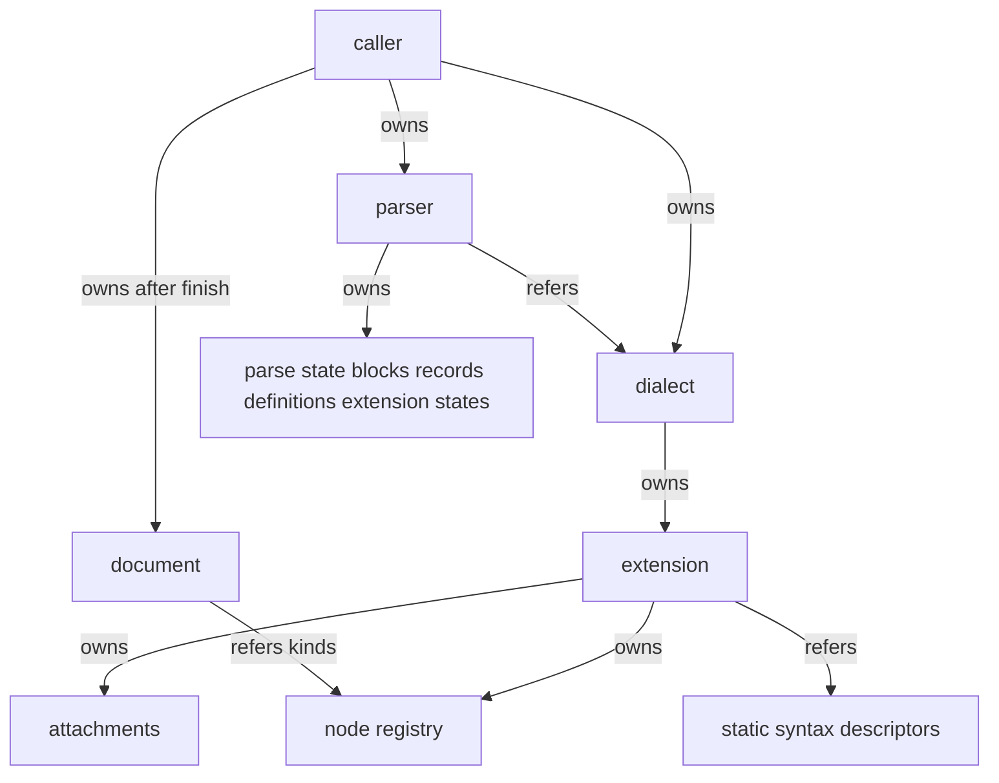

# Design Document: parser-core

## Overview

**Purpose**: Amark の構文非依存パーサエンジンを提供する。エンジンは cmark と同じ 2 段階（行単位のブロック解析 → インライン解析）の骨組みだけを持ち、個々の構文はブロック構文・インライン構文・段落の内容の処理器・後処理の vtable として「拡張」に束ねて登録する。拡張の集合が「方言」であり、利用者は方言を指定してパーサを生成し、入力を分割供給または一括で与えて node-tree の文書を得る。

**Users**: ライブラリ利用者は方言を組み立てて解析する。commonmark spec は本設計の公開 API だけで CommonMark の全構文を実装する（エンジンの非公開部分に触れない）。将来の gfm と第三者の拡張の作者は同じ API で構文とノード種別を追加し、レンダラの出力を同じ拡張に結び付ける。

**Impact**: foundation・node-tree の上に 6 つの公開ヘッダと対応するソース・テストを追加する。foundation のエラー列挙へ 1 つのコードを末尾追加する。node-tree の API は変更しない。

### Goals
- 構文を 1 つも含まない方言で、入力を段落とテキストだけの木にする
- CommonMark の全構文（コンテナ、葉、遅延継続、Setext 見出し、リンク参照定義、tight / loose、強調、リンク、画像、コードスパン、改行など）と GFM テーブルを、公開 API だけで実装できる汎用機構を揃える
- 分割供給と一括パースが同一の木を返す
- 病的な入力に対して入力長に線形に近い時間とメモリで解析を終え、深い入れ子でも呼び出しスタックをあふれさせない

### Non-Goals
- 個々の構文の規則とデータ（CommonMark の文字クラス表、HTML エンティティ表、参照ラベルの正規化）
- レンダリングとレンダラのフック機構の型
- ソース位置、ロスレス表現、増分再解析
- 拡張間の依存関係の宣言、構文単位の無効化（拡張単位の取り外しで代替する）

## Boundary Commitments

### This Spec Owns
- パーサオブジェクト `amark_parser_t` の寿命、解析オプション、分割供給・終了・リセット・一括パース
- 入力の前処理: 行末の正規化、NUL と不正な UTF-8 の U+FFFD への置換、先頭の BOM の除去、タブの桁計算と部分消費
- 段落とテキストのフォールバック（段落の振る舞いはエンジンが所有する）
- ブロック段階の行処理アルゴリズム、ブロック構文の vtable `amark_block_syntax_t` とブロック文脈 API
- 遅延継続、段落の中断と引き取り、段落の内容の処理器 `amark_paragraph_processor_t`、空行の記録
- インライン段階の走査とトリガー文字による呼び出し、インライン構文の vtable `amark_inline_syntax_t` とインライン文脈 API、デリミタスタックとデリミタ処理器 `amark_delimiter_handler_t`、ブラケットスタック
- 後処理 `amark_postprocessor_t`、定義テーブル `amark_definition_table_t`、拡張ごとの解析状態
- 拡張 `amark_extension_t`（記述子、ノード種別の登録、鍵付きの付随データ）と方言 `amark_dialect_t`（所有、名前の衝突、優先順位、凍結）
- 上限（ブロックの入れ子の深さ、ブラケットの深さ）と計算量の保証
- foundation のエラー列挙へ追加する `AMARK_ERROR_INVALID_STATE` を parser-core で返す条件と、実装時の追記（値・文字列・意味の定義元は foundation design.md のエラー表）
- 「Cross-Spec Contract」に定める、拡張とレンダラを結び付ける契約

### Out of Boundary
- 構文の規則（何が見出しか、flanking の判定、rule of 3、リンク先の文法、ラベルの正規化）— commonmark と各拡張
- レンダラの型、フックの表、出力 — html-renderer / markdown-renderer
- ノード、種別、レジストリ、編集、走査、正規化の実装 — node-tree（使うだけ）
- アロケータ、エラー文字列化の仕組み、スライス、バッファ、UTF-8 — foundation（エラー列挙への末尾追加のみ）
- GFM 固有の構文とノード種別

### Allowed Dependencies
- foundation の公開ヘッダ: `export.h`、`error.h`、`memory.h`、`slice.h`、`utf8.h`、`buffer.h`
- node-tree の公開ヘッダ: `node_kind.h`、`node.h`、`node_iter.h`
- C 標準ライブラリ: `<stddef.h>`、`<stdint.h>`、`<stdbool.h>`、`<string.h>`
- テスト: Naos、foundation の `tests/support/test_allocator`（テスト補助は `tests/support/test_<area>.{h,c}`、関数は `test_<area>_*` の命名に従う）
- 依存方向（左ほど下位。右から左への include のみ）: `foundation → node-tree → parse_shared.h → block_syntax.h, inline_syntax.h → extension.h → dialect.h → parser.h`。`src/parser/parser_internal.h` は本 spec の `.c` だけが include する。parser-core はレンダラのヘッダを include せず、node-tree の非公開ヘッダ `node_internal.h` を include しない

### Revalidation Triggers
- vtable（`amark_block_syntax_t`、`amark_inline_syntax_t`、`amark_delimiter_handler_t`、`amark_paragraph_processor_t`、`amark_postprocessor_t`）のフィールド・コールバックの型・結果の列挙の変更
- 行処理アルゴリズムの順序（継続 → 開始 → 遅延 → 内容）、段落の中断・遅延の可能性の定義、空行の記録規則の変更
- デリミタ処理の手順・openers_bottom の索引、ブラケットの閉じと無効化の意味の変更
- 段落のフォールバック規則（空白の除去、遅延継続、処理器の呼び出し時点）の変更
- 拡張・方言の所有規則、名前の衝突規則、優先順位の規則、凍結の規則、寿命の義務（標準種別だけの文書は拡張・方言・パーサの破棄後も有効、という保証を含む。`amark_cmark_parse` が依存する）の変更
- 「空行」の定義（継続判定と開始判定の後の行の残りがスペースとタブだけ）、インライン対象を 1 つずつ完了まで解析する順序と `amark_inline_context_get_block` の契約の変更（commonmark が依存する）
- 鍵付きの付随データ（attachment）と種別ハンドル取得の契約の変更（レンダラ側が依存する）
- 追加エラーコードの値・意味の変更、上限の既定値の変更

## Cross-Spec Contract（拡張とレンダラの結び付け）

parser-core はレンダラの型を一切知らない。拡張・ノード種別・レンダラ出力は次の契約で 1 つの拡張パッケージにまとまる。

1. **キーは種別ハンドル**: レンダラのフックは `const amark_node_kind_t *` をキーに引く（node-tree の下流ガイダンスどおり）。parser-core は、拡張が宣言したノード種別のハンドルを `amark_extension_create` の成功直後から `amark_extension_get_kind_at` / `amark_extension_find_kind` で返し、そのハンドルは拡張の破棄まで不変である。方言経由でも `amark_dialect_find_kind` で名前から得られる
2. **鍵付きの付随データ（attachment）**: `amark_extension_set_attachment(ext, key, data, destroy, user_data)` で、型を知らない任意のデータを `const void *` の鍵ごとに拡張へ結び付けられる。鍵はアドレスの同一性で比べる。レンダラの spec は自分の静的オブジェクトのアドレスを鍵として公開してよい（例: html-renderer がフック表を置く鍵）。parser-core はデータを読まず、拡張の破棄時に `destroy` を 1 回呼ぶ
3. **結び付けるのは拡張パッケージの側**: 「構文＋ノード種別＋HTML 出力＋Markdown 出力」を提供するパッケージ（例: 将来の gfm）は、parser-core の拡張を生成する関数と、各レンダラにフックを登録する関数を自分で公開する。後者は種別ハンドル（または拡張そのもの）を受け取る。parser-core はレンダラに依存せず、レンダラは parser-core に依存しない
4. **列挙の手段**: `amark_dialect_get_extension_count` / `amark_dialect_get_extension_at` で方言内の拡張を列挙できる。両方に依存する上位のモジュールや利用者のコードは、列挙と attachment を使って方言の全拡張のレンダラ出力を一括で登録できる
5. **寿命**: 種別ハンドルと attachment は拡張（方言に追加後は方言）の破棄まで有効。拡張（またはそれを所有する方言）は、その拡張の種別のノードを含む文書と、その種別のフックを保持するレンダラより長く生きなければならない（利用者の義務）。標準種別だけの文書と標準種別だけのフックはこの制約を受けない（標準種別のハンドルは node-tree の定数データ）

html-renderer への期待: フックのキーを `const amark_node_kind_t *` とし、標準種別の上書きは `amark_node_kind_get_standard` のハンドルで同じ表に入れる。attachment を使う場合は鍵とデータの型を html-renderer 側で公開する。本契約は parser-core 側に変更を要さない。

## Cross-Spec Change Note（foundation のエラー列挙）

本仕様が使う追加コード `AMARK_ERROR_INVALID_STATE`（`"invalid state"`）は、foundation design.md のエラーコード一覧表（追加した spec・文字列・意味の正本。並びは `AMARK_ERROR_LIST` と同じ）に、追加した spec を parser-core として登録済みである。node-tree が追加する `AMARK_ERROR_INVALID_CHILD`、`AMARK_ERROR_ALREADY_EXISTS` も同じ表で、その前に並ぶ。値は一覧の並び順で決まり、明示しない。本書では再定義しない。

- 本仕様での使い方: `INVALID_STATE` は、終了済み・失敗済みのパーサへの供給と終了、凍結された方言の変更、方言が所有する拡張の別の方言への追加
- 実装時は parser-core のタスクとして `include/amark/error.h` の `AMARK_ERROR_LIST` の末尾に `X(AMARK_ERROR_INVALID_STATE, "invalid state")` を追記する（追記専用。既存の項目を並べ替えない）。`src/base/error.c` と `tests/error_test.c` は一覧から生成・走査されるため変更しない
- 既存コードの使い分け: 引数の形の違反は `AMARK_ERROR_INVALID_ARGUMENT`、名前の重複と定義の重複は `AMARK_ERROR_ALREADY_EXISTS`、ノードの親子規則違反は `AMARK_ERROR_INVALID_CHILD`

node-tree との関係: node-tree の design.md は、本設計の決定（拡張ごとに 1 つのレジストリを拡張が所有し、parser-core の API には出さない。方言は拡張間の名前の重複を検査する）に合わせて更新済みである。

## Architecture

### Architecture Pattern & Boundary Map



**Architecture Integration**:
- Selected pattern: foundation・node-tree と同じ層状モジュール構成。公開ヘッダは `parse_shared.h → block_syntax.h / inline_syntax.h → extension.h → dialect.h → parser.h` の順に積む。ソースは非公開ヘッダ `parser_internal.h` で構造体を共有し、図の矢印の向き（依存先）だけを呼ぶ
- Domain/feature boundaries: 共有基盤（`parser_map`、`definition_table`）、拡張と方言（`extension`、`dialect`）、ブロック段階（`input_reader`、`block_line`、`block_context`、`paragraph`、`block_engine`）、インライン段階（`inline_delimiter`、`inline_bracket`、`inline_engine`）、全体の制御（`parser`）に分ける。ブロック段階とインライン段階は、`parser_internal.h` の「インライン対象」と「ブロック記録」を介してだけ接する
- Existing patterns preserved: foundation の共通 API 規約（エラー戻り値＋出力引数、`NULL` で `AMARK_ERROR_INVALID_ARGUMENT`、強い保証、`void` の後片付けは `NULL` で何もしない）、命名（`amark_<module>_<verb>`、`_t`、`_create` / `_destroy`、`_init`）、ヘッダ規約
- New components rationale: 各コンポーネントは要件群に対応する（Components 表）
- Steering compliance: エンジンは構文の名前で分岐しない（構文の同一性はポインタと名前の一致だけで扱う）。可変のグローバル状態を持たない。確保はすべて `amark_malloc` 系。テスト用の構文は `tests/support/` に置き、本体に入れない。深さに比例する再帰を使わない

### Technology Stack

| Layer | Choice / Version | Role in Feature | Notes |
|-------|------------------|-----------------|-------|
| 言語 | C99（foundation の設定を継承） | 本体とテスト | 新しい依存なし |
| ランタイム API | foundation（アロケータ、エラー、スライス、バッファ、UTF-8） | 確保、借用文字列、内容の蓄積、不正バイトの判定 | `amark_utf8_decode` の最大部分列で置換する |
| 木 | node-tree（ノード、種別、レジストリ、イテレータ、正規化） | 出力先、拡張種別の登録、文書順の走査、隣接テキストの結合 | `amark_node_normalize` |
| テスト | Naos v0.4.0、`amark_test_support` | モジュールごとのテスト実行ファイル、失敗注入 | テスト用の構文と木のダンプは `tests/support/` |

## File Structure Plan

### Directory Structure
```
include/amark/
├── parse_shared.h        # amark_definition_table_t と操作、amark_extension_t の前方宣言
├── block_syntax.h        # amark_block_syntax_t、内容の扱い・結果の列挙、amark_block_context_t の API、amark_paragraph_processor_t
├── inline_syntax.h       # amark_inline_syntax_t、amark_inline_context_t の API、デリミタ処理器、ブラケット
├── extension.h           # amark_extension_desc_t、amark_postprocessor_t、拡張の生成・破棄・種別・attachment
├── dialect.h             # amark_dialect_t、分類の列挙、追加・取り外し・検索・列挙・優先順位・凍結
└── parser.h              # amark_parser_options_t、amark_parser_t、生成・供給・終了・リセット・一括パース
src/
└── parser/
    ├── parser_internal.h     # 非公開: 全構造体の定義、内部関数の宣言（export しない）
    ├── parser_map.c          # 内部ハッシュ表（バイト列キーとポインタキー）。定義テーブルとブロック記録・インライン対象で共用
    ├── definition_table.c    # 名前空間付き定義テーブル（公開 API）と後片付け
    ├── extension.c           # 記述子の検証、レジストリの生成と種別登録、attachment
    ├── dialect.c             # 所有、名前の衝突検査、優先順位、凍結、並び替えた呼び出し表の構築
    ├── input_reader.c        # 分割入力の連結、行末の正規化、NUL・不正 UTF-8 の置換、BOM の除去、行の取り出し
    ├── block_line.c          # 行カーソル（バイト位置、桁、タブの部分消費、字下げ、空行判定）
    ├── block_context.c       # ブロック文脈の公開関数（行の問い合わせ・読み進め、open、内容、インライン対象、空行の問い合わせ）
    ├── paragraph.c           # フォールバック段落の振る舞い、段落の内容の処理器の呼び出しとキャッシュ、行の引き取り
    ├── block_engine.c        # 開いているブロックのスタック、1 行の処理手順、クローズ、ブロック記録、空行の記録
    ├── inline_delimiter.c    # デリミタスタック、openers_bottom、デリミタ処理の手順、テキストの確定
    ├── inline_bracket.c      # ブラケットスタック、水位線による無効化、閉じと取り除き
    ├── inline_engine.c       # インライン文脈の公開関数、トリガー表による呼び出し、保留テキスト、インライン対象の処理
    └── parser.c              # オプション、パーサの寿命と状態、供給・終了・リセット・一括パース、解析状態、後処理、正規化
tests/
├── support/
│   ├── test_syntax.h     # テスト用の拡張を作る関数 test_syntax_* の宣言
│   ├── test_syntax.c     # テスト用の構文（下の Testing Strategy の一覧）。公開 API だけを使う
│   ├── test_tree_dump.h  # 木を S 式風の文字列にする補助 test_tree_dump_* の宣言
│   └── test_tree_dump.c  # node_iter による反復で木を文字列化（期待値比較用）
├── parser_input_test.c      # 前処理（行末・NUL・不正 UTF-8・BOM・最終行）と UTF-8 の保証
├── parser_fallback_test.c   # 構文なしの段落とテキスト、空白の除去、空入力
├── parser_stream_test.c     # 分割供給の全分割点で一括と同一、状態遷移、リセット、一括パース
├── extension_test.c         # 記述子の検証、種別の登録と取得、attachment、失敗注入
├── dialect_test.c           # 所有、衝突、優先順位、取り外し、検索・列挙、凍結、失敗注入
├── block_syntax_test.c      # 開始・継続・クローズ・コンテナ・葉・子の受け入れ・タブの部分消費・ブロックの状態
├── paragraph_test.c         # 遅延継続、中断、引き取り、段落の内容の処理器、空行の記録の問い合わせ
├── inline_syntax_test.c     # トリガー、優先順位、未処理、テキスト結合、トリム、インライン対象
├── inline_delimiter_test.c  # デリミタ処理（強調相当・取り消し線相当）、分類の下限、残り
├── inline_bracket_test.c    # ブラケットの閉じ・取り除き・無効化・残り、定義テーブル
├── parser_limits_test.c     # 深さの上限、ブラケットの上限、10 万段、病的入力の呼び出し回数の線形性
└── parser_error_test.c      # 失敗注入の網羅、コールバックのエラー、失敗状態、後処理のエラー、資源の解放
```

### Modified Files
実装時に本 spec のタスクとして変更する（本 spec の作成時には変更しない）。
- `include/amark/error.h` — `AMARK_ERROR_LIST` の末尾へ `X(AMARK_ERROR_INVALID_STATE, "invalid state")` を追記（foundation design.md のエラーコード一覧表で登録済み）
- `include/amark/amark.h` — 6 つの公開ヘッダの include を parser-core のブロックとして追記
- `src/CMakeLists.txt` — 本 spec の 13 個の `.c` を `parser/<file>.c` の形でソース一覧に追記
- `tests/CMakeLists.txt` — 12 個のテスト実行ファイルを追記登録し、`test_syntax.c` と `test_tree_dump.c` をテスト補助ライブラリ `amark_test_support` のソースに追記する
- `tests/cxx_header_test.cpp` — C++ から方言の生成、一括パース、文書と方言の破棄を呼ぶ確認を追記
- 上の共有ファイル（包括ヘッダ、ビルド定義、C++ 検査、エラー列挙、`amark_test_support` のソース一覧）は foundation が所有する追記専用のファイルである。parser-core は自分のブロックを追記するだけで、既存の行を変更・並べ替えしない

## System Flows

### 1 行の処理（ブロック段階）



- 継続判定は、文書の直下から最も内側の開いているブロックまで、各ブロックの `continue_line` を呼ぶ。`NO` で止まり、それより内側は「未一致」になる。`CLOSE` はそのブロックを閉じて行を終える（フェンスの閉じ）。`continue_line` が `NULL` のブロックは常に `NO`（見出し、区切り線）
- 開始判定は、未一致のブロックが残る状態で始まってよい。最初のブロックを開く直前に、未一致のブロックを内側から閉じる（新しいブロックが始まった行は遅延継続にならないため）
- 開始判定を呼ぶ位置は「現在の位置」。構文は字下げを自分で読み飛ばす。`start_chars` を持つ構文は、現在の位置から最初の空白でない文字がその集合に含まれるときだけ呼ばれる（空行では呼ばれない）。`start_chars == NULL` の構文は毎回呼ばれる
- **空行の定義**（4.1、7.1、8.4、8.5）: 継続判定と開始判定で読み進めた後の現在位置から行末までがスペースとタブだけである行を空行とする（BlockLine の `blank` を、その時点の位置で評価する）。構文を含まない方言では読み進めがないため、行全体がスペースとタブだけの行と一致する。例: `> - a` / `>` / `> - b` の 2 行目は、引用の `continue_line` が `>` を読み進めた後の残りが空なので空行であり、項目に空行が記録されて CommonMark どおりリストが loose になる
- 遅延継続: 新しいブロックが開かれず、未一致のブロックがあり、前の行の終わりで最も内側だったブロックが遅延継続を受け付ける（`AMARK_BLOCK_FLAG_LAZY` を持つ INLINE のブロック。フォールバック段落は常に持つ）開いたブロックで、行が空行でないとき、行の残りをそのブロックに加え、未一致のブロックを閉じない
- 内容の追加: 未一致のブロックを閉じた後の最も内側の開いているブロック（tip）が RAW なら行の残りを蓄え、INLINE なら行として加える。BLOCKS か NONE で行が空行でなければ、子を受け入れる最も内側のブロックの下にフォールバック段落を開いて加える。空行は何も加えない
- 文書の終わりでは、開いているすべてのブロックを内側から閉じる

### ブロックのクローズ



- 段落の内容は「各行の先頭のスペースとタブを除いた行」を `\n` で連結したもの。末尾の空白は閉じるときに除く（4.3）
- INLINE のブロックは、閉じるときに自分のインライン内容をインライン対象として登録する。`finalize` は `amark_block_context_set_inline_content` で内容を差し替えるか、`amark_block_context_add_inline_target` で子孫ノードを追加の対象にできる（GFM テーブルのセル）

### インライン段階と後処理



### パーサの状態



- `Ready` の間に入力が来るたび、完成した行をブロック段階で処理する。インライン段階・後処理・正規化は `finish` の中で行う
- 失敗は、確保の失敗、コールバックが返したエラー、構文の契約違反（`AMARK_ERROR_INVALID_ARGUMENT` を返す文脈関数の誤用など）で起きる。失敗した時点で未完成の文書と解析状態を解放する

## Requirements Traceability

| Requirement | Summary | Components | Interfaces | Flows |
|-------------|---------|------------|------------|-------|
| 1.1, 1.2, 1.3, 1.4 | 生成とオプション | ParserCore | `amark_parser_create`、`amark_parser_options_init` | パーサの状態 |
| 1.5, 1.6, 1.7 | 破棄・リセット | ParserCore | `amark_parser_destroy`、`amark_parser_reset` | パーサの状態 |
| 2.1, 2.2, 2.5, 2.6 | 分割供給と同一性 | ParserCore, InputReader | `amark_parser_feed` | 1 行の処理 |
| 2.3, 2.4, 2.8 | 終了と一括パース | ParserCore | `amark_parser_finish`、`amark_parser_parse` | インライン段階 |
| 2.7 | 終了後の拒否 | ParserCore | `AMARK_ERROR_INVALID_STATE` | パーサの状態 |
| 3.1, 3.2, 3.3, 3.4, 3.5, 3.7 | 行末・NUL・不正 UTF-8・BOM | InputReader | 内部 `amark_input_reader_*` | 1 行の処理 |
| 3.6 | タブの桁と部分消費 | BlockLine, BlockContext | `amark_block_context_advance_columns` ほか | 1 行の処理 |
| 4.1, 4.2, 4.3, 4.5, 4.6 | 段落のフォールバック | Paragraph, BlockEngine | 内部の段落の振る舞い | 1 行の処理、クローズ |
| 4.4 | テキストのフォールバック | InlineEngine | 保留テキスト | インライン段階 |
| 5.1, 5.2, 5.3, 5.4, 5.5 | 開始判定 | BlockEngine, BlockContext, BlockLine | `amark_block_syntax_t.start`、`amark_block_context_*` | 1 行の処理 |
| 5.6, 5.7, 5.8 | 子の受け入れと open | BlockContext, BlockEngine | `amark_block_context_open`、`can_contain` | 1 行の処理 |
| 6.1, 6.2, 6.4, 6.7 | 継続とクローズ順 | BlockEngine | `continue_line`、結果の列挙 | 1 行の処理 |
| 6.3, 6.5 | 内容の扱い 4 種と RAW の追加 | BlockEngine, BlockLine | `amark_block_content_t` | 1 行の処理 |
| 6.6, 6.8 | finalize とブロックの状態 | BlockEngine, BlockContext | `finalize`、`destroy_state` | クローズ |
| 7.1, 7.6 | 遅延継続と空行の定義 | BlockEngine, Paragraph, BlockLine | `AMARK_BLOCK_FLAG_LAZY`、`amark_block_context_is_blank` | 1 行の処理 |
| 7.2, 7.3 | 段落の行の提供と引き取り | Paragraph, BlockContext | `amark_block_context_get_paragraph`、`amark_block_context_open_from_paragraph` | 1 行の処理 |
| 7.4, 7.5 | 段落の内容の処理器 | Paragraph | `amark_paragraph_processor_t` | クローズ |
| 8.1, 8.2 | 定義テーブル | DefinitionTable, ParserMap | `amark_definition_table_add`、`_find` | — |
| 8.3 | 拡張ごとの解析状態 | ParserCore, Extension | `state_create`、`state_destroy`、`*_get_state` | パーサの状態 |
| 8.4, 8.5 | 空行（継続・開始の後の残りで判定）の記録と問い合わせ | BlockEngine, BlockContext, BlockLine | `record_blank`、`amark_block_context_ends_with_blank` | 1 行の処理 |
| 8.6 | 解析中の状態をノードに持たない | ParserCore, BlockEngine | ブロック記録（パーサ側の表） | パーサの状態 |
| 9.1, 9.2, 9.3, 9.4, 9.5, 9.6 | インライン対象の逐次処理、呼び出しとテキスト | InlineEngine | `amark_inline_syntax_t`、`amark_inline_context_*`、`amark_inline_context_get_block` | インライン段階 |
| 9.7 | トリガー文字の検証 | Extension | `amark_extension_create` | — |
| 10.1, 10.2, 10.3, 10.4, 10.5 | デリミタ処理 | InlineDelimiter | `amark_delimiter_handler_t`、`amark_inline_context_push_delimiter` | インライン段階 |
| 11.1, 11.2, 11.3, 11.4, 11.5, 11.6 | ブラケット処理 | InlineBracket | `amark_inline_context_push_bracket` ほか | インライン段階 |
| 12.1, 12.2 | 後処理 | ParserCore | `amark_postprocessor_t` | インライン段階 |
| 13.1, 13.2, 13.3, 13.4 | 拡張の生成と種別 | Extension | `amark_extension_desc_t`、`amark_extension_create` | — |
| 13.5, 13.6 | attachment と破棄 | Extension | `amark_extension_set_attachment`、`_get_attachment` | — |
| 13.7, 13.8 | 同じ API・寿命の義務（拡張種別を含む文書に限る） | Extension, Dialect | 公開ヘッダの文書 | — |
| 14.1, 14.2, 14.3, 14.4 | 追加・衝突・順序・優先順位 | Dialect | `amark_dialect_add_extension`、`amark_dialect_set_priority` | — |
| 14.5, 14.6, 14.8 | 取り外し・検索・破棄 | Dialect | `amark_dialect_remove_extension`、`_find_*`、`_destroy` | — |
| 14.7, 14.9 | 凍結と寿命の義務（拡張種別を含む文書に限る） | Dialect, ParserCore | `amark_dialect_freeze`、`dialect.h` の文書 | パーサの状態 |
| 15.1, 15.5 | 線形時間とメモリ | BlockEngine, InlineEngine, InlineDelimiter, InlineBracket, Paragraph | 計算量の規則 | 全フロー |
| 15.2 | ブロックの深さの上限 | BlockEngine | `max_nesting_depth` | 1 行の処理 |
| 15.3 | ブラケットの上限 | InlineBracket | `max_bracket_depth` | インライン段階 |
| 15.4 | 10 万段で再帰なし | BlockEngine, InlineEngine, ParserCore | 反復アルゴリズム | 全フロー |
| 16.1 | 共通エラーコード | 全コンポーネント, ErrorCodeAddition | `AMARK_ERROR_INVALID_STATE` | — |
| 16.2, 16.4, 16.5 | アロケータ・引数・解放 | 全コンポーネント | 共通 API 規約 | — |
| 16.3 | 失敗状態 | ParserCore | 状態遷移 | パーサの状態 |
| 16.6 | スレッドの規則 | Dialect, ParserCore | `dialect.h`、`parser.h` の文書 | — |

## Components and Interfaces

| Component | Domain/Layer | Intent | Req Coverage | Key Dependencies (P0/P1) | Contracts |
|-----------|--------------|--------|--------------|--------------------------|-----------|
| ParserInternal | 非公開 | 構造体と内部関数の共有定義 | 全体の前提 | foundation, node-tree (P0) | State |
| ParserMap | 共有基盤 | 内部ハッシュ表 | 8.1, 15.1 | Memory (P0) | Service |
| DefinitionTable | 共有基盤 | 名前空間付き定義テーブル | 8.1, 8.2 | ParserMap (P0) | Service, State |
| Extension | 拡張 | 記述子の検証、種別の登録、attachment | 9.7, 13.1–13.8 | NodeRegistry (P0) | Service, State |
| Dialect | 拡張 | 拡張の集合、衝突・順序・凍結 | 14.1–14.9, 16.6 | Extension (P0) | Service, State |
| InputReader | ブロック段階 | 前処理と行の取り出し | 2.1, 2.2, 3.1–3.5, 3.7 | Utf8, Buffer (P0) | Service, State |
| BlockLine | ブロック段階 | 行カーソル（桁、タブ） | 3.6, 5.4, 6.5 | — | Service |
| BlockContext | ブロック段階 | 構文に公開するブロック文脈 | 3.6, 5.4, 5.5, 5.7, 5.8, 6.6, 6.8, 7.2, 7.3, 8.4 | BlockLine (P0), BlockEngine (P0) | Service |
| Paragraph | ブロック段階 | フォールバック段落と段落の内容の処理器 | 4.1–4.3, 4.5, 7.1–7.5, 15.1 | BlockContext (P0) | Service |
| BlockEngine | ブロック段階 | 1 行の処理手順、開いているブロック、記録 | 4.6, 5.1–5.3, 5.6, 6.1–6.8, 7.1, 7.6, 8.4–8.6, 15.1, 15.2, 15.4 | Paragraph, InputReader (P0) | Service, State |
| InlineDelimiter | インライン段階 | デリミタスタックと処理 | 10.1–10.5, 15.1 | node-tree (P0) | Service, State |
| InlineBracket | インライン段階 | ブラケットスタック | 11.1–11.6, 15.3 | InlineDelimiter (P0) | Service, State |
| InlineEngine | インライン段階 | トリガー呼び出し、テキスト、インライン対象 | 4.4, 9.1–9.6, 15.1, 15.4 | InlineBracket (P0) | Service, State |
| ParserCore | 制御 | オプション、寿命、供給、終了、解析状態、後処理 | 1.1–1.7, 2.1–2.8, 8.3, 8.6, 12.1, 12.2, 14.7, 16.3, 16.6 | BlockEngine, InlineEngine, Dialect (P0) | Service, State |
| ErrorCodeAddition | foundation への追加 | `AMARK_ERROR_INVALID_STATE` | 16.1 | foundation Error (P0) | Service |
| ParserIntegration | ビルド・テスト登録 | 包括ヘッダ、ビルド、テスト補助、C++ 検査 | 13.7, 16.1, 16.2 | foundation BuildSystem, TestHarness (P0) | Batch |

### 共通の API 規約（本仕様の全公開関数）
- foundation の共通 API 規約に従う。`amark_error_t` を返す関数は、必須のポインタ引数が `NULL` なら `AMARK_ERROR_INVALID_ARGUMENT` を返し何も変更しない（16.4）。失敗時は呼び出し前の状態を保つ。ただし解析中の失敗はパーサを失敗状態にする（16.3）
- 名前（拡張名、構文名、処理器名）は node-tree の種別名と同じ規則: 1〜64 バイト、`[a-z][a-z0-9_]*`
- 文脈（`amark_block_context_t`、`amark_inline_context_t`）はそれを渡されたコールバックの実行中だけ有効。保存して後で使ってはならない
- コールバックは、渡されたノード・文脈の操作関数・自分の状態以外に、解析中の文書を変更してはならない（後処理を除く）。ライブラリはこれを検出しない
- 所有権の移転: 解析中に構文が渡すもの（`amark_block_context_open` / `_open_from_paragraph` のノードと状態、`amark_inline_context_append_node` と `amark_inline_context_close_bracket` のノード）は、成功・失敗にかかわらずエンジンが引き取る（失敗時はエンジンが破棄する）。利用者が渡すもの（`amark_dialect_add_extension` の拡張、`amark_definition_table_add` の値、`amark_extension_set_attachment` のデータ）は成功時だけ引き取り、失敗時は呼び出し側に残る（14.2）
- 公開ヘッダは `AMARK_<NAME>_H` の include ガード、`AMARK_BEGIN_DECLS` / `AMARK_END_DECLS`、`AMARK_API` を付ける

### 非公開

#### ParserInternal

| Field | Detail |
|-------|--------|
| Intent | 本 spec の `.c` が共有する構造体定義と内部関数 |
| Requirements | 全体の前提 |

**Contracts**: State [x]

##### State Management
主要な構造体（`src/parser/parser_internal.h`、`AMARK_API` を付けず export しない）:

| 構造体 | 主なフィールド | 所有 |
|---|---|---|
| `struct amark_extension` | 名前の複製、記述子の配列の複製（構文は `const` ポインタのまま）、`amark_node_registry_t *`、種別ハンドルの配列、attachment の配列、`owner`（方言、なければ `NULL`） | 方言または呼び出し側 |
| `struct amark_dialect` | 拡張の配列（追加順）、優先順位の上書きの表、`frozen`、凍結時に作る呼び出し表（開始判定の順序付き配列、トリガー文字 → 構文の 256 要素の表、処理器・後処理の順序付き配列） | 呼び出し側 |
| `struct amark_parser` | 方言、オプション、状態（READY / FINISHED / FAILED）、入力読み取り、ブロック段階、定義テーブル、拡張ごとの解析状態の配列、未完成の文書 | 呼び出し側 |
| `amark_open_block_t` | ノード、構文（フォールバック段落は内部の静的な構文）、状態、内容バッファ、段落の行の終わりの位置の配列、`close_after_line` | ブロック段階 |
| `amark_block_record_t` | `last_line_blank`、インライン対象の内容（所有、なければ空） | ブロック記録の表（ノードのポインタがキー） |
| `struct amark_definition_table` | ParserMap（名前空間 + `\0` + 鍵 → 値、後片付け関数、user_data） | パーサ |

- サイズ 0 の確保の禁止（foundation の Memory のライブラリ内の規則）: 個数が 0 になりうる配列は、個数が 1 以上のときだけ確保し、空は `NULL` と個数 0 で表す。対象は、拡張の記述子の配列の複製と種別ハンドルの配列（構文・処理器・後処理・ノード種別のいずれかを宣言しない拡張。例: commonmark の各拡張は `node_kind_count = 0`）、attachment の配列、方言の拡張の配列（拡張 0 個の方言）、凍結時の呼び出し表（該当する分類の要素が 0 個の方言の開始判定の配列・処理器と後処理の配列、トリガー表の各文字の構文一覧）、拡張ごとの解析状態の配列、段落の行の終わりの位置の配列、デリミタとブラケットのスタック、openers_bottom の組の配列。伸長する配列は最初の追加で 1 以上の初期容量を確保する。確保の戻り値 `NULL` を `AMARK_ERROR_NO_MEMORY` と扱うのは、個数が 1 以上の確保に限る。開いているブロックのスタックは文書を底に常に 1 段以上、内容は foundation のバッファ（予約は常に 1 以上）、名前と定義の鍵の複製は 1 バイト以上（名前は空を拒否し、鍵は名前空間 + `\0` を含む）なので該当しない

- 内部関数の向きは Architecture の図どおり。ブロック段階（`block_line.c`、`block_context.c`、`paragraph.c`、`block_engine.c`）は 1 つの層として扱い、層の中の相互呼び出し（`block_context.c` の open が `block_engine.c` の内部関数を呼ぶ、など）だけを `parser_internal.h` の宣言で許す。層をまたぐ向きは図の矢印だけ: インライン段階のソースはブロック段階のソースを呼ばず、ブロック段階はインライン段階を呼ばない。両段階をつなぐのは `parser.c` だけである

### 共有基盤

#### ParserMap

| Field | Detail |
|-------|--------|
| Intent | 開番地法のハッシュ表。キーはバイト列（定義テーブル）またはポインタ（ブロック記録、attachment は配列で足りるため使わない） |
| Requirements | 8.1, 15.1 |

- 操作: 初期化、後片付け、挿入（既存なら既存を返す）、検索。初期化は確保せず（空は `NULL` と容量 0）、最初の挿入で 1 以上の初期容量を確保する。負荷率 0.5 を超えたら 2 倍に伸長し、償却定数時間（15.1）。ハッシュは FNV-1a（64 ビット、`size_t` に畳む）。確保失敗時は表を変更しない
- Risks: ハッシュの衝突攻撃で最悪二乗になる。定義テーブルの鍵は構文が正規化した入力由来のため、ハッシュにパーサごとの種（パーサのアドレスと生成順の値の混合）を加えて固定パターンの攻撃を避ける

#### DefinitionTable

| Field | Detail |
|-------|--------|
| Intent | 1 回の解析の間ブロック段階とインライン段階で共有する、名前空間付きの定義テーブル |
| Requirements | 8.1, 8.2 |

**Contracts**: Service [x] / State [x]

##### Service Interface
```c
/* include/amark/parse_shared.h */
#include <amark/node.h>

typedef struct amark_extension amark_extension_t;
typedef struct amark_definition_table amark_definition_table_t;
typedef void (*amark_definition_destroy_fn_t)(void *value, void *user_data);

AMARK_API amark_error_t amark_definition_table_add(amark_definition_table_t *table, amark_slice_t space, amark_slice_t key,
                                                   void *value, amark_definition_destroy_fn_t destroy, void *user_data);
AMARK_API void *amark_definition_table_find(const amark_definition_table_t *table, amark_slice_t space,
                                            amark_slice_t key);
```
- `add`: `table` が `NULL`、`space` または `key` がスライスの不変条件に反する、`space` が空: `AMARK_ERROR_INVALID_ARGUMENT`。同じ `(space, key)` が既にあれば既存を保ち `AMARK_ERROR_ALREADY_EXISTS`（8.2。CommonMark の「最初の定義が優先」）。確保失敗で `AMARK_ERROR_NO_MEMORY`。成功時だけ値の所有を引き取り、失敗時は呼び出し側に残す（`destroy` を呼ばない）
- `find`: バイト単位で一致する値、なければ `NULL`。鍵の正規化（大文字小文字の畳み込み、空白の圧縮）は構文の責任
- 後片付け: 解析の完了・失敗・リセット・パーサの破棄の時に、登録順に各値の `destroy(value, user_data)`（`NULL` なら呼ばない）を 1 回呼ぶ（8.6）
- 取得: `amark_block_context_get_definitions`、`amark_inline_context_get_definitions`、後処理の引数（8.1）

### 拡張

#### Extension

| Field | Detail |
|-------|--------|
| Intent | 構文・ノード種別・処理器・後処理・解析ごとの状態を 1 つにまとめる単位 |
| Requirements | 9.7, 13.1, 13.2, 13.3, 13.4, 13.5, 13.6, 13.7, 13.8 |

**Responsibilities & Constraints**
- 拡張は自分の `amark_node_registry_t` を所有し、宣言したノード種別をすべて登録する（拡張ごとのレジストリ。research.md の決定）。種別ハンドルは拡張の破棄まで不変（13.2）
- 構文・処理器・後処理の記述子は `const` ポインタとして保持し、複製しない。記述子とその `name`・`start_chars`・`triggers`・`user_data` の参照先は拡張より長く生きること（静的データを想定）。ノード種別の記述子と拡張名は複製する
- ライブラリ同梱の構文（commonmark）も外部の拡張も、この API だけで作る（13.7）

**Contracts**: Service [x] / State [x]

##### Service Interface
```c
/* include/amark/extension.h */
#include <amark/block_syntax.h>
#include <amark/inline_syntax.h>

typedef amark_error_t (*amark_extension_state_create_fn_t)(void **state, void *user_data);
typedef void (*amark_extension_state_destroy_fn_t)(void *state, void *user_data);
typedef void (*amark_extension_attachment_destroy_fn_t)(void *data, void *user_data);

typedef amark_error_t (*amark_postprocess_fn_t)(amark_node_t *doc, amark_definition_table_t *definitions,
                                                void *state, void *user_data);

typedef struct amark_postprocessor
{
    amark_slice_t name;
    int priority;                   /* 小さいほど先 */
    amark_postprocess_fn_t process; /* 必須 */
    void *user_data;
} amark_postprocessor_t;

typedef struct amark_extension_desc
{
    amark_slice_t name;
    const amark_node_kind_desc_t *node_kinds;              /* 複製される */
    size_t node_kind_count;
    const amark_block_syntax_t *const *block_syntaxes;     /* ポインタを保持 */
    size_t block_syntax_count;
    const amark_inline_syntax_t *const *inline_syntaxes;
    size_t inline_syntax_count;
    const amark_paragraph_processor_t *const *paragraph_processors;
    size_t paragraph_processor_count;
    const amark_postprocessor_t *const *postprocessors;
    size_t postprocessor_count;
    amark_extension_state_create_fn_t state_create;        /* NULL 可。state_destroy と対 */
    amark_extension_state_destroy_fn_t state_destroy;
    void *user_data;                                       /* 状態の関数へ渡す。所有しない */
} amark_extension_desc_t;

AMARK_API amark_error_t amark_extension_create(const amark_extension_desc_t *desc, amark_extension_t **extension);
AMARK_API void amark_extension_destroy(amark_extension_t *extension);
AMARK_API amark_slice_t amark_extension_get_name(const amark_extension_t *extension);
AMARK_API size_t amark_extension_get_kind_count(const amark_extension_t *extension);
AMARK_API const amark_node_kind_t *amark_extension_get_kind_at(const amark_extension_t *extension, size_t index);
AMARK_API const amark_node_kind_t *amark_extension_find_kind(const amark_extension_t *extension, amark_slice_t name);
AMARK_API amark_error_t amark_extension_set_attachment(amark_extension_t *extension, const void *key, void *data,
                                                       amark_extension_attachment_destroy_fn_t destroy,
                                                       void *user_data);
AMARK_API void *amark_extension_get_attachment(const amark_extension_t *extension, const void *key);
```
- `amark_extension_create` の検証順（失敗時は何も残さず `*extension` を変更しない）:
  1. `desc`・`extension` が `NULL`、配列が `NULL` なのに個数が 1 以上、配列の要素が `NULL`: `AMARK_ERROR_INVALID_ARGUMENT`
  2. 拡張名・構文名・処理器名・後処理名の形式違反、同じ分類の中の名前の重複、必須の関数の欠落（インライン構文の `parse`、処理器の `process`、後処理の `process`。ブロック構文に必須の関数はない: `start == NULL` は他の構文から open されるだけの構文、`continue_line == NULL` は 1 行で終わる構文を表す）、`state_create` と `state_destroy` の片方だけ、`content` が未定義値、`start_chars` / `triggers` に許されない文字: `AMARK_ERROR_INVALID_ARGUMENT`（13.3）
  3. `triggers` は 1 文字以上で、各バイトが `0x20`〜`0x7E` または `\n`（9.7）。`start_chars` は `0x21`〜`0x7E`（空白でない印字可能 ASCII）
  4. レジストリを生成し、ノード種別を宣言順に `amark_node_registry_add`。node-tree が返す `AMARK_ERROR_INVALID_ARGUMENT`（記述子の矛盾）・`AMARK_ERROR_ALREADY_EXISTS`（拡張内または標準種別との名前の重複、13.4）・`AMARK_ERROR_NO_MEMORY` をそのまま返し、レジストリを破棄する
  5. 成功: `*extension` に書き `AMARK_OK`（13.1）。種別は `get_kind_at(i)` で宣言順に得られる（13.2）
- `amark_extension_destroy`: `NULL`、または方言が所有する拡張（`owner != NULL`）には何もしない（所有者が破棄する）。それ以外は attachment の `destroy` を設定順に 1 回ずつ呼び、レジストリ（種別）と自身を解放する（13.6）
- `get_kind_at`: 範囲外は `NULL`。`find_kind`: この拡張の種別だけを名前で探す（標準種別は返さない）
- `set_attachment(ext, key, data, destroy, user_data)`: `ext`・`key` が `NULL` は `AMARK_ERROR_INVALID_ARGUMENT`。同じ鍵があれば旧データの `destroy` を呼んで置き換える（同じ `data` なら何もしない）。`data == NULL` は鍵の削除（旧データの `destroy` を呼ぶ）。新しい鍵の確保失敗は `AMARK_ERROR_NO_MEMORY` でデータの所有は移らない（13.5）。凍結された方言の拡張にも設定できる（解析に影響しないため）。ただしその拡張を使う解析と同時に呼んではならない
- `get_attachment`: 鍵の一致するデータ、なければ `NULL`
- 寿命の義務（13.8、`extension.h` に明記）: 拡張の種別のノードを**含む**文書は、拡張の破棄（方言に追加済みなら方言の破棄）より先に破棄すること。その種別のフックを保持するレンダラも同様。標準種別のノードだけからなる文書はノードが node-tree の定数の種別だけを参照するため、拡張の破棄の後も有効である

**Implementation Notes**
- Validation: `extension_test.c` で正常な生成と種別の取得、各検証エラー、種別名の重複（拡張内、標準名）、トリガー文字の境界（`0x1F`、`0x7F`、`0x80`、`\n`）、attachment の置換・削除・後片付けの回数、所有された拡張の destroy が何もしないこと、失敗注入の網羅パターン（失敗時 `live` が呼び出し前と同じ）

#### Dialect

| Field | Detail |
|-------|--------|
| Intent | 拡張の集合を所有し、名前の衝突・試行順・凍結を管理する |
| Requirements | 14.1, 14.2, 14.3, 14.4, 14.5, 14.6, 14.7, 14.8, 14.9, 16.6 |

**Contracts**: Service [x] / State [x]

##### Service Interface
```c
/* include/amark/dialect.h */
#include <amark/extension.h>

typedef struct amark_dialect amark_dialect_t;

typedef enum amark_syntax_category
{
    AMARK_SYNTAX_CATEGORY_BLOCK,
    AMARK_SYNTAX_CATEGORY_INLINE,
    AMARK_SYNTAX_CATEGORY_PARAGRAPH_PROCESSOR,
    AMARK_SYNTAX_CATEGORY_POSTPROCESSOR
} amark_syntax_category_t;

AMARK_API amark_error_t amark_dialect_create(amark_dialect_t **dialect);
AMARK_API void amark_dialect_destroy(amark_dialect_t *dialect);
AMARK_API amark_error_t amark_dialect_add_extension(amark_dialect_t *dialect, amark_extension_t *extension);
AMARK_API amark_error_t amark_dialect_remove_extension(amark_dialect_t *dialect, amark_slice_t name);
AMARK_API amark_extension_t *amark_dialect_find_extension(const amark_dialect_t *dialect, amark_slice_t name);
AMARK_API size_t amark_dialect_get_extension_count(const amark_dialect_t *dialect);
AMARK_API amark_extension_t *amark_dialect_get_extension_at(const amark_dialect_t *dialect, size_t index);
AMARK_API const amark_node_kind_t *amark_dialect_find_kind(const amark_dialect_t *dialect, amark_slice_t name);
AMARK_API amark_error_t amark_dialect_set_priority(amark_dialect_t *dialect, amark_syntax_category_t category,
                                                   amark_slice_t name, int priority);
AMARK_API amark_error_t amark_dialect_freeze(amark_dialect_t *dialect);
AMARK_API bool amark_dialect_is_frozen(const amark_dialect_t *dialect);
```
- `add_extension`（14.1、14.2）: 凍結済みなら `AMARK_ERROR_INVALID_STATE`（14.7）。拡張が既に方言に所有されていれば `AMARK_ERROR_INVALID_STATE`。拡張名、同じ分類の構文名・処理器名・後処理名、ノード種別名のいずれかが方言内の既存と一致すれば `AMARK_ERROR_ALREADY_EXISTS`。配列の伸長失敗は `AMARK_ERROR_NO_MEMORY`。いずれの失敗も方言を変えず、所有は呼び出し側に残る。成功時は所有を移し（`owner` を設定）末尾に加える
- 試行順（14.3）: 各分類の要素を「実効優先順位（上書きがあればその値、なければ記述子の `priority`）の昇順、同じ値なら方言への追加順、同じ拡張内では配列の順」に並べる。インライン構文はトリガー文字ごとにこの順の一覧を作る。並べ替えは凍結時に安定ソートで 1 回行う
- `set_priority`（14.4）: 凍結済みなら `AMARK_ERROR_INVALID_STATE`。未定義の分類、名前が方言内に見つからなければ `AMARK_ERROR_INVALID_ARGUMENT`。上書きは拡張の取り外し後も名前に対して残る（同じ名前の構文を差し替えた場合に同じ順位を引き継ぐ）
- `remove_extension`（14.5）: 凍結済みなら `AMARK_ERROR_INVALID_STATE`。見つからなければ `AMARK_ERROR_INVALID_ARGUMENT`。見つかれば配列から除き、`owner` を外してから破棄する
- `find_extension` / `get_extension_at` / `get_extension_count`: 一致・範囲内の拡張、なければ `NULL` / 0（14.6）
- `find_kind(name)`: 標準種別（`amark_node_kind_get_standard` で得られる 18 の標準種別の名前）、次に追加順に各拡張の `amark_extension_find_kind`。なければ `NULL`（14.6）
- `freeze`: 呼び出し表を構築して凍結する。既に凍結済みなら何もせず `AMARK_OK`。確保失敗は `AMARK_ERROR_NO_MEMORY` で凍結しない。`amark_parser_create` は内部で `freeze` を呼ぶ（14.7）。凍結は解除できない
- `destroy`: 拡張を追加順に破棄し（`owner` を外して `amark_extension_destroy`）、自身を解放する（14.8）
- 寿命の義務（14.9、`dialect.h` に明記）: 方言は、それを使うすべてのパーサと、それらが返した文書のうち方言の拡張の種別のノードを含むものより後に破棄すること。返した文書はパーサと方言を参照しないため、標準種別のノードだけからなる文書は方言とパーサの破棄の後も有効である（commonmark の `amark_cmark_parse` は、内部で作った方言とパーサを破棄してから文書を返すことにこの保証を使う）

##### State Management
- State model: 「組み立て中」と「凍結」の 2 状態。凍結後は構文の構成と順序が変わらない
- Concurrency strategy（16.6）: 凍結後の方言は読み取り専用で、それを使う異なるパーサを別スレッドで同時に使ってよい（構文のコールバックがスレッド安全である限り）。凍結（`freeze` または最初の `amark_parser_create`）は他のスレッドと同時に行わないこと。attachment の変更は解析と同時に行わない

**Implementation Notes**
- Validation: `dialect_test.c` で追加と所有の移転、各種の名前の衝突（拡張名、ブロック構文名、インライン構文名、処理器名、後処理名、ノード種別名）で状態不変かつ所有が残ること、優先順位の昇順と同順位の追加順（記録用の構文で呼び出し順を観測）、`set_priority` による順序の変更、取り外し、検索と列挙、凍結後の変更の拒否、二重所有の拒否、失敗注入

### ブロック段階

#### InputReader

| Field | Detail |
|-------|--------|
| Intent | 分割入力を連結し、正規化された完成した行を順に取り出す |
| Requirements | 2.1, 2.2, 3.1, 3.2, 3.3, 3.4, 3.5, 3.7 |

**Contracts**: Service [x] / State [x]

- 内部 API: `amark_input_reader_init`、`_deinit`、`_reset`、`_push(reader, data, len)`（断片を未処理バッファへ追記）、`_next_line(reader, at_end, amark_slice_t *line, bool *has_line)`（完成した行を 1 つ正規化して返す。`at_end` が真なら行末のない最後の行も返す）
- 正規化（行ごとに 1 回、出力は内部の行バッファ）:
  - 行末: LF、CR LF、単独の CR を区切りとし、行末を含めない（3.1）。断片の末尾が CR のときは次の断片か終了まで行を確定しない（CR LF の分割に対する同一性、2.2）。行末のない最後の行は終了時に 1 行として返す（3.2）
  - NUL（`0x00`）は U+FFFD（`EF BF BD`）に置換（3.3）
  - 不正な UTF-8 は `amark_utf8_decode` が返す最大部分列ごとに U+FFFD 1 つへ置換し、エラーにしない（3.4）。断片の末尾で途切れた多バイト文字は次の断片を待つ（未処理バッファに残す）
  - 入力全体の先頭が `EF BB BF` なら除く。先頭 3 バイトが揃うまで判定を保留する（3.5）。2 行目以降の U+FEFF はそのまま
  - 結果として構文と木に渡るすべてのバイト列は妥当な UTF-8（3.7）
- 計算量: 各入力バイトを定数回だけ読む。未処理バッファは確定した行の分を前詰めし、未完成の 1 行と途切れた最大 3 バイトだけを残す（15.1、15.5）
- Validation: `parser_input_test.c`（フォールバックの段落の内容で観測）、`parser_stream_test.c`（全分割点）

#### BlockLine

| Field | Detail |
|-------|--------|
| Intent | 1 行の中の現在位置・桁・タブの部分消費の管理 |
| Requirements | 3.6, 5.4, 6.5 |

- 状態: 行（スライス）、バイト位置 `offset`、桁 `column`、`partial_tab`（現在位置のタブのうち未消費の桁数、0〜3）、現在位置からの最初の空白でない位置 `first_nonspace` とその桁、`blank`（`first_nonspace` が行末。つまり現在位置から行末までスペースとタブだけ）。エンジンが空行の判定（遅延継続、空行の記録、フォールバック段落の継続と開始）に使う `blank` は、継続判定と開始判定を終えた時点の位置で評価した値である
- タブの桁: タブは次の 4 の倍数の桁へ進める（3.6）
- `advance(bytes)`: バイト単位で進める。タブの途中にいる場合はそのタブの残りを消費してから数える。行末で止める
- `advance_columns(columns)`: 桁単位で進める。タブの幅が残りの桁より大きければ、`offset` をタブに置いたまま `partial_tab` に残りの桁を記録する（部分消費、3.6）
- 内容の取り出し: 現在位置からの残りを返すとき、`partial_tab > 0` なら先頭に `partial_tab` 個のスペースを補ってからタブの次のバイト以降を続ける（6.5。例: `>\tfoo` の引用の中の字下げコード）
- `first_nonspace` と字下げの桁は位置が変わるたびに遅延計算し、同じ位置で再計算しない（1 行の処理で各バイトを定数回だけ走査、15.1）

#### BlockContext

| Field | Detail |
|-------|--------|
| Intent | ブロック構文のコールバックに公開する文脈と、ブロック構文の vtable |
| Requirements | 3.6, 5.4, 5.5, 5.7, 5.8, 6.6, 6.8, 7.2, 7.3, 8.4 |

**Contracts**: Service [x]

##### Service Interface
```c
/* include/amark/block_syntax.h */
#include <amark/parse_shared.h>

typedef struct amark_block_context amark_block_context_t;
typedef struct amark_block_syntax amark_block_syntax_t;

typedef enum amark_block_content
{
    AMARK_BLOCK_CONTENT_NONE,   /* 内容を持たない（区切り線） */
    AMARK_BLOCK_CONTENT_BLOCKS, /* 子のブロックを持つ（引用、リスト、項目） */
    AMARK_BLOCK_CONTENT_RAW,    /* 行をそのまま蓄える（コードブロック、HTML ブロック） */
    AMARK_BLOCK_CONTENT_INLINE  /* インライン内容として蓄える（見出し、段落相当） */
} amark_block_content_t;

typedef enum amark_block_start_result
{
    AMARK_BLOCK_START_NONE,      /* 開かなかった。位置は戻される */
    AMARK_BLOCK_START_CONTAINER, /* コンテナを開いた。同じ行で開始判定を続ける */
    AMARK_BLOCK_START_LEAF,      /* 葉を開いた。行の残りを内容の扱いに従って渡す */
    AMARK_BLOCK_START_LINE_DONE  /* 葉を開き、行全体を処理した。内容を渡さない */
} amark_block_start_result_t;

typedef enum amark_block_continue_result
{
    AMARK_BLOCK_CONTINUE_NO,   /* この行で継続しない */
    AMARK_BLOCK_CONTINUE_YES,  /* 継続する。読み進めた位置から内側を調べる */
    AMARK_BLOCK_CONTINUE_CLOSE /* 行を消費し、このブロックを閉じる（フェンスの閉じ） */
} amark_block_continue_result_t;

#define AMARK_BLOCK_FLAG_LAZY 0x1u  /* INLINE のブロックが遅延継続行を受け付ける（7.6） */
#define AMARK_BLOCK_OPEN_MAX_PER_START 4

typedef amark_error_t (*amark_block_start_fn_t)(amark_block_context_t *ctx, void *user_data,
                                                amark_block_start_result_t *result);
typedef amark_error_t (*amark_block_continue_fn_t)(amark_block_context_t *ctx, amark_node_t *node, void *state,
                                                   void *user_data, amark_block_continue_result_t *result);
typedef amark_error_t (*amark_block_finalize_fn_t)(amark_block_context_t *ctx, amark_node_t *node, void *state,
                                                   amark_slice_t content, void *user_data);
typedef bool (*amark_block_can_contain_fn_t)(const amark_node_t *node, void *state, const amark_node_kind_t *child,
                                             void *user_data);
typedef bool (*amark_block_record_blank_fn_t)(const amark_node_t *node, void *state, void *user_data);
typedef void (*amark_block_state_destroy_fn_t)(void *state, void *user_data);

struct amark_block_syntax
{
    amark_slice_t name;
    int priority;            /* 小さいほど先に試す */
    const char *start_chars; /* NUL 終端。最初の空白でない文字の候補。NULL なら毎回呼ぶ */
    amark_block_content_t content;
    unsigned flags;                               /* AMARK_BLOCK_FLAG_* */
    amark_block_start_fn_t start;                 /* NULL: 他の構文から open されるだけ */
    amark_block_continue_fn_t continue_line;      /* NULL: 次の行で常に継続しない */
    amark_block_finalize_fn_t finalize;           /* NULL 可 */
    amark_block_can_contain_fn_t can_contain;     /* NULL: amark_node_kind_can_contain に従う */
    amark_block_record_blank_fn_t record_blank;   /* NULL: 空行なら記録する */
    amark_block_state_destroy_fn_t destroy_state; /* NULL 可 */
    void *user_data;
};

/* 行の問い合わせと読み進め（開始・継続の中で有効） */
AMARK_API amark_slice_t amark_block_context_get_line(const amark_block_context_t *ctx);
AMARK_API size_t amark_block_context_get_offset(const amark_block_context_t *ctx);
AMARK_API size_t amark_block_context_get_column(const amark_block_context_t *ctx);
AMARK_API size_t amark_block_context_get_indent(const amark_block_context_t *ctx);
AMARK_API size_t amark_block_context_get_first_nonspace(const amark_block_context_t *ctx);
AMARK_API int amark_block_context_peek(const amark_block_context_t *ctx);
AMARK_API bool amark_block_context_is_blank(const amark_block_context_t *ctx);
AMARK_API void amark_block_context_advance(amark_block_context_t *ctx, size_t bytes);
AMARK_API void amark_block_context_advance_columns(amark_block_context_t *ctx, size_t columns);
AMARK_API void amark_block_context_skip_to_nonspace(amark_block_context_t *ctx);

/* 構造の問い合わせ（開始の中で有効） */
AMARK_API amark_node_t *amark_block_context_get_container(const amark_block_context_t *ctx);
AMARK_API bool amark_block_context_interrupts_paragraph(const amark_block_context_t *ctx);
AMARK_API bool amark_block_context_maybe_lazy(const amark_block_context_t *ctx);
AMARK_API amark_error_t amark_block_context_get_paragraph(amark_block_context_t *ctx, size_t *line_count);
AMARK_API amark_slice_t amark_block_context_get_paragraph_line(const amark_block_context_t *ctx, size_t index);

/* ブロックを開く（開始の中で有効） */
AMARK_API amark_error_t amark_block_context_open(amark_block_context_t *ctx, const amark_block_syntax_t *syntax,
                                                 amark_node_t *node, void *state);
AMARK_API amark_error_t amark_block_context_open_from_paragraph(amark_block_context_t *ctx,
                                                                const amark_block_syntax_t *syntax,
                                                                amark_node_t *node, void *state,
                                                                size_t first_line);
AMARK_API amark_error_t amark_block_context_add_content(amark_block_context_t *ctx, amark_slice_t text);
AMARK_API void amark_block_context_close_after_line(amark_block_context_t *ctx);

/* クローズ時（finalize の中で有効） */
AMARK_API amark_error_t amark_block_context_set_inline_content(amark_block_context_t *ctx, amark_slice_t content);
AMARK_API amark_error_t amark_block_context_add_inline_target(amark_block_context_t *ctx, amark_node_t *node,
                                                              amark_slice_t content);
AMARK_API bool amark_block_context_ends_with_blank(const amark_block_context_t *ctx, const amark_node_t *node);

/* 共有状態（すべてのブロック側コールバックで有効） */
AMARK_API amark_definition_table_t *amark_block_context_get_definitions(amark_block_context_t *ctx);
AMARK_API void *amark_block_context_get_state(amark_block_context_t *ctx);
AMARK_API const amark_extension_t *amark_block_context_get_extension(const amark_block_context_t *ctx);

/* 段落の内容の処理器 */
typedef amark_error_t (*amark_paragraph_process_fn_t)(amark_block_context_t *ctx, amark_slice_t content,
                                                      size_t *consumed_lines, void *user_data);

typedef struct amark_paragraph_processor
{
    amark_slice_t name;
    int priority;
    amark_paragraph_process_fn_t process; /* 必須 */
    void *user_data;
} amark_paragraph_processor_t;
```

**行の問い合わせ**（3.6、5.4）
- `get_line`: 正規化済みの行全体（行末を含まない）。`get_offset` / `get_column`: 現在の位置のバイト位置と桁（部分消費中のタブでは消費済みの桁を含む）。`get_indent`: 現在の位置から最初の空白でない文字までの桁数（部分消費の残りを含む）。`get_first_nonspace`: そのバイト位置。`peek`: 現在の位置のバイト（`0`〜`255`）、行末なら `-1`。`is_blank`: 現在の位置から行末まで空白だけ
- `advance` / `advance_columns` / `skip_to_nonspace`: BlockLine の規則で進める。行末を越えない。開始判定が `NONE` を返した場合、エンジンは判定前の位置に戻す（5.5）

**構造の問い合わせ**（5.4、7.2）
- `get_container`: 開かれたブロックが追加される先（最後に継続したブロック、またはこの開始判定の中で直前に開いたコンテナ）
- `interrupts_paragraph`: `get_container` が開いているフォールバック段落（または `AMARK_BLOCK_FLAG_LAZY` を持つ INLINE のブロック）である。つまり新しいブロックがその段落を中断する
- `maybe_lazy`: 前の行の終わりで最も内側だったブロックが遅延継続を受け付け、かつこの行ですべての開いているブロックが継続したわけではない（遅延継続の可能性がある。CommonMark の字下げコードの判定用）
- `get_paragraph(ctx, &count)`: `interrupts_paragraph` が偽なら `*count = 0` で `AMARK_OK`。真なら段落の内容の処理器を適用した後（Paragraph のキャッシュ規則）の段落の行数を返す。処理器のエラーをそのまま返す。処理器が段落を消費し尽くした場合は `*count = 0` で、`interrupts_paragraph` はこの呼び出し以降偽になる（7.2、7.4）
- `get_paragraph_line(ctx, i)`: `get_paragraph` が返した i 番目の行（先頭の空白を除いた行）。範囲外は `{NULL, 0}`

**ブロックを開く**（5.6、5.7、5.8、6.8、7.3、15.2）
- `open(ctx, syntax, node, state)`: `node` と `state` の所有は成否にかかわらずエンジンに移る（失敗時は `destroy_state` を呼んでからノードを破棄する）。検証:
  1. 開始判定の外での呼び出し、`syntax` または `node` が `NULL`、`node` が親を持つ、`syntax` が方言に含まれない（凍結時の表に照らす）、この開始判定で既に `AMARK_BLOCK_OPEN_MAX_PER_START` 個開いた、葉（BLOCKS 以外）を開いた後にさらに開く: `AMARK_ERROR_INVALID_ARGUMENT`（構文の契約違反として解析を失敗させる）
  2. 最初の open の直前に未一致のブロックを閉じる
  3. 追加先 `get_container` から外側へ、追加先の構文の `can_contain(node_of_container, state, kind, user_data)`（なければ `amark_node_kind_can_contain(container_kind, kind)`）が真になる最初のブロックを探し、内側のブロックを閉じる（5.6、5.7）。文書まで受け入れなければ `AMARK_ERROR_INVALID_CHILD`
  4. `amark_node_append_child` で追加し、開いているブロックとして積み、ブロック記録を作る（8.4）
- `syntax` は同じ拡張に属さなくてよい（5.8。例: 項目の開始判定がリストと項目を順に開く）
- `open_from_paragraph(ctx, syntax, node, state, first_line)`: `interrupts_paragraph` が真で `get_paragraph` が呼ばれた後でだけ有効（それ以外、`first_line` が行数以上: `AMARK_ERROR_INVALID_ARGUMENT`）。段落の行 `[first_line, count)` を引き取り、段落を行 `[0, first_line)` だけで閉じ（`first_line == 0` なら段落ノードを取り除いて破棄し、段落の処理器も inline 対象の登録も行わない）、段落の親を追加先として `open` と同じ手順で開き、引き取った行を `\n` で連結して新しいブロックの内容の初期値とする（7.3）。Setext 見出しは `first_line = 0`、GFM テーブルは `first_line = count - 1`
- `add_content(ctx, text)`: この開始判定で最後に開いたブロックの内容に追記する（RAW は末尾に `\n` を付けない生の追記、INLINE は 1 行として追加）。ATX 見出しの内容の設定に使う
- `close_after_line(ctx)`: 開始・継続中のブロック（開始では最後に開いたブロック、継続では継続判定中のブロック）を、この行の内容を加えた後で閉じる（HTML ブロックの終了条件）

**クローズ時**（6.6）
- `finalize(ctx, node, state, content, user_data)` の `content`: RAW は蓄えた行（各行の末尾に `\n`）、INLINE は蓄えた行を `\n` で連結した内容（末尾の改行なし）、BLOCKS と NONE は空
- `set_inline_content(ctx, content)`: INLINE のブロック自身のインライン内容を置き換える（内容を複製）
- `add_inline_target(ctx, node, content)`: クローズ中のブロックの子孫 `node`（INLINE の子を受け入れる種別）を、内容 `content`（複製）でインライン解析の対象に加える。`node` が子孫でない、子を受け入れない: `AMARK_ERROR_INVALID_ARGUMENT`。既に対象として登録されたノードを再び渡すと内容を置き換える（対象はノードごとに 1 つ、9.1）
- `ends_with_blank(ctx, node)`: その解析で作られた任意のブロックについて、記録された「最後の行が空行」を返す（記録がなければ偽、8.4）。リストの tight 判定は、リストの `finalize` が項目と子孫を node-tree の参照関数でたどってこれを問い合わせ、`amark_node_set_list_tight` を呼んで行う

**ブロックの状態**（6.8）: `open` に渡した `state` は、`continue_line`・`finalize`・`can_contain`・`record_blank` に渡され、ブロックを閉じた後（`finalize` の後）、または解析の失敗・リセット・パーサの破棄で閉じられずに捨てられる時に、`destroy_state(state, user_data)` が 1 回だけ呼ばれる

**Implementation Notes**
- Integration: 文脈の公開関数は BlockEngine の内部状態への薄い窓口で、呼び出し可能な時点（開始・継続・クローズ・処理器）を文脈の種別フィールドで検査する
- Validation: `block_syntax_test.c`、`paragraph_test.c`

#### Paragraph

| Field | Detail |
|-------|--------|
| Intent | エンジンが所有するフォールバック段落と、段落の内容の処理器の適用 |
| Requirements | 4.1, 4.2, 4.3, 4.5, 7.1, 7.2, 7.3, 7.4, 7.5, 15.1 |

**Responsibilities & Constraints**
- フォールバック段落は内部の静的な構文（方言に属さない、名前を持たない）として BlockEngine に渡す: 内容 INLINE、`AMARK_BLOCK_FLAG_LAZY`、継続は「行が空行でなければ YES」、ノードは標準の `AMARK_NODE_PARAGRAPH`
- 行の追加: 現在位置から先頭のスペースとタブを除いた残りを 1 行として加える（4.3）。行の境界の位置を記録する（行単位の提供と引き取りのため）
- 空行（4.1）の判定は BlockLine の `blank`
- 段落の内容の処理器の適用（7.4、7.5）: 段落の行を `\n` で連結した内容を、凍結時の順で各処理器の `process(ctx, content, &consumed_lines, user_data)` に渡す。処理器が 1 行以上消費したら先頭の行を除き、最初の処理器から繰り返す。すべての処理器が 0 を返したら終える。`consumed_lines` が残りの行数を超えれば残りの行数に切り詰める
- キャッシュ（15.1）: 適用の結果は「段落の行数」とともに記録し、行が加わるまで `get_paragraph` が再適用しない。閉じるときは、行が加わっていなければ再適用しない
- 閉じる手順（クローズの図）: 処理器を適用し、行が残らなければノードを取り外して破棄する（7.5）。残れば最後の行の末尾のスペースとタブを除き（4.3）、内容をインライン対象として登録する

**Implementation Notes**
- Risks: 処理器が自分の内容の長さに線形でないと、テーブル相当の開始判定が繰り返し呼ぶ場合に遅くなる。契約として `block_syntax.h` に明記する

#### BlockEngine

| Field | Detail |
|-------|--------|
| Intent | 開いているブロックのスタックと 1 行の処理手順、クローズ、ブロック記録、空行の記録 |
| Requirements | 4.6, 5.1, 5.2, 5.3, 5.6, 6.1, 6.2, 6.3, 6.4, 6.5, 6.6, 6.7, 6.8, 7.1, 7.6, 8.4, 8.5, 8.6, 15.1, 15.2, 15.4 |

**Contracts**: Service [x] / State [x]

- 内部 API: `amark_block_engine_init(engine, dialect, opts, doc)`、`_process_line(engine, line)`、`_finish(engine)`（開いているブロックを内側から閉じる、6.7）、`_deinit(engine)`（未完了のブロックの状態の後片付け）
- 1 行の処理は「1 行の処理」の図の順序に従う（5.1〜5.3、6.1、6.2、6.4、7.1）。具体的な規則:
  - 開いているブロックは配列のスタックに持ち、継続判定はスタックの下から上へ反復する（再帰なし、15.4）
  - `CONTINUE_YES` で構文が位置を進めなかった場合もそのまま内側へ進む。`CONTINUE_NO` でエンジンは継続判定の前の位置に戻す
  - 開始判定の試行（5.1）: 凍結時に作った順序の配列を先頭から試し、`start_chars` が `NULL` か、最初の空白でない文字を含む構文だけを呼ぶ。結果が `NONE` なのに open した場合は `AMARK_ERROR_INVALID_ARGUMENT`（契約違反）。`CONTAINER` なのに最後に開いたのがコンテナでない、`LEAF` / `LINE_DONE` なのに何も開いていない、も同様
  - `CONTAINER` の後は、開いているブロックの深さ（文書を除く）が `max_nesting_depth` 未満である限り、新しい位置で最初の構文から試行を繰り返す。上限に達したら試行をやめ、行の残りを内容の追加へ回す（15.2）
  - 新しいブロックが開かれなかった行で、遅延継続の条件を満たさず、tip が BLOCKS または NONE で行が空行でなければ、追加先（最後に継続したブロック、子を受け入れなければ受け入れる祖先）にフォールバック段落を開く（4.2、4.6）
  - RAW のブロックへの追加は BlockLine の内容の取り出し（部分消費の補い、6.5）と `\n`
- 空行の記録（8.4、8.5）: 行が空行（継続判定と開始判定の後の残りがスペースとタブだけ。「1 行の処理」の空行の定義）のとき、最も内側の開いているブロック（その行で開いたものを含む）に、構文の `record_blank(node, state, user_data)`（なければ真）の結果を `last_line_blank` として記録し、その祖先の記録を偽にする。空行でない行では最も内側のブロックの記録を偽にする（cmark の `S_set_last_line_blank` と同じ規則を、例外を構文側の宣言に移したもの）
- ブロック記録（8.4、8.6）: ノードのポインタをキーとする ParserMap に `amark_block_record_t` を持ち、インライン段階の完了まで保つ。解析中の状態はノードに書かない
- クローズ（6.6、6.8）: 「ブロックのクローズ」の図。`finalize` の後に `destroy_state`。クローズ済みのブロックの内容バッファは、INLINE の内容をインライン対象として記録に移した後で解放する
- 計算量（15.1）: 1 行あたり、継続判定は一致したブロック数（行の中の記号の数で抑えられる）に比例し、閉じるブロックの総数は開いたブロックの総数以下。開始判定は位置ごとに構文数の定数回。全体は入力長に線形

##### State Management
- State model: 開いているブロックのスタック（文書が底）、前の行の終わりの tip、行ごとの一時状態（最後に継続したブロック、未一致の境界、この行で開いたブロック数）
- Persistence & consistency: スタックの各ブロックのノードは常に文書の木に連結されている。失敗時は未完成の文書ごと破棄する

#### ブロック構文の書き方（commonmark への指針、規範ではなく例）

| 構文 | 実現方法 |
|---|---|
| ブロック引用 | `start_chars ">"`、字下げ 3 以下で `>` を読み、続く 1 桁の空白を `advance_columns(1)` で部分消費して CONTAINER。`continue_line` も同じ判定。`record_blank` は偽（空行を記録しない） |
| リスト・項目 | 項目の開始判定が、追加先がリストでないか記号が違えばリストを、続いて項目を `open` する（2 つ）。`interrupts_paragraph` のとき空項目と開始番号 1 以外の順序付きを開かない。項目の状態に内容の桁を持ち、`continue_line` で字下げを比べる。リストの `finalize` で `ends_with_blank` をたどって tight を設定 |
| 字下げコード | `start_chars NULL`、字下げ 4 以上かつ `!interrupts_paragraph && !maybe_lazy` かつ空行でないとき `advance_columns(4)` して LEAF（RAW）。`finalize` で末尾の空行を除いて literal を設定 |
| フェンスコード | `start` が info を状態に持ち LINE_DONE。`continue_line` が閉じフェンスで `CLOSE`、それ以外は状態の字下げまで `advance_columns` して YES。`record_blank` は偽 |
| HTML ブロック | `start` が種類を状態に持ち LEAF（RAW）。同じ行に終了条件があれば `close_after_line`。`continue_line` は種類 6・7 なら空行で NO、それ以外は YES と終了条件で `close_after_line` |
| ATX 見出し | LINE_DONE と `add_content`（INLINE）。`continue_line` は `NULL` |
| Setext 見出し | `start_chars "=-"`、`interrupts_paragraph` のとき `get_paragraph` が 1 行以上なら `open_from_paragraph(..., 0)` で見出しを開いて LINE_DONE |
| 区切り線 | LINE_DONE（NONE）。`start_chars "*-_"` の優先順位を Setext 見出しより後にする |
| リンク参照定義 | 段落の内容の処理器。定義を解析して `amark_definition_table_add`（`ALREADY_EXISTS` は無視して消費）し、消費した行数を返す |
| GFM テーブル（将来） | 区切り行で `get_paragraph` の最後の行をヘッダとして判定し `open_from_paragraph(..., count - 1)`。行を RAW で蓄え、`finalize` で行とセルのノードを作り、各セルを `add_inline_target` で登録 |

### インライン段階

#### InlineEngine

| Field | Detail |
|-------|--------|
| Intent | インライン対象の文書順の処理、トリガー文字による呼び出し、保留テキスト、インライン構文の vtable と文脈 |
| Requirements | 4.4, 9.1, 9.2, 9.3, 9.4, 9.5, 9.6, 15.1, 15.4 |

**Contracts**: Service [x] / State [x]

##### Service Interface
```c
/* include/amark/inline_syntax.h */
#include <amark/parse_shared.h>

typedef struct amark_inline_context amark_inline_context_t;
typedef struct amark_inline_bracket amark_inline_bracket_t;

typedef amark_error_t (*amark_inline_parse_fn_t)(amark_inline_context_t *ctx, void *user_data, bool *handled);

typedef struct amark_inline_syntax
{
    amark_slice_t name;
    int priority;
    const char *triggers;          /* NUL 終端。0x20〜0x7E と '\n' */
    amark_inline_parse_fn_t parse; /* 必須 */
    void *user_data;
} amark_inline_syntax_t;

AMARK_API amark_slice_t amark_inline_context_get_content(const amark_inline_context_t *ctx);
AMARK_API size_t amark_inline_context_get_offset(const amark_inline_context_t *ctx);
AMARK_API void amark_inline_context_advance(amark_inline_context_t *ctx, size_t bytes);
AMARK_API amark_node_t *amark_inline_context_get_block(const amark_inline_context_t *ctx);
AMARK_API amark_error_t amark_inline_context_append_text(amark_inline_context_t *ctx, amark_slice_t text);
AMARK_API amark_error_t amark_inline_context_append_node(amark_inline_context_t *ctx, amark_node_t *node);
AMARK_API size_t amark_inline_context_trim_trailing_spaces(amark_inline_context_t *ctx);
AMARK_API amark_definition_table_t *amark_inline_context_get_definitions(amark_inline_context_t *ctx);
AMARK_API void *amark_inline_context_get_state(amark_inline_context_t *ctx);
AMARK_API const amark_extension_t *amark_inline_context_get_extension(const amark_inline_context_t *ctx);
```
- 処理順（9.1）: インライン段階の開始時、`amark_node_iter` で文書を走査し、インライン対象の記録を持つノードに出会うたびにその内容を解析する。対象のノードの子として結果を追加する。対象は 1 つずつ処理し、ある対象の解析（内容の終わりのブラケットとデリミタの処理を含む）を完了してから次の対象へ進む。対象の記録はノードのポインタをキーとするため、各対象は互いに異なるノードである（同じノードを再登録すると内容が置き換わる）
- 走査（9.2、9.3）: 内容を先頭から読み、トリガー表（凍結時に作った 256 要素の表）に構文の一覧がないバイトは保留テキストへ連続で加える（`memchr` 相当の連続走査）。一覧があるバイトでは順に `parse(ctx, user_data, &handled)` を呼び、`handled` が真で位置が進んでいれば採用、そうでなければ位置を戻して次の構文へ。どの構文も採用されなければそのバイトをテキストにする
- 進まない処理（9.4）: `handled` が真でも位置が呼び出し前から進んでいなければ「処理しなかった」として扱い、その呼び出しの間に追加したノードとテキストを取り消す（取り消しのために、呼び出し前の追加先の最後の子と保留テキストの長さを記録する）。デリミタとブラケットの登録は必ず位置を進めるため、進まない呼び出しで取り消す対象は追加したノードとテキストだけである
- 文脈（9.5）: `get_content` は内容全体（妥当な UTF-8、NUL を含まない）、`get_offset` は現在位置、`advance` は内容の終わりで止まる。直前・直後の文字は `get_content` と `get_offset` で構文自身が復号する（flanking の判定用）。`get_block` は現在解析中のインライン対象のノード。1 つの対象の解析の間（その対象に対するすべての `parse` とデリミタの `create` の呼び出し）は常に同じノードを返し、対象が変われば別のノードを返す（9.1。構文はこれを使って対象ごとの状態をノードで区別できる）
- テキスト（9.6）: `append_text` は保留テキストのバッファに追記するだけで、ノードの追加・デリミタ・ブラケットの登録の直前と内容の終わりにだけ 1 つの text ノードとして確定する。`trim_trailing_spaces` は保留テキストの末尾の `' '` を取り除いた数を返す（保留テキストが空なら 0。ハード改行の判定用）
- `append_node(ctx, node)`: 保留テキストを確定してから現在の追加先（対象のノード）の末尾に `amark_node_append_child` で追加する。所有は成否にかかわらず移る。受け入れられなければ `AMARK_ERROR_INVALID_CHILD`（解析の失敗）
- 構文が 1 つもない場合（4.4）: 内容全体が 1 つのテキストになる。内容が空なら子を作らない
- 内容の終わりで、ブラケットの残り（11.6）とデリミタの処理（10.5）を行う
- 隣接テキストのまとめ（9.6）: 全対象の解析後に ParserCore が `amark_node_normalize(doc)` を呼ぶ。デリミタの残りのテキストと隣のテキストもここでまとまる
- 計算量（15.1、15.4）: 各バイトはトリガーでなければ 1 回、トリガーなら呼ばれる構文数の定数回。構文が読み進めた分は構文の責任（構文が処理した入力に比例すること）。再帰を使わない

#### InlineDelimiter

| Field | Detail |
|-------|--------|
| Intent | デリミタスタックと、照合規則を構文に委ねた線形時間のデリミタ処理 |
| Requirements | 10.1, 10.2, 10.3, 10.4, 10.5, 15.1 |

**Contracts**: Service [x] / State [x]

##### Service Interface
```c
/* include/amark/inline_syntax.h（続き） */
#define AMARK_DELIMITER_CLASS_COUNT 8

typedef struct amark_delimiter_info
{
    char character;
    size_t len;          /* 残りの個数 */
    size_t original_len; /* 積んだときの個数 */
    bool can_open;
    bool can_close;
} amark_delimiter_info_t;

typedef struct amark_delimiter_handler
{
    size_t (*match)(const amark_delimiter_info_t *opener, const amark_delimiter_info_t *closer, void *user_data);
    unsigned (*closer_class)(const amark_delimiter_info_t *closer, void *user_data);
    amark_error_t (*create)(amark_inline_context_t *ctx, size_t used, void *user_data, amark_node_t **node);
    void *user_data;
} amark_delimiter_handler_t;

AMARK_API amark_error_t amark_inline_context_push_delimiter(amark_inline_context_t *ctx,
                                                            const amark_delimiter_handler_t *handler, size_t len,
                                                            bool can_open, bool can_close);
```
- `push_delimiter`（10.1）: 現在位置から `len` バイトが同じ 1 文字の並びでなければ、`handler` の関数が欠けていれば `AMARK_ERROR_INVALID_ARGUMENT`。保留テキストを確定し、その並びを 1 つの text ノードとして追加し、`{handler, character, len, original_len = len, can_open, can_close, text_node}` をスタックに積み、位置を `len` 進める。`can_open` も `can_close` も偽なら積まずにテキストだけを置く
- 処理の手順（10.2〜10.5。範囲はスタックの下限 `bottom` より上。内容の終わりでは底、ブラケットの閉じではブラケットを積んだ時点のスタックの高さ）:
  1. `bottom` より上の最も古いデリミタから、`can_close` の閉じ側を順に調べる
  2. 閉じ側について、同じ `handler`・同じ `character` の `can_open` の開き側を、閉じ側の直前から下へ、`max(bottom, openers_bottom[handler, character, closer_class(closer)])` まで探し、最初に `match(opener, closer) > 0` となったものを採る（10.2）
  3. 一致: `used = min(match の結果, opener.len, closer.len)`。`create(ctx, used, user_data, &node)` で空のノードを作り、開き側の text ノードと閉じ側の text ノードの間の兄弟を順に `node` の子へ移し、`node` を開き側の text ノードの直後に置く。両側の `len` を `used` 減らし、間のデリミタをスタックから除く。長さ 0 になった側はスタックから除き、その text ノードを取り外して破棄する。閉じ側が残っていれば同じ閉じ側で手順 2 を続ける（10.3）
  4. 不一致: `openers_bottom[handler, character, closer_class(closer)]` を閉じ側の直前の位置に更新し（10.4）、閉じ側が `can_open` でなければスタックから除く。次の閉じ側へ進む
  5. 終わりに `bottom` より上のデリミタをすべて除く。残った文字はテキストのまま（10.5）
- テキストの確定（15.1）: デリミタの text ノードの literal は処理の間は書き換えず、デリミタを除くときに残りの `len` で 1 回だけ `amark_node_set_literal` する（並びの長さに比例する再設定の繰り返しを避ける）
- 線形性の契約（10.4、`inline_syntax.h` に明記）: `match` は、ある分類の閉じ側と一致しなかった開き側が、同じ分類の後続の閉じ側とも一致しないように定めること。CommonMark の強調では `closer_class = (can_open ? 3 : 0) + (original_len % 3)`、`match` は rule of 3（どちらかが両用で、長さの和が 3 の倍数かつ両方が 3 の倍数でなければ 0、それ以外は両方 2 以上なら 2、そうでなければ 1）。GFM の取り消し線では分類 0、長さが等しく 1 か 2 なら長さ、それ以外 0
- `closer_class` の戻り値が `AMARK_DELIMITER_CLASS_COUNT` 以上なら `AMARK_DELIMITER_CLASS_COUNT - 1` に丸める
- openers_bottom は (handler, character) の組ごとに 8 要素の配列を持つ。組は 1 回の内容の解析の中で出現順に小さな配列で管理する

#### InlineBracket

| Field | Detail |
|-------|--------|
| Intent | ブラケットスタック、閉じ・取り除き・水位線による無効化 |
| Requirements | 11.1, 11.2, 11.3, 11.4, 11.5, 11.6, 15.3 |

**Contracts**: Service [x] / State [x]

##### Service Interface
```c
/* include/amark/inline_syntax.h（続き） */
#define AMARK_BRACKET_FLAG_BITS 8

AMARK_API amark_error_t amark_inline_context_push_bracket(amark_inline_context_t *ctx, size_t len, unsigned flags,
                                                          bool *pushed);
AMARK_API amark_inline_bracket_t *amark_inline_context_get_top_bracket(amark_inline_context_t *ctx);
AMARK_API unsigned amark_inline_bracket_get_flags(const amark_inline_bracket_t *bracket);
AMARK_API bool amark_inline_bracket_is_active(const amark_inline_bracket_t *bracket);
AMARK_API size_t amark_inline_bracket_get_content_offset(const amark_inline_bracket_t *bracket);
AMARK_API amark_error_t amark_inline_context_close_bracket(amark_inline_context_t *ctx,
                                                           amark_inline_bracket_t *bracket, amark_node_t *node);
AMARK_API void amark_inline_context_remove_bracket(amark_inline_context_t *ctx, amark_inline_bracket_t *bracket);
AMARK_API void amark_inline_context_deactivate_brackets(amark_inline_context_t *ctx, unsigned flags);
```
- `push_bracket(ctx, len, flags, &pushed)`（11.1、15.3）: `len` が 0 または残りを超える、`flags` が下位 8 ビットを超える: `AMARK_ERROR_INVALID_ARGUMENT`。保留テキストを確定し、現在位置から `len` バイト（`[` や `![`）を text ノードとして置き、位置を進める。スタックの深さが `max_bracket_depth` 未満なら `{text_node, flags, content_offset = 新しい位置, delimiter_height = デリミタスタックの高さ, index}` を積んで `*pushed = true`、上限なら積まずに `*pushed = false`（テキストとしてだけ残る）
- `get_top_bracket`: 最も上の開き、なければ `NULL`。ハンドルはそのブラケットが除かれるまで有効
- `get_flags` / `is_active` / `get_content_offset`（11.2）: 有効は「どのフラグのビット b についても `index >= watermark[b]` が成り立つ（そのビットを持つ場合）」。`content_offset` は開きの直後の内容中の位置（参照リンクのラベルの取り出し用）
- `close_bracket(ctx, bracket, node)`（11.3）: `node` の所有は成否にかかわらず移る。`bracket` がスタックにない、`node` が親を持つ: `AMARK_ERROR_INVALID_ARGUMENT`。保留テキストを確定し、開きの text ノードの後ろの兄弟を順に `node` の子へ移し（受け入れなければ `AMARK_ERROR_INVALID_CHILD`）、`node` を開きの text ノードの位置に置いて text ノードを破棄し、`delimiter_height` より上のデリミタを `node` の子の範囲で処理し（InlineDelimiter の手順、`bottom = delimiter_height`）、開きとそれより上のブラケットをスタックから除く。閉じの文字（`]` や `](url)`）は構文が `advance` で読み飛ばしておく
- `remove_bracket(ctx, bracket)`（11.5）: 開きとそれより上のブラケットをスタックから除く。text ノードはテキストとして残る
- `deactivate_brackets(ctx, flags)`（11.4）: `flags` の各ビット b について `watermark[b] = 現在のスタックの深さ` とする（一定時間）。CommonMark ではリンクの閉じの後に「リンク」のフラグで呼ぶ（画像の閉じでは呼ばない）
- 内容の終わり（11.6）: 残ったブラケットを除く。text ノードはテキストとして残る

### 制御

#### ParserCore

| Field | Detail |
|-------|--------|
| Intent | 解析オプション、パーサの寿命と状態、供給・終了・リセット・一括パース、解析状態、後処理 |
| Requirements | 1.1, 1.2, 1.3, 1.4, 1.5, 1.6, 1.7, 2.1, 2.2, 2.3, 2.4, 2.5, 2.6, 2.7, 2.8, 8.3, 8.6, 12.1, 12.2, 14.7, 16.3, 16.6 |

**Contracts**: Service [x] / State [x]

##### Service Interface
```c
/* include/amark/parser.h */
#include <amark/dialect.h>

typedef struct amark_parser amark_parser_t;

#define AMARK_PARSER_DEFAULT_MAX_NESTING_DEPTH 1000u
#define AMARK_PARSER_DEFAULT_MAX_BRACKET_DEPTH 1000u

typedef struct amark_parser_options
{
    size_t max_nesting_depth; /* 開いているブロックの深さ（文書を除く）の上限。1 以上 */
    size_t max_bracket_depth; /* ブラケットスタックの深さの上限。1 以上 */
} amark_parser_options_t;

AMARK_API void amark_parser_options_init(amark_parser_options_t *opts);
AMARK_API amark_error_t amark_parser_create(amark_dialect_t *dialect, const amark_parser_options_t *opts,
                                            amark_parser_t **parser);
AMARK_API void amark_parser_destroy(amark_parser_t *parser);
AMARK_API amark_error_t amark_parser_reset(amark_parser_t *parser);
AMARK_API amark_error_t amark_parser_feed(amark_parser_t *parser, const char *data, size_t len);
AMARK_API amark_error_t amark_parser_finish(amark_parser_t *parser, amark_node_t **doc);
AMARK_API amark_error_t amark_parser_parse(amark_dialect_t *dialect, const char *data, size_t len,
                                           const amark_parser_options_t *opts, amark_node_t **doc);
```
- `options_init`: 両方を既定値 1000 にする。`NULL` は何もしない（1.4）
- `create`（1.1〜1.3）: `dialect`・`parser` が `NULL`、`opts` のいずれかの項目が 0: `AMARK_ERROR_INVALID_ARGUMENT`。`opts == NULL` なら既定値（1.2）。`amark_dialect_freeze` を呼び（失敗はそのまま返す）、パーサを確保し、解析の開始（下の「解析の開始」）を行って `Ready` で返す。途中の失敗はすべて戻して `*parser` を変更しない
- 解析の開始: 空の文書ノードを作り、定義テーブルを初期化し、方言の拡張の追加順に `state_create(&state, user_data)` を呼ぶ（8.3）。失敗時は作成済みの状態を逆順に `state_destroy` する
- 解析の後片付け（完了・失敗・リセット・破棄で共通、8.3、8.6）: 開いているブロックの状態の `destroy_state`、ブロック記録とインライン対象、定義テーブルの値の `destroy`、拡張の状態の `state_destroy`（追加順の逆）を 1 回ずつ行う。未完成の文書は破棄する
- `feed(parser, data, len)`（2.1、2.5〜2.7）: `parser` が `NULL`、`len > 0 && data == NULL`: `AMARK_ERROR_INVALID_ARGUMENT`。`Ready` でなければ `AMARK_ERROR_INVALID_STATE`。`len == 0` は何もせず `AMARK_OK`。入力を InputReader に渡し、完成した行をすべて BlockEngine で処理する。失敗したら後片付けをして `Failed` にし、そのエラーを返す（16.3）
- `finish(parser, &doc)`（2.3、2.8）: `Ready` でなければ `AMARK_ERROR_INVALID_STATE`（2.7）。残りの行の処理 → BlockEngine の終了 → インライン段階（InlineEngine）→ `amark_node_normalize(doc)` → 後処理を凍結時の順に `process(doc, definitions, 拡張の状態, user_data)`（12.1。エラーなら以降を呼ばず失敗、12.2）→ 解析の後片付け（文書は破棄しない）→ `*doc` に書いて `Finished`。失敗時は後片付けして `Failed`、`*doc` は変更しない（16.3）
- `reset`（1.7）: どの状態からでも後片付けをして解析の開始を行い `Ready` にする。解析の開始の失敗時は `Failed` のまま失敗を返す
- `destroy`（1.5、1.6）: `NULL` は何もしない。後片付けをして解放する。既に返した文書には触れない
- `amark_parser_parse(dialect, data, len, opts, doc)`（2.4）: 引数の順序は「対象（方言）、入力（`data`, `len`）、オプション、出力」で、`feed` の `data, len` の並びに揃える。`create`・`feed`・`finish`・`destroy` を順に行う。途中の失敗では生成したものをすべて解放してそのエラーを返す。返した文書は（標準種別のノードだけなら）方言の破棄の後も有効（14.9）
- 引数の並びの規約: 入力を受け取る関数は常に `data, len` の順で、対象のオブジェクトの直後に置く（`feed(parser, data, len)`、`parser_parse(dialect, data, len, ...)`）。入力を受け取らない `create(dialect, opts, &parser)` は「対象、オプション、出力」
- 分割の同一性（2.2）: ブロック段階は完成した行だけを処理し、行の確定は InputReader が分割位置によらず同じに行うため、木は分割に依存しない

##### State Management
- State model: パーサの状態の図（Ready / Finished / Failed）
- Concurrency strategy（16.6）: 1 つのパーサを複数スレッドから同時に使わない。凍結済みの同じ方言を使う異なるパーサは別スレッドで同時に使ってよい。`parser.h` に明記する

**Implementation Notes**
- Validation: `parser_stream_test.c`、`parser_error_test.c`

### foundation への追加・統合

#### ErrorCodeAddition
- foundation design.md のエラーコード一覧表に登録済みの順と文字列どおりに、`include/amark/error.h` の `AMARK_ERROR_LIST` の末尾へ 1 項目を追記する。列挙と文字列化は一覧から生成されるため、`src/base/error.c` と `tests/error_test.c` は変更しない（16.1）

#### ParserIntegration

**Contracts**: Batch [x]
- Trigger: `cmake -S . -B build && cmake --build build && ctest --test-dir build`（静的・動的の両方）
- Input: Modified Files の一覧
- Output: 12 のテスト実行ファイルが CTest に登録され成功する。foundation のヘッダ単独 include 検査が 6 つの新しい公開ヘッダに自動で適用される。C++ 検査が方言の生成と一括パースを呼んでリンクできる。動的ライブラリの公開シンボルは本設計の `AMARK_API` 関数だけ。テスト用の構文は `amark_test_support` にだけ含まれる（13.7、16.2）

## Data Models

### Domain Model
- **集約**: 方言（拡張を所有）と、パーサ（1 回の解析の状態を所有）。文書はパーサが作り、`finish` で呼び出し側へ移る
- **値オブジェクト**: 構文の記述子（静的、不変）、種別ハンドル（拡張のレジストリが所有）、定義（定義テーブルが所有）
- **不変条件**: 解析中の状態はノードに持たない。木は常に node-tree の親子規則を満たす（追加はすべて node-tree の編集 API を通る）。木の文字列は妥当な UTF-8。凍結後の方言の構成は変わらない



## Error Handling

### Error Strategy
- 公開 API の引数と状態の検査は、変更の前に行い強い保証を守る
- 解析中（`feed`、`finish`、`reset` の開始）の失敗は、パーサを `Failed` にして未完成の文書を破棄する。部分的な文書は返さない（16.3）
- コールバックが返した `AMARK_OK` 以外の値は、そのまま解析の結果として返す。構文の契約違反（文脈関数の誤用）は `AMARK_ERROR_INVALID_ARGUMENT` で解析を失敗させる
- 上限の超過はエラーにせず、テキストとして扱う（15.2、15.3）

### Error Categories and Responses

| エラー | 返す操作と条件 |
|---|---|
| `AMARK_ERROR_INVALID_ARGUMENT` | 必須引数が `NULL`、オプションが 0、記述子の不正、名前の形式違反、トリガー文字の範囲外、見つからない名前の取り外し・優先順位、文脈関数の誤用 |
| `AMARK_ERROR_INVALID_STATE`（foundation のエラーコード一覧表で parser-core が追加） | 終了済み・失敗済みのパーサへの供給と終了、凍結された方言の変更、所有済みの拡張の追加 |
| `AMARK_ERROR_ALREADY_EXISTS`（node-tree） | 方言内の名前の重複、拡張内の種別名の重複、定義テーブルの鍵の重複 |
| `AMARK_ERROR_INVALID_CHILD`（node-tree） | 構文が開いた・作ったノードを受け入れる親がない |
| `AMARK_ERROR_NO_MEMORY` | すべての確保失敗 |
| `AMARK_ERROR_OVERFLOW` | 内容バッファのサイズ計算のあふれ（foundation のバッファが返す） |

- 判定の優先順位: `INVALID_ARGUMENT`（引数の形）→ `INVALID_STATE`（状態）→ `ALREADY_EXISTS`（名前）→ `NO_MEMORY`（確保）

### Monitoring
- ライブラリ本体は記録を持たない。確保の釣り合いはテスト側の計測アロケータで確認する

## Testing Strategy

すべて公開 API だけを使う。確保失敗は foundation の `test_allocator_*` で注入する。構文の振る舞いは `tests/support/test_syntax.c` のテスト用拡張（`test_syntax_*` 関数で作る）で確かめ、結果は `tests/support/test_tree_dump.c` の `test_tree_dump_*` 関数が作る文字列（例: `(document (paragraph (text "a\nb")))`）と比較する。

テスト用拡張（`test_syntax.c`、CommonMark の規則を簡略化したもの）: `>` のコンテナ（タブの部分消費、`record_blank` 偽）、`-` の項目とリスト（1 回の開始で 2 つを open、tight の設定）、```` ``` ```` の RAW 葉（`CLOSE`）、`    ` の字下げ RAW 葉（`maybe_lazy` 判定）、`#` の LINE_DONE 見出し、`=` の段落引き取り（`first_line = 0`）、`|` の末尾 1 行の引き取りとセルの `add_inline_target`、`[x]: url` の段落の内容の処理器（定義テーブルへの登録）、`<` の `close_after_line` 付き RAW、`` ` `` のコードスパン、`\n` の改行（`trim_trailing_spaces`）、`*` の強調（rule of 3 と分類）、`~` の取り消し線（分類 0）、`[` `]` のリンク（ブラケット、無効化、定義の検索）、`!` `[` の画像、記録用の構文（呼び出し順の観測）、エラーを返す構文、契約違反をする構文、後処理（呼び出し順とエラー）、解析状態を持つ拡張（生成・後片付けの回数）。

### Unit Tests
- `parser_input_test.c`: LF / CR / CR LF の混在（3.1）、行末なしの最終行（3.2）、NUL の置換（3.3）、不正な UTF-8（`C0 80`、`ED A0 80`、`F4 90 80 80`、途切れ `E3 81`、孤立 `80`）が最大部分列ごとに 1 つの U+FFFD になり解析が成功する（3.4）、先頭の BOM だけが除かれる（3.5）、出力の全文字列が `amark_utf8_validate` を通る（3.7）
- `parser_fallback_test.c`: 構文なしで空行区切りの段落、空白だけの行が空行、各行の先頭の空白と最後の行の末尾の空白の除去、行の連結、テキスト 1 つ（4.1〜4.4）、空入力・空行だけで子なし（4.5、2.8）、構文ありでどの構文も始まらない行が段落になる（4.6）
- `extension_test.c`: 生成と種別の取得（13.1、13.2）、記述子の各エラー（13.3）、種別名の重複（13.4）、トリガー文字の境界（9.7）、attachment の設定・置換・削除・取得・破棄時の後片付け回数（13.5、13.6）、失敗注入
- `dialect_test.c`: 追加と所有（14.1）、各衝突で状態不変・所有は呼び出し側（14.2）、試行順（14.3）、優先順位の変更（14.4）、取り外し（14.5）、検索・列挙・標準種別の検索（14.6）、凍結後の拒否（14.7）、破棄で拡張と attachment が解放される（14.8）、失敗注入
- `block_syntax_test.c`: 開始判定の優先順位と採用（5.1）、コンテナの後の続行（5.2）、葉と LINE_DONE（5.3）、文脈の値（位置・桁・字下げ・空行・中断、5.4）、NONE で位置が戻る（5.5）、受け入れない追加先の自動クローズ（5.6）、`can_contain` の上書き（5.7）、他の拡張の構文での open（5.8）、継続の順序と未一致のクローズ時期（6.1）、`CLOSE`（6.2）、4 種の内容（6.3）、RAW の中で開始判定しない（6.4）、`>\t` の部分消費が RAW の内容に空白として現れる（3.6、6.5）、finalize の内容（6.6）、文書の終わりのクローズ（6.7）、状態の後片付けが 1 回（正常・失敗・リセット・破棄、6.8）、契約違反の検出
- `paragraph_test.c`: `>` の中の遅延継続行と、空行・開始のある行が遅延継続にならないこと、`>` だけの行（継続の後の残りが空）が空行として扱われること（7.1）、`AMARK_BLOCK_FLAG_LAZY` の有無（7.6）、中断時の行の提供（7.2）、`first_line = 0` と `count - 1` の引き取り（7.3）、処理器の消費と繰り返し、処理器の後で提供される行（7.4）、全消費で段落が残らない（7.5）、`ends_with_blank` と `record_blank`（8.4、8.5）、リストの tight / loose（`> - a` / `>` / `> - b` が loose になることを含む、8.4）
- `inline_syntax_test.c`: 文書順の処理と `add_inline_target`、対象ごとに解析が完了してから次へ進むことと `get_block` が 1 つの対象の間は同じノード・対象ごとに異なるノードを返すこと（9.1）、同じトリガーの優先順位（9.2）、未処理とトリガーでない文字のテキスト化（9.3）、進まない処理の取り消し（9.4）、文脈の値と `trim_trailing_spaces`（9.5）、隣接テキストのまとめ（9.6）、インライン構文なしでテキスト 1 つ（4.4）、定義テーブルの共有（8.1）
- `inline_delimiter_test.c`: 強調相当で CommonMark の代表例（`*foo*`、`**foo**`、`***foo***`、`*foo**bar**baz*`、`*foo**bar*`、`**foo*`）の木（10.1〜10.3）、取り消し線相当（10.2）、不一致の残り（10.5）、分類の下限（10.4、`match` の呼び出し回数で確認）
- `inline_bracket_test.c`: リンク・画像の閉じと中の強調（11.3）、リンク後の無効化と画像では無効化しない（11.4）、一致しない閉じ（11.5）、残りの開き（11.6）、`get_content_offset` によるラベル（11.2）、定義の重複（8.2）

### Integration Tests
- `parser_stream_test.c`: 代表的な入力（テスト用拡張の全構文、CR LF、多バイト文字、不正バイト、BOM）を全分割点の 2 分割と 1 バイトずつの供給で与え、一括と同じダンプになる（2.1、2.2）、`amark_parser_parse` と同一（2.4）、長さ 0（2.5）、`NULL` データ（2.6）、終了後の拒否（2.7）、リセット後の再利用（1.7）、生成・オプション・破棄（1.1〜1.6）、解析状態の生成と後片付けの回数（8.3）、後処理の順序（12.1）
- `parser_error_test.c`: パーサの生成・供給・終了の失敗注入の網羅パターン（各回で `NO_MEMORY` か成功、破棄後 `live == 0`、16.2、16.5）、構文と処理器と後処理がエラーを返した場合の伝播と失敗状態（12.2、16.3）、失敗後の拒否とリセット、`NULL` 引数（16.4）、契約違反
- `cxx_header_test.cpp`: C++ から方言の生成、一括パース、文書と方言の破棄
- 寿命の保証（`parser_stream_test.c`）: 標準種別だけの文書を返した後にパーサと方言を破棄しても、文書の走査と破棄が成功し `live == 0` になる（13.8、14.9）
- `error_test.c`（foundation、変更しない）: 一覧を走査する既存のテストが、追加コードの連番の値と固有の文字列を確認する（16.1）

### Performance
- `parser_limits_test.c`:
  - 深さの上限: `>` を 2000 個並べた行で深さが上限 1000 で止まり、残りが段落のテキストになる。オプション 5 で 5 段（15.2）
  - ブラケットの上限: `[` を 2000 個並べ、`pushed` が偽になった後もテキストとして残る（15.3）
  - 10 万段: `max_nesting_depth = 100000` で `>` を 10 万個並べた行と、`*` 10 万個の入れ子の強調相当が完了する（15.4）
  - 線形性（15.1、15.5）: 入力サイズ n と 2n の病的入力（`>` の入れ子の後の遅延継続行の大量、`*a` の繰り返し、`**_` の混在、`[` と `](` の大量、`[a]` の参照の大量、テーブル相当の区切り行の大量、空行の多いリスト）について、構文のコールバックの呼び出し回数と計測アロケータの `bytes_total`が 2n で n の 2.5 倍以下に収まることを決定的に確認する（時間の測定は使わない）

## Security Considerations
- 入力は信頼できないものとして扱う。不正な UTF-8 と NUL は置換し、木に入る文字列は妥当な UTF-8（3.4、3.7）
- 深さ・ブラケットの上限と反復アルゴリズムで、スタックあふれと二乗時間を防ぐ（15.1〜15.4）
- 定義テーブルのハッシュにパーサごとの種を混ぜ、固定パターンの衝突攻撃を緩和する
- サイズ計算はすべて foundation のバッファ・確保関数のあふれ検査を通る

## Performance & Scalability
- 目標: 入力長に線形（構文のコールバックが線形である限り）。メモリは入力長とノード数に比例
- 線形性を壊しうる構文側の契約（段落の内容の処理器は内容に線形、デリミタの `match` は分類内で単調、構文は自分が読んだ分に比例する時間）を公開ヘッダに明記する
